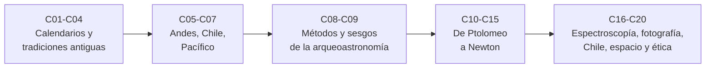

# B02 — Historia, arqueoastronomía y culturas del cielo

**Programa:** Programa Integral de Astronomía, Astrofísica, Ciencias Espaciales e Ingeniería Aeroespacial
**Área:** A01 — Alfabetización científica, astronómica y tecnológica
**Nivel:** N0 → N1 (descubrimiento y fundamentos) · **Clases:** 20 · **Carga:** por calibrar con el uso
**Estado:** guía pedagógica del bloque. Las clases enlazadas en la tabla están redactadas; todas conservan el estado E0 en el catálogo hasta registrar revisión disciplinar. Varias fuentes del bloque son secundarias, divulgativas o solo resúmenes y están rotuladas como tales en la sección 11 de cada clase; no se marca ninguna clase como verificada.

## 🎯 Propósito del bloque

Enseña que el cielo se ha leído de muchas maneras: para contar el tiempo, orientarse, sembrar, navegar, predecir eclipses, construir modelos y salir al espacio. El bloque recorre calendarios, tradiciones de varios continentes (incluidos los Andes, Chile y el Pacífico), los métodos con que hoy se estudian sitios y alineaciones, la secuencia de ideas que va de Ptolomeo a Newton, el nacimiento de la espectroscopía y la astrofotografía, la astronomía en Chile, la exploración espacial y la ética del patrimonio. Las astronomías de los pueblos se tratan como saberes propios, con sus fuentes y sus límites, y no como mitología frente a una ciencia moderna.

## 📚 Al terminar el bloque podrás

1. Calcular la deriva de un calendario y explicar las estrategias de intercalar, derivar y combinar ciclos.
2. Distinguir registro, regla y modelo, y tipo de fuente (primaria, tardía, material, secundaria, divulgativa).
3. Convertir una orientación medida en una declinación y calcular cuántas alineaciones esperarías por azar.
4. Comparar modelos del cosmos con criterios declarados y reconocer qué observación decide entre ellos.
5. Reproducir con datos publicados cálculos clave: período sinódico, leyes de Kepler, prueba de la Luna, líneas de Balmer.
6. Redactar fichas que separen dato, cálculo, interpretación y divulgación, y un plan de consentimiento cultural.

## 🧭 Secuencia del bloque

**Descripción textual.** Cinco tramos encadenados: calendarios y tradiciones antiguas (C01–C04); cielos de pueblos vivos en los Andes, Chile y el Pacífico (C05–C07); métodos y sesgos para estudiar sitios (C08–C09); la secuencia de modelos y datos de Ptolomeo a Newton (C10–C15); y cierre con técnicas modernas, astronomía en Chile, exploración espacial y ética del patrimonio (C16–C20).

## 🗂️ Las 20 clases en resumen

**Navegación:** cada clase desarrollada enlaza a la anterior, a la siguiente y a este bloque. La columna «Evidencia» indica el producto que demostrará el aprendizaje.

### Tramo 1 · Calendarios y tradiciones antiguas

| ID | Clase | Qué se aprende | Evidencia |
|---|---|---|---|
| [B02-C01](../clases/B02/B02-C01-calendarios-astronomicos-en-civilizaciones-antiguas/CLASE.md) | Calendarios astronómicos en civilizaciones antiguas | Por qué ningún calendario simple es exacto; deriva, bisiesto, ciclo metónico y calendario circular; el año nuevo mapuche como ejemplo de calendario anclado al cielo. | Ficha de deriva de un calendario |
| [B02-C02](../clases/B02/B02-C02-observacion-mesopotamica-y-egipcia/CLASE.md) | Observación mesopotámica y egipcia | Registro continuo, regularidad y explicación; el ciclo de Saros como casi-igualdad de tres meses lunares; calendario civil egipcio. | Ficha de registro y regla |
| [B02-C03](../clases/B02/B02-C03-astronomia-griega-y-helenistica/CLASE.md) | Astronomía griega y helenística | De los registros a los modelos geométricos; medida de la Tierra con incertidumbre del estadio; Hiparco y la precesión; el mecanismo de Anticitera. | Ficha de un resultado antiguo |
| [B02-C04](../clases/B02/B02-C04-astronomia-de-india-china-y-mundo-islamico/CLASE.md) | Astronomía de India, China y mundo islámico | Registros, instrumentos e instituciones como tipos de evidencia; Jantar Mantar, la estrella visitante de 1054 y el observatorio de Maraga. | Ficha de un caso intercultural |

### Tramo 2 · Cielos de pueblos vivos

| ID | Clase | Qué se aprende | Evidencia |
|---|---|---|---|
| [B02-C05](../clases/B02/B02-C05-cosmovisiones-andinas-del-cielo/CLASE.md) | Cosmovisiones andinas del cielo | Sitio, crónica y voz viva como capas de evidencia; huacas del Cusco, constelaciones oscuras, Chankillo y Machu Picchu; cómo tratar fuentes en tensión. | Ficha de un caso andino |
| [B02-C06](../clases/B02/B02-C06-astronomia-de-pueblos-originarios-de-chile/CLASE.md) | Astronomía de pueblos originarios de Chile | Lo que una fuente institucional dice sobre *Wenumapu* y *We Tripantu*; saber, registro y divulgación; por qué no generalizar; consentimiento. | Ficha de fuente y consentimiento |
| [B02-C07](../clases/B02/B02-C07-observaciones-de-polinesia-y-navegacion-oceanica/CLASE.md) | Observaciones de Polinesia y navegación oceánica | Estrella como rumbo (azimut de salida); Hōkūle‘a 1976 como evidencia experimental; debate sobre transmisión y apropiación del saber. | Ficha de rumbo estelar |

### Tramo 3 · Métodos y sesgos

| ID | Clase | Qué se aprende | Evidencia |
|---|---|---|---|
| [B02-C08](../clases/B02/B02-C08-arqueoastronomia-y-sus-metodos/CLASE.md) | Arqueoastronomía y sus métodos | Medir, convertir a declinación, comparar, contrastar con el azar e interpretar; el horizonte como dato del sitio; resultados negativos. | Ficha de orientación |
| [B02-C09](../clases/B02/B02-C09-alineaciones-arqueologicas-y-sesgos/CLASE.md) | Alineaciones arqueológicas y sesgos | Cuántas alineaciones aparecen por azar; sesgo de selección y comparaciones múltiples; fijar objetivos y tolerancia antes de mirar. | Ficha de control de azar |

### Tramo 4 · De Ptolomeo a Newton

| ID | Clase | Qué se aprende | Evidencia |
|---|---|---|---|
| [B02-C10](../clases/B02/B02-C10-geocentrismo-y-heliocentrismo/CLASE.md) | Geocentrismo y heliocentrismo | Epiciclo, deferente y ecuante; dos modelos para el mismo vaivén; el argumento del paralaje; criterios para elegir entre modelos. | Ficha de comparación de modelos |
| [B02-C11](../clases/B02/B02-C11-revolucion-copernicana-y-metodos/CLASE.md) | Revolución copernicana y métodos | Período sinódico frente a sidéreo; método para pasar de lo observado a lo real; lo que Copérnico cambió y conservó. | Ficha del método sinódico |
| [B02-C12](../clases/B02/B02-C12-tycho-brahe-y-observaciones-sistematicas/CLASE.md) | Tycho Brahe y observaciones sistemáticas | Observación sistemática, presupuesto de error en minutos de arco; supernova de 1572 y cometa de 1577; sistema tychónico. | Ficha de presupuesto de error |
| [B02-C13](../clases/B02/B02-C13-galileo-y-primeras-observaciones-telescopicas/CLASE.md) | Galileo y primeras observaciones telescópicas | Telescopio de 1609, Luna, lunas de Júpiter y manchas solares; dato frente a inferencia; por qué hacían falta varias noches. | Ficha de observación telescópica |
| [B02-C14](../clases/B02/B02-C14-kepler-y-reconstruccion-de-orbitas/CLASE.md) | Kepler y reconstrucción de órbitas | Las tres leyes; ecuación de Kepler; reconstruir una órbita y verificar áreas y T²/a³. | Ficha de órbita |
| [B02-C15](../clases/B02/B02-C15-newton-y-gravitacion-universal/CLASE.md) | Newton y gravitación universal | Una fuerza 1/r² para la caída y la órbita; prueba de la Luna al 1 %; GM de Júpiter desde sus lunas. | Ficha de prueba de la ley |

### Tramo 5 · Técnicas, Chile, espacio y ética

| ID | Clase | Qué se aprende | Evidencia |
|---|---|---|---|
| [B02-C16](../clases/B02/B02-C16-historia-de-la-espectroscopia-astronomica/CLASE.md) | Historia de la espectroscopía astronómica | Líneas como firmas químicas; Fraunhofer, Kirchhoff y Bunsen, helio; líneas de Balmer con Rydberg contra NIST; vacío frente a aire. | Ficha de un hito espectroscópico |
| [B02-C17](../clases/B02/B02-C17-nacimiento-de-la-astrofotografia/CLASE.md) | Nacimiento de la astrofotografía | Hitos de 1840 a 1883 con atribución cuidadosa; giro del cielo durante una exposición; el archivo de placas. | Ficha de un hito fotográfico |
| [B02-C18](../clases/B02/B02-C18-expansion-de-la-astronomia-en-chile/CLASE.md) | Expansión de la astronomía en Chile | Gilliss y el observatorio de Santa Lucía; llegada de ESO, CTIO y ALMA; áreas colectoras; preguntas de territorio. | Ficha de un observatorio |
| [B02-C19](../clases/B02/B02-C19-historia-de-la-exploracion-espacial/CLASE.md) | Historia de la exploración espacial | Sputnik, Vostok, Apollo 11 y Voyager con fuentes; órbita estimada con la tercera ley; duración de vuelo frente a período; Tratado de 1967. | Ficha de un hito espacial |
| [B02-C20](../clases/B02/B02-C20-patrimonio-astronomico-y-etica-cultural/CLASE.md) | Patrimonio astronómico y ética cultural | Categorías de patrimonio astronómico; Maunakea; consentimiento libre, previo e informado; plan de cuidado del patrimonio. | Plan de consentimiento y patrimonio |

## 🧵 Hilos que atraviesan el bloque

- **Calendarios y ciclos:** C01 y C02 introducen la deriva y el Saros; C03 los encuentra en el mecanismo de Anticitera; C11 y C14 usan períodos para deducir órbitas.
- **Fuentes y tipos de evidencia:** C03, C04, C05 y C06 enseñan a distinguir primaria, tardía, material, secundaria y divulgativa; todas las clases rotulan su fuente.
- **Del dato al modelo:** C08 y C09 (orientación y azar), C12 (error), C13 (inferencia), C14 y C15 (leyes y fuerza) muestran cómo un dato acota una conclusión.
- **Consentimiento y respeto:** C05, C06, C07 y C20 enseñan a preguntar, citar con exactitud y devolver.
- **Chile:** C01 y C06 (año nuevo mapuche), C18 (observatorios) y C20 (territorio) conectan el bloque con el país.

## 📝 Evaluación del bloque (propuesta, por calibrar)

- Una ficha por clase (la evidencia de la tabla), con retroalimentación y recuperación con evidencia distinta.
- Portafolio: primera versión, retroalimentación y cambio; cierra con el plan de consentimiento de C20.
- Condiciones críticas que no se compensan con promedio: citar solo lo consultado; rotular lo sintético; no atribuir a un pueblo lo que no dijo; no usar material sagrado o restringido sin permiso.

## ⚠️ Seguridad y límites

Cualquier observación del Sol exige filtros certificados y supervisión; el bloque es educativo y no sustituye orientación profesional ni jurídica. Los cálculos no sirven para predecir eclipses, operar naves ni navegar. Las astronomías de los pueblos son saberes vivos: se estudian con permiso, con cita exacta y sin generalizar. Fuentes secundarias, divulgativas, solo-resumen o de copia no oficial (por ejemplo, páginas enciclopédicas, comunicados, el texto del Tratado de 1967) están rotuladas en cada clase y deben contrastarse antes de la revisión disciplinar.

## Fuentes de orientación preliminar

- **[NASA-DATA]** [NASA Science Data](https://science.data.nasa.gov/) — Portal general de datos y servicios científicos.
- **[IAU]** [International Astronomical Union: resolutions](https://www.iau.org/Iau/Publications/List-of-Resolutions.aspx) — Nomenclatura, tiempos, sistemas de referencia y recomendaciones científicas.
- **[ESO]** [European Southern Observatory](https://www.eso.org/) — Observatorios ópticos, instrumentación y astronomía profesional.
- **[ADS]** [NASA Astrophysics Data System](https://ui.adsabs.harvard.edu/) — Índice bibliográfico de literatura astronómica y física.

> La asociación de estas fuentes es orientativa por bloque. Las fuentes realmente consultadas para cada afirmación están en la sección 11 de cada clase. Comprobar documentos, versiones y licencias antes de ampliar contenido.

[🏠 Volver al programa](../../README.md) · [⬅️ B01 — El universo y el pensamiento científico](./B01-el-universo-y-el-pensamiento-cientifico.md) · [➡️ B03 — Matemática elemental para ciencias espaciales](./B03-matematica-elemental-para-ciencias-espaciales.md)
