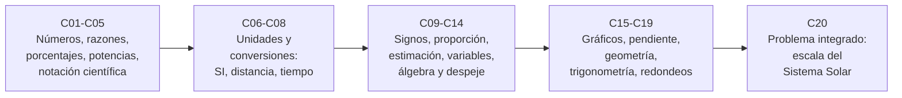

# B03 — Matemática elemental para ciencias espaciales

**Programa:** Programa Integral de Astronomía, Astrofísica, Ciencias Espaciales e Ingeniería Aeroespacial
**Área:** A01 — Alfabetización científica, astronómica y tecnológica
**Nivel:** N0 → N1 (descubrimiento y fundamentos) · **Clases:** 20 · **Carga:** por calibrar con el uso
**Estado:** guía pedagógica del bloque (resumen de qué se aprende en cada clase). Las clases enlazadas en la tabla ya están redactadas; el resto son resúmenes de especificación. Todas conservan el estado E0 en el catálogo hasta registrar revisión disciplinar.

## 🎯 Propósito del bloque

Es el taller de herramientas matemáticas del programa. Enseña la aritmética, la proporcionalidad, las unidades, el álgebra inicial, los gráficos y la geometría básica **al servicio de problemas reales de las ciencias espaciales**: cuánto tarda la luz, qué escala tiene el Sistema Solar, cuánto cambia una distancia, qué tan fiable es un número. No es un repaso genérico: cada clase parte de una necesidad concreta y de datos publicados (NASA, SI, IAU, CODATA) con su procedencia.

## 📚 Al terminar el bloque podrás

1. Operar con números, fracciones, porcentajes, potencias y raíces con orden y sentido.
2. Escribir y comparar cantidades muy grandes o muy pequeñas con notación científica y órdenes de magnitud.
3. Usar el Sistema Internacional y convertir distancias, velocidades, tiempos y ángulos sin perder la unidad.
4. Trabajar con signos, proporcionalidad, variables, constantes y despejes en fórmulas elementales.
5. Representar y leer datos en un plano cartesiano, interpretar pendientes y calcular áreas, volúmenes y razones trigonométricas elementales.
6. Estimar, redondear y propagar errores de forma responsable, e integrar todo en una maqueta a escala del Sistema Solar.

## 🧭 Secuencia del bloque

**Descripción textual.** Cinco tramos encadenados: cantidades y su escritura (C01–C05), unidades y conversiones (C06–C08), lenguaje algebraico y razonamiento cuantitativo (C09–C14), representación y geometría (C15–C19) y un problema integrador (C20).

## 🗂️ Las 20 clases en resumen

**Navegación:** cada clase desarrollada enlaza a la anterior, a la siguiente y a este bloque; mientras una clase siga en E0, su enlace lleva a su fila en esta tabla.

Los resúmenes son la **especificación pedagógica propuesta** (nivel E1 parcial, pendiente de revisión). La columna «Evidencia» indica el producto que demostrará el aprendizaje.

### Tramo 1 · Cantidades y su escritura

| ID | Clase | Qué se aprende | Evidencia |
|---|---|---|---|
| [B03-C01](../clases/B03/B03-C01-numeros-y-operaciones-fundamentales/CLASE.md) | Números y operaciones fundamentales | Clases de números, jerarquía de operaciones y aproximación del computador; se calcula el período lunar y la rapidez orbital de la Tierra. | Ficha de operaciones comprobadas |
| [B03-C02](../clases/B03/B03-C02-fracciones-y-razones-de-magnitudes/CLASE.md) | Fracciones y razones de magnitudes | Fracciones, razones adimensionales y proporciones para comparar radios y masas de astros. | Tabla de razones comentada |
| [B03-C03](../clases/B03/B03-C03-porcentajes-y-escalas-comparativas/CLASE.md) | Porcentajes y escalas comparativas | Cambio porcentual, base de referencia, punto porcentual y error relativo con perihelio, afelio y constantes. | Tabla de cambios porcentuales |
| [B03-C04](../clases/B03/B03-C04-potencias-y-raices/CLASE.md) | Potencias y raíces | Reglas de potencias, exponentes negativos y fraccionarios, raíces y la tercera ley de Kepler con los ocho planetas. | Hoja de predicciones de Kepler |
| [B03-C05](../clases/B03/B03-C05-notacion-cientifica-y-ordenes-de-magnitud/CLASE.md) | Notación científica y órdenes de magnitud | Mantisa y exponente, operar con potencias de diez, comparar escalas por órdenes de magnitud. | Tabla de órdenes de magnitud |

### Tramo 2 · Unidades y conversiones

| ID | Clase | Qué se aprende | Evidencia |
|---|---|---|---|
| [B03-C06](../clases/B03/B03-C06-unidades-del-sistema-internacional/CLASE.md) | Unidades del Sistema Internacional | Unidades base, derivadas y prefijos; escritura correcta y análisis dimensional. | Ficha de análisis dimensional |
| [B03-C07](../clases/B03/B03-C07-conversion-de-distancia-y-velocidad/CLASE.md) | Conversión de distancia y velocidad | Factores de conversión entre m, km, au y entre m/s, km/s y km/h. | Hoja de conversiones verificada |
| [B03-C08](../clases/B03/B03-C08-tiempo-y-conversiones-astronomicas/CLASE.md) | Tiempo y conversiones astronómicas | Segundos, días, años y ángulos (grados, minutos y segundos de arco, horas). | Tabla de tiempos y ángulos convertidos |

### Tramo 3 · Razonamiento cuantitativo y álgebra inicial

| ID | Clase | Qué se aprende | Evidencia |
|---|---|---|---|
| B03-C09 | Operaciones con números negativos | Signos, valor absoluto y convenciones: cuenta regresiva, tiempo de luz y energía ligada. | Registro de signos y convenciones |
| B03-C10 | Proporcionalidad directa e inversa | Constante de proporcionalidad, ley del inverso del cuadrado y comprobación de relaciones. | Cuaderno de proporcionalidades |
| B03-C11 | Estimación y redondeo responsable | Cifras significativas, estimación de Fermi, cotas y cuándo redondear. | Informe de estimación con cotas |
| B03-C12 | Variables y constantes científicas | Variables, parámetros, constantes exactas y medidas; G y GM. | Glosario de variables y constantes |
| B03-C13 | Expresiones algebraicas iniciales | Traducir enunciados a expresiones, evaluar, simplificar y factorizar. | Ficha de expresiones |
| B03-C14 | Despeje de ecuaciones elementales | Operaciones inversas, despejar una variable de una fórmula y verificarla por sustitución. | Hoja de despejes verificados |

### Tramo 4 · Representar, medir y geometrizar

| ID | Clase | Qué se aprende | Evidencia |
|---|---|---|---|
| B03-C15 | Representación cartesiana de datos | Ejes, escalas lineal y logarítmica, ejes rotulados y gráficos accesibles. | Gráfico cartesiano accesible |
| B03-C16 | Pendiente e interpretación de gráficos | Pendiente como tasa de cambio, recta de ajuste y lectura de una gráfica log–log. | Informe de pendiente con unidades |
| B03-C17 | Áreas y volúmenes elementales | Círculo, esfera, cilindro; densidad media y potencia interceptada. | Hoja de áreas y volúmenes |
| B03-C18 | Razones trigonométricas iniciales | Seno, coseno y tangente, tamaño angular y paralaje. | Ficha de triángulo y ángulo |
| B03-C19 | Propagación elemental de redondeos | Cotas de error y combinación de incertidumbres en sumas y productos. | Balance de redondeos e incertidumbre |

### Tramo 5 · Integración

| ID | Clase | Qué se aprende | Evidencia |
|---|---|---|---|
| B03-C20 | Problema integrado de escala del sistema solar | Requisitos, factor de escala, tabla de maqueta y verificaciones cruzadas. | Informe de maqueta con verificaciones |

## 🧵 Hilos que atraviesan el bloque

- **Unidad y magnitud:** C06–C08 hacen explícito lo que C01–C05 usan; el análisis dimensional vuelve en C14 y C19.
- **Escala:** C02, C05, C15 y C20 comparan tamaños y distancias que van de la Luna al Sol y de la Tierra a Neptuno.
- **Datos reales:** radios, masas, semiejes y períodos de las fichas de la NASA se reutilizan de una clase a otra, de modo que cada resultado puede cotejarse con el anterior.
- **Incertidumbre:** C03, C11 y C19 construyen la idea de que un número sin cota no es un resultado completo.

## 📝 Evaluación del bloque (propuesta, por calibrar)

- Una evidencia por clase, con retroalimentación y recuperación con datos distintos.
- Cada ejercicio indica la sección que lo prepara; los ejercicios de transferencia usan datos nuevos.
- Proyecto C20 con rúbrica publicada antes; las condiciones críticas (no omitir unidades, citar solo lo consultado, no presentar lo estimado como medido) no se compensan con promedio.

## ⚠️ Seguridad y límites

El bloque es educativo: los cálculos usan valores medios publicados y modelos simplificados, no efemérides ni datos operativos, y no sirven para navegación, diseño de misión ni toma de decisiones críticas. Los errores de unidades pueden perder una misión real (caso de Mars Climate Orbiter, citado en B03-C06 con su fuente).

## Fuentes de orientación preliminar

Las fuentes **realmente consultadas** de cada clase se listan en su sección 11. La siguiente lista orienta el bloque.

- **[NASA-DATA]** [NASA Science Data](https://science.data.nasa.gov/) — Portal general de datos y servicios científicos.
- **[IAU]** [International Astronomical Union: resolutions](https://www.iau.org/Iau/Publications/List-of-Resolutions.aspx) — Nomenclatura, tiempos, sistemas de referencia y recomendaciones científicas.
- **[ESO]** [European Southern Observatory](https://www.eso.org/) — Observatorios ópticos, instrumentación y astronomía profesional.
- **[ADS]** [NASA Astrophysics Data System](https://ui.adsabs.harvard.edu/) — Índice bibliográfico de literatura astronómica y física.

> La asociación de estas fuentes es orientativa por bloque. Las clases enlazadas citan solo lo que se consultó; las demás filas siguen pendientes de esa comprobación.

[🏠 Volver al programa](../../README.md) · [➡️ B04 — Álgebra, trigonometría y geometría espacial](./B04-algebra-trigonometria-y-geometria-espacial.md)
