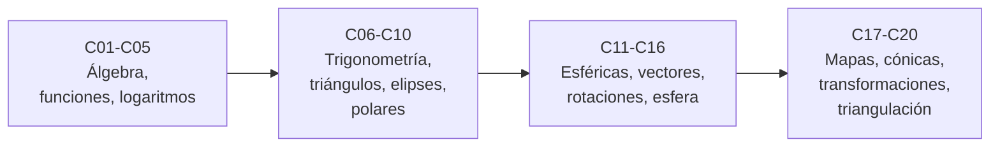

# B04 — Álgebra, trigonometría y geometría espacial

**Programa:** Programa Integral de Astronomía, Astrofísica, Ciencias Espaciales e Ingeniería Aeroespacial
**Área:** A01 — Alfabetización científica, astronómica y tecnológica
**Nivel:** N1 (fundamentos) · **Clases:** 20 · **Carga:** por calibrar con el uso
**Estado:** guía pedagógica del bloque. Las clases enlazadas en la tabla están redactadas; todas conservan el estado E0 en el catálogo hasta registrar revisión disciplinar. No se marcan como verificadas.

## 🎯 Propósito del bloque

Reúne las herramientas matemáticas con las que se pasa de *medir un ángulo o una distancia* a *saber dónde está algo y cómo se mueve*: ecuaciones, funciones, trigonometría, coordenadas, vectores, rotaciones, esferas y órbitas. Cada clase responde a una necesidad concreta de las ciencias espaciales (calibrar un detector, medir una distancia por paralaje, cambiar de sistema de coordenadas, clasificar una órbita) y deja un producto que puedes revisar.

## 📚 Al terminar el bloque podrás

1. Plantear y resolver ecuaciones y sistemas, y comprobar toda solución por sustitución.
2. Describir relaciones con funciones, gráficas, exponenciales y logaritmos, declarando dominio y escala.
3. Usar trigonometría en radianes para obtener distancias y tamaños a partir de ángulos.
4. Pasar entre coordenadas cartesianas, polares y esféricas, y entre sistemas astronómicos, declarando el marco de referencia.
5. Operar con vectores, producto escalar, producto vectorial y rotaciones.
6. Calcular distancias sobre la esfera y entender qué distorsiona cada proyección.
7. Clasificar órbitas con cónicas y diseñar una triangulación con su incertidumbre.

## 🧭 Secuencia del bloque

**Descripción textual.** Cuatro tramos encadenados: lenguaje algebraico y funcional (C01–C05), trigonometría y curvas (C06–C10), direcciones en el espacio con coordenadas, vectores y rotaciones (C11–C16) y aplicaciones a mapas, órbitas, cambios de sistema y triangulación (C17–C20).

## 🗂️ Las 20 clases en resumen

**Navegación:** cada clase enlaza a la anterior, a la siguiente y a este bloque. La columna «Evidencia» indica el producto que demuestra el aprendizaje. Cada clase trae un laboratorio en Python (solo biblioteca estándar) con pruebas contra casos analíticos, y declara si sus datos son observados, estimados, sintéticos o calculados.

### Tramo 1 · Álgebra para modelar

| ID | Clase | Qué se aprende | Evidencia |
|---|---|---|---|
| [B04-C01](../clases/B04/B04-C01-polinomios-y-factorizacion/CLASE.md) | Polinomios y factorización | Leer, evaluar (Horner) y factorizar polinomios; usarlos como modelos con intervalo de validez (oblicuidad de la eclíptica). | Ficha de una fórmula publicada |
| [B04-C02](../clases/B04/B04-C02-ecuaciones-lineales-y-cuadraticas/CLASE.md) | Ecuaciones lineales y cuadráticas | Despejar, resolver con la fórmula cuadrática, interpretar el discriminante y elegir la raíz con sentido físico (caída lunar, tiempo de luz). | Informe de una ecuación física resuelta |
| [B04-C03](../clases/B04/B04-C03-sistemas-de-ecuaciones-elementales/CLASE.md) | Sistemas de ecuaciones elementales | Resolver sistemas 2×2 y 3×3, reconocer casos sin solución única y medir cuándo un sistema es frágil (calibración, rumbos). | Calibración con su comprobación |
| [B04-C04](../clases/B04/B04-C04-funciones-y-graficas/CLASE.md) | Funciones y gráficas | Dominio, rango, funciones de potencia, inversa y lectura honesta de gráficas con datos planetarios (tercera ley de Kepler como función). | Ficha de una relación contrastada con datos |
| [B04-C05](../clases/B04/B04-C05-funciones-exponenciales-y-logaritmicas/CLASE.md) | Funciones exponenciales y logarítmicas | Crecimiento por factores, logaritmos, escala de magnitudes y módulo de distancia; resolver exponentes con logaritmos. | Tabla magnitud–flujo–distancia con comprobación |

### Tramo 2 · Trigonometría y curvas

| ID | Clase | Qué se aprende | Evidencia |
|---|---|---|---|
| [B04-C06](../clases/B04/B04-C06-identidades-trigonometricas/CLASE.md) | Identidades trigonométricas | Razones trigonométricas en radianes, identidades fundamentales, suma de ángulos y aproximación de ángulo pequeño con su error. | Hoja de identidades verificadas numéricamente |
| [B04-C07](../clases/B04/B04-C07-triangulos-y-distancias-angulares/CLASE.md) | Triángulos y distancias angulares | Triángulo rectángulo, tamaño angular y distancia (Sol, Luna, paralaje); medir sin llegar al objeto. | Cálculo de tamaño o distancia por ángulo |
| [B04-C08](../clases/B04/B04-C08-ley-de-senos-y-ley-de-cosenos/CLASE.md) | Ley de senos y ley de cosenos | Resolver triángulos no rectángulos; elongaciones y distancias planetarias en el plano orbital. | Resolución de un triángulo astronómico con comprobación |
| [B04-C09](../clases/B04/B04-C09-circunferencias-y-elipses/CLASE.md) | Circunferencias y elipses | Ecuación de circunferencia y elipse, semiejes, excentricidad, focos y distancias extremas de una órbita. | Ficha geométrica de una órbita |
| [B04-C10](../clases/B04/B04-C10-coordenadas-polares-y-cartesianas/CLASE.md) | Coordenadas polares y cartesianas | Pasar de (x, y) a (r, θ) con el cuadrante correcto; ecuación polar de una órbita. | Tabla de conversión y órbita en polares |

### Tramo 3 · Direcciones en el espacio

| ID | Clase | Qué se aprende | Evidencia |
|---|---|---|---|
| [B04-C11](../clases/B04/B04-C11-coordenadas-esfericas/CLASE.md) | Coordenadas esféricas | Longitud, latitud y ángulo polar; ascensión recta y declinación; vector unitario de una dirección del cielo. | Dirección de una estrella como vector |
| [B04-C12](../clases/B04/B04-C12-vectores-y-componentes/CLASE.md) | Vectores y componentes | Suma de vectores, componentes y módulo; velocidad orbital y sus componentes. | Descomposición de un movimiento en componentes |
| [B04-C13](../clases/B04/B04-C13-producto-escalar-y-angulo-entre-vectores/CLASE.md) | Producto escalar y ángulo entre vectores | Producto escalar, ángulo entre direcciones y separación angular de dos estrellas. | Tabla de separaciones angulares verificada |
| [B04-C14](../clases/B04/B04-C14-producto-vectorial-y-orientacion/CLASE.md) | Producto vectorial y orientación | Producto vectorial, regla de la mano derecha, normal a un plano y orientación de una órbita. | Orientación de una órbita a partir de sus elementos |
| [B04-C15](../clases/B04/B04-C15-rotacion-de-puntos-y-ejes/CLASE.md) | Rotación de puntos y ejes | Matrices de rotación, rotaciones activa y pasiva, composición y comprobación de ortogonalidad. | Rotación documentada con sus pruebas |
| [B04-C16](../clases/B04/B04-C16-geometria-de-esferas-y-circulos-maximos/CLASE.md) | Geometría de esferas y círculos máximos | Distancia angular sobre una esfera, círculo máximo y ley de cosenos esférica. | Distancia sobre la esfera por dos métodos |

### Tramo 4 · Esfera, mapas, órbitas y triangulación

| ID | Clase | Qué se aprende | Evidencia |
|---|---|---|---|
| B04-C17 | Proyecciones cartográficas elementales | Proyecciones Mercator y ortográfica, distorsión de escala y elección según el uso. | Comparación de distorsiones de dos proyecciones |
| B04-C18 | Cónicas y secciones orbitales | Elipse, parábola e hipérbola, ecuación polar común y clasificación por excentricidad (Halley y ʻOumuamua). | Clasificación de órbitas con justificación |
| B04-C19 | Transformaciones de coordenadas astronómicas | Ecuatoriales, eclípticas y galácticas encadenadas con rotaciones y comprobadas contra definiciones. | Cadena de transformaciones con pruebas |
| B04-C20 | Triangulación espacial aplicada | Paralaje y bases largas: distancia, ángulo, incertidumbre y diseño de una medición por triangulación. | Plan de triangulación con incertidumbre |

## 🧵 Hilos que atraviesan el bloque

- **Ángulo y distancia:** C06–C08, C16 y C20 se apoyan en la misma idea: un ángulo pequeño y una base dan una distancia.
- **Marco de referencia:** C10–C11, C15 y C19 insisten en declarar origen, ejes, sentido de los ángulos y época.
- **Incertidumbre:** C03, C06, C08 y C20 muestran cuándo un resultado correcto en papel es frágil en la práctica.
- **Órbitas:** C09, C10, C14 y C18 describen la misma curva con elipses, polares, vectores y cónicas.

## 📝 Evaluación del bloque (propuesta, por calibrar)

- Un producto por clase con rúbrica de cuatro niveles; recuperación con evidencia distinta.
- Las condiciones críticas (declarar unidades y marco de referencia, comprobar los resultados, rotular lo sintético y citar solo lo consultado) no se compensan con promedio.
- Integrador del bloque: el plan de triangulación de C20, con comprobación y fuentes.

## ⚠️ Seguridad y límites

Material educativo: los cálculos no sirven para navegación, operaciones de misión ni efemérides profesionales. Las fórmulas de laboratorio declaran su dominio de validez y sus tolerancias. Las observaciones del Sol exigen filtros certificados y supervisión; este bloque no las propone.

## Fuentes consultadas y de orientación

Las fuentes con localizador, fecha de consulta y alcance están en la sección 11 de cada clase. Las principales: IERS Conventions 2010 (TN36), IAU 2015 (resoluciones B2 y B3), BIPM (*SI Brochure*, 9.ª ed.), NASA NSSDC (hojas de datos de planetas y de la Luna), NASA/JPL SBDB, NASA Exoplanet Archive, ESA *Hipparcos Catalogue* (SP-1200, vol. 1) y USGS *Map Projections – A Working Manual*. Orientación general por bloque:

- **[NASA-DATA]** [NASA Science Data](https://science.data.nasa.gov/) — Portal general de datos y servicios científicos.
- **[IAU]** [International Astronomical Union: resolutions](https://www.iau.org/Iau/Publications/List-of-Resolutions.aspx) — Nomenclatura, tiempos, sistemas de referencia y recomendaciones científicas.
- **[ESO]** [European Southern Observatory](https://www.eso.org/) — Observatorios ópticos, instrumentación y astronomía profesional.
- **[ADS]** [NASA Astrophysics Data System](https://ui.adsabs.harvard.edu/) — Índice bibliográfico de literatura astronómica y física.

> La asociación de las fuentes de orientación es general por bloque; no significa que cada afirmación esté respaldada. Comprobar documentos, versiones y licencias antes de ampliar contenido.

[🏠 Volver al programa](../../README.md) · [➡️ B05 — Física fundamental para el espacio](./B05-fisica-fundamental-para-el-espacio.md)
