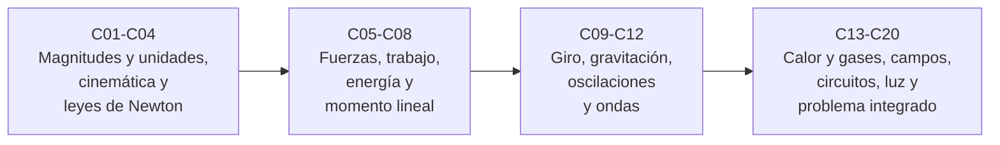

# B05 — Física fundamental para el espacio

**Programa:** Programa Integral de Astronomía, Astrofísica, Ciencias Espaciales e Ingeniería Aeroespacial
**Área:** A01 — Alfabetización científica, astronómica y tecnológica
**Nivel:** N1 (fundamentos) · **Clases:** 20 · **Carga:** por calibrar con el uso
**Estado:** guía pedagógica del bloque (resumen de qué se aprende en cada clase). Las 20 clases enlazadas en la tabla están redactadas. Todas conservan el estado E0 en el catálogo hasta registrar revisión disciplinar y aprobación del autor.

## 🎯 Propósito del bloque

Reúne la física que sostiene todo lo que viene después: cómo se describe un movimiento, qué lo causa, qué se conserva, cómo actúan la gravedad, el calor, las cargas y la luz. Todo el bloque gira alrededor de un mismo **satélite ideal** (1000 kg en órbita circular a 400 km) que crece de clase en clase hasta un problema integrado. Enseña a **plantear un modelo físico, calcularlo con unidades, verificarlo y declarar dónde deja de valer**, hábitos que reutilizan los bloques de matemática, simulación y astrodinámica.

## 📚 Al terminar el bloque podrás

1. Expresar cualquier magnitud con su unidad SI y dimensión, y comprobar la coherencia dimensional de una ecuación.
2. Describir movimientos rectilíneos, circulares y oscilatorios con posición, velocidad y aceleración, y explicar sus causas con las leyes de Newton y diagramas de cuerpo libre.
3. Usar trabajo, energía, momento lineal y momento angular, y saber qué se conserva en cada caso.
4. Aplicar la gravitación universal para obtener períodos, velocidades y energías de órbitas circulares y transferencias simples.
5. Relacionar temperatura, presión y energía térmica con el comportamiento de un gas y con el equilibrio radiativo.
6. Calcular campos y fuerzas eléctricas y magnéticas, resolver circuitos simples y describir la radiación electromagnética y la óptica básica.
7. Resolver y validar un problema físico integrado, separando datos publicados, sintéticos y simulados.

## 🧭 Secuencia del bloque

**Descripción textual.** Cuatro tramos encadenados: lenguaje de medida y descripción del movimiento (C01–C04), herramientas de dinámica y conservación (C05–C08), giro, gravitación, oscilaciones y ondas (C09–C12) y, por último, termodinámica elemental, electromagnetismo, óptica y el problema integrado del satélite ideal (C13–C20).

## 🗂️ Las 20 clases en resumen

**Navegación:** cada clase desarrollada enlaza a la anterior, a la siguiente y a este bloque. La columna «Evidencia» indica el producto que demostrará el aprendizaje; el título y el contenido de cada clase siguen el estándar pedagógico del programa.

### Tramo 1 · Medida y movimiento

| ID | Clase | Qué se aprende | Evidencia |
|---|---|---|---|
| [B05-C01](../clases/B05/B05-C01-magnitudes-fisicas-y-dimensiones/CLASE.md) | Magnitudes físicas y dimensiones | Magnitud, unidad y dimensión; análisis dimensional; conversión de unidades; el caso de la sonda perdida por un error de unidades. | Hoja de verificación dimensional |
| [B05-C02](../clases/B05/B05-C02-posicion-velocidad-y-aceleracion/CLASE.md) | Posición, velocidad y aceleración | Marco de referencia, vectores, velocidad media e instantánea, aceleración centrípeta y derivación numérica. | Ficha de movimiento |
| [B05-C03](../clases/B05/B05-C03-movimiento-rectilineo-y-circular/CLASE.md) | Movimiento rectilíneo y circular | Fórmulas del movimiento con aceleración constante y del movimiento circular uniforme; órbitas circulares a tres alturas. | Hoja de modelo cinemático |
| [B05-C04](../clases/B05/B05-C04-leyes-del-movimiento-de-newton/CLASE.md) | Leyes del movimiento de Newton | Las tres leyes, masa y peso, ingravidez como caída libre e integración numérica de `F = m a`. | Planteamiento de dinámica |

### Tramo 2 · Fuerzas, energía y momento

| ID | Clase | Qué se aprende | Evidencia |
|---|---|---|---|
| [B05-C05](../clases/B05/B05-C05-diagramas-de-cuerpo-libre/CLASE.md) | Diagramas de cuerpo libre | Aislar un cuerpo, descomponer fuerzas, equilibrio y aceleración; tensión en cables según el ángulo. | Diagrama y planteamiento |
| [B05-C06](../clases/B05/B05-C06-trabajo-y-energia/CLASE.md) | Trabajo y energía | Trabajo, teorema trabajo–energía, energía potencial gravitatoria y energía necesaria para llegar a órbita. | Hoja de balance energético |
| [B05-C07](../clases/B05/B05-C07-conservacion-de-energia-mecanica/CLASE.md) | Conservación de energía mecánica | Energía específica, altura máxima, velocidad de escape de la Tierra y la Luna, deriva de energía de un integrador. | Informe de energía y escape |
| [B05-C08](../clases/B05/B05-C08-momento-lineal-e-impulsos/CLASE.md) | Momento lineal e impulsos | Momento, impulso, choques inelásticos y ecuación del cohete deducida paso a paso. | Hoja de momento e impulso |

### Tramo 3 · Giro, gravitación, oscilaciones y ondas

| ID | Clase | Qué se aprende | Evidencia |
|---|---|---|---|
| [B05-C09](../clases/B05/B05-C09-momento-angular-y-torque/CLASE.md) | Momento angular y torque | Momento angular, torque, fuerza central, segunda ley de Kepler y `r_p v_p = r_a v_a`. | Hoja de momento angular |
| [B05-C10](../clases/B05/B05-C10-gravitacion-universal/CLASE.md) | Gravitación universal | Ley del cuadrado inverso, `G` frente a `GM`, tercera ley de Kepler y prueba de la Luna con datos publicados. | Prueba de consistencia gravitatoria |
| [B05-C11](../clases/B05/B05-C11-movimiento-oscilatorio/CLASE.md) | Movimiento oscilatorio | Oscilador masa–resorte, péndulo, amortiguamiento y resonancia; verificación contra la solución analítica. | Ficha de oscilador |
| [B05-C12](../clases/B05/B05-C12-ondas-mecanicas-y-frecuencia/CLASE.md) | Ondas mecánicas y frecuencia | `v = f λ`, velocidad del sonido, superposición, Doppler mecánico, muestreo y aliasing con una DFT. | Informe de señal y frecuencia |

### Tramo 4 · Calor, campos, luz e integración

| ID | Clase | Qué se aprende | Evidencia |
|---|---|---|---|
| [B05-C13](../clases/B05/B05-C13-temperatura-y-energia-termica/CLASE.md) | Temperatura y energía térmica | Temperatura y energía de las partículas, calor, Stefan–Boltzmann y equilibrio radiativo; temperatura efectiva del Sol. | Balance térmico |
| [B05-C14](../clases/B05/B05-C14-gases-y-presion/CLASE.md) | Gases y presión | Gas ideal, procesos con una magnitud fija, atmósfera isoterma y fuerza sobre una superficie. | Hoja de gas y presión |
| [B05-C15](../clases/B05/B05-C15-campos-electricos/CLASE.md) | Campos eléctricos | Ley de Coulomb, campo, superposición, partículas en campo uniforme y cociente eléctrico/gravitatorio. | Hoja de campo eléctrico |
| [B05-C16](../clases/B05/B05-C16-corriente-y-circuitos-elementales/CLASE.md) | Corriente y circuitos elementales | Ohm, Kirchhoff, análisis nodal, balance de potencia y presupuesto de energía con eclipse. | Hoja de circuito y presupuesto de energía |
| [B05-C17](../clases/B05/B05-C17-campos-magneticos/CLASE.md) | Campos magnéticos | Fuerza de Lorentz, giro de partículas, campo de un hilo y comparación con el campo terrestre publicado. | Hoja de partícula en campo magnético |
| [B05-C18](../clases/B05/B05-C18-electromagnetismo-y-radiacion/CLASE.md) | Electromagnetismo y radiación | `c = 1/√(ε₀μ₀)`, espectro, energía del fotón, cuadrado inverso y radiación ionizante, sin dosis ni límites. | Ficha de banda y flujo |
| [B05-C19](../clases/B05/B05-C19-optica-y-velocidad-de-la-luz/CLASE.md) | Óptica y velocidad de la luz | Snell, lente delgada, límite de difracción, resolución desde órbita y tiempos de luz. | Hoja de óptica y tiempo de luz |
| [B05-C20](../clases/B05/B05-C20-problema-fisico-integrado-de-satelite-ideal/CLASE.md) | Problema físico integrado de satélite ideal | Integración de todo el bloque: órbita, energía, momento angular, transferencia de Hohmann, propelente, validación numérica y límites. | Informe de problema integrado |

## 🧵 Hilos que atraviesan el bloque

- **El satélite ideal:** aparece en C01 y crece hasta C20; cada clase añade una pregunta al mismo modelo.
- **Conservación:** energía (C06–C07), momento lineal (C08), momento angular (C09) y balance de potencia (C16) enseñan a verificar con una cantidad que no cambia.
- **Unidades y dimensiones:** C01 las introduce y todas las clases las exigen; el caso de la sonda perdida por un error de unidades vuelve en C20.
- **Modelo y dominio de validez:** cada clase declara qué ignora (sin atmósfera, masa puntual, gas ideal, campo uniforme…).
- **Verificación numérica:** casi todas las clases incluyen un laboratorio con prueba contra un caso analítico o una referencia publicada.

## 📝 Evaluación del bloque (propuesta, por calibrar)

- Una hoja o ficha por clase, con retroalimentación y recuperación con otro caso.
- Portafolio con la primera versión y la corregida de al menos tres evidencias.
- Informe integrado de C20 con rúbrica publicada antes. Condiciones críticas que no se compensan con promedio: unidades y marco declarados, rótulo de datos publicados, sintéticos o simulados, citar solo lo consultado y **no presentar una simulación educativa como cálculo de misión, certificación de vuelo ni de seguridad**.

## ⚠️ Seguridad y límites

El bloque es educativo. Sus laboratorios usan modelos ideales y datos en gran parte sintéticos, y no sirven para diseñar ni operar naves, recipientes a presión, instalaciones eléctricas ni protección radiológica. C18 describe qué radiación es ionizante pero no da dosis ni límites. Observar el Sol requiere filtros certificados y supervisión (B01).

## Fuentes consultadas por el bloque

Todas se consultaron el 2026-11-05; el detalle por afirmación está en la sección 11 de cada clase.

- **BIPM**, *SI defining constants*: constantes definitorias exactas (`c`, `h`, `e`, `k`, `N_A`, Δν_Cs). https://www.bipm.org/en/measurement-units/si-defining-constants
- **NIST, CODATA 2022**, valores de `G`, `g_n`, `ε₀`, `μ₀`, `R`, `σ`, `k_B`, `N_A`, `m_p`, `m_e`. https://physics.nist.gov/cuu/Constants/index.html
- **NASA NSSDC**, *Earth Fact Sheet* (act. 15-nov-2024), *Moon Fact Sheet* (act. 11-ene-2024), *Sun Fact Sheet* (act. 9-may-2024).
- **NASA Science**, «Mars Climate Orbiter»; **NASA**, «Space Station Facts and Figures»; **NASA Science**, «Electromagnetic Spectrum: Introduction»; **NASA Science**, «Van Allen Probes» (solo lo que la página afirma).
- **NASA Glenn**, *Beginner's Guide to Aeronautics*, «Speed of Sound».
- **NOAA NCEI**, «World Magnetic Model».

## Fuentes de orientación preliminar

- **[NASA-DATA]** [NASA Science Data](https://science.data.nasa.gov/) — Portal general de datos y servicios científicos.
- **[IAU]** [International Astronomical Union: resolutions](https://www.iau.org/Iau/Publications/List-of-Resolutions.aspx) — Nomenclatura, tiempos, sistemas de referencia y recomendaciones científicas.
- **[ESO]** [European Southern Observatory](https://www.eso.org/) — Observatorios ópticos, instrumentación y astronomía profesional.
- **[ADS]** [NASA Astrophysics Data System](https://ui.adsabs.harvard.edu/) — Índice bibliográfico de literatura astronómica y física.

> La asociación de estas fuentes preliminares es orientativa por bloque. No significa que cada afirmación esté respaldada por ellas: la verificación afirmación por afirmación está en la sección 11 de cada clase, con sus límites.

[🏠 Volver al programa](../../README.md) · [➡️ B06 — Química y materia del universo](./B06-quimica-y-materia-del-universo.md)
