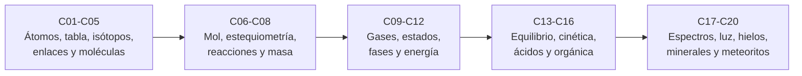

# B06 — Química y materia del universo

**Programa:** Programa Integral de Astronomía, Astrofísica, Ciencias Espaciales e Ingeniería Aeroespacial
**Área:** A01 — Alfabetización científica, astronómica y tecnológica
**Nivel:** N1 (fundamentos) · **Clases:** 20 · **Carga:** por calibrar con el uso
**Estado:** guía pedagógica del bloque (resumen de qué se aprende en cada clase). Las clases enlazadas en la tabla ya están redactadas; el resto son resúmenes de especificación. Todas conservan el estado E0 en el catálogo hasta registrar revisión disciplinar.

## 🎯 Propósito del bloque

Enseña la química que hace falta para leer el cosmos: de qué están hechos los átomos, cómo se unen, cuánto hay de cada cosa y cómo cambian la materia y la energía cuando algo reacciona o cambia de estado. La química aquí no es un fin en sí misma, sino el lenguaje con el que se interpretan espectros, atmósferas planetarias, hielos, polvo y meteoritos. Cada clase parte de un ejemplo astronómico con datos publicados y termina en un cálculo con unidades y límites declarados.

## 📚 Al terminar el bloque podrás

1. Describir el átomo, la tabla periódica y los isótopos, y calcular niveles de energía y masas atómicas.
2. Explicar los enlaces y la geometría de moléculas sencillas, y estimar energías de atracción.
3. Usar mol, masa molar y estequiometría para pasar de masas a números de átomos y de moléculas.
4. Aplicar conservación de masa y energía en una reacción y balancearla.
5. Relacionar presión, volumen, temperatura y cantidad de gas, y leer diagramas de fase de agua y CO₂.
6. Calcular energías de reacción, constantes de equilibrio y velocidades de reacción en casos simples.
7. Interpretar espectros atómicos y moleculares y entender qué hace la luz con una molécula.
8. Comparar la composición del Sol, de hielos, minerales y meteoritos con sus incertidumbres.

## 🧭 Secuencia del bloque

**Descripción textual.** Cinco tramos encadenados: la estructura de la materia (C01–C05), la contabilidad química (C06–C08), el comportamiento macroscópico y la energía (C09–C12), la dirección y velocidad de las reacciones junto con la química del carbono (C13–C16), y la aplicación a espectros, fotoquímica, hielos, minerales y meteoritos (C17–C20).

## 🗂️ Las 20 clases en resumen

**Navegación:** cada clase desarrollada enlaza a la anterior, a la siguiente y a este bloque; mientras una clase siga en E0, su enlace lleva a su fila en esta tabla.

Los resúmenes son la **especificación pedagógica propuesta** (nivel E1 parcial, pendiente de revisión). La columna «Evidencia» indica el producto que demostrará el aprendizaje.

### Tramo 1 · Estructura de la materia

| ID | Clase | Qué se aprende | Evidencia |
|---|---|---|---|
| [B06-C01](../clases/B06/B06-C01-estructura-atomica/CLASE.md) | Estructura atómica | Núcleo y electrones, niveles de energía, modelo de Bohr y líneas de Balmer del hidrógeno con constantes CODATA 2022. | Ficha del átomo de hidrógeno |
| [B06-C02](../clases/B06/B06-C02-tabla-periodica-y-abundancias-cosmicas/CLASE.md) | Tabla periódica y abundancias cósmicas | Configuración electrónica, periodos y grupos; abundancias solares en escala logarítmica y su paso a fracciones en número y en masa. | Ficha de composición solar |
| [B06-C03](../clases/B06/B06-C03-isotopos-y-masa-atomica/CLASE.md) | Isótopos y masa atómica | Isótopos, promedio ponderado, intervalos de peso atómico, razones isotópicas y notación δ. | Ficha isotópica |
| [B06-C04](../clases/B06/B06-C04-enlaces-ionicos-y-covalentes/CLASE.md) | Enlaces iónicos y covalentes | Electrones de valencia, estructuras de Lewis y energía de Coulomb frente a la agitación térmica. | Ficha de enlace |
| [B06-C05](../clases/B06/B06-C05-moleculas-y-geometria-molecular/CLASE.md) | Moléculas y geometría molecular | Pares de electrones, geometrías lineal, angular y tetraédrica, polaridad y ángulos medidos. | Ficha geométrica de una molécula |

### Tramo 2 · Contabilidad química

| ID | Clase | Qué se aprende | Evidencia |
|---|---|---|---|
| [B06-C06](../clases/B06/B06-C06-cantidad-de-sustancia-y-mol/CLASE.md) | Cantidad de sustancia y mol | El mol y la constante de Avogadro del SI; masa molar; de gramos a átomos en una muestra real. | Hoja de conversión masa–mol–átomos |
| [B06-C07](../clases/B06/B06-C07-estequiometria-elemental/CLASE.md) | Estequiometría elemental | Fórmulas y composición porcentual; masa molar media de una atmósfera a partir de su composición. | Balance de composición de una atmósfera |
| [B06-C08](../clases/B06/B06-C08-reacciones-y-conservacion-de-masa/CLASE.md) | Reacciones y conservación de masa | Balancear ecuaciones, conservar átomos y carga, y distinguir la conservación química de la nuclear. | Ecuación balanceada con verificación |

### Tramo 3 · Gases, estados, fases y energía

| ID | Clase | Qué se aprende | Evidencia |
|---|---|---|---|
| [B06-C09](../clases/B06/B06-C09-gases-ideales-y-no-ideales/CLASE.md) | Gases ideales y no ideales | Ley de los gases ideales, densidad y altura de escala de atmósferas, y cuándo falla el modelo ideal. | Tabla de densidades atmosféricas verificada |
| [B06-C10](../clases/B06/B06-C10-estados-de-la-materia/CLASE.md) | Estados de la materia | Sólido, líquido, gas y plasma comparando energía térmica con energía de cohesión. | Comparación energía térmica–cohesión |
| [B06-C11](../clases/B06/B06-C11-diagramas-de-fase/CLASE.md) | Diagramas de fase | Lectura de los diagramas del agua y del CO₂; Marte, Venus y la Tierra en el diagrama; Clausius–Clapeyron. | Ubicación de un ambiente en el diagrama de fases |
| [B06-C12](../clases/B06/B06-C12-termoquimica-y-energia-de-reaccion/CLASE.md) | Termoquímica y energía de reacción | Entalpía de formación, ley de Hess y energía por masa de una reacción. | Ficha de energía de reacción con incertidumbre |

### Tramo 4 · Equilibrio, cinética, ácidos y carbono

| ID | Clase | Qué se aprende | Evidencia |
|---|---|---|---|
| B06-C13 | Equilibrio químico | Constante de equilibrio, cociente de reacción, principio de Le Chatelier y tabla de concentraciones. | Cálculo de equilibrio verificado |
| B06-C14 | Cinética química inicial | Velocidad, orden, vida media y la ecuación de Arrhenius; por qué la química se frena en el frío. | Curva de decaimiento con su modelo |
| B06-C15 | Ácidos, bases y soluciones | Concentración, pH, ácidos fuertes y débiles y transferencia de protones. | Cálculo de pH con supuestos declarados |
| B06-C16 | Química orgánica esencial | Hidrocarburos, grupos funcionales, masa molar de fórmulas y la química orgánica de un asteroide. | Ficha de moléculas orgánicas |

### Tramo 5 · Luz, hielos, minerales y meteoritos

| ID | Clase | Qué se aprende | Evidencia |
|---|---|---|---|
| B06-C17 | Espectros atómicos y moleculares | Series de Rydberg, identificación de líneas, corrimiento Doppler y bandas moleculares. | Identificación de líneas en un espectro |
| B06-C18 | Fotoquímica y radiación | Energía del fotón, umbrales de ionización y de ruptura de enlaces y seguridad con radiación. | Tabla fotón–umbral con medidas de seguridad |
| B06-C19 | Química de hielos y minerales | Hielos de agua, CO₂ y amoníaco; silicatos; el papel de los hielos en las nubes y en los asteroides. | Ficha de un hielo o mineral |
| B06-C20 | Análisis químico introductorio de meteoritos | Comparar el Sol con los meteoritos, composición de Bennu y buenas prácticas de muestras. | Informe de comparación Sol–meteorito |

## 🧵 Hilos que atraviesan el bloque

- **Cuenta de átomos:** C02, C03, C06, C07 y C20 convierten entre abundancia, masa y número con unidades claras.
- **Energía y escalas:** C01, C04, C10, C12 y C18 comparan energías en electronvoltios, julios por mol y `kT`.
- **Luz y materia:** C01, C17 y C18 usan la misma tabla de constantes y fotones.
- **Atmósferas, hielos y asteroides:** C09, C11, C19 y C20 reutilizan datos de Marte, Venus, la Tierra y Bennu.

## 📝 Evaluación del bloque (propuesta, por calibrar)

- Fichas y ejercicios por clase, con retroalimentación y recuperación con evidencia distinta.
- Portafolio: primera versión, retroalimentación y cambio; cada ficha declara unidades, constantes con edición y límites.
- Las condiciones críticas (no presentar lo sintético como observado, no mezclar bases de composición, citar sólo lo consultado) no se compensan con promedio.

## ⚠️ Seguridad y límites

El bloque es teórico y de cálculo: ninguna clase exige reactivos. Si algún docente añade prácticas, deben usar materiales de bajo riesgo (agua, hielo, sal, vinagre, bicarbonato de sodio en cantidades de cocina, modelos moleculares), gafas, supervisión y la hoja de seguridad vigente; no se describen síntesis de sustancias peligrosas ni manipulación de reactivos corrosivos, tóxicos, explosivos o radiactivos. Los cálculos de energía de combustión son conceptuales y no sirven para diseñar propulsores. La radiación ultravioleta, X o gamma se trata sólo como concepto; las lámparas y fuentes reales exigen equipo certificado. Las cifras sintéticas se rotulan como tales.

## Fuentes de orientación preliminar

- **[NASA-DATA]** [NASA Science Data](https://science.data.nasa.gov/) — Portal general de datos y servicios científicos.
- **[IAU]** [International Astronomical Union: resolutions](https://www.iau.org/Iau/Publications/List-of-Resolutions.aspx) — Nomenclatura, tiempos, sistemas de referencia y recomendaciones científicas.
- **[ESO]** [European Southern Observatory](https://www.eso.org/) — Observatorios ópticos, instrumentación y astronomía profesional.
- **[ADS]** [NASA Astrophysics Data System](https://ui.adsabs.harvard.edu/) — Índice bibliográfico de literatura astronómica y física.

**Fuentes realmente consultadas hasta ahora (2026-11-05)**, citadas en la sección 11 de cada clase: NIST CODATA 2022; NIST Atomic Weights and Isotopic Compositions; NIST Atomic Spectra Database v5.12; NIST Chemistry WebBook; NIST CCCBDB (agua); BIPM, *SI Brochure*, 9.ª ed.; Asplund et al. (2009); Glavin et al. (2025); McClure et al. (2023, resumen); fichas de datos de la NASA NSSDC (Tierra, Marte, Venus, Sol) y nota de prensa de la NASA sobre Bennu (2 dic. 2025).

> La asociación de estas fuentes es orientativa por bloque. No significa que cada afirmación de una futura clase esté respaldada todavía. Comprobar documentos, versiones y licencias antes de desarrollar contenido.

[🏠 Volver al programa](../../README.md) · [➡️ B07 — Informática científica desde cero](./B07-informatica-cientifica-desde-cero.md)
