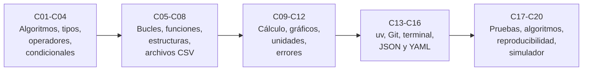

# B07 — Informática científica desde cero

**Programa:** Programa Integral de Astronomía, Astrofísica, Ciencias Espaciales e Ingeniería Aeroespacial
**Área:** A01 — Alfabetización científica, astronómica y tecnológica
**Nivel:** N1 → N2 (fundamentos y primeras aplicaciones) · **Clases:** 20 · **Carga:** por calibrar con el uso
**Estado:** guía pedagógica del bloque. Las 20 clases están redactadas y sus laboratorios se ejecutaron el 2026-11-05 (Python 3.12.9). Todas conservan el estado E0 en el catálogo: **no hay revisión disciplinar ni aprobación del autor registradas**.

## 🎯 Propósito del bloque

Es el taller de programación del programa. Enseña a **programar para hacer ciencia**: describir un procedimiento con precisión, escribirlo en Python, probarlo contra casos conocidos, declarar unidades y versiones, guardar la historia del trabajo y dejar un resultado que otra persona pueda volver a obtener. No exige haber programado antes: cada comando, símbolo y palabra reservada se explica antes de usarse. Casi todos los ejemplos usan datos publicados por el NASA NSSDC (los ocho planetas) y un dato central: la relación entre el período y el semieje de una órbita.

## 📚 Al terminar el bloque podrás

1. Descomponer un problema en pasos exactos y escribirlos como algoritmo, pseudocódigo y programa.
2. Usar en Python tipos de datos, operadores, condicionales, bucles, funciones y estructuras (listas, diccionarios, conjuntos).
3. Leer datos de archivos CSV, JSON y YAML y validarlos antes de usarlos.
4. Calcular con NumPy y `math`, graficar con Matplotlib y gestionar unidades con Astropy.
5. Manejar errores sin ocultarlos y escribir pruebas automáticas con tolerancias justificadas.
6. Crear entornos reproducibles con `uv`, registrar la historia con Git y documentar y registrar ejecuciones.
7. Construir y verificar un primer simulador de un movimiento celeste.

## 🧭 Secuencia del bloque

**Descripción textual.** Cinco tramos encadenados: el lenguaje básico (C01–C04), la repetición, la modularidad y los datos (C05–C08), el cálculo científico con sus controles (C09–C12), las herramientas de trabajo reproducible (C13–C16) y el cierre con pruebas, algoritmos, documentación y un simulador que reúne todo (C17–C20).

## 🗂️ Las 20 clases en resumen

**Navegación:** cada clase enlaza a la anterior, a la siguiente y a este bloque.

La columna «Evidencia» indica el producto que demostrará el aprendizaje. Los laboratorios (scripts en la carpeta de cada clase) incluyen pruebas que detienen la ejecución si algo falla.

### Tramo 1 · Lenguaje básico

| ID | Clase | Qué se aprende | Evidencia |
|---|---|---|---|
| [B07-C01](../clases/B07/B07-C01-pensamiento-algoritmico/CLASE.md) | Pensamiento algorítmico | Qué es un algoritmo; pseudocódigo, traza, búsqueda del máximo con `n−1` comparaciones; casos borde. | Ficha de algoritmo con traza |
| [B07-C02](../clases/B07/B07-C02-tipos-de-datos-y-variables/CLASE.md) | Tipos de datos y variables | `int`, `float`, `str`, `bool`, `None`; notación científica; conversiones; por qué `0.1 + 0.2 ≠ 0.3`. | Ficha de datos tipada |
| [B07-C03](../clases/B07/B07-C03-operadores-y-expresiones/CLASE.md) | Operadores y expresiones | Aritmética, precedencia, comparaciones y lógica; f-strings; verificación de la regularidad de Kepler con datos reales. | Tabla de verificación de Kepler |
| [B07-C04](../clases/B07/B07-C04-condicionales-y-decisiones/CLASE.md) | Condicionales y decisiones | `if/elif/else`, umbrales y casos frontera; convención frente a definición. | Tabla de decisión probada |

### Tramo 2 · Repetir, organizar y leer datos

| ID | Clase | Qué se aprende | Evidencia |
|---|---|---|---|
| [B07-C05](../clases/B07/B07-C05-bucles-y-simulaciones-sencillas/CLASE.md) | Bucles y simulaciones sencillas | `for`, `while`, acumuladores; caída libre con Euler y su error `dt/t`. | Informe de convergencia |
| [B07-C06](../clases/B07/B07-C06-funciones-y-modularidad/CLASE.md) | Funciones y modularidad | `def`, parámetros, `return`, alcance, módulos, docstrings y la guarda `__main__`. | Módulo con pruebas |
| [B07-C07](../clases/B07/B07-C07-listas-y-estructuras-de-datos/CLASE.md) | Listas y estructuras de datos | Listas, tuplas, diccionarios, conjuntos, comprensiones; alias y copia. | Catálogo de datos |
| [B07-C08](../clases/B07/B07-C08-lectura-de-archivos-csv/CLASE.md) | Lectura de archivos CSV | `csv`, codificación, conversión de tipos, validación y filas defectuosas; procedencia de los datos. | Informe de lectura |

### Tramo 3 · Cálculo, gráficos, unidades y errores

| ID | Clase | Qué se aprende | Evidencia |
|---|---|---|---|
| [B07-C09](../clases/B07/B07-C09-calculos-cientificos-basicos-con-python/CLASE.md) | Cálculos científicos básicos con Python | NumPy, vectorización, `math`; densidad de los planetas contrastada con el dato publicado. | Hoja de verificación de cálculo |
| [B07-C10](../clases/B07/B07-C10-graficos-bidimensionales-iniciales/CLASE.md) | Gráficos bidimensionales iniciales | Matplotlib, ejes con unidades, escala log-log y ajuste de una recta; accesibilidad. | Figura con descripción |
| [B07-C11](../clases/B07/B07-C11-gestion-de-unidades-en-programas/CLASE.md) | Gestión de unidades en programas | `astropy.units`, conversiones, `UnitConversionError`, constantes con unidad; gravedad y densidad. | Hoja de unidades verificadas |
| [B07-C12](../clases/B07/B07-C12-manejo-de-errores-y-excepciones/CLASE.md) | Manejo de errores y excepciones | Trazas, `try/except/else/finally`, `raise`, `nan`; validar frente a `assert`. | Tabla de errores tratados |

### Tramo 4 · Herramientas de trabajo reproducible

| ID | Clase | Qué se aprende | Evidencia |
|---|---|---|---|
| [B07-C13](../clases/B07/B07-C13-entornos-y-dependencias-con-uv/CLASE.md) | Entornos y dependencias con uv | Entornos virtuales, `pyproject.toml`, `uv.lock`, `uv run`; verificar el entorno. | Proyecto reproducible |
| [B07-C14](../clases/B07/B07-C14-control-de-versiones-con-git/CLASE.md) | Control de versiones con Git | Tres zonas, `status`, `add`, `commit`, `diff`, `log`, `restore`, ramas. | Historial comentado |
| [B07-C15](../clases/B07/B07-C15-terminal-y-rutas-de-archivos/CLASE.md) | Terminal y rutas de archivos | Directorio de trabajo, rutas relativas y absolutas, `pathlib`, Windows frente a POSIX. | Ficha de rutas |
| [B07-C16](../clases/B07/B07-C16-formatos-json-y-yaml/CLASE.md) | Formatos JSON y YAML | Sintaxis, correspondencia con tipos de Python, `safe_load`, trampas de YAML, validación. | Archivo de parámetros validado |

### Tramo 5 · Pruebas, algoritmos, reproducibilidad y simulador

| ID | Clase | Qué se aprende | Evidencia |
|---|---|---|---|
| [B07-C17](../clases/B07/B07-C17-pruebas-de-funciones-matematicas/CLASE.md) | Pruebas de funciones matemáticas | `pytest`, casos analíticos, propiedades, tolerancias, estabilidad numérica y sensibilidad de las pruebas. | Juego de pruebas con demostración de sensibilidad |
| [B07-C18](../clases/B07/B07-C18-algoritmos-de-busqueda-y-ordenamiento/CLASE.md) | Algoritmos de búsqueda y ordenamiento | Búsqueda lineal y binaria, inserción y mezcla; costo medido en comparaciones; `sorted` y `bisect`. | Informe de costos |
| [B07-C19](../clases/B07/B07-C19-documentacion-y-reproducibilidad/CLASE.md) | Documentación y reproducibilidad | Docstrings, README, semillas, huellas SHA-256, registro de ejecución. | Paquete reproducible |
| [B07-C20](../clases/B07/B07-C20-primer-simulador-de-un-movimiento-celeste/CLASE.md) | Primer simulador de un movimiento celeste | La Tierra alrededor del Sol con Euler y leapfrog; conservación, convergencia y comparación con el período publicado. | Simulador verificado |

## 🧵 Hilos que atraviesan el bloque

- **Datos publicados con procedencia:** C01–C20 usan las fichas del NASA NSSDC (semieje, período, masa, radio, densidad, gravedad y GM del Sol); la tabla se guarda en `planetas_nssdc.csv` (C08) y se reutiliza en C09, C10, C11, C12, C15 y C19.
- **Verificar antes de confiar:** pruebas con casos analíticos y con datos publicados (C03, C09, C11, C17, C20); cada resultado se rotula **publicado**, **calculado**, **simulado** o **sintético**.
- **Unidades y errores:** de las unidades en el nombre (C02, C09) a las unidades automáticas (C11) y al tratamiento de errores (C12).
- **Reproducibilidad:** entorno (C13), historia (C14), rutas portables (C15), parámetros en archivo (C16), semillas y registro (C19), todo junto en C20.
- **La relación período–semieje:** aparece en C03 (tabla), C06 (módulo), C10 (figura log-log), C17 (pruebas) y C20 (simulador).

## 🛠️ Software y datos del bloque

| Elemento | Versión | Dónde se declara |
|---|---|---|
| Python | 3.12.9 | C13 (`proyecto_laboratorios/pyproject.toml`) |
| uv | 0.13.7 | C13 |
| NumPy · Matplotlib | 2.4.4 · 3.10.8 | C13 |
| Astropy · PyYAML · pytest | 8.0.2 · 6.0.3 · 9.2.0 | C13 |
| Git | 2.55.0 | C14 |
| Datos | NASA NSSDC (consultados el 2026-11-05) | C08 (`planetas_nssdc.csv`) |

Todos los laboratorios se ejecutaron con Python 3.12.9 y estas versiones; cada clase copia en su sección 17 la salida real obtenida.

## 📝 Evaluación del bloque (propuesta, por calibrar)

- Una evidencia por clase, con retroalimentación y recuperación con una evidencia distinta.
- Portafolio: repositorio de Git con los laboratorios del bloque, entorno fijado, README y registros de ejecución.
- Proyecto de cierre C20 con rúbrica publicada antes; las **condiciones críticas** (rotular lo simulado, citar solo lo consultado, probar contra una referencia independiente, no ocultar errores ni filas descartadas) no se compensan con promedio.
- La prueba automática de cada laboratorio es parte del criterio: un laboratorio cuyas pruebas fallan no se da por completado.

## ⚠️ Seguridad y límites

Instalar paquetes ejecuta código de terceros: usa fuentes confiables y versiones fijadas (C13). No uses `yaml.load` con datos ajenos (C16). Los comandos que borran o mueven archivos deben ensayarse sobre copias (C15). No incluyas contraseñas, claves, tokens ni datos personales en el código, los archivos de parámetros ni el historial de Git (C14, C16). Los generadores pseudoaleatorios del bloque no sirven para criptografía (C19). El simulador de C20 es didáctico y **no sirve para diseñar ni navegar trayectorias reales**. Material educativo; las clases no han recibido revisión disciplinar.

## Fuentes consultadas

Las clases citan en su sección 11 solo lo realmente consultado. Documentación leída el 2026-11-05 (mutable):

- **Python 3.12:** *The Python Tutorial* (§3 introducción, §4 control de flujo y funciones, §5 estructuras de datos, §6 módulos, §8 errores, entornos virtuales, aritmética de coma flotante), *The Python Standard Library* (`csv`, `json`, `math`, `pathlib`, `random`, `bisect`, tipos integrados, parcialmente) y *Sorting Techniques*; PEP 257.
- **NumPy 2.4** (guía introductoria y `Generator`), **Matplotlib 3.10.8** (guía rápida), **Astropy 8.0.2** (`Quantity`, unidades y constantes), **pytest 9.2.0** (primeros pasos y aserciones), **PyYAML** (documentación), **uv** (proyectos, dependencias, bloqueo, estructura), **Pro Git** (qué es Git, registrar cambios, deshacer, ramas, historial).
- **Formatos:** RFC 8259 (JSON) y especificación YAML 1.2.2 (leída parcialmente).
- **Datos:** NASA NSSDC, *Planetary Fact Sheet* y fichas individuales de Mercurio a Neptuno y del Sol (https://nssdc.gsfc.nasa.gov/planetary/factsheet/).

Fuentes de orientación preliminar del catálogo (sin leer a fondo para este bloque, salvo la NASA arriba):

- **[NASA-DATA]** [NASA Science Data](https://science.data.nasa.gov/) — Portal general de datos y servicios científicos.
- **[IAU]** [International Astronomical Union: resolutions](https://www.iau.org/Iau/Publications/List-of-Resolutions.aspx) — Nomenclatura, tiempos, sistemas de referencia y recomendaciones científicas.
- **[ESO]** [European Southern Observatory](https://www.eso.org/) — Observatorios ópticos, instrumentación y astronomía profesional.
- **[ADS]** [NASA Astrophysics Data System](https://ui.adsabs.harvard.edu/) — Índice bibliográfico de literatura astronómica y física.

> Límites: no se consultaron fuentes de mecánica orbital para el simulador de C20 (sus fórmulas se verifican numéricamente y contra los datos de la NASA); la ley de Kepler se usa como regularidad empírica; no se consultaron la IAU, ESO ni ADS para este bloque. Las referencias preliminares no prueban conformidad ni autorizan reutilizaciones.

[🏠 Volver al programa](../../README.md) · [➡️ B08 — Observación del cielo y astronomía práctica](./B08-observacion-del-cielo-y-astronomia-practica.md)
