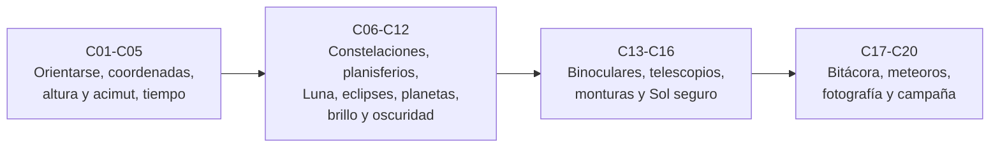

# B08 — Observación del cielo y astronomía práctica

**Programa:** Programa Integral de Astronomía, Astrofísica, Ciencias Espaciales e Ingeniería Aeroespacial
**Área:** A01 — Alfabetización científica, astronómica y tecnológica
**Nivel:** N1 (fundamentos aplicados) · **Clases:** 20 · **Carga:** por calibrar con el uso
**Estado:** guía pedagógica del bloque. Las 20 clases están redactadas y enlazadas en la tabla; todas conservan el estado E0 en el catálogo hasta registrar revisión disciplinar y aprobación del autor.

## 🎯 Propósito del bloque

Es el bloque de **práctica**: enseña a salir, mirar el cielo con método y registrar lo que se ve. Parte de la orientación y de las coordenadas, pasa por el tiempo, la Luna, los planetas, el brillo y la oscuridad del cielo, introduce binoculares, telescopios y fotografía, trata la observación solar con seguridad como condición crítica y termina con una campaña de observación como proyecto. Cada actividad se puede hacer con recursos distintos: sin equipo, con binoculares, con telescopio o con datos abiertos, y con una alternativa no visual.

## 📚 Al terminar el bloque podrás

1. Orientarte y ubicar un objeto en la esfera celeste con coordenadas ecuatoriales y horizontales, y pasar de unas a otras con el tiempo sidéreo.
2. Predecir y explicar fases lunares, eclipses y la visibilidad de los planetas con datos y cálculos que puedes comprobar.
3. Comparar brillos con la escala de magnitudes y medir cuánto limita el cielo (Luna y luz artificial) lo que puedes ver.
4. Elegir y usar con seguridad binoculares y telescopios, y calcular sus prestaciones.
5. Observar el Sol solo con métodos verificados o estudiarlo con datos abiertos.
6. Llevar una bitácora validada y distinguir siempre lo observado de lo calculado.
7. Planificar y evaluar una campaña de observación nocturna con requisitos, criterios go/no-go y accesibilidad.

## 🧭 Secuencia del bloque

**Descripción textual.** Cuatro tramos encadenados: orientarse y medir el tiempo (C01–C05), el cielo y sus condiciones de observación (C06–C12), instrumentos y observación solar segura (C13–C16), y registro, eventos, fotografía y campaña (C17–C20).

## 🗂️ Las 20 clases en resumen

**Navegación:** cada clase enlaza a la anterior, a la siguiente y a este bloque. La columna «Evidencia» indica el producto que demuestra el aprendizaje.

### Tramo 1 · Orientarse y medir el tiempo

| ID | Clase | Qué se aprende | Evidencia |
|---|---|---|---|
| [B08-C01](../clases/B08/B08-C01-orientacion-geografica-y-puntos-cardinales/CLASE.md) | Orientación geográfica y puntos cardinales | Norte verdadero y magnético; orto del Sol (no siempre al este); sombra de una vara y Cruz del Sur para hallar el sur. | Tarjeta de orientación con incertidumbres |
| [B08-C02](../clases/B08/B08-C02-esfera-celeste-y-horizonte-local/CLASE.md) | Esfera celeste y horizonte local | La esfera celeste como modelo: altura del polo = latitud; circumpolares y horas sobre el horizonte. | Carta del horizonte local |
| [B08-C03](../clases/B08/B08-C03-ascension-recta-y-declinacion/CLASE.md) | Ascensión recta y declinación | Ascensión recta y declinación; horas y grados; época y precesión; separación angular. | Ficha de coordenadas con época |
| [B08-C04](../clases/B08/B08-C04-altura-y-acimut/CLASE.md) | Altura y acimut | De AR y Dec a altura y acimut con el ángulo horario; salida, tránsito y puesta de la Luna; refracción y paralaje. | Tabla de seguimiento comprobada con una referencia |
| [B08-C05](../clases/B08/B08-C05-tiempo-sidereo-y-solar/CLASE.md) | Tiempo sidéreo y solar | Día sidéreo y solar (3,93 min por día); tiempo sidéreo local; ecuación del tiempo. | Reloj sidéreo con tránsitos |

### Tramo 2 · El cielo, la Luna, los planetas y la oscuridad

| ID | Clase | Qué se aprende | Evidencia |
|---|---|---|---|
| [B08-C06](../clases/B08/B08-C06-constelaciones-y-catalogos-estelares/CLASE.md) | Constelaciones y catálogos estelares | Las 88 constelaciones de la IAU, designaciones y catálogos (Hipparcos, Gaia DR3); densidad de fuentes por campo. | Ficha de catálogo con versión y época |
| [B08-C07](../clases/B08/B08-C07-planisferios-y-aplicaciones-celestes/CLASE.md) | Planisferios y aplicaciones celestes | Cómo funciona un planisferio con tiempo sidéreo; aplicaciones, sus errores de configuración y cómo verificarlas. | Planisferio propio verificado |
| [B08-C08](../clases/B08/B08-C08-fases-lunares-y-libracion/CLASE.md) | Fases lunares y libración | Fases como geometría de iluminación; período sinódico; tamaño aparente; libración, con la tabla de la NASA. | Diario lunar de siete noches |
| [B08-C09](../clases/B08/B08-C09-eclipses-y-geometria-de-sombras/CLASE.md) | Eclipses y geometría de sombras | Conos de sombra, eclipses totales, anulares y parciales; por qué no hay uno cada mes; eclipses visibles desde Chile. | Plan de eclipse con seguridad solar |
| [B08-C10](../clases/B08/B08-C10-planetas-observables-y-elongacion/CLASE.md) | Planetas observables y elongación | Elongación, períodos sinódicos y qué planetas se ven una noche dada. | Pronóstico planetario con fuente |
| [B08-C11](../clases/B08/B08-C11-magnitudes-aparentes-y-brillo/CLASE.md) | Magnitudes aparentes y brillo | Escala de magnitudes (5 mag = 100×), suma de magnitudes y ganancia ideal de un instrumento. | Escalera de brillos |
| [B08-C12](../clases/B08/B08-C12-limitacion-por-contaminacion-luminica/CLASE.md) | Limitación por contaminación lumínica | Magnitud límite, Luna como contaminación natural, atlas mundial de brillo artificial y cielos de Chile con fuentes. | Informe de cielo con incertidumbre |

### Tramo 3 · Instrumentos y Sol seguro

| ID | Clase | Qué se aprende | Evidencia |
|---|---|---|---|
| [B08-C13](../clases/B08/B08-C13-uso-seguro-de-binoculares/CLASE.md) | Uso seguro de binoculares | Pupila de salida, campo y ganancia de binoculares; uso, cuidado y seguridad ocular. | Ficha de uso seguro de binoculares |
| [B08-C14](../clases/B08/B08-C14-telescopios-de-iniciacion/CLASE.md) | Telescopios de iniciación | Refractor, reflector y Dobson; aumento, pupila de salida y poder separador; criterio de compra. | Ficha de telescopio con cálculos |
| [B08-C15](../clases/B08/B08-C15-monturas-y-seguimiento-inicial/CLASE.md) | Monturas y seguimiento inicial | Montura altacimutal y ecuatorial; ritmo del cielo de 15,04″/s; alineación polar al polo sur. | Plan de seguimiento |
| [B08-C16](../clases/B08/B08-C16-observacion-solar-con-filtros-certificados/CLASE.md) | Observación solar con filtros certificados | Visores y filtros ISO 12312-2 verificados, proyección con orificio y datos abiertos del Sol. | Plan de observación solar (condición crítica) |

### Tramo 4 · Registro, eventos, fotografía y campaña

| ID | Clase | Qué se aprende | Evidencia |
|---|---|---|---|
| [B08-C17](../clases/B08/B08-C17-registro-sistematico-en-bitacora/CLASE.md) | Registro sistemático en bitácora | Campos mínimos, UT en ISO 8601, procedencia de cada dato y validación de la bitácora. | Bitácora de una sesión validada |
| [B08-C18](../clases/B08/B08-C18-introduccion-a-meteoros-y-lluvias/CLASE.md) | Introducción a meteoros y lluvias | Meteoroide, meteoro y lluvia; calendario de la IMO; ZHR y correcciones. | Informe de una sesión de meteoros |
| [B08-C19](../clases/B08/B08-C19-fotografia-astronomica-elemental/CLASE.md) | Fotografía astronómica elemental | Escala de placa, campo, estela y tiempo máximo sin seguimiento; regla de 500 evaluada; fotografiar el Sol con filtro. | Ficha de una fotografía |
| [B08-C20](../clases/B08/B08-C20-proyecto-de-campana-de-observacion-nocturna/CLASE.md) | Proyecto de campaña de observación nocturna | Campaña como proyecto: requisitos verificables, componentes, go/no-go y cierre. | Plan de campaña (y su informe) |

## 🧵 Hilos que atraviesan el bloque

- **Un mismo lugar y una misma noche:** casi todas las clases retoman el valle del Elqui (coordenadas redondeadas) y los días de noviembre de 2025 con datos de la NASA, para que cada cálculo pueda compararse con el anterior.
- **Calculado frente a observado:** cada dato lleva su procedencia (C03, C08, C10, C17); ningún cálculo se presenta como observación.
- **Referencias independientes:** los programas de laboratorio (`astrolib_b08.py` y los de cada clase) se prueban contra datos de la NASA, casos analíticos o una referencia numérica (astropy) antes de usarse.
- **Seguridad solar:** aparece desde C01 y se desarrolla en C09, C13, C14, C15, C16 y C19; es condición crítica en todos los planes.
- **Accesibilidad y recursos:** cada actividad tiene una alternativa sin equipo, con datos abiertos y no visual.

## 📝 Evaluación del bloque (propuesta, por calibrar)

- Un producto por clase (tarjeta, carta, tabla, ficha, bitácora, plan), con rúbrica de cuatro niveles y retroalimentación.
- Condiciones críticas que no se compensan por promedio: seguridad solar (C09, C13, C14, C16, C19, C20), declarar lo sintético o calculado, citar solo lo consultado y no atribuir a una fuente lo que no dice.
- Proyecto integrador: el plan de campaña de C20 y, si se realiza, su informe de cierre.
- Recuperación con evidencia distinta y portafolio con primera versión, retroalimentación y cambio.

## ⚠️ Seguridad y límites

**Nunca se observa el Sol sin protección certificada y verificada.** NASA indica que los visores deben cumplir ISO 12312-2, que las gafas de sol no protegen y que los binoculares y telescopios necesitan un filtro especial montado al frente; la AAS añade que una etiqueta no basta y que los filtros de ocular son peligrosos (consultadas el 2026-11-05; la norma ISO no se leyó). En campo hay además riesgos de oscuridad, frío, terreno, tráfico y fatiga: se observa en grupo, con plan de regreso y linterna roja. La normativa chilena de iluminación y de acceso a terrenos, el pronóstico del tiempo y la regla vigente de hora oficial **no se consultaron** y deben verificarse en la fuente oficial antes de actuar. El bloque es educativo y no sustituye orientación profesional. Las cosmovisiones culturales del cielo se estudian en B02 como saberes propios.

## 🔬 Fuentes consultadas por el bloque

Se citan solo páginas y datos efectivamente leídos el 2026-11-05; cada clase detalla localizador, qué respalda y estado en su sección 11.

- NASA SVS 5415, *Moon Phase and Libration, 2025* (efeméride JPL DE421; archivo `mooninfo_2025.txt`) — fase, distancia, posición y libración de la Luna.
- NASA NSSDC, fichas de la Tierra, la Luna, el Sol y de razones planetarias — radios, períodos y distancias.
- NASA, *Eclipse safety* y *Eclipse types*; NASA Eclipse Web Site, *Solar Eclipses 2021–2030* — seguridad y calendario de eclipses.
- AAS, páginas de seguridad solar (visores y filtros) — verificación y filtros para óptica.
- USNO, *Rise, Set, and Twilight Definitions* — crepúsculos, orto y tránsito.
- IAU, *The Constellations* (FAQ); ESA, Hipparcos y Gaia DR3; Stellarium — constelaciones y catálogos.
- IMO, calendario de lluvias, glosario y observación visual — meteoros y magnitud límite.
- Falchi et al. 2016 (arXiv:1609.01041, resumen); ESO, Paranal y La Silla — contaminación lumínica y observatorios.
- Night Sky Network y NASA Science — binoculares, telescopios, Luna y meteoros; NOAA NCEI, *World Magnetic Model*; SILSO y NASA SDO — Sol.
- astropy 8.0.2 / pyerfa 2.0.1.5 — referencia numérica independiente (valores copiados, no importados).

> No se usó el libro *Astronomy 2e* de OpenStax como fuente de redacción. Las asociaciones iniciales de fuentes del catálogo (NASA-DATA, IAU, ESO, ADS) son orientativas; solo valen las citas verificadas en cada clase.

[🏠 Volver al programa](../../README.md) · [⬅️ B07 — Informática científica desde cero](./B07-informatica-cientifica-desde-cero.md) · [➡️ B09 — Cálculo diferencial e integral](./B09-calculo-diferencial-e-integral.md)
