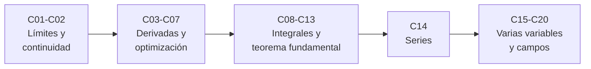

# B09 — Cálculo diferencial e integral

**Programa:** Programa Integral de Astronomía, Astrofísica, Ciencias Espaciales e Ingeniería Aeroespacial
**Área:** A02 — Matemática, física computacional y métodos científicos
**Nivel:** N1 → N4 (de límites a campos vectoriales) · **Clases:** 20 · **Carga:** por calibrar con el uso
**Estado:** guía pedagógica del bloque. Las 20 clases están redactadas y pendientes de revisión; todas conservan el estado E0 en el catálogo hasta registrar revisión disciplinar.

## 🎯 Propósito del bloque

Da el lenguaje matemático del cambio y de la acumulación que usan casi todos los bloques siguientes: tasas, optimización, energía, campos y propagación de incertidumbre. Cada clase parte de una necesidad concreta de las ciencias espaciales (paralaje, separación de etapas, marea, velocidad de escape, gravedad de un cuerpo extenso) y la comprueba con un script contra una solución exacta o un valor publicado.

## 📚 Al terminar el bloque podrás

1. Calcular límites y reconocer continuidad, discontinuidades y el error de una aproximación de ángulo pequeño.
2. Derivar cualquier combinación de funciones elementales, incluso de forma implícita, e interpretar la derivada con unidades.
3. Optimizar una cantidad y medir su sensibilidad.
4. Integrar por sustitución y por partes, y evaluar integrales definidas con antiderivada y con cuadratura numérica.
5. Aproximar con series de Taylor con cota de error.
6. Trabajar con funciones de varias variables: derivadas parciales, gradiente, integrales múltiples, divergencia, rotacional y campos gravitatorios.

## 🧭 Secuencia del bloque

**Descripción textual.** Cinco tramos encadenados: límites y continuidad (C01–C02), derivadas y optimización (C03–C07), integrales hasta el teorema fundamental y sus aplicaciones geométricas (C08–C13), series (C14) y cálculo de varias variables hasta los campos gravitatorios (C15–C20).

## 🗂️ Las 20 clases en resumen

**Navegación:** cada clase enlaza a la anterior, a la siguiente y a este bloque. La columna «Evidencia» indica el producto que demostrará el aprendizaje. Las cifras de cada clase están rotuladas como publicadas, estimadas, sintéticas o simuladas.

### Tramo 1 · Límites y continuidad

| ID | Clase | Qué se aprende | Evidencia |
|---|---|---|---|
| [B09-C01](../clases/B09/B09-C01-limites-de-funciones-reales/CLASE.md) | Límites de funciones reales | Límite numérico y algebraico, límites laterales, `sin t / t → 1`, ε–δ y cancelación numérica. | Tabla ángulo–aproximación–error |
| [B09-C02](../clases/B09/B09-C02-continuidad-y-discontinuidad/CLASE.md) | Continuidad y discontinuidad | Continuidad en un punto, tipos de discontinuidad, teorema del valor intermedio y bisección. | Tabla de discontinuidades de un vehículo sintético |

### Tramo 2 · Derivadas y optimización

| ID | Clase | Qué se aprende | Evidencia |
|---|---|---|---|
| [B09-C03](../clases/B09/B09-C03-derivada-como-tasa-de-cambio/CLASE.md) | Derivada como tasa de cambio | Cociente de diferencias, derivada como límite, tangente, unidades y error numérico. | Tabla de cocientes de diferencia con error y paso óptimo |
| [B09-C04](../clases/B09/B09-C04-reglas-de-derivacion/CLASE.md) | Reglas de derivación | Potencia, suma, producto, cociente y cadena; gradiente de la gravedad y marea. | Tabla de derivadas verificadas |
| [B09-C05](../clases/B09/B09-C05-derivadas-trigonometricas/CLASE.md) | Derivadas trigonométricas | `sin′`, `cos′`, `tan′`, `arctan′`; velocidad de seguimiento de un astro. | Tabla de velocidades de seguimiento con comprobación |
| [B09-C06](../clases/B09/B09-C06-derivacion-implicita/CLASE.md) | Derivación implícita | Derivar sin despejar; ecuación de Kepler, Newton y tasas relacionadas. | Tabla de soluciones de Kepler con derivada y residuo |
| [B09-C07](../clases/B09/B09-C07-optimizacion-con-derivadas/CLASE.md) | Optimización con derivadas | Puntos críticos, segunda derivada, bordes y sensibilidad; tanque óptimo y punto de atracción igual. | Tabla de diseño óptimo con sensibilidad |

### Tramo 3 · Integrales

| ID | Clase | Qué se aprende | Evidencia |
|---|---|---|---|
| [B09-C08](../clases/B09/B09-C08-integrales-indefinidas/CLASE.md) | Integrales indefinidas | Antiderivada, constante de integración, condiciones iniciales y potencial gravitatorio. | Tabla de antiderivadas verificadas |
| [B09-C09](../clases/B09/B09-C09-integracion-por-sustitucion/CLASE.md) | Integración por sustitución | Cambio de variable y de límites; masa de columna de una atmósfera exponencial. | Tabla de masa de columna y presión con comprobación numérica |
| [B09-C10](../clases/B09/B09-C10-integracion-por-partes/CLASE.md) | Integración por partes | Elección de `u` y `dv`; espera media entre fotones y comparación con simulación. | Tabla de momentos analíticos, numéricos y simulados |
| [B09-C11](../clases/B09/B09-C11-integrales-definidas/CLASE.md) | Integrales definidas | Sumas de Riemann, propiedades, trapecio y Simpson, órdenes y ruido; incremento de velocidad. | Tabla de convergencia de la cuadratura |
| [B09-C12](../clases/B09/B09-C12-teorema-fundamental-del-calculo/CLASE.md) | Teorema fundamental del cálculo | Las dos partes del teorema, integral impropia y energía de escape. | Tabla de energía de escape con verificación |
| [B09-C13](../clases/B09/B09-C13-areas-y-volumenes-por-integracion/CLASE.md) | Áreas y volúmenes por integración | Discos, cascarones, superficies; esferoide terrestre, espejo parabólico y elipse orbital. | Hoja de geometría de un espejo y de un esferoide |

### Tramo 4 · Series

| ID | Clase | Qué se aprende | Evidencia |
|---|---|---|---|
| [B09-C14](../clases/B09/B09-C14-series-y-aproximaciones/CLASE.md) | Series y aproximaciones | Taylor, resto de Lagrange, serie binomial y radio de convergencia; gravedad con la altitud. | Tabla de aproximaciones con cota de error |

### Tramo 5 · Varias variables y campos

| ID | Clase | Qué se aprende | Evidencia |
|---|---|---|---|
| [B09-C15](../clases/B09/B09-C15-funciones-de-varias-variables/CLASE.md) | Funciones de varias variables | Dominio, cortes, curvas de nivel y punto de silla; potencial Tierra–Luna y luminosidad. | Mapa de cortes y curvas de nivel con comprobación |
| [B09-C16](../clases/B09/B09-C16-derivadas-parciales/CLASE.md) | Derivadas parciales | Parciales, mixtas, propagación de incertidumbre, Monte Carlo y hessiano. | Tabla de sensibilidades con propagación de incertidumbre |
| [B09-C17](../clases/B09/B09-C17-gradiente-y-derivada-direccional/CLASE.md) | Gradiente y derivada direccional | Gradiente, `D_u f`, perpendicularidad a las curvas de nivel y `g = −∇Φ`. | Tabla de gradiente y derivadas direccionales |
| [B09-C18](../clases/B09/B09-C18-integrales-dobles-y-triples/CLASE.md) | Integrales dobles y triples | Integración iterada, jacobianos, masa e inercia de un planeta y potencia interceptada. | Hoja de masa, inercia y potencia |
| [B09-C19](../clases/B09/B09-C19-calculo-vectorial-introductorio/CLASE.md) | Cálculo vectorial introductorio | Divergencia, rotacional, integral de línea, Gauss y Stokes con gravedad y rotación. | Tabla de divergencia, rotacional, flujo y circulación |
| [B09-C20](../clases/B09/B09-C20-aplicaciones-a-campos-gravitatorios/CLASE.md) | Aplicaciones a campos gravitatorios | Teorema de la capa, masa encerrada, `J₂` y rotación; cierre del bloque. | Hoja de campo gravitatorio de un cuerpo extenso |

## 🧵 Hilos que atraviesan el bloque

- **Aproximación y error:** C01, C03, C11 y C14 miden siempre cuánto se equivoca un método y con qué cota.
- **Gravitación:** C04 (marea), C07 (punto de atracción igual), C08 (potencial), C12 (escape), C15–C17 (potencial y gradiente), C19–C20 (Gauss y cuerpos extensos).
- **Comprobación independiente:** cada clase contrasta con una solución exacta, otro método o un valor publicado (IAU, IERS, NASA, NIST).

## 📝 Evaluación del bloque (propuesta, por calibrar)

- Una evidencia por clase con rúbrica publicada y recuperación con evidencia distinta.
- Portafolio: primera versión, retroalimentación y cambio.
- Condiciones críticas que no se compensan con promedio: rotular lo sintético y lo simulado, declarar unidades y modelo, comprobar con un método independiente y citar solo fuentes consultadas.

## ⚠️ Seguridad y límites

Los modelos son educativos: masa puntual, cuerpos fijos, rotación rígida, atmósfera y vehículos sintéticos. No sirven para diseñar vehículos, planificar misiones, navegar ni calibrar instrumentos. No se debe apuntar un telescopio al Sol sin filtro certificado.

## Fuentes de orientación preliminar

- **[NIST]** [NIST Digital Library of Mathematical Functions](https://dlmf.nist.gov/) — capítulo 1 consultado (§1.4–1.6); constantes CODATA 2022 de NIST.
- **[IAU]** [Resolución B3 de 2015](https://arxiv.org/abs/1510.07674) — valores nominales solares y planetarios.
- **[IERS]** [IERS Conventions (2010), TN36](https://iers-conventions.obspm.fr/content/tn36.pdf) — constantes de la Tierra.
- **[NASA]** [Earth Fact Sheet](https://nssdc.gsfc.nasa.gov/planetary/factsheet/earthfact.html), [Moon Fact Sheet](https://nssdc.gsfc.nasa.gov/planetary/factsheet/moonfact.html) y [JPL Approximate Positions](https://ssd.jpl.nasa.gov/planets/approx_pos.html).

> Cada clase lista en su sección 11 las fuentes realmente consultadas, con fecha y estado. Las páginas web se consultaron mediante extracción automática de texto; no equivalen a revisión disciplinar.

[🏠 Volver al programa](../../README.md) · [➡️ B10 — Álgebra lineal y matemáticas geométricas](./B10-algebra-lineal-y-matematicas-geometricas.md)
