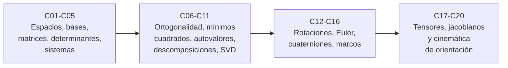

# B10 — Álgebra lineal y matemáticas geométricas

**Programa:** Programa Integral de Astronomía, Astrofísica, Ciencias Espaciales e Ingeniería Aeroespacial
**Área:** A02 — Matemática, física computacional y métodos científicos
**Nivel:** N2 → N3 (fundamentos y herramientas) · **Clases:** 20 · **Carga:** por calibrar con el uso
**Estado:** guía pedagógica del bloque (resumen de qué se aprende en cada clase). Las clases enlazadas en la tabla ya están redactadas; el resto son resúmenes de especificación. Todas conservan el estado E0 en el catálogo hasta registrar revisión disciplinar.

## 🎯 Propósito del bloque

Es el lenguaje con el que las ciencias espaciales describen **direcciones, orientaciones y sistemas lineales**: cómo se suman estados, se resuelven sistemas, se ajustan datos por mínimos cuadrados, se encuentran los ejes principales de un cuerpo y se pasa de un marco de referencia a otro. Parte de los vectores de B04 y del cálculo de B09, y prepara las ecuaciones diferenciales (B11), la estadística (B12), el procesamiento de señales (B15), el control (B16) y todas las clases de navegación, actitud y mecánica orbital.

## 📚 Al terminar el bloque podrás

1. Decidir si un conjunto es un espacio o subespacio vectorial y describirlo con una base.
2. Representar operadores con matrices y resolver sistemas lineales de forma estable, sabiendo cuándo están mal condicionados.
3. Ajustar un modelo lineal a datos por mínimos cuadrados e interpretar los residuos.
4. Calcular autovalores, autovectores, descomposiciones y SVD, y usarlos para ejes principales y estabilidad.
5. Representar una orientación en el espacio con matrices, ángulos de Euler y cuaterniones, y conocer sus singularidades.
6. Encadenar transformaciones entre marcos de referencia declarando convenciones y unidades.
7. Manejar tensores con notación indicial y linealizar con jacobianos.
8. Integrar la cinemática de orientación de un satélite y verificarla con soluciones exactas.

## 🧭 Secuencia del bloque

**Descripción textual.** Cuatro tramos encadenados: estructura lineal y sistemas (C01–C05), geometría de los datos y descomposiciones (C06–C11), orientación en el espacio (C12–C16) y herramientas multilineales con aplicación integrada (C17–C20).

## 🗂️ Las 20 clases en resumen

**Navegación:** cada clase desarrollada enlaza a la anterior, a la siguiente y a este bloque; mientras una clase siga en E0, su enlace lleva a su fila en esta tabla.

Los resúmenes son la **especificación pedagógica propuesta** (nivel E1 parcial, pendiente de revisión). La columna «Evidencia» indica el producto que demostrará el aprendizaje.

### Tramo 1 · Estructura lineal y sistemas

| ID | Clase | Qué se aprende | Evidencia |
|---|---|---|---|
| [B10-C01](../clases/B10/B10-C01-espacios-vectoriales/CLASE.md) | Espacios vectoriales | Axiomas, subespacios y prueba de tres pasos; por qué las perturbaciones se superponen y las órbitas completas no. | Ficha de subespacios |
| [B10-C02](../clases/B10/B10-C02-bases-y-dimension/CLASE.md) | Bases y dimensión | Independencia, bases, coordenadas, rango y nulidad; la base orbital de una órbita inclinada. | Cuaderno de bases |
| [B10-C03](../clases/B10/B10-C03-matrices-y-operadores-lineales/CLASE.md) | Matrices y operadores lineales | Matriz como operador, producto como composición, no conmutatividad; estación terrestre que gira. | Hoja de operadores |
| [B10-C04](../clases/B10/B10-C04-determinantes-y-soluciones/CLASE.md) | Determinantes y soluciones | Determinante como área o volumen, invertibilidad, regla de Cramer; triangulación con dos estaciones. | Informe de geometría de visuales |
| [B10-C05](../clases/B10/B10-C05-sistemas-lineales-y-eliminacion/CLASE.md) | Sistemas lineales y eliminación | Eliminación gaussiana con pivoteo, sustitución, condición; trilateración plana. | Bitácora de eliminación con verificación |

### Tramo 2 · Geometría de los datos y descomposiciones

| ID | Clase | Qué se aprende | Evidencia |
|---|---|---|---|
| [B10-C06](../clases/B10/B10-C06-producto-interno-y-ortogonalidad/CLASE.md) | Producto interno y ortogonalidad | Norma, ángulo, Cauchy–Schwarz, Gram–Schmidt; ángulo de incidencia solar sobre un panel. | Ficha de ángulos y bases ortonormales |
| [B10-C07](../clases/B10/B10-C07-proyecciones-y-minimos-cuadrados/CLASE.md) | Proyecciones y mínimos cuadrados | Proyección ortogonal, ecuaciones normales, residuos; ajuste de una trayectoria con ruido sintético. | Informe de ajuste con residuos |
| [B10-C08](../clases/B10/B10-C08-autovalores-y-autovectores/CLASE.md) | Autovalores y autovectores | Ecuación característica, traza y determinante; ejes principales de inercia de un satélite. | Ficha de ejes principales |
| [B10-C09](../clases/B10/B10-C09-diagonalizacion-y-estabilidad/CLASE.md) | Diagonalización y estabilidad | Diagonalizar, potencias y exponencial de matrices; estabilidad de sistemas lineales. | Informe de estabilidad |
| [B10-C10](../clases/B10/B10-C10-descomposiciones-matriciales/CLASE.md) | Descomposiciones matriciales | LU, QR y Cholesky; cuándo conviene cada una y cómo se verifican. | Cuaderno de factorizaciones |
| [B10-C11](../clases/B10/B10-C11-valores-singulares-y-svd/CLASE.md) | Valores singulares y SVD | SVD, rango efectivo, número de condición y aproximación de bajo rango. | Informe SVD con rango efectivo |

### Tramo 3 · Orientación en el espacio

| ID | Clase | Qué se aprende | Evidencia |
|---|---|---|---|
| [B10-C12](../clases/B10/B10-C12-rotaciones-en-el-plano-y-espacio/CLASE.md) | Rotaciones en el plano y espacio | Rotación activa y pasiva, ejes, eje–ángulo; la rotación diaria de la Tierra. | Hoja de rotaciones con convenciones |
| B10-C13 | Matrices de rotación tridimensional | Matrices elementales, grupo de rotaciones, fórmula de Rodrigues y convención de SPICE. | Cuaderno de matrices de rotación |
| B10-C14 | Ángulos de Euler y singularidades | Secuencias de ejes, ambigüedad y bloqueo de cardán. | Informe de singularidad |
| B10-C15 | Cuaterniones unitarios | Álgebra de cuaterniones, composición, doble cobertura y convención escalar‑primero. | Hoja de cuaterniones verificada |
| B10-C16 | Transformación de marcos de referencia | Cadena de marcos, rotación terrestre, velocidades en marco giratorio. | Cadena de marcos documentada |

### Tramo 4 · Tensores, linealización y orientación satelital

| ID | Clase | Qué se aprende | Evidencia |
|---|---|---|---|
| B10-C17 | Tensores y notación indicial | Convención de suma, delta de Kronecker, Levi‑Civita, tensor de inercia. | Hoja de notación indicial |
| B10-C18 | Producto tensorial y contracción | Producto externo, contracción y traza; tensor de marea gravitatoria. | Ficha del tensor de marea |
| B10-C19 | Jacobianos y linealización | Jacobiano, aproximación lineal y su error; conversión de coordenadas. | Informe de linealización |
| B10-C20 | Cinemática de orientación satelital | Ecuaciones de cinemática con cuaterniones, integración y verificación. | Simulación de actitud verificada |

## 🧵 Hilos que atraviesan el bloque

- **Convención:** C03, C12, C13, C15 y C16 insisten en declarar activa o pasiva, orden de ejes y escalar‑primero.
- **Condición y error:** C04, C05, C07 y C11 enseñan cuándo un cálculo bien planteado es sensible.
- **Ejes naturales:** C08–C11 buscan los ejes en los que un operador es simple; C17–C18 los reencuentran en el tensor de inercia y el de marea.
- **Verificar:** cada clase compara con una solución exacta o con un método independiente.

## 📝 Evaluación del bloque (propuesta, por calibrar)

- Fichas y ejercicios por clase, con retroalimentación y recuperación con evidencia distinta.
- Portafolio de laboratorios: cada script con su prueba y sus resultados.
- Proyecto de cierre C20 con rúbrica publicada antes; las condiciones críticas (declarar convenciones y unidades, rotular sintético y estimado, no presentar lo simulado como observado) no se compensan con promedio.

## ⚠️ Seguridad y límites

Las clases usan datos **sintéticos** o constantes publicadas para ilustrar métodos: no sirven para maniobras, navegación real ni diseño de control de vuelo. Las convenciones de rotación y cuaterniones cambian entre bibliotecas; una convención mal asumida produce errores reales de actitud. La verificación disciplinar sigue pendiente.

## Fuentes de orientación preliminar

- **[NIST]** [NIST Publications](https://www.nist.gov/publications) — Metrología, física, seguridad, computación y normas.
- **[IERS]** [International Earth Rotation and Reference Systems Service](https://www.iers.org/) — Rotación terrestre y sistemas de referencia.
- **[JPL-SPICE]** [NASA NAIF SPICE](https://naif.jpl.nasa.gov/naif/) — Geometría de observación, referencias espaciales y tiempos.
- **[NASA-NTRS]** [NASA Technical Reports Server](https://ntrs.nasa.gov/) — Informes técnicos e investigación histórica y actual.

> La asociación de estas fuentes es orientativa por bloque. Las fuentes realmente consultadas para cada afirmación se listan en la sección 11 de cada clase redactada.

[🏠 Volver al programa](../../README.md)
