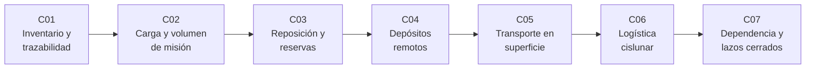

# B100 — Logística y cadena de suministro extraterrestre

> **Bloque nuevo de la estructura `0.2.0`.** Sus 7 clases estaban programadas por la ampliación y ahora están redactadas. Ver el [programa completo](../../PROGRAMA_ACADEMICO_COMPLETO.md).

**Programa:** Programa Integral de Astronomía, Astrofísica, Ciencias Espaciales e Ingeniería Aeroespacial
**Área:** A08 — Operaciones de misión y robótica espacial
**Nivel:** N3 (fundamentos disciplinares) · **Clases:** 7 · **Carga:** por calibrar con el uso
**Estado:** guía pedagógica del bloque (resumen de qué se aprende en cada clase). Las clases enlazadas en la tabla ya están redactadas; todas conservan el estado E0 en el catálogo hasta registrar revisión disciplinar.

## 🎯 Propósito del bloque

Enseña **cómo se mantiene abastecida una instalación lejos de la Tierra** cuando cada kilogramo cuesta propelente, cada reposición tarda meses y no hay tienda cercana. Recorre el control de lotes y trazabilidad de materiales, el cálculo de la masa y el volumen de carga de una misión, la reposición de suministros con demoras interplanetarias y reservas de seguridad, el almacenamiento remoto y su degradación, el transporte de carga sobre una superficie, la red logística cislunar de nodos y depósitos, y la parte de los suministros que debe seguir viniendo de la Tierra aunque se cierren lazos. Cada clase cierra con un laboratorio en Python con semilla fija y datos **sintéticos** o **ilustrativos** rotulados, con comprobaciones por una segunda vía.

## 📚 Al terminar el bloque podrás

1. Llevar un inventario por lotes con trazabilidad, comparar las reglas FIFO y FEFO y conciliar existencias.
2. Dimensionar la masa y el volumen de carga de una misión y trasladarlos a masa en órbita con la ecuación del cohete.
3. Calcular el punto de reposición y la reserva de seguridad con demoras y ventanas sinódicas, y comprobar el nivel de servicio por simulación.
4. Estimar la vida útil de un depósito con degradación dependiente de la temperatura y las pérdidas por evaporación de criógenos.
5. Calcular la energía de transporte de carga en Luna y Marte y elegir una ruta de mínima energía.
6. Comparar una ruta cislunar directa con otra con depósito de reabastecimiento.
7. Cuantificar la fracción de suministros que sigue viniendo de la Tierra según la eficiencia de los lazos cerrados y el punto de equilibrio del equipo de reciclaje.
8. Rotular qué es dato consultado, qué es ilustrativo y qué es simulado.

## 🧭 Secuencia del bloque

**Descripción textual.** Siete clases encadenadas: qué hay y de dónde viene (C01), cuánto hay que llevar (C02), cuándo reponerlo (C03), cómo se conserva (C04), cómo se mueve sobre la superficie (C05), cómo llega por la red cislunar (C06) y qué parte puede dejar de venir de la Tierra (C07).

## 🗂️ Las 7 clases en resumen

**Navegación:** cada clase enlaza a la anterior, a la siguiente y a este bloque.

La columna «Evidencia» indica el producto que demostrará el aprendizaje. Los laboratorios usan datos **sintéticos** o **ilustrativos** (rotulados) o valores publicados con fuente y fecha.

### Tramo 1 · Qué se lleva y cómo se controla

| ID | Clase | Qué se aprende | Evidencia |
|---|---|---|---|
| [B100-C01](../clases/B100/B100-C01-gestion-de-inventario-de-materias-primas-y-piezas/CLASE.md) | Gestión de inventario de materias primas y piezas | Lotes, trazabilidad, FIFO frente a FEFO y exactitud del registro. | Registro de lotes con consulta de trazabilidad |
| [B100-C02](../clases/B100/B100-C02-dimensionamiento-de-carga-y-volumen-de-mision/CLASE.md) | Dimensionamiento de carga y volumen de misión | Masa y volumen de consumibles, repuestos y embalaje; factor de crecimiento de masa. | Ficha de carga de una misión de superficie |
| [B100-C03](../clases/B100/B100-C03-gestion-de-inventarios-y-reposicion-de-suministros/CLASE.md) | Gestión de inventarios y reposición de suministros | Nivel de reposición, reserva de seguridad y ventanas sinódicas. | Política de reposición con nivel de servicio comprobado |

### Tramo 2 · Conservar y mover

| ID | Clase | Qué se aprende | Evidencia |
|---|---|---|---|
| [B100-C04](../clases/B100/B100-C04-almacenamiento-remoto-y-depositos-de-suministros/CLASE.md) | Almacenamiento remoto y depósitos de suministros | Degradación con Arrhenius y evaporación de criógenos en depósitos. | Ficha de vida útil de un depósito |
| [B100-C05](../clases/B100/B100-C05-transporte-de-carga-sobre-superficie-planetaria/CLASE.md) | Transporte de carga sobre superficie planetaria | Energía de rodadura y pendiente, alcance y ruta de mínima energía. | Ficha de transporte con ruta comparada |
| [B100-C06](../clases/B100/B100-C06-logistica-cislunar-nodos-depositos-y-rutas-de-reabastecimiento/CLASE.md) | Logística cislunar: nodos, depósitos y rutas de reabastecimiento | Red de nodos, ecuación del cohete por tramo y ahorro de un depósito. | Comparación de rutas con y sin depósito |

### Tramo 3 · Cuánto depende de la Tierra

| ID | Clase | Qué se aprende | Evidencia |
|---|---|---|---|
| [B100-C07](../clases/B100/B100-C07-dependencia-de-suministros-terrestres-y-cierre-de-lazos-logisticos/CLASE.md) | Dependencia de suministros terrestres y cierre de lazos logísticos | Fracción terrestre, eficiencia de reciclaje y punto de equilibrio del equipo. | Ficha de dependencia terrestre |

## 🧵 Hilos que atraviesan el bloque

- **El tiempo es parte del costo:** demoras de reposición en C03, degradación en C04 y ventanas en C06.
- **La masa se amplifica:** la ecuación del cohete aparece en C02 y C06 y explica por qué conviene producir o reciclar en el lugar (C07).
- **Reservas y márgenes:** reserva de seguridad (C03), margen de repuestos (C02) y energía de reserva (C05).
- **Observado frente a modelado:** todo número del bloque es un modelo con datos sintéticos o ilustrativos; ninguno es una medición de una operación real.
- **Verificación independiente:** cada laboratorio contrasta con otra vía de cálculo o con un caso analítico.

## 📝 Evaluación del bloque (propuesta, por calibrar)

- Fichas y ejercicios por clase, con retroalimentación y recuperación con evidencia distinta.
- Portafolio: la ficha de dependencia terrestre (C07) con sus supuestos y su sensibilidad.
- Las condiciones críticas (rotular lo ilustrativo y sintético, no presentar un modelo como operación real y citar solo lo consultado) no se compensan con promedio.

## ⚠️ Seguridad y límites

El bloque es educativo. Las tasas de consumo, las eficiencias, los Δv de la red cislunar, las energías de rodadura y las tasas de degradación son **ilustrativas** y no sustituyen a los requisitos de una misión, a los datos de proveedores ni a las normas de la agencia. Solo las gravedades de la Luna y de Marte, la distancia Tierra–Luna, las distancias y el periodo sinódico de Marte, la ecuación ideal del cohete y la existencia de la órbita NRHO de Gateway proceden de fuentes consultadas. No se modela ninguna operación real.

## 📖 Fuentes consultadas en el bloque (resumen)

Consultadas el 2026-11-10: las fichas de datos de la Luna y de Marte de la NASA/NSSDC, la página de la ecuación ideal del cohete de NASA Glenn y la página de Gateway de la NASA (órbita NRHO; no da periodo ni distancias). La constante de gravedad estándar `g₀ = 9,80665 m/s²`, `R = 8,314462618 J/(mol·K)` y `c = 299 792 458 m/s` son valores exactos del SI y no se consultaron en esta sesión. Las normas ECSS, los manuales de gestión de inventarios y la literatura de logística espacial no se consultaron.

## Fuentes de orientación preliminar

- **[NASA-NTRS]** [NASA Technical Reports Server](https://ntrs.nasa.gov/) — Informes técnicos de la NASA.
- **[ECSS]** [European Cooperation for Space Standardization](https://ecss.nl/) — Normas de ingeniería espacial.
- **[ESA-SCIENCE]** [European Space Agency](https://www.esa.int/) — Misiones y material institucional.
- **[NASA-SPACE-TECH]** [NASA Space Technology](https://www.nasa.gov/space-technology-mission-directorate/) — Tecnología de exploración.

> La asociación de estas fuentes es orientativa por bloque. Las fuentes realmente consultadas para cada afirmación se registran en la sección 11 de cada clase.

## Roles que lo usan

- [Recursos extraterrestres y economía industrial espacial](../../rutas/recursos-extraterrestres-y-economia-industrial-espacial.md)

[🏠 Volver al programa](../../README.md)
