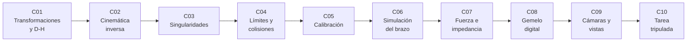

# B101 — Manipuladores robóticos espaciales

> **Bloque nuevo de la estructura `0.2.0`.** Sus 10 clases estaban programadas por la ampliación y ahora están redactadas. Ver el [programa completo](../../PROGRAMA_ACADEMICO_COMPLETO.md).

**Programa:** Programa Integral de Astronomía, Astrofísica, Ciencias Espaciales e Ingeniería Aeroespacial
**Área:** A08 — Operaciones de misión y robótica espacial
**Nivel:** N3 (fundamentos disciplinares) · **Clases:** 10 · **Carga:** por calibrar con el uso
**Estado:** guía pedagógica del bloque (resumen de qué se aprende en cada clase). Las clases enlazadas en la tabla ya están redactadas; todas conservan el estado E0 en el catálogo hasta registrar revisión disciplinar.

## 🎯 Propósito del bloque

Enseña **cómo se describe, se mueve, se limita, se calibra y se opera un brazo robótico espacial**. Parte de la transformación homogénea y de la parametrización de Denavit-Hartenberg, resuelve la cinemática inversa (con redundancia), analiza las singularidades y la manipulabilidad, impone los límites articulares y la evitación de colisiones, identifica los parámetros cinemáticos reales a partir de mediciones y simula la dinámica de un brazo en microgravedad. Después añade el contacto (control de fuerza e impedancia), un gemelo digital para ensayar reparaciones y, desde el lado del operador, las cámaras y los puntos ciegos y una tarea tripulada de captura. Cada clase cierra con un laboratorio en Python con semilla fija, datos **sintéticos** rotulados y comprobaciones automáticas contra una vía de cálculo independiente.

## 📚 Al terminar el bloque podrás

1. Construir la cadena de transformaciones homogéneas de un brazo con parámetros Denavit-Hartenberg y verificar su posición final.
2. Resolver la cinemática inversa de forma analítica y numérica, y aprovechar la redundancia de un brazo de 7 articulaciones.
3. Calcular el jacobiano, la manipulabilidad y la cercanía a una singularidad, y amortiguarla.
4. Estimar el espacio de trabajo, respetar límites articulares y comprobar colisiones entre eslabones.
5. Identificar errores de parámetros cinemáticos por mínimos cuadrados a partir de mediciones sintéticas.
6. Integrar la dinámica de un brazo con base libre y comprobar la conservación de la cantidad de movimiento.
7. Diseñar un control de impedancia y simular un contacto con un componente.
8. Ensayar una reparación en un gemelo digital y comparar el modelo con una «realidad» sintética.
9. Calcular campos de visión y puntos ciegos de cámaras y simular una captura con un operador humano.
10. Rotular qué es dato consultado, qué es modelo y qué es sintético en cada resultado.

## 🧭 Secuencia del bloque

**Descripción textual.** Diez clases encadenadas: la descripción geométrica (C01), el problema inverso (C02), la pérdida de movilidad (C03), las restricciones (C04), la identificación de parámetros (C05), la simulación dinámica (C06), el contacto (C07), el gemelo digital (C08) y las dos clases del operador: la vista (C09) y la tarea completa (C10).

## 🗂️ Las 10 clases en resumen

**Navegación:** cada clase enlaza a la anterior, a la siguiente y a este bloque.

La columna «Evidencia» indica el producto que demostrará el aprendizaje. Los laboratorios usan datos **sintéticos** (rotulados); los datos de brazos reales proceden de fuentes con fecha o no se consultaron.

### Tramo 1 · Cinemática del brazo

| ID | Clase | Qué se aprende | Evidencia |
|---|---|---|---|
| [B101-C01](../clases/B101/B101-C01-transformaciones-homogeneas-y-parametrizacion-de-eslabones-denavit-hartenberg/CLASE.md) | Transformaciones homogéneas y parametrización de eslabones (Denavit-Hartenberg) | Matriz 4×4, tabla D-H y cinemática directa de un brazo de 7 articulaciones. | Tabla D-H y posición del extremo |
| [B101-C02](../clases/B101/B101-C02-cinematica-inversa-y-redundancia-de-manipuladores/CLASE.md) | Cinemática inversa y redundancia de manipuladores | Soluciones múltiples, Newton con pseudoinversa y espacio nulo. | Ficha de soluciones inversas |
| [B101-C03](../clases/B101/B101-C03-singularidades-y-manipulabilidad-de-brazos-roboticos/CLASE.md) | Singularidades y manipulabilidad de brazos robóticos | Jacobiano, SVD, índice de Yoshikawa y mínimos cuadrados amortiguados. | Mapa de manipulabilidad |

### Tramo 2 · Restricciones e identificación

| ID | Clase | Qué se aprende | Evidencia |
|---|---|---|---|
| [B101-C04](../clases/B101/B101-C04-limites-articulares-espacio-de-trabajo-y-evitacion-de-colisiones/CLASE.md) | Límites articulares, espacio de trabajo y evitación de colisiones | Espacio de trabajo por Monte Carlo, límites y distancia entre cápsulas. | Ficha de espacio de trabajo |
| [B101-C05](../clases/B101/B101-C05-calibracion-cinematica-de-manipuladores/CLASE.md) | Calibración cinemática de manipuladores | Identificación de parámetros por Gauss-Newton y covarianza. | Informe de calibración |

### Tramo 3 · Dinámica, contacto y gemelo digital

| ID | Clase | Qué se aprende | Evidencia |
|---|---|---|---|
| [B101-C06](../clases/B101/B101-C06-simulacion-de-un-brazo-robotico-espacial/CLASE.md) | Simulación de un brazo robótico espacial | Dinámica de un brazo planar con base libre y conservación del momento. | Registro de simulación |
| [B101-C07](../clases/B101/B101-C07-control-de-fuerza-e-impedancia-en-manipulacion/CLASE.md) | Control de fuerza e impedancia en manipulación | Masa-resorte-amortiguador deseado y fuerza de contacto. | Ficha de impedancia |
| [B101-C08](../clases/B101/B101-C08-gemelo-digital-para-ensayo-de-reparaciones-roboticas/CLASE.md) | Gemelo digital para ensayo de reparaciones robóticas | Modelo frente a «realidad» sintética, residuos y margen de la maniobra. | Informe de ensayo en el gemelo |

### Tramo 4 · El operador humano

| ID | Clase | Qué se aprende | Evidencia |
|---|---|---|---|
| [B101-C09](../clases/B101/B101-C09-coordinacion-visual-y-camaras-en-operaciones-con-manipulador/CLASE.md) | Coordinación visual y cámaras en operaciones con manipulador | Campo de visión, cobertura y puntos ciegos. | Mapa de cobertura |
| [B101-C10](../clases/B101/B101-C10-simulacion-de-una-tarea-tripulada-con-manipulador/CLASE.md) | Simulación de una tarea tripulada con manipulador | Captura con retardo, ley de Fitts y carga del operador. | Informe de la tarea simulada |

## 🧵 Hilos que atraviesan el bloque

- **Un solo brazo de 7 articulaciones sintético**, definido en C01 y reutilizado, con la misma tabla D-H, hasta C05. Es un modelo didáctico, no el de un brazo real.
- **Cada resultado se verifica por otra vía:** posición por rotaciones elementales, Jacobiano por diferencias finitas, energía y momento en la dinámica.
- **Unidades y marcos explícitos:** metros, radianes, newton; marco de la base `{0}` y marco del extremo `{E}`.
- **Observado frente a modelado:** ningún número es una medición de un brazo real.

## 📝 Evaluación del bloque (propuesta, por calibrar)

- Fichas y ejercicios por clase, con retroalimentación y recuperación con evidencia distinta.
- Portafolio: el informe de calibración (C05) y el informe de la tarea simulada (C10).
- Las condiciones críticas (rotular lo sintético, verificar con una comprobación independiente y citar solo lo consultado) no se compensan con promedio.

## ⚠️ Seguridad y límites

El bloque es educativo. Los modelos son simplificados (cuerpos rígidos, sin holguras ni flexibilidad, sin modelo de motor ni de fricción) y no sustituyen la ingeniería de un brazo real ni los procedimientos de operación. Las cifras de brazos reales (ERA, Canadarm2) proceden de las fuentes citadas o no se consultaron. Ninguna clase enseña a operar hardware real.

## 📖 Fuentes consultadas en el bloque (resumen)

Consultadas el 2026-11-10: el comunicado de Airbus (5-07-2021) sobre el European Robotic Arm (11,3 m, siete articulaciones, 5 mm de precisión, 3 000 kg de forma rutinaria y hasta 8 000 kg en modo lento); el resumen del artículo de Razvi y Burns (NASA JSC, 2007) sobre la evolución del manipulador de la estación (diseño de 7 grados de libertad); y el listado de normas activas de ECSS (ECSS-E-ST-33-01C Rev.2 *Mechanisms*, ECSS-E-ST-10-11C *Human factors engineering*, ECSS-E-ST-10-09C *Reference coordinate system*), de las que solo se consultaron títulos y fechas. Las matemáticas (D-H, jacobiano, pseudoinversa, mínimos cuadrados, impedancia) son relaciones estándar de los textos de robótica que cada laboratorio verifica y no se consultaron en un libro concreto. Los datos de longitud y masa de Canadarm2 no se consultaron en una página fuente.

## Fuentes de orientación preliminar

- **[NASA-NTRS]** [NASA Technical Reports Server](https://ntrs.nasa.gov/) — Informes técnicos de la NASA.
- **[ESA-ROBOTICS]** [ESA Automation and Robotics](https://www.esa.int/Enabling_Support/Space_Engineering_Technology/Automation_and_Robotics) — Robótica espacial de la ESA.
- **[ECSS]** [European Cooperation for Space Standardization](https://ecss.nl/) — Normas de ingeniería espacial.
- **[CSA-ISS]** [Canadian Space Agency](https://www.asc-csa.gc.ca/) — Robótica de la Estación Espacial Internacional.

> La asociación de estas fuentes es orientativa por bloque. Las fuentes realmente consultadas para cada afirmación se registran en la sección 11 de cada clase.

## Roles que lo usan

- [Robótica espacial y sistemas autónomos](../../rutas/robotica-espacial-y-sistemas-autonomos.md)
- [Astronáutica tripulada y entrenamiento de astronautas](../../rutas/astronautica-tripulada-y-entrenamiento-de-astronautas.md)

[🏠 Volver al programa](../../README.md) · [⬅️ B100 — Logística y cadena de suministro extraterrestre](./B100-logistica-y-cadena-de-suministro-extraterrestre.md) · [➡️ B102 — Movilidad de robots planetarios](./B102-movilidad-de-robots-planetarios.md)
