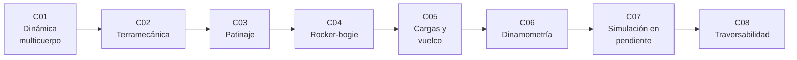

# B102 — Movilidad de robots planetarios

> **Bloque nuevo de la estructura `0.2.0`.** Sus 8 clases estaban programadas por la ampliación y ahora están redactadas. Ver el [programa completo](../../PROGRAMA_ACADEMICO_COMPLETO.md).

**Programa:** Programa Integral de Astronomía, Astrofísica, Ciencias Espaciales e Ingeniería Aeroespacial
**Área:** A08 — Operaciones de misión y robótica espacial
**Nivel:** N3 (fundamentos disciplinares) · **Clases:** 8 · **Carga:** por calibrar con el uso
**Estado:** guía pedagógica del bloque (resumen de qué se aprende en cada clase). Las clases enlazadas en la tabla ya están redactadas; todas conservan el estado E0 en el catálogo hasta registrar revisión disciplinar.

## 🎯 Propósito del bloque

Enseña **cómo se mueve un robot sobre la superficie de otro mundo y cómo se decide por dónde puede ir**. Parte de la dinámica de cuerpos articulados, pasa a la interacción rueda-suelo (terramecánica) y al deslizamiento que la acompaña, estudia la suspensión rocker-bogie y el reparto de cargas que evita el vuelco, mide las fuerzas de tracción con un banco, simula el avance sobre una pendiente y termina convirtiendo pendiente, rugosidad y rocas en un mapa de riesgo de navegación. Cada clase cierra con un laboratorio en Python con semilla fija; la gravedad de Marte y de la Luna procede de fichas consultadas y todo lo demás (suelos, rover, terreno) es **sintético o ilustrativo** y está rotulado.

## 📚 Al terminar el bloque podrás

1. Formular la dinámica de un manipulador de dos eslabones con su matriz de masa y comprobar la conservación de la energía.
2. Calcular el hundimiento, el empuje y la tracción de barra de una rueda rígida sobre suelo suelto con el modelo de Bekker y Mohr–Coulomb.
3. Estimar el patinaje de una rueda a partir de odometría y de una referencia independiente, y corregir la distancia recorrida.
4. Repartir la carga en una suspensión rocker-bogie y obtener la altura de escalón que una rueda puede superar.
5. Calcular los márgenes de vuelco longitudinal y lateral y la transferencia de carga entre ruedas en pendiente.
6. Calibrar una celda de carga y expresar la incertidumbre de una fuerza de tracción.
7. Simular el avance de un rover en pendiente y hallar la pendiente máxima alcanzable.
8. Convertir un modelo de terreno sintético en un mapa de riesgo y una ruta de mínimo coste.
9. Rotular qué es observado, qué es ley consultada y qué es ilustrativo en cada resultado.

## 🧭 Secuencia del bloque

**Descripción textual.** Ocho clases encadenadas: la dinámica de cuerpos articulados (C01), la interacción rueda-suelo (C02), el deslizamiento y su estimación (C03), la suspensión (C04), el reparto de cargas y la estabilidad (C05), la medición de fuerzas de tracción (C06), la simulación del avance sobre pendientes (C07) y el riesgo de terreno que decide la ruta (C08). El hilo común es el equilibrio entre tracción disponible y resistencia, y cómo cambia con la gravedad.

## 🗂️ Las 8 clases en resumen

**Navegación:** cada clase enlaza a la anterior, a la siguiente y a este bloque.

La columna «Evidencia» indica el producto que demostrará el aprendizaje. Los laboratorios usan datos **sintéticos** o **ilustrativos** (rotulados) o valores publicados con fuente y fecha.

### Tramo 1 · Mecánica del vehículo y del suelo

| ID | Clase | Qué se aprende | Evidencia |
|---|---|---|---|
| [B102-C01](../clases/B102/B102-C01-dinamica-multicuerpo-de-rovers-y-manipuladores/CLASE.md) | Dinámica multicuerpo de rovers y manipuladores | Ecuaciones de Lagrange de un brazo de dos eslabones, par de gravedad y energía. | Ficha dinámica de un brazo en Tierra y Marte |
| [B102-C02](../clases/B102/B102-C02-terramecanica-traccion-y-hundimiento-en-suelos-sueltos/CLASE.md) | Terramecánica: tracción y hundimiento en suelos sueltos | Presión-hundimiento de Bekker, cizalladura de Mohr–Coulomb y tracción de barra. | Curva de tracción de barra frente al patinaje |
| [B102-C03](../clases/B102/B102-C03-deslizamiento-y-estimacion-de-patinaje/CLASE.md) | Deslizamiento y estimación de patinaje | Patinaje desde odometría y referencia, filtro y corrección de distancia. | Informe de patinaje con su incertidumbre |

### Tramo 2 · Suspensión, cargas y medición

| ID | Clase | Qué se aprende | Evidencia |
|---|---|---|---|
| [B102-C04](../clases/B102/B102-C04-suspension-rocker-bogie-y-mecanica-de-rovers/CLASE.md) | Suspensión rocker-bogie y mecánica de rovers | Estática del rocker-bogie, reparto de carga y escalón máximo. | Ficha de suspensión con cargas por rueda |
| [B102-C05](../clases/B102/B102-C05-distribucion-de-cargas-y-estabilidad-ante-vuelco/CLASE.md) | Distribución de cargas y estabilidad ante vuelco | Ángulos de vuelco, transferencia de carga y margen en pendiente. | Tabla de márgenes de estabilidad |
| [B102-C06](../clases/B102/B102-C06-dinamometria-y-medicion-de-fuerzas-de-traccion/CLASE.md) | Dinamometría y medición de fuerzas de tracción | Calibración de celda de carga, ajuste lineal e incertidumbre expandida. | Certificado de calibración sintético |

### Tramo 3 · Simular y decidir

| ID | Clase | Qué se aprende | Evidencia |
|---|---|---|---|
| [B102-C07](../clases/B102/B102-C07-simulacion-de-movilidad-sobre-pendientes-y-terreno/CLASE.md) | Simulación de movilidad sobre pendientes y terreno | Dinámica longitudinal con tracción dependiente del patinaje y pendiente máxima. | Curva de pendiente alcanzable en Marte y la Luna |
| [B102-C08](../clases/B102/B102-C08-traversabilidad-y-evaluacion-de-riesgo-de-terreno/CLASE.md) | Traversabilidad y evaluación de riesgo de terreno | Pendiente, rugosidad y rocas en un coste y una ruta de mínimo riesgo. | Mapa de riesgo y ruta sobre un terreno sintético |

## 🧵 Hilos que atraviesan el bloque

- **Gravedad:** las cargas escalan con `g` (C01, C04, C05); las razones de tracción y los ángulos de vuelco, no (C05, C07).
- **Tracción frente a resistencia:** C02, C03 y C07 son tres vistas del mismo balance.
- **Del modelo a la medición:** C06 enseña a medir lo que C02 y C07 modelan.
- **Observado frente a modelado:** todo número del bloque es un modelo con datos sintéticos o ilustrativos; ninguno es una medición de un rover.
- **Verificación independiente:** cada laboratorio contrasta con un caso analítico o con otra vía de cálculo.

## 📝 Evaluación del bloque (propuesta, por calibrar)

- Fichas y ejercicios por clase, con retroalimentación y recuperación con evidencia distinta.
- Portafolio: el mapa de riesgo y la ruta (C08) con sus umbrales y su sensibilidad.
- Las condiciones críticas (rotular lo ilustrativo y sintético, no presentar un modelo como observación y citar solo lo consultado) no se compensan con promedio.

## ⚠️ Seguridad y límites

El bloque es educativo. Los modelos son simplificaciones (rueda rígida, suelo homogéneo, planar, estática o cuasiestática) y no sustituyen al análisis de un rover real ni a los procedimientos de operación de una misión. Los parámetros de suelo, rover, celda de carga y terreno son ilustrativos. La ley de Bekker, Mohr–Coulomb y la fórmula de Lagrange son relaciones estándar que verifica cada laboratorio y no se consultaron en una fuente concreta.

## 📖 Fuentes consultadas en el bloque (resumen)

Consultadas el 2026-11-10: las fichas de la NASA/NSSDC de Marte (gravedad media 3,73 m/s²) y de la Luna (1,62 m/s²), la página «Rover Components» de la misión Mars 2020 Perseverance en science.nasa.gov (rocker-bogie, seis ruedas de 52,5 cm, masa 1025 kg, diseño para 45° de inclinación y evitación de más de 30°) y las constantes del NIST (CODATA 2022: `gₙ` = 9,806 65 m/s²). Una presentación de JPL sobre ruedas de MER/MSL se intentó consultar y no pudo leerse (archivo demasiado grande), por lo que no se usa. Los libros y artículos de terramecánica (Bekker, Wong, Janosi y Hanamoto) no se consultaron.

## Fuentes de orientación preliminar

- **[NASA-JPL]** [NASA Jet Propulsion Laboratory](https://www.jpl.nasa.gov/) — Misiones y robótica planetaria.
- **[ECSS]** [European Cooperation for Space Standardization](https://ecss.nl/) — Estándares de ingeniería espacial.
- **[NASA-NTRS]** [NASA Technical Reports Server](https://ntrs.nasa.gov/) — Informes técnicos de la NASA.
- **[NIST]** [NIST](https://www.nist.gov/) — Metrología y constantes físicas.

> La asociación de estas fuentes es orientativa por bloque. Las fuentes realmente consultadas para cada afirmación se registran en la sección 11 de cada clase.

## Roles que lo usan

- [Robótica espacial y sistemas autónomos](../../rutas/robotica-espacial-y-sistemas-autonomos.md)

[🏠 Volver al programa](../../README.md) · [➡️ B103 — Percepción visual robótica](./B103-percepcion-visual-robotica.md)
