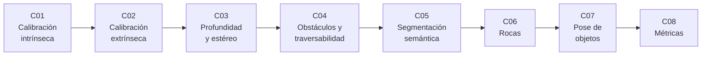

# B103 — Percepción visual robótica

> **Bloque nuevo de la estructura vigente.** Sus 8 clases estaban programadas por la ampliación y ahora están redactadas. Ver el [programa completo](../../PROGRAMA_ACADEMICO_COMPLETO.md).

**Programa:** Programa Integral de Astronomía, Astrofísica, Ciencias Espaciales e Ingeniería Aeroespacial
**Área:** A08 — Operaciones de misión y robótica espacial
**Nivel:** N3 (fundamentos disciplinares) · **Clases:** 8 · **Carga:** por calibrar con el uso
**Estado:** guía pedagógica del bloque (resumen de qué se aprende en cada clase). Las clases enlazadas en las tablas ya están redactadas; todas conservan el estado E0 en el catálogo hasta registrar revisión disciplinar.

## 🎯 Propósito del bloque

Enseña **cómo un robot que explora una superficie planetaria convierte píxeles en decisiones de movimiento**, y cuánta confianza merece cada número que sale de ese proceso. Recorre el modelo geométrico de una cámara y su calibración, la pose entre sensores, el cálculo de profundidad por estéreo con su error, la construcción de mapas de traversabilidad, la segmentación semántica de superficies, la detección y catalogación de rocas, la estimación de la pose de un objeto y las métricas con las que se valida todo lo anterior. Cada clase cierra con un laboratorio en Python con semilla fija sobre **datos sintéticos rotulados**: el bloque no presenta ninguna salida simulada como si fuera una observación de una misión.

## 📚 Al terminar el bloque podrás

1. Calibrar de forma intrínseca una cámara con un patrón plano, estimar focal, punto principal y distorsión radial, y medir el error de reproyección.
2. Estimar la pose rígida entre dos sensores a partir de correspondencias y propagar su incertidumbre a un brazo de palanca dado.
3. Calcular un mapa de disparidad por correspondencia de bloques, convertirlo en profundidad y predecir su error con `Z²/(f B)`.
4. Construir un mapa de traversabilidad a partir de un modelo digital de elevación con ruido de estéreo y evaluar la tasa de falsos «seguro».
5. Entrenar un clasificador de píxeles sencillo, medir su IoU por clase y reconocer cuándo falla fuera de su dominio de entrenamiento.
6. Detectar rocas, convertir píxeles en tamaños físicos y ajustar una distribución tamaño-frecuencia con su incertidumbre.
7. Estimar la pose de un objeto con un modelo plano conocido y ver cómo crece el error con la distancia.
8. Elegir y calcular precisión, exhaustividad, IoU, AP y errores de profundidad, y reportarlos con intervalos de confianza.
9. Rotular qué es dato sintético, qué es valor consultado y qué es ilustrativo en cada resultado de percepción.

## 🧭 Secuencia del bloque

**Descripción textual.** Ocho clases encadenadas: el modelo de cámara (C01) y la pose entre sensores (C02) sostienen la profundidad por estéreo (C03); de la profundidad sale el mapa de traversabilidad (C04); la segmentación (C05) y la detección de rocas (C06) añaden significado a la imagen; la pose de objetos (C07) apunta a un blanco concreto; y las métricas (C08) cierran el ciclo midiendo la calidad de todo lo anterior. El hilo común es la propagación del error de píxeles a metros.

## 🗂️ Las 8 clases en resumen

**Navegación:** cada clase enlaza a la anterior, a la siguiente y a este bloque.

La columna «Evidencia» indica el producto que demostrará el aprendizaje. Los laboratorios usan datos **sintéticos** (rotulados) y, cuando aparece un valor publicado, con fuente y fecha.

### Tramo 1 · Geometría de sensores

| ID | Clase | Qué se aprende | Evidencia |
|---|---|---|---|
| [B103-C01](../clases/B103/B103-C01-calibracion-intrinseca-de-camaras/CLASE.md) | Calibración intrínseca de cámaras | Modelo estenopeico con distorsión radial, calibración plana por homografías y error de reproyección. | Ficha de calibración con su error de reproyección |
| [B103-C02](../clases/B103/B103-C02-calibracion-extrinseca-y-registro-multisensor/CLASE.md) | Calibración extrínseca y registro multisensor | Pose rígida por SVD (Kabsch), error de rotación y de traslación y su efecto a distancia. | Ficha de registro con presupuesto de error |

### Tramo 2 · De la imagen al terreno

| ID | Clase | Qué se aprende | Evidencia |
|---|---|---|---|
| [B103-C03](../clases/B103/B103-C03-mapas-de-profundidad-y-correspondencia-estereo/CLASE.md) | Mapas de profundidad y correspondencia estéreo | Disparidad por bloques, profundidad `Z = f B/d` y error `Z²σ_d/(f B)`. | Mapa de profundidad con error por rango |
| [B103-C04](../clases/B103/B103-C04-deteccion-de-obstaculos-y-mapas-de-traversabilidad/CLASE.md) | Detección de obstáculos y mapas de traversabilidad | Pendiente, rugosidad y escalón sobre una ventana del tamaño del vehículo; falsos «seguro». | Mapa de traversabilidad con matriz de confusión |

### Tramo 3 · Significado y objetivos

| ID | Clase | Qué se aprende | Evidencia |
|---|---|---|---|
| [B103-C05](../clases/B103/B103-C05-segmentacion-semantica-de-superficies-planetarias/CLASE.md) | Segmentación semántica de superficies planetarias | Clasificador de píxeles con regresión softmax, IoU por clase y fallo fuera de dominio. | Informe de IoU por clase en dos dominios |
| [B103-C06](../clases/B103/B103-C06-deteccion-y-catalogacion-de-rocas-en-imagenes-de-superficie/CLASE.md) | Detección y catalogación de rocas en imágenes de superficie | Umbralización, componentes conexos, tamaño físico y ajuste de la distribución tamaño-frecuencia. | Catálogo de rocas con exponente e incertidumbre |
| [B103-C07](../clases/B103/B103-C07-estimacion-de-pose-de-objetos-y-objetivos-por-vision/CLASE.md) | Estimación de pose de objetos y objetivos por visión | Pose con modelo plano (homografía y refinamiento), error frente a la distancia. | Ficha de pose con error por distancia |

### Tramo 4 · Validar

| ID | Clase | Qué se aprende | Evidencia |
|---|---|---|---|
| [B103-C08](../clases/B103/B103-C08-metricas-de-evaluacion-de-percepcion/CLASE.md) | Métricas de evaluación de percepción | Precisión, exhaustividad, IoU, AP, error de profundidad e intervalos por remuestreo. | Informe de métricas con intervalos de confianza |

## 🧵 Hilos que atraviesan el bloque

- **De píxeles a metros:** el error de 0,3 px de C01 y C03 se convierte en error métrico en C02, C03 y C07.
- **El rango manda:** el error de profundidad crece con `Z²` (C03) y la pose se degrada con la distancia (C07).
- **Sintético frente a observado:** toda imagen y todo mapa del bloque es sintético y se rotula así; ningún resultado equivale a validación con datos de misión.
- **Medir con una vara independiente:** cada laboratorio compara con la verdad conocida del generador o con una segunda vía de cálculo (C08 sistematiza esto).

## 📝 Evaluación del bloque (propuesta, por calibrar)

- Fichas y ejercicios por clase, con retroalimentación y recuperación con evidencia distinta.
- Portafolio: la ficha de métricas (C08) aplicada al mapa de profundidad (C03) o a la segmentación (C05), con sus supuestos y su incertidumbre.
- Las condiciones críticas (rotular lo sintético, no presentar un resultado simulado como observado y citar solo lo consultado) no se compensan con promedio.

## ⚠️ Seguridad y límites

El bloque es educativo. Los algoritmos son versiones mínimas sobre imágenes sintéticas y no sustituyen a las cadenas de percepción de una misión ni a su calificación de vuelo. Un error de percepción puede llevar a un vehículo a una zona peligrosa: las decisiones reales exigen validación con datos de misión, márgenes y verificación independiente. Cámaras de misión reales solo se citan con lo consultado (la ficha de rover de la NASA); sus especificaciones detalladas no se consultaron.

## 📖 Fuentes consultadas en el bloque (resumen)

Consultadas el 2026-11-10: la página de la publicación de Zhang (Microsoft Research) sobre calibración con un patrón plano (resumen), el resumen y la introducción de Scharstein y Szeliski sobre estéreo denso (PDF, con PyMuPDF), la página del grupo CVLab (EPFL) sobre EPnP, la página de componentes del rover Perseverance de la NASA (Navcam y Hazcam) y un listado de PubMed que confirma la existencia del artículo de Maki et al. sobre las cámaras de ingeniería de Mars 2020 (solo el título; el artículo no se consultó). La documentación de OpenCV y el sitio de PASCAL VOC devolvieron error y **no se consultaron**. Las relaciones estándar (proyección estenopeica, Kabsch, propagación de error, IoU, AP) las verifica cada laboratorio y no se consultaron en una fuente concreta.

## Fuentes de orientación preliminar

- **[NASA-PDS]** [NASA Planetary Data System](https://pds.nasa.gov/) — Archivo de datos de misiones planetarias.
- **[ESA-SCIENCE]** [European Space Agency Science](https://www.esa.int/Science_Exploration/Space_Science) — Misiones, descubrimientos y material científico institucional.
- **[ADS]** [NASA Astrophysics Data System](https://ui.adsabs.harvard.edu/) — Índice bibliográfico de literatura astronómica y física.

> La asociación de estas fuentes es orientativa por bloque. Las fuentes realmente consultadas para cada afirmación se registran en la sección 11 de cada clase.

## Roles que lo usan

- [Robótica espacial y sistemas autónomos](../../rutas/robotica-espacial-y-sistemas-autonomos.md)

[🏠 Volver al programa](../../README.md) · [➡️ B104 — Astronáutica y preparación de astronautas](./B104-astronautica-y-preparacion-de-astronautas.md)
