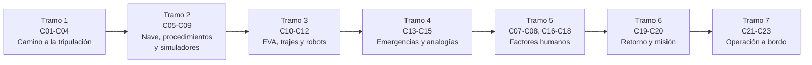

# B104 — Astronáutica y preparación de astronautas

> **Bloque ampliado (`0.2.0`).** Tiene 23 clases: las 20 de la línea base y 3 programadas por la ampliación (`B104-C21` a `B104-C23`), todas ya redactadas. Ver el [programa completo](../../PROGRAMA_ACADEMICO_COMPLETO.md).

**Programa:** Programa Integral de Astronomía, Astrofísica, Ciencias Espaciales e Ingeniería Aeroespacial
**Área:** A09 — Astronáutica humana, medicina y hábitats
**Nivel:** N3 (fundamentos disciplinares) · **Clases:** 23 · **Carga:** por calibrar con el uso
**Estado:** guía pedagógica del bloque (resumen de qué se aprende en cada clase). Las clases enlazadas en las tablas están redactadas; todas conservan el estado E0 en el catálogo hasta registrar revisión disciplinar.

## 🎯 Propósito del bloque

Enseña **cómo se prepara a las personas y a la nave para que un vuelo tripulado salga bien**, y cuánta confianza merece cada número con que se justifica esa preparación. Recorre la historia de los vuelos tripulados, los requisitos y la selección de la tripulación, el acondicionamiento físico, los sistemas de la nave, el entrenamiento (procedimientos, simuladores, analogías subacuáticas, supervivencia), los factores humanos (liderazgo, comunicación, conflictos, fatiga, aislamiento), las actividades extravehiculares y los trajes, la robótica operada por personas, las emergencias, el retorno y la misión simulada, y añade tres clases de operación a bordo: inventario y estiba, listas de comprobación y ejecución de experimentos. Cada clase cierra con un laboratorio en Python con semilla fija sobre **modelos y datos sintéticos rotulados**: el bloque no presenta ninguna simulación como si fuera una observación ni un dato de misión.

## 📚 Al terminar el bloque podrás

1. Contrastar el vuelo tripulado con relaciones físicas simples (periodo orbital, retardo de luz, presión) y distinguir lo consultado de lo ilustrativo.
2. Dimensionar consumibles de una tripulación y razonar sobre un embudo de selección y sus errores de clasificación.
3. Modelar carga de entrenamiento, aprendizaje y olvido de procedimientos, y la transferencia desde un simulador.
4. Estimar cómo la comunicación, el liderazgo y las listas de comprobación cambian la probabilidad de detectar un error.
5. Calcular un presupuesto de oxígeno de una actividad extravehicular y un tiempo de preoxigenación con un modelo de tejido, sin tomarlos como pautas operativas.
6. Cuantificar el efecto de un retardo de comunicación en la teleoperación y el efecto del agua en un entrenamiento de flotabilidad neutra.
7. Estimar el tiempo de despresurización por una fuga y la carga de desaceleración en un reingreso balístico.
8. Simular fatiga con un modelo de dos procesos, detectar el deterioro del ánimo con una carta CUSUM y evaluar estrategias ante un conflicto.
9. Gestionar inventario y estiba, asignar horas de tripulación a experimentos y llevar un registro íntegro.
10. Rotular qué es dato sintético, qué es valor consultado y qué es modelo ilustrativo en cada resultado.

## 🧭 Secuencia del bloque

**Descripción textual.** Siete tramos: quién vuela y cómo se elige (C01–C04); qué es la nave y cómo se entrena su uso (C05, C06, C09, C22); el trabajo fuera de la nave (C10–C12); emergencias y supervivencia (C13–C15); los factores humanos (C07, C08, C16–C18); el retorno y la misión simulada que integra lo anterior (C19, C20); y la operación diaria a bordo (C21–C23). Las clases se leen en orden de ID; las tablas agrupan por tema.

## 🗂️ Las 23 clases en resumen

**Navegación:** cada clase enlaza a la anterior, a la siguiente y a este bloque.

La columna «Evidencia» indica el producto que demostrará el aprendizaje. Los laboratorios usan modelos **sintéticos** (rotulados) y, cuando aparece un valor publicado, con fuente y fecha.

### Tramo 1 · El camino a la tripulación

| ID | Clase | Qué se aprende | Evidencia |
|---|---|---|---|
| [B104-C01](../clases/B104/B104-C01-historia-de-vuelos-tripulados/CLASE.md) | Historia de vuelos tripulados | Cómo leer una cronología con la física orbital: periodo de Kepler, vueltas por día y qué dato es consultado. | Ficha de cronología con periodos calculados |
| [B104-C02](../clases/B104/B104-C02-requisitos-de-tripulacion/CLASE.md) | Requisitos de tripulación | Requisitos como cadena trazable y dimensionado lineal de consumibles por tripulante y día. | Matriz de requisitos con consumibles |
| [B104-C03](../clases/B104/B104-C03-seleccion-y-aptitud/CLASE.md) | Selección y aptitud | Embudo de selección, umbral de corte, precisión y tasa base. | Informe de embudo con errores de clasificación |
| [B104-C04](../clases/B104/B104-C04-acondicionamiento-fisico-general/CLASE.md) | Acondicionamiento físico general | Carga de entrenamiento y modelo de aptitud–fatiga de Banister. | Plan de 12 semanas con curvas de carga |

### Tramo 2 · La nave, los procedimientos y los simuladores

| ID | Clase | Qué se aprende | Evidencia |
|---|---|---|---|
| [B104-C05](../clases/B104/B104-C05-sistemas-de-vehiculos-tripulados/CLASE.md) | Sistemas de vehículos tripulados | Atmósfera de cabina, presión parcial de oxígeno y pérdida por fuga. | Balance de atmósfera de cabina |
| [B104-C06](../clases/B104/B104-C06-entrenamiento-de-procedimientos/CLASE.md) | Entrenamiento de procedimientos | Curva de aprendizaje potencial, curva de olvido y calendario de repaso. | Plan de repaso con tiempos esperados |
| [B104-C09](../clases/B104/B104-C09-entrenamiento-en-simuladores/CLASE.md) | Entrenamiento en simuladores | Razón de efectividad de transferencia y punto de equilibrio de costos. | Ficha de transferencia de un simulador |
| [B104-C22](../clases/B104/B104-C22-diseno-y-uso-de-listas-de-comprobacion-de-cabina/CLASE.md) | Diseño y uso de listas de comprobación de cabina | Probabilidad de omisión con y sin verificación y costo en tiempo. | Evaluación comparada de formatos de lista |

### Tramo 3 · Fuera de la nave

| ID | Clase | Qué se aprende | Evidencia |
|---|---|---|---|
| [B104-C10](../clases/B104/B104-C10-actividades-extravehiculares-eva/CLASE.md) | Actividades extravehiculares EVA | Presupuesto de oxígeno con perfil metabólico y margen. | Presupuesto de consumibles de una EVA |
| [B104-C11](../clases/B104/B104-C11-trajes-espaciales/CLASE.md) | Trajes espaciales | Presión del traje y modelo de tejido de Haldane para la preoxigenación. | Curva de nitrógeno en tejido |
| [B104-C12](../clases/B104/B104-C12-robotica-tripulada/CLASE.md) | Robótica tripulada | Teleoperación con retardo: mover y esperar frente a autonomía supervisada. | Tabla de tiempos por retardo |

### Tramo 4 · Emergencias y analogías

| ID | Clase | Qué se aprende | Evidencia |
|---|---|---|---|
| [B104-C13](../clases/B104/B104-C13-procedimientos-de-emergencia/CLASE.md) | Procedimientos de emergencia | Despresurización por un orificio y margen de tiempo de respuesta. | Tabla de tiempo disponible por tamaño de fuga |
| [B104-C14](../clases/B104/B104-C14-supervivencia-en-entorno-terrestre/CLASE.md) | Supervivencia en entorno terrestre | Dispersión de aterrizaje, tiempo de espera de rescate y suficiencia de provisiones. | Probabilidad de espera mayor que la autonomía |
| [B104-C15](../clases/B104/B104-C15-entrenamiento-subacuatico-como-analogia/CLASE.md) | Entrenamiento subacuático como analogía | Flotabilidad neutra, masa añadida y arrastre; qué reproduce y qué no. | Ficha de analogía con límites |

### Tramo 5 · Factores humanos

| ID | Clase | Qué se aprende | Evidencia |
|---|---|---|---|
| [B104-C07](../clases/B104/B104-C07-factores-de-liderazgo/CLASE.md) | Factores de liderazgo | Gradiente de autoridad y probabilidad de que un error sea señalado. | Curva de detección frente a gradiente |
| [B104-C08](../clases/B104/B104-C08-comunicacion-de-tripulacion/CLASE.md) | Comunicación de tripulación | Retardo de luz, canal con ruido y repetición de lectura. | Tabla de retardos y errores residuales |
| [B104-C16](../clases/B104/B104-C16-manejo-de-conflictos/CLASE.md) | Manejo de conflictos | Modelo ilustrativo de tensión y comparación de estrategias de resolución. | Comparación de estrategias de resolución |
| [B104-C17](../clases/B104/B104-C17-gestion-de-fatiga/CLASE.md) | Gestión de fatiga | Modelo de dos procesos (homeostático y circadiano) y deuda de sueño. | Curva de alerta con 8 h y 6 h de sueño |
| [B104-C18](../clases/B104/B104-C18-aislamiento-y-convivencia/CLASE.md) | Aislamiento y convivencia | Seguimiento del ánimo con carta CUSUM, alarmas falsas y demora de detección. | Informe de monitoreo con ARL |

### Tramo 6 · Retorno e integración

| ID | Clase | Qué se aprende | Evidencia |
|---|---|---|---|
| [B104-C19](../clases/B104/B104-C19-operaciones-de-retorno-y-reintegracion/CLASE.md) | Operaciones de retorno y reintegración | Desaceleración máxima de un reingreso balístico y ángulo de entrada. | Tabla de g máximos por ángulo |
| [B104-C20](../clases/B104/B104-C20-mision-tripulada-simulada/CLASE.md) | Misión tripulada simulada | Simulación Monte Carlo de una misión analógica que integra consumibles, fallas y tiempo. | Informe de misión simulada con margen |

### Tramo 7 · Operación a bordo (clases añadidas en la `0.2.0`)

| ID | Clase | Qué se aprende | Evidencia |
|---|---|---|---|
| [B104-C21](../clases/B104/B104-C21-inventario-logistica-y-estiba-a-bordo/CLASE.md) | Inventario, logística y estiba a bordo | Punto de reorden, inventario de consumibles y empaquetado en volumen. | Plan de inventario y estiba |
| [B104-C23](../clases/B104/B104-C23-ejecucion-de-experimentos-a-bordo-procedimientos-y-registro/CLASE.md) | Ejecución de experimentos a bordo: procedimientos y registro | Asignación de horas de tripulación por valor y registro encadenado con hash. | Plan de horas y registro íntegro |

## 🧵 Hilos que atraviesan el bloque

- **Modelo ilustrativo frente a evidencia:** casi todos los laboratorios son modelos simples; sirven para razonar sobre magnitudes y sensibilidades, no para predecir a una persona ni a una misión.
- **Los márgenes mandan:** consumibles, tiempo de respuesta, carga de tripulación y atmósfera se juzgan por su margen, no por el valor medio.
- **El error humano se diseña:** listas de comprobación, repetición de lectura, gradiente de autoridad y simuladores existen para detectar y corregir errores.
- **Distancia y retardo:** de la órbita baja a Marte, el retardo de luz cambia cómo se comunica, se teleopera y se decide.
- **Sintético frente a observado:** ningún resultado equivale a datos de una misión o de un astronauta reales.

## 📝 Evaluación del bloque (propuesta, por calibrar)

- Fichas y ejercicios por clase, con retroalimentación y recuperación con evidencia distinta.
- Portafolio: el informe de misión simulada (C20) con los márgenes de C05, C10, C13 y C21 y la lista de supuestos.
- Las condiciones críticas (rotular lo sintético, no dar consejo médico ni operativo y citar solo lo consultado) no se compensan con promedio.

## ⚠️ Seguridad y límites

El bloque es **educativo**. No da consejo médico, de entrenamiento físico individual, de buceo, de supervivencia ni operativo, y no sustituye a los requisitos, procedimientos, estándares médicos y calificación de las agencias espaciales. Los modelos (preoxigenación, fatiga, tensión, flujo por una fuga, reingreso) son versiones mínimas con parámetros ilustrativos: **no** son pautas para realizar una actividad ni para tratar a una persona. Los requisitos y cifras de NASA citados son los de las páginas consultadas en la fecha indicada y cambian en cada convocatoria.

## 📖 Fuentes consultadas en el bloque (resumen)

Consultadas el 2026-11-10 (páginas leídas con WebFetch): NASA, «Become an Astronaut» y «Astronaut Candidates»; NASA, «Neutral Buoyancy Laboratory»; NASA, «Space Station Spacewalks»; NASA, «Human Research Program» y su página de peligros; NASA Human Research Roadmap, riesgo de sueño, desincronización circadiana y sobrecarga de trabajo; ESA, «Mars500 study overview»; NASA History, SP-4225, «Training and Operations» (Shuttle–Mir); NTRS, Degani y Wiener, *Human factors of flight-deck checklists* (solo el resumen). El PDF de la ficha del EMU de NASA no pudo leerse como texto y **no se consultó**; la cifra de 4,3 psi aparece solo en un resultado de búsqueda y se rotula así. Las órbitas históricas de Vostok 1, el artículo de Borbély sobre el modelo de dos procesos, la fórmula de Allen–Eggers y las demás relaciones estándar las verifica cada laboratorio y **no se consultaron** en una fuente concreta.

## Fuentes de orientación preliminar

- **[NASA-HUMAN]** [NASA Human Research Program](https://www.nasa.gov/hrp/) — Factores humanos, medicina y riesgos de exploración tripulada.
- **[UNOOSA]** [United Nations Office for Outer Space Affairs](https://www.unoosa.org/) — Tratados, regulación e iniciativas de cooperación internacional.
- **[ITU]** [International Telecommunication Union](https://www.itu.int/) — Telecomunicaciones y coordinación del espectro internacional.
- **[NASA-SYSTEMS]** [NASA Systems Engineering Handbook](https://www.nasa.gov/reference/systems-engineering-handbook/) — Ingeniería de sistemas, verificación, validación y gestión técnica.

> La asociación de estas fuentes es orientativa por bloque. Las fuentes realmente consultadas para cada afirmación se registran en la sección 11 de cada clase.

## Roles que lo usan

- Ver el [programa completo](../../PROGRAMA_ACADEMICO_COMPLETO.md) (los roles se enlazan al final de la reorganización).

[🏠 Volver al programa](../../README.md) · [⬅️ B103 — Percepción visual robótica](./B103-percepcion-visual-robotica.md) · [➡️ B105 — Medicina y biología espacial](./B105-medicina-y-biologia-espacial.md)
