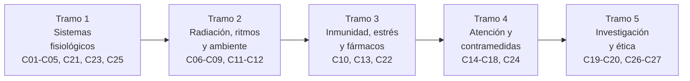

# B105 — Medicina y biología espacial

> **Bloque ampliado.** Sus 20 clases de la línea base y las 7 programadas por la ampliación (`B105-C21` a `B105-C27`) están redactadas. Ver el [programa completo](../../PROGRAMA_ACADEMICO_COMPLETO.md).

**Programa:** Programa Integral de Astronomía, Astrofísica, Ciencias Espaciales e Ingeniería Aeroespacial
**Área:** A09 — Astronáutica humana, medicina y hábitats
**Nivel:** N3 (fundamentos disciplinares) · **Clases:** 27 · **Carga:** por calibrar con el uso
**Estado:** guía pedagógica del bloque (resumen de qué se aprende en cada clase). Las clases enlazadas en las tablas ya están redactadas; todas conservan el estado E0 en el catálogo hasta registrar revisión disciplinar.

## 🎯 Propósito del bloque

Enseña **cómo responde el cuerpo humano a la microgravedad, la radiación y el aislamiento, y cómo se mide, se contrarresta y se investiga esa respuesta**, con números y con la incertidumbre de cada número. Recorre los sistemas fisiológicos (cardiovascular, óseo, muscular, vestibular, visual, respiratorio, térmico y sensoriomotor), la radiación y su dosimetría, los ritmos circadianos, la salud mental, la inmunidad, el microbioma, la nutrición y la farmacología, la atención de urgencia y la telemedicina, las contramedidas de ejercicio y la rehabilitación, la gravedad parcial y, al final, la investigación con personas: bioética, diseño de protocolos, biomarcadores e instrumentos validados. Cada clase cierra con un laboratorio en Python con semilla fija sobre **datos sintéticos rotulados** y cita solo lo realmente consultado.

## 📚 Al terminar el bloque podrás

1. Calcular con unidades los efectos físicos básicos de la microgravedad sobre fluidos, huesos, músculos y sentidos, y reconocer qué parte es modelo didáctico y qué parte es cifra publicada.
2. Distinguir dosis absorbida, equivalente y efectiva, y comparar un presupuesto de dosis con un límite declarado, con su incertidumbre.
3. Estimar la incertidumbre de un dosímetro, de un biomarcador y de una escala psicométrica.
4. Modelar ritmos, estrés, adaptación motora, farmacocinética y recuperación con ecuaciones sencillas y ajustarlas a datos sintéticos.
5. Calcular riesgos de misión (eventos de Poisson), retardos de luz y presupuestos de latencia para la atención remota.
6. Diseñar un protocolo simulado con tamaño de muestra y potencia coherentes con una tripulación pequeña.
7. Aplicar los principios del informe Belmont y reconocer el riesgo de reidentificación en cohortes pequeñas.
8. Rotular qué es dato sintético, qué es valor consultado y qué es ilustrativo; no dar nunca consejo médico ni operativo.

## 🧭 Secuencia del bloque

**Descripción textual.** Cinco tramos: primero se estudia qué le hace el entorno al cuerpo (sistemas fisiológicos), luego los agentes ambientales y los ritmos (radiación, luz, aislamiento, ambiente cerrado y nutrición), después la defensa, el estrés y los fármacos, a continuación cómo se atiende, se contrarresta y se rehabilita, y por último cómo se investiga todo esto con personas y con rigor. Las clases se numeran de C01 a C27; las programadas (C21 a C27) se intercalan por tema en los tramos y enlazan con su clase de origen.

## 🗂️ Las 27 clases en resumen

**Navegación:** cada clase enlaza a la anterior, a la siguiente y a este bloque.

La columna «Evidencia» indica el producto que demostrará el aprendizaje. Los laboratorios usan datos **sintéticos** (rotulados) y, cuando aparece un valor publicado, con fuente y fecha.

### Tramo 1 · Sistemas fisiológicos en microgravedad

| ID | Clase | Qué se aprende | Evidencia |
|---|---|---|---|
| [B105-C01](../clases/B105/B105-C01-respuesta-cardiovascular-a-microgravedad/CLASE.md) | Respuesta cardiovascular a microgravedad | Presión hidrostática `ρ g h`, desplazamiento de fluidos a la cabeza y su efecto en la presión arterial y la tolerancia ortostática. | Ficha de respuesta cardiovascular con presupuesto de presión |
| [B105-C02](../clases/B105/B105-C02-perdida-de-masa-osea/CLASE.md) | Pérdida de masa ósea | Modelo exponencial de la densidad mineral ósea con la tasa mensual publicada, y recuperación incompleta. | Ficha de pérdida ósea con intervalo por tasa |
| [B105-C03](../clases/B105/B105-C03-atrofia-muscular/CLASE.md) | Atrofia muscular | Sección transversal, fuerza proporcional al área y atrofia como balance de proteína. | Ficha de atrofia con balance proteico |
| [B105-C04](../clases/B105/B105-C04-sistema-vestibular/CLASE.md) | Sistema vestibular | Otolitos como acelerómetros, ambigüedad inclinación–traslación y canales semicirculares como filtro pasa-altos. | Ficha vestibular con la respuesta simulada |
| [B105-C05](../clases/B105/B105-C05-cambios-de-vision/CLASE.md) | Cambios de visión | Desplazamiento de fluidos, presión intracraneal y desplazamiento hipermetrópico con un ojo reducido. | Ficha de visión con el cambio en dioptrías |
| [B105-C21](../clases/B105/B105-C21-fisiologia-respiratoria-en-microgravedad-y-atmosferas-de-cabina/CLASE.md) | Fisiología respiratoria en microgravedad y atmósferas de cabina | Ecuación del gas alveolar, presión parcial de O₂ y CO₂ y atmósferas de cabina. | Ficha respiratoria con presiones parciales |
| [B105-C23](../clases/B105/B105-C23-termorregulacion-humana-en-vuelo/CLASE.md) | Termorregulación humana en vuelo | Balance de calor del cuerpo sin convección natural, sudoración y aumento de temperatura central. | Ficha térmica con el balance de calor |
| [B105-C25](../clases/B105/B105-C25-adaptacion-sensoriomotora-y-control-motor-en-microgravedad/CLASE.md) | Adaptación sensoriomotora y control motor en microgravedad | Modelo de adaptación de estado–espacio del control motor y sus constantes de aprendizaje. | Ficha de adaptación con las constantes ajustadas |

### Tramo 2 · Radiación, ritmos y ambiente cerrado

| ID | Clase | Qué se aprende | Evidencia |
|---|---|---|---|
| [B105-C06](../clases/B105/B105-C06-radiacion-ionizante-y-exposicion/CLASE.md) | Radiación ionizante y exposición | Magnitudes de dosis (Gy, Sv), dosis efectiva con factores de ponderación y comparación con un límite de carrera. | Ficha de exposición con presupuesto de dosis |
| [B105-C07](../clases/B105/B105-C07-dosimetria-personal/CLASE.md) | Dosimetría personal | Estadística de conteo, calibración, límite de detección e incertidumbre de un dosímetro personal. | Ficha de dosímetro con su incertidumbre |
| [B105-C08](../clases/B105/B105-C08-sueno-y-ritmos-circadianos/CLASE.md) | Sueño y ritmos circadianos | Oscilador circadiano con arrastre por luz y desfase en un hábitat con 16 amaneceres al día. | Ficha circadiana con el horario de luz |
| [B105-C09](../clases/B105/B105-C09-salud-mental-en-aislamiento/CLASE.md) | Salud mental en aislamiento | Series temporales de ánimo, detección de cambio y falsas alarmas en aislamiento. | Ficha de seguimiento con su tasa de falsas alarmas |
| [B105-C11](../clases/B105/B105-C11-microbioma-en-ambientes-cerrados/CLASE.md) | Microbioma en ambientes cerrados | Diversidad alfa y beta (Shannon, Bray–Curtis) en una comunidad cerrada sintética y rarefacción. | Ficha de microbioma con diversidad e incertidumbre |
| [B105-C12](../clases/B105/B105-C12-nutricion-espacial/CLASE.md) | Nutrición espacial | Gasto energético (Mifflin–St Jeor), balance energético, agua y masa de provisiones. | Ficha nutricional con balance y masa |

### Tramo 3 · Inmunidad, estrés y fármacos

| ID | Clase | Qué se aprende | Evidencia |
|---|---|---|---|
| [B105-C10](../clases/B105/B105-C10-respuesta-inmune/CLASE.md) | Respuesta inmune | Reactivación viral y muestreo: probabilidad de detectar un episodio según el intervalo de toma. | Ficha inmune con la probabilidad de detección |
| [B105-C13](../clases/B105/B105-C13-farmacologia-y-microgravedad/CLASE.md) | Farmacología y microgravedad | Farmacocinética de un compartimento con cambios de volumen y aclaramiento; AUC y semivida. | Ficha farmacocinética con escenarios |
| [B105-C22](../clases/B105/B105-C22-sistema-neuroendocrino-y-respuesta-al-estres-en-vuelo/CLASE.md) | Sistema neuroendocrino y respuesta al estrés en vuelo | Eje del estrés como sistema con retroalimentación: cortisol circadiano y respuesta a un estresor. | Ficha neuroendocrina con simulación |

### Tramo 4 · Atención, contramedidas y rehabilitación

| ID | Clase | Qué se aprende | Evidencia |
|---|---|---|---|
| [B105-C14](../clases/B105/B105-C14-atencion-de-urgencia-remota/CLASE.md) | Atención de urgencia remota | Eventos médicos como proceso de Poisson, riesgo de al menos un evento y consumo de recursos. | Ficha de riesgo médico de misión sintética |
| [B105-C15](../clases/B105/B105-C15-telemedicina-espacial/CLASE.md) | Telemedicina espacial | Retardo de luz, ancho de banda y presupuesto de latencia de una consulta remota. | Ficha de enlace con el presupuesto de latencia |
| [B105-C16](../clases/B105/B105-C16-contramedidas-de-ejercicio/CLASE.md) | Contramedidas de ejercicio | Energía del ejercicio (MET), carga mecánica y dosis–respuesta sintética de contramedidas. | Ficha de prescripción educativa con su balance |
| [B105-C17](../clases/B105/B105-C17-rehabilitacion-posterior-al-vuelo/CLASE.md) | Rehabilitación posterior al vuelo | Recuperación exponencial, ajuste log-lineal y tiempo hasta recuperar un porcentaje. | Ficha de rehabilitación con tiempos de recuperación |
| [B105-C18](../clases/B105/B105-C18-investigacion-de-efectos-de-gravedad-parcial/CLASE.md) | Investigación de efectos de gravedad parcial | Gravedad lunar y marciana, número de Froude, marcha y presión hidrostática en gravedad parcial. | Ficha de gravedad parcial con los casos Luna y Marte |
| [B105-C24](../clases/B105/B105-C24-indicadores-clinicos-y-biomarcadores-de-vuelo/CLASE.md) | Indicadores clínicos y biomarcadores de vuelo | Intervalos de referencia, línea base personal, valor de cambio de referencia y sensibilidad/especificidad. | Ficha de indicadores con umbrales |

### Tramo 5 · Investigación y ética

| ID | Clase | Qué se aprende | Evidencia |
|---|---|---|---|
| [B105-C19](../clases/B105/B105-C19-bioetica-en-investigacion-tripulada/CLASE.md) | Bioética en investigación tripulada | Principios del informe Belmont, cohortes pequeñas, riesgo de reidentificación y consentimiento. | Ficha ética con riesgo de reidentificación |
| [B105-C20](../clases/B105/B105-C20-diseno-de-protocolo-medico-simulado/CLASE.md) | Diseño de protocolo médico simulado | Potencia, tamaño del efecto y diseño pre/post con N pequeño en un protocolo simulado. | Protocolo médico simulado con potencia |
| [B105-C26](../clases/B105/B105-C26-medidas-fisiologicas-y-biomarcadores-en-investigacion-espacial/CLASE.md) | Medidas fisiológicas y biomarcadores en investigación espacial | Fiabilidad test–retest, error estándar de medida y cambio mínimo detectable. | Ficha de medidas con su MDC |
| [B105-C27](../clases/B105/B105-C27-instrumentos-validados-y-psicometria-en-investigacion/CLASE.md) | Instrumentos validados y psicometría en investigación | Alfa de Cronbach, análisis de ítems y validez de un instrumento psicométrico sintético. | Ficha psicométrica con alfa e intervalo |

## 🧵 Hilos que atraviesan el bloque

- **Un cuerpo, varios sistemas:** el desplazamiento de fluidos (C01) reaparece en la visión (C05), el sistema respiratorio (C21) y la tolerancia ortostática tras el vuelo (C17); la carga mecánica une hueso, músculo y ejercicio (C02, C03, C16).
- **Dosis y exposición:** la dosis efectiva (C06) se mide con un dosímetro con incertidumbre (C07); la misma lógica de medir con error vale para biomarcadores (C24, C26) y escalas (C27).
- **N pequeño:** una tripulación de 4 a 6 personas limita la estadística (C19, C20, C26): se usan líneas base personales y tamaños del efecto, no promedios de gran muestra.
- **Sintético frente a observado:** todo dato de los laboratorios es sintético y se rotula así; ningún resultado equivale a un dato de tripulantes reales.
- **Medir con una vara independiente:** cada laboratorio compara con la verdad conocida del generador o con una segunda vía de cálculo.

## 📝 Evaluación del bloque (propuesta, por calibrar)

- Fichas y ejercicios por clase, con retroalimentación y recuperación con evidencia distinta.
- Portafolio: el protocolo médico simulado (C20) con su potencia, su dimensión ética (C19) y la medida elegida con su MDC (C26).
- Las condiciones críticas (rotular lo sintético, no presentar un resultado simulado como observado, no dar consejo médico ni operativo y citar solo lo consultado) no se compensan con promedio.

## ⚠️ Seguridad y límites

Contenido **educativo**: no es consejo médico, no sustituye la formación, la licencia ni la supervisión de profesionales de la salud ni de la medicina aeroespacial, y no contiene dosis, tratamientos ni procedimientos para aplicar a una persona real. Los modelos son versiones mínimas sobre datos sintéticos; las cifras publicadas se citan con su fuente y su fecha y pueden haber cambiado de revisión. Cualquier decisión médica u operativa real corresponde a los profesionales y a las normas vigentes de la agencia o la misión.

## 📖 Fuentes consultadas en el bloque (resumen)

Consultadas el 2026-11-10: las páginas «Human body in space» y «Human Research Program» de la NASA (resúmenes de la página por WebFetch), la página de la Publicación 103 de la ICRP (2007, resumen de la página) y, por búsqueda web, resúmenes de la NASA sobre el límite de carrera de 600 mSv y la base del 3 % de riesgo de muerte inducida por exposición (el PDF del estándar NASA-STD-3001 **no se abrió**) y sobre los tres principios del informe Belmont (el texto de HHS no se abrió: la página devolvió 403). La página de riesgos de radiación de la NASA devolvió 404 y **no se consultó**. Las relaciones físicas, estadísticas y fisiológicas estándar las verifica cada laboratorio y no se consultaron en una fuente concreta; cada clase lo rotula.

## Fuentes de orientación preliminar

- **[NASA-HUMAN]** [NASA Human Research Program](https://www.nasa.gov/hrp/) — Factores humanos, medicina y riesgos de exploración tripulada.
- **[UNOOSA]** [United Nations Office for Outer Space Affairs](https://www.unoosa.org/) — Tratados, regulación e iniciativas de cooperación internacional.
- **[ITU]** [International Telecommunication Union](https://www.itu.int/) — Telecomunicaciones y coordinación del espectro internacional.
- **[NASA-SYSTEMS]** [NASA Systems Engineering Handbook](https://www.nasa.gov/reference/systems-engineering-handbook/) — Ingeniería de sistemas, verificación, validación y gestión técnica.

> La asociación de estas fuentes es orientativa por bloque. Las fuentes realmente consultadas para cada afirmación se registran en la sección 11 de cada clase.

## Roles que lo usan

- [Arquitectura y hábitats extraterrestres](../../rutas/arquitectura-y-habitats-extraterrestres.md)
- [Astronáutica tripulada y entrenamiento de astronautas](../../rutas/astronautica-tripulada-y-entrenamiento-de-astronautas.md)
- [Heliofísica y climatología espacial](../../rutas/heliofisica-y-climatologia-espacial.md)
- [Medicina y bioingeniería espacial](../../rutas/medicina-y-bioingenieria-espacial.md)

[🏠 Volver al programa](../../README.md) · [⬅️ B104 — Astronáutica y preparación de astronautas](./B104-astronautica-y-preparacion-de-astronautas.md)
