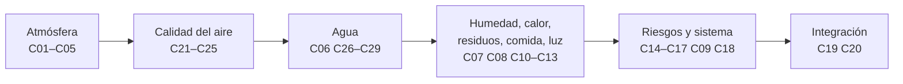

# B106 — Hábitats espaciales y soporte vital

> **Bloque ampliado (`0.2.0`).** Sus 20 clases de la línea base y sus 9 clases programadas (`B106-C21` a `B106-C29`) están ahora redactadas. Ver el [programa completo](../../PROGRAMA_ACADEMICO_COMPLETO.md).

**Programa:** Programa Integral de Astronomía, Astrofísica, Ciencias Espaciales e Ingeniería Aeroespacial
**Área:** A09 — Astronáutica humana, medicina y hábitats
**Nivel:** N3 (fundamentos disciplinares) · **Clases:** 29 · **Carga:** por calibrar con el uso
**Estado:** guía pedagógica del bloque (resumen de qué se aprende en cada clase). Las clases enlazadas en las tablas ya están redactadas; todas conservan el estado E0 en el catálogo hasta registrar revisión disciplinar.

## 🎯 Propósito del bloque

Enseña **cómo se mantiene con vida y en buen estado a una tripulación dentro de una cabina cerrada** y cómo se razona con balances: lo que una persona consume y emite, lo que el hábitat repone, recicla o evacua, y cuánto margen queda cuando algo falla. Recorre la presión y la composición del aire, el control del dióxido de carbono y del oxígeno, la calidad del aire y de las partículas, el ciclo del agua (reciclaje, orina, aguas grises, microbiología y distribución), la humedad y el calor, los residuos, los alimentos y el cultivo, la luz y el ritmo circadiano, los riesgos (radiación, micrometeoritos, incendio), la fiabilidad y, al final, un asentamiento lunar conceptual y un balance ambiental completo. Cada clase cierra con un laboratorio en Python con semilla fija: **modelos mínimos con datos sintéticos rotulados**; el bloque no presenta ninguna salida simulada como si fuera una medición de un hábitat real.

## 📚 Al terminar el bloque podrás

1. Calcular el balance de oxígeno, CO₂, agua y calor de una tripulación y compararlo con los límites de una norma consultada.
2. Dimensionar un recinto presurizado (esfuerzo de aro, fuga por un orificio) y comparar atmósferas de cabina por su presión parcial de oxígeno.
3. Predecir la presión parcial de CO₂ de una cabina con y sin depurador, y el tiempo disponible ante una falla.
4. Escribir la estequiometría de la electrólisis y de la reacción de Sabatier y calcular masa y energía por kilogramo de oxígeno.
5. Evaluar la calidad del aire con un índice aditivo, estimar la vida de un lecho de carbón y el tiempo de limpieza de partículas.
6. Dimensionar lazos de agua (recuperación, orina, aguas grises, reserva y distribución) y explicar por qué la recuperación tiene un límite químico.
7. Estimar humedad, rocío y carga térmica, y el área de un radiador.
8. Calcular el riesgo por impactos y por incendio, y la fiabilidad con redundancia y repuestos, con intervalos o verificación por Monte Carlo.
9. Integrar todo en una simulación de balance ambiental con matriz de verificación, y rotular siempre qué es dato consultado, valor ilustrativo o simulación.

## 🧭 Secuencia del bloque

**Descripción textual.** Seis tramos. Primero la atmósfera (presión, composición, CO₂ y O₂); después la calidad del aire (trazas, fuentes, partículas, límites y sensores); luego el agua; después humedad, calor, residuos, alimentos, cultivo y luz; a continuación los riesgos (radiación, micrometeoritos, ergonomía, incendio), el sistema ECLSS visto como un conjunto de lazos y la fiabilidad; y por último la integración en un asentamiento conceptual y un balance ambiental completo. **Orden de navegación:** la tabla agrupa las clases por tema; el «anterior/siguiente» de cada clase sigue la numeración (C01 a C29).

## 🗂️ Las 29 clases en resumen

**Navegación:** cada clase enlaza a la anterior, a la siguiente y a este bloque.

La columna «Evidencia» indica el producto que demostrará el aprendizaje. Los laboratorios usan datos **sintéticos o ilustrativos** (rotulados) y, cuando aparece un valor publicado, con fuente y fecha.

### Tramo 1 · Atmósfera, presión y oxígeno

| ID | Clase | Qué se aprende | Evidencia |
|---|---|---|---|
| [B106-C01](../clases/B106/B106-C01-requisitos-de-habitabilidad/CLASE.md) | Requisitos de habitabilidad | Balance de entradas y salidas de una persona (oxígeno, CO₂, agua, calor) y las zonas de temperatura y humedad que fija la norma. | Ficha de requisitos con el balance por tripulante |
| [B106-C02](../clases/B106/B106-C02-presurizacion-de-modulos/CLASE.md) | Presurización de módulos | Esfuerzo de aro en un recinto presurizado, espesor mínimo y tiempo de despresurización por un orificio. | Ficha de presurización con margen y tiempo de fuga |
| [B106-C03](../clases/B106/B106-C03-composicion-atmosferica-respirable/CLASE.md) | Composición atmosférica respirable | Presión parcial inspirada de oxígeno, fracción de diluyente y comparación de atmósferas de cabina. | Tabla de atmósferas con su verificación |
| [B106-C04](../clases/B106/B106-C04-control-de-dioxido-de-carbono/CLASE.md) | Control de dióxido de carbono | Balance de CO₂ de una cabina bien mezclada, régimen estacionario y tiempo hasta un límite si falla el depurador. | Curva de ppCO₂ con y sin depurador |
| [B106-C05](../clases/B106/B106-C05-suministro-y-generacion-de-oxigeno/CLASE.md) | Suministro y generación de oxígeno | Estequiometría de la electrólisis y de la reacción de Sabatier, masa de agua y energía por kilogramo de oxígeno. | Balance de oxígeno e hidrógeno por tripulante |

### Tramo 2 · Calidad del aire de cabina

| ID | Clase | Qué se aprende | Evidencia |
|---|---|---|---|
| [B106-C21](../clases/B106/B106-C21-depuracion-de-trazas-gaseosas-de-la-atmosfera-de-cabina/CLASE.md) | Depuración de trazas gaseosas de la atmósfera de cabina | Balance de un contaminante traza, ruptura de un lecho de carbón y conversión de un catalizador. | Ficha de depuración con vida del lecho |
| [B106-C22](../clases/B106/B106-C22-fuentes-e-identificacion-de-contaminantes-del-aire-de-cabina/CLASE.md) | Fuentes e identificación de contaminantes del aire de cabina | Emisión de materiales (decaimiento), fuentes metabólicas y de equipos, e identificación de una mezcla por espectros sintéticos. | Inventario de fuentes con identificación |
| [B106-C23](../clases/B106/B106-C23-control-de-particulas-y-polvo-respirable-en-cabina/CLASE.md) | Control de partículas y polvo respirable en cabina | Sedimentación de Stokes según la gravedad, eficiencia de filtrado y tiempo de limpieza de la cabina. | Ficha de partículas con tiempo de limpieza |
| [B106-C24](../clases/B106/B106-C24-calidad-del-aire-y-limites-de-exposicion-en-cabina/CLASE.md) | Calidad del aire y límites de exposición en cabina | Conversión de ppm a mg/m³ y índice de riesgo aditivo frente a límites (valores ilustrativos rotulados). | Informe de calidad del aire con índice |
| [B106-C25](../clases/B106/B106-C25-sensores-de-presion-gases-y-humedad-para-monitoreo-de-habitat/CLASE.md) | Sensores de presión, gases y humedad para monitoreo de hábitat | Calibración lineal, deriva, votación 2 de 3 y sensor de absorción de CO₂ (Beer–Lambert). | Ficha de sensores con falsas alarmas |

### Tramo 3 · Agua

| ID | Clase | Qué se aprende | Evidencia |
|---|---|---|---|
| [B106-C06](../clases/B106/B106-C06-reciclaje-de-agua/CLASE.md) | Reciclaje de agua | Lazo de agua con fracción de recuperación, agua de reposición y punto de equilibrio de masa frente al agua lanzada. | Curva de masa lanzada frente a recuperación |
| [B106-C26](../clases/B106/B106-C26-tratamiento-de-aguas-grises-en-habitats/CLASE.md) | Tratamiento de aguas grises en hábitats | Biorreactor de mezcla completa, tiempo de residencia para una remoción dada y desinfección por concentración por tiempo. | Dimensionado de un tratamiento de aguas grises |
| [B106-C27](../clases/B106/B106-C27-tratamiento-de-orina-y-recuperacion-de-agua/CLASE.md) | Tratamiento de orina y recuperación de agua | Concentración de la salmuera, precipitación de sulfato de calcio, límite de recuperación y energía de destilación. | Ficha de recuperación de orina con su límite |
| [B106-C28](../clases/B106/B106-C28-monitoreo-microbiologico-de-agua-y-superficies-del-habitat/CLASE.md) | Monitoreo microbiológico de agua y superficies del hábitat | Probabilidad de detectar una contaminación según el volumen de muestra y la tasa de recuperación; crecimiento logístico. | Plan de muestreo con confianza |
| [B106-C29](../clases/B106/B106-C29-almacenamiento-y-distribucion-de-agua-potable-en-habitats/CLASE.md) | Almacenamiento y distribución de agua potable en hábitats | Volumen de reserva, caída de presión de una línea (Poiseuille) y vida útil del biocida residual. | Ficha de almacenamiento y distribución de agua |

### Tramo 4 · Humedad, calor, residuos, comida y luz

| ID | Clase | Qué se aprende | Evidencia |
|---|---|---|---|
| [B106-C07](../clases/B106/B106-C07-gestion-de-humedad/CLASE.md) | Gestión de humedad | Psicrometría básica: humedad relativa, punto de rocío, carga latente de la tripulación y riesgo de condensación. | Ficha de humedad con margen de rocío |
| [B106-C08](../clases/B106/B106-C08-control-termico-interior/CLASE.md) | Control térmico interior | Balance térmico de la cabina, caudal de refrigerante y área de radiador por Stefan–Boltzmann. | Presupuesto térmico con área de radiador |
| [B106-C10](../clases/B106/B106-C10-gestion-de-residuos-humanos/CLASE.md) | Gestión de residuos humanos | Masas y volúmenes de heces y orina por tripulante, contención y almacenamiento en una misión. | Presupuesto de residuos de la misión |
| [B106-C11](../clases/B106/B106-C11-almacenamiento-de-alimentos/CLASE.md) | Almacenamiento de alimentos | Energía y masa de alimento por tripulante, envase y vida útil por la regla de Q10. | Plan de alimentos con vida útil |
| [B106-C12](../clases/B106/B106-C12-agricultura-en-ambiente-controlado/CLASE.md) | Agricultura en ambiente controlado | Fotones, área de cultivo y balance de oxígeno de un cultivo con luz artificial, con valores ilustrativos rotulados. | Dimensionado de un cultivo con su consumo eléctrico |
| [B106-C13](../clases/B106/B106-C13-iluminacion-y-ciclos-circadianos/CLASE.md) | Iluminación y ciclos circadianos | Un oscilador de fase para ver cuándo la luz arrastra el ritmo circadiano y qué pasa con el día marciano. | Mapa de arrastre frente a la duración del día |

### Tramo 5 · Riesgos y sistema

| ID | Clase | Qué se aprende | Evidencia |
|---|---|---|---|
| [B106-C14](../clases/B106/B106-C14-proteccion-contra-radiacion/CLASE.md) | Protección contra radiación | Alcance de protones en un blindaje (ley de potencias) y fracción detenida de un espectro sintético; límites del modelo. | Ficha de blindaje con sus límites |
| [B106-C15](../clases/B106/B106-C15-proteccion-frente-a-micrometeoritos/CLASE.md) | Protección frente a micrometeoritos | Probabilidad de no penetración por impactos de Poisson, escalado de la penetración y efecto del espaciado. | Ficha de riesgo de impacto con intervalo |
| [B106-C16](../clases/B106/B106-C16-ergonomia-en-microgravedad/CLASE.md) | Ergonomía en microgravedad | Conservación del momento y del momento angular al empujar y al apretar un tornillo sin punto de apoyo. | Ficha de reacciones con la maniobra corregida |
| [B106-C17](../clases/B106/B106-C17-prevencion-y-respuesta-a-incendios/CLASE.md) | Prevención y respuesta a incendios | Energía liberada, aumento de temperatura y de presión de una cabina cerrada, oxígeno consumido y tiempo de detección. | Ficha de escenario de incendio con tiempos |
| [B106-C09](../clases/B106/B106-C09-sistemas-eclss/CLASE.md) | Sistemas ECLSS | Los subsistemas del ECLSS como lazos con fracciones de cierre, la masa que hay que reponer y su sensibilidad. | Diagrama de lazos con balance de reposición |
| [B106-C18](../clases/B106/B106-C18-fiabilidad-y-redundancia/CLASE.md) | Fiabilidad y redundancia | Fiabilidad exponencial, redundancia k de n, causa común y repuestos por Poisson, verificados por Monte Carlo. | Diagrama de fiabilidad con repuestos |

### Tramo 6 · Integración

| ID | Clase | Qué se aprende | Evidencia |
|---|---|---|---|
| [B106-C19](../clases/B106/B106-C19-arquitectura-de-asentamiento-lunar-conceptual/CLASE.md) | Arquitectura de asentamiento lunar conceptual | Ciclo día-noche lunar, energía de la noche, presión frente a peso del regolito y masa de baterías. | Dimensionado conceptual de un asentamiento |
| [B106-C20](../clases/B106/B106-C20-proyecto-de-balance-ambiental-de-habitat/CLASE.md) | Proyecto de balance ambiental de hábitat | Simulación de balance ambiental de un hábitat de cuatro personas con controladores y una falla, con matriz de verificación. | Informe de balance ambiental con matriz de verificación |

## 🧵 Hilos que atraviesan el bloque

- **Todo es un balance:** lo que entra, lo que sale y lo que se acumula (masa, energía, concentración); la mayor parte de las clases resuelve la misma ecuación con otros símbolos.
- **El margen manda:** el tiempo hasta un límite tras una falla (CO₂ sin depurador, despresurización, incendio) importa más que el valor nominal.
- **Cerrar el lazo tiene un costo:** reciclar agua ahorra masa lanzada, pero cuesta energía, repuestos y química (el sulfato de calcio de la orina es el ejemplo de la norma consultada).
- **Consultado frente a ilustrativo:** los límites de la norma NASA-STD-3001 se citan solo desde los resúmenes técnicos consultados; los demás valores (materiales, cultivos, biocidas, cargas) son ilustrativos y se rotulan.

## 📝 Evaluación del bloque (propuesta, por calibrar)

- Fichas y ejercicios por clase, con retroalimentación y recuperación con evidencia distinta.
- Portafolio: el informe de balance ambiental (C20) con su matriz de verificación, sus supuestos y la falla simulada.
- Las condiciones críticas (rotular lo simulado, no presentar un límite ilustrativo como norma y citar solo lo consultado) no se compensan con promedio.

## ⚠️ Seguridad y límites

El bloque es **educativo** y **no da consejo médico ni operativo**: ninguna cifra sirve para decidir la atmósfera, el agua, la exposición o la respuesta ante una emergencia de un hábitat real ni de una persona. Los modelos son versiones mínimas (mezcla perfecta, parámetros constantes, valores ilustrativos) y no sustituyen a las normas vigentes, a las cadenas de verificación ni a la calificación de vuelo. Los límites de exposición, de radiación y de calidad del agua reales los fijan organismos y normas que hay que consultar en su versión vigente; aquí solo se muestran los que se consultaron, con su fecha.

## 📖 Fuentes consultadas en el bloque (resumen)

Consultadas el 2026-11-10: la página de la NASA sobre el sistema de control ambiental y soporte vital de la ISS (actualizada el 4 de abril de 2025); los resúmenes técnicos OCHMO-TB-002 (ECLSS, rev. B), OCHMO-TB-003 (atmósfera habitable) y OCHMO-TB-004 (dióxido de carbono) de la Oficina del Jefe de Salud y Medicina de la NASA, derivados de NASA-STD-3001 vol. 2 rev. D (PDF leídos con PyMuPDF); y la página de la NASA sobre las guías de exposición SMAC y SWEG. Un listado de búsqueda confirmó la existencia de JSC 20584 (límites SMAC), pero **sus valores no se consultaron**. La página de recuperación de agua de la ISS (error 404) y los resúmenes OCHMO sobre agua, residuos e incendios **no se consultaron**. Las relaciones físicas estándar (esfuerzo de aro, estequiometría, Stokes, Poisson, Beer–Lambert, Stefan–Boltzmann) las verifica cada laboratorio y no se consultaron en una fuente concreta.

## Fuentes de orientación preliminar

- **[NASA-HUMAN]** [NASA Human Research Program](https://www.nasa.gov/hrp/) — Factores humanos, medicina y riesgos de exploración tripulada.
- **[UNOOSA]** [United Nations Office for Outer Space Affairs](https://www.unoosa.org/) — Tratados, regulación e iniciativas de cooperación internacional.
- **[ITU]** [International Telecommunication Union](https://www.itu.int/) — Telecomunicaciones y coordinación del espectro internacional.
- **[NASA-SYSTEMS]** [NASA Systems Engineering Handbook](https://www.nasa.gov/reference/systems-engineering-handbook/) — Ingeniería de sistemas, verificación, validación y gestión técnica.

> La asociación de estas fuentes es orientativa por bloque. Las fuentes realmente consultadas para cada afirmación se registran en la sección 11 de cada clase.

[🏠 Volver al programa](../../README.md) · [➡️ B107 — Acondicionamiento físico y rehabilitación de astronautas](./B107-acondicionamiento-fisico-y-rehabilitacion-de-astronautas.md)
