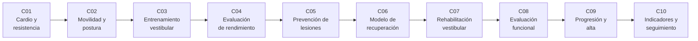

# B107 — Acondicionamiento físico y rehabilitación de astronautas

> **Bloque nuevo de la estructura vigente.** Sus 10 clases estaban programadas por la ampliación y ahora están redactadas. Ver el [programa completo](../../PROGRAMA_ACADEMICO_COMPLETO.md).

**Programa:** Programa Integral de Astronomía, Astrofísica, Ciencias Espaciales e Ingeniería Aeroespacial
**Área:** A09 — Astronáutica humana, medicina y hábitats
**Nivel:** N3 (fundamentos disciplinares) · **Clases:** 10 · **Carga:** por calibrar con el uso
**Estado:** guía pedagógica del bloque (resumen de qué se aprende en cada clase). Las clases enlazadas en la tabla ya están redactadas; todas conservan el estado E0 en el catálogo hasta registrar revisión disciplinar.

## 🎯 Propósito del bloque

Enseña **cómo se piensa, se mide y se modela la preparación física de una tripulación antes del vuelo y su recuperación después**, con herramientas cuantitativas que se pueden auditar: un modelo de dosis y respuesta del entrenamiento, el espacio de trabajo de una articulación limitada por un traje, un canal vestibular como filtro, la fiabilidad y el cambio mínimo detectable de una prueba, la razón de carga aguda:crónica, la curva exponencial de recuperación, el control postural con re-ponderación sensorial, la medida funcional con su error, los criterios de alta con su probabilidad de error y los indicadores de seguimiento con datos censurados. Cada clase cierra con un laboratorio en Python con semilla fija; **todos los datos son sintéticos o ilustrativos** y ninguno procede de un astronauta ni de una misión.

## 📚 Al terminar el bloque podrás

1. Explicar y simular un modelo de impulso-respuesta del entrenamiento y comparar planes con la misma carga semanal.
2. Calcular cómo un límite de par y de rango articular reduce el espacio de trabajo de un miembro.
3. Describir el canal semicircular como filtro paso alto y la ambigüedad inclinación-traslación, y modelar una curva de aprendizaje.
4. Calcular fiabilidad, error típico de medida, cambio fiable y cambio mínimo detectable, y saber cuándo un cambio no es distinguible del error.
5. Calcular una razón de carga aguda:crónica y explicar por qué sus umbrales no están validados.
6. Ajustar una recuperación exponencial con su incertidumbre y su tiempo al 95 %.
7. Mostrar cómo la re-ponderación sensorial y la rigidez de control determinan la estabilidad postural.
8. Diseñar criterios de progresión y de alta, y cuantificar su probabilidad de pase falso.
9. Calcular indicadores de seguimiento con censura (Kaplan–Meier) y detectar un estancamiento con un CUSUM.
10. Rotular qué es sintético, qué es consultado y qué no se consultó, y no dar consejo médico ni operativo.

## 🧭 Secuencia del bloque

**Descripción textual.** Diez clases encadenadas en dos tramos. El primero prepara y evalúa antes del vuelo: resistencia (C01), movilidad (C02), orientación (C03), medida del rendimiento (C04) y carga y lesiones (C05). El segundo recupera después: el modelo de recuperación (C06), el equilibrio (C07), la evaluación funcional (C08), los criterios de alta (C09) y los indicadores de seguimiento (C10). El hilo común es medir con su error.

## 🗂️ Las 10 clases en resumen

**Navegación:** cada clase enlaza a la anterior, a la siguiente y a este bloque.

La columna «Evidencia» indica el producto que demostrará el aprendizaje. Los laboratorios usan datos **sintéticos** o **ilustrativos** (rotulados).

### Tramo 1 · Preparar y evaluar antes del vuelo

| ID | Clase | Qué se aprende | Evidencia |
|---|---|---|---|
| [B107-C01](../clases/B107/B107-C01-entrenamiento-cardiorrespiratorio-y-de-resistencia-de-astronautas/CLASE.md) | Entrenamiento cardiorrespiratorio y de resistencia de astronautas | Modelo impulso-respuesta: aptitud, fatiga, instante del máximo y planes con la misma carga. | Comparación de dos planes de carga |
| [B107-C02](../clases/B107/B107-C02-movilidad-articular-flexibilidad-y-postura/CLASE.md) | Movilidad articular, flexibilidad y postura | Cinemática de un brazo plano, rango libre y rango útil con un par resistivo. | Ficha de espacio de trabajo con y sin traje |
| [B107-C03](../clases/B107/B107-C03-entrenamiento-vestibular-y-de-orientacion-espacial/CLASE.md) | Entrenamiento vestibular y de orientación espacial | Canal como paso alto, ambigüedad inclinación-traslación y curva de aprendizaje. | Curva de aprendizaje con sus sesiones al 95 % |
| [B107-C04](../clases/B107/B107-C04-evaluacion-del-rendimiento-fisico-y-cognitivo-de-tripulantes/CLASE.md) | Evaluación del rendimiento físico y cognitivo de tripulantes | Fiabilidad, SEM, RCI y cambio mínimo detectable de una prueba. | Informe de fiabilidad y de potencia de detección |
| [B107-C05](../clases/B107/B107-C05-prevencion-de-lesiones-en-entrenamiento-y-trabajo-operativo/CLASE.md) | Prevención de lesiones en entrenamiento y trabajo operativo | ACWR con media móvil y EWMA; límites de los umbrales de riesgo. | Tablero de carga con alertas y sus límites |

### Tramo 2 · Recuperar y dar seguimiento después del vuelo

| ID | Clase | Qué se aprende | Evidencia |
|---|---|---|---|
| [B107-C06](../clases/B107/B107-C06-estimacion-y-modelado-de-la-recuperacion-posterior-al-vuelo/CLASE.md) | Estimación y modelado de la recuperación posterior al vuelo | Recuperación exponencial, ajuste, remuestreo y tiempo al 95 %. | Curva de recuperación con intervalo |
| [B107-C07](../clases/B107/B107-C07-rehabilitacion-vestibular-y-del-equilibrio-posterior-al-vuelo/CLASE.md) | Rehabilitación vestibular y del equilibrio posterior al vuelo | Péndulo invertido, umbral de rigidez y re-ponderación sensorial. | Estudio de peso sensorial y estabilidad |
| [B107-C08](../clases/B107/B107-C08-evaluacion-funcional-posterior-al-vuelo/CLASE.md) | Evaluación funcional posterior al vuelo | Compuesto geométrico, Bland–Altman y MDC95. | Informe de concordancia y cambio mínimo |
| [B107-C09](../clases/B107/B107-C09-progresion-de-recuperacion-y-criterios-de-alta/CLASE.md) | Progresión de recuperación y criterios de alta | Umbrales, confirmación y probabilidad de pase falso. | Regla de alta con su tasa de error |
| [B107-C10](../clases/B107/B107-C10-indicadores-de-rehabilitacion-y-seguimiento/CLASE.md) | Indicadores de rehabilitación y seguimiento | Kaplan–Meier con censura y CUSUM de estancamiento. | Panel de indicadores de una cohorte sintética |

## 🧵 Hilos que atraviesan el bloque

- **Medir con su error:** SEM, MDC, RCI, intervalos y probabilidad de error (C04, C06, C08, C09).
- **Carga y adaptación:** aptitud y fatiga con escalas de tiempo distintas (C01, C05, C06).
- **Información sensorial:** el equilibrio como combinación ponderada de fuentes (C03, C07).
- **Sintético frente a observado:** ninguna cifra es una medición de astronautas.
- **Verificación independiente:** cada laboratorio contrasta con una forma cerrada o con otra vía de cálculo.

## 📝 Evaluación del bloque (propuesta, por calibrar)

- Fichas y ejercicios por clase, con retroalimentación y recuperación con evidencia distinta.
- Portafolio: la regla de alta con su tasa de pase falso (C09) y el panel de seguimiento (C10).
- Las condiciones críticas (rotular lo sintético, no dar consejo médico ni operativo y citar solo lo consultado) no se compensan con promedio.

## ⚠️ Seguridad y límites

El bloque es **educativo**. **No da consejo médico, de entrenamiento ni operativo**, no prescribe ejercicio, no define criterios clínicos de alta y no sustituye la formación, la licencia ni la supervisión de profesionales de la medicina, la fisioterapia, la fisiología del ejercicio ni de los equipos de salud de una agencia. Los modelos son simplificaciones (exponenciales, linealizaciones, normalidad) con parámetros inventados; los umbrales (95 %, 1,3, 1,96, etc.) son del ejemplo salvo que se indique lo contrario. Nada se presenta como medición de una persona real.

## 📖 Fuentes consultadas en el bloque (resumen)

Consultadas el 2026-11-10 en PubMed (NCBI/NLM): solo los **títulos, autores, revista y los fragmentos de resumen** que mostró la página de resultados, no los artículos completos: Ploutz-Snyder et al. 2014 (*Med Sci Sports Exerc* 46(2):358-68), Scott et al. 2014 (*Aviat Space Environ Med* 85(6):612-7), Loehr et al. 2015 y English et al. 2015 (*Aerosp Med Hum Perform* 86(12 Suppl)), Mulavara et al. 2018 (*Med Sci Sports Exerc*), Macaulay et al. 2021 (*Front Syst Neurosci*), Clément et al. 2023 (*Front Neurol*), Basner et al. 2015 y 2020 y Casario et al. 2022 (batería Cognition). La página de la NASA sobre el ejercicio en la ISS devolvió un error 404 y **no se consultó**. Los modelos (Banister, Jacobson–Truax, Bland–Altman, Kaplan–Meier, CUSUM, ACWR) son métodos estándar que verifica cada laboratorio y **no se consultaron** en una fuente concreta.

## Fuentes de orientación preliminar

- **[NASA-HRP]** [NASA Human Research Program](https://www.nasa.gov/hrp/) — Programa de investigación en salud y rendimiento humano. *No consultada en este bloque.*
- **[PUBMED]** [PubMed](https://pubmed.ncbi.nlm.nih.gov/) — Índice de literatura biomédica revisada por pares.
- **[ESA-HUMAN]** [ESA Human and Robotic Exploration](https://www.esa.int/Science_Exploration/Human_and_Robotic_Exploration) — Material institucional. *No consultada.*

> La asociación de estas fuentes es orientativa por bloque. Las fuentes realmente consultadas para cada afirmación se registran en la sección 11 de cada clase.

## Roles que lo usan

- [Astronáutica tripulada y entrenamiento de astronautas](../../rutas/astronautica-tripulada-y-entrenamiento-de-astronautas.md)
- [Medicina y bioingeniería espacial](../../rutas/medicina-y-bioingenieria-espacial.md)
