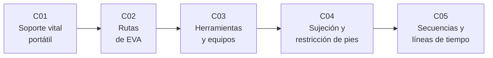

# B108 — Actividades extravehiculares y trajes espaciales

> **Bloque nuevo de la estructura vigente.** Sus 5 clases estaban programadas por la ampliación y ahora están redactadas. Ver el [programa completo](../../PROGRAMA_ACADEMICO_COMPLETO.md).

**Programa:** Programa Integral de Astronomía, Astrofísica, Ciencias Espaciales e Ingeniería Aeroespacial
**Área:** A09 — Astronáutica humana, medicina y hábitats
**Nivel:** N3 (fundamentos disciplinares) · **Clases:** 5 · **Carga:** por calibrar con el uso
**Estado:** guía pedagógica del bloque (resumen de qué se aprende en cada clase). Las clases enlazadas en la tabla ya están redactadas; todas conservan el estado E0 en el catálogo hasta registrar revisión disciplinar.

## 🎯 Propósito del bloque

Enseña **cómo se razona, con números, una actividad extravehicular (EVA)**: qué consume el traje mientras la persona trabaja, por dónde se mueve, qué le exige una herramienta, cómo se sujeta para que el trabajo no la empuje fuera de su puesto y si la secuencia completa cabe en los consumibles y en el tiempo disponibles. Recorre el balance de consumibles del sistema portátil de soporte vital, la planificación de rutas sobre una estructura con asideros, la reacción de herramientas y la reacción de torque, la rigidez de una restricción de pies y la evaluación probabilística de una línea de tiempo. Cada clase cierra con un laboratorio en Python con semilla fija; los datos del traje y de las pruebas proceden de documentos de la NASA consultados y todo lo demás es **sintético y rotulado**.

## 📚 Al terminar el bloque podrás

1. Calcular el balance de oxígeno, CO₂ y agua de refrigeración de una EVA a partir de un perfil de tasa metabólica y contrastarlo con rangos publicados de pruebas del sistema portátil de soporte vital.
2. Planificar una ruta de traslación sobre un grafo de asideros con restricciones de alcance y de longitud de cordón, y verificar el óptimo con una segunda vía.
3. Estimar el par de apriete que se obtiene con una fuerza y un brazo de palanca, y la rotación que produce la reacción en un cuerpo no sujeto.
4. Modelar una restricción de pies como un sistema masa–resorte–amortiguador y comparar el desplazamiento con y sin ella.
5. Evaluar una línea de tiempo con duraciones inciertas: ruta crítica, probabilidad de exceder el tiempo disponible y margen de consumibles.
6. Distinguir en cada cifra lo consultado, lo calculado y lo ilustrativo, y no presentar un modelo educativo como procedimiento operativo.

## 🧭 Secuencia del bloque

**Descripción textual.** Cinco clases encadenadas: lo que consume el traje (C01), cómo se llega al puesto de trabajo (C02), qué fuerzas y pares exigen las herramientas (C03), cómo se sostiene la persona mientras trabaja (C04) y si el conjunto cabe en el tiempo y los consumibles (C05).

## 🗂️ Las 5 clases en resumen

**Navegación:** cada clase enlaza a la anterior, a la siguiente y a este bloque.

La columna «Evidencia» indica el producto que demostrará el aprendizaje. Los laboratorios usan datos **sintéticos** o **ilustrativos** (rotulados) o valores publicados con fuente y fecha.

### Tramo 1 · El traje y el camino

| ID | Clase | Qué se aprende | Evidencia |
|---|---|---|---|
| [B108-C01](../clases/B108/B108-C01-sistemas-portatiles-de-soporte-vital-plss/CLASE.md) | Sistemas portátiles de soporte vital (PLSS) | Balance de O₂, CO₂ y agua de refrigeración a partir de la tasa metabólica; contraste con rangos de la prueba PLSS 1.0. | Ficha de consumibles de una EVA sintética |
| [B108-C02](../clases/B108/B108-C02-planificacion-de-desplazamientos-y-rutas-de-eva/CLASE.md) | Planificación de desplazamientos y rutas de EVA | Camino mínimo en un grafo de asideros con alcance y cordón; verificación por enumeración. | Plan de ruta sobre una estructura sintética |

### Tramo 2 · El trabajo en el puesto

| ID | Clase | Qué se aprende | Evidencia |
|---|---|---|---|
| [B108-C03](../clases/B108/B108-C03-herramientas-y-equipos-de-eva/CLASE.md) | Herramientas y equipos de EVA | Par de apriete `τ = F·L`, reacción de par y rotación de un cuerpo libre; deriva de una herramienta suelta. | Ficha de reacción de una herramienta |
| [B108-C04](../clases/B108/B108-C04-sistemas-de-sujecion-y-restriccion-de-pies/CLASE.md) | Sistemas de sujeción y restricción de pies | Masa–resorte–amortiguador, desplazamiento en régimen estático y respuesta temporal con y sin restricción. | Comparación con y sin restricción de pies |

### Tramo 3 · Evaluar el conjunto

| ID | Clase | Qué se aprende | Evidencia |
|---|---|---|---|
| [B108-C05](../clases/B108/B108-C05-evaluacion-de-secuencias-y-lineas-de-tiempo-de-eva/CLASE.md) | Evaluación de secuencias y líneas de tiempo de EVA | Ruta crítica, Monte Carlo con semilla, probabilidad de exceder el tiempo y margen de consumibles. | Informe de márgenes de una línea de tiempo sintética |

## 🧵 Hilos que atraviesan el bloque

- **Cada acción cuesta energía y consumibles:** la tasa metabólica de C01 reaparece en C05.
- **Acción y reacción:** C03 y C04 son la misma física (fuerza aplicada, reacción en el cuerpo) vista como par y como rigidez.
- **Incertidumbre explícita:** duraciones y fuerzas se tratan como rangos, no como un único número.
- **Observado, calculado, ilustrativo:** las cifras consultadas se rotulan con su fuente; los escenarios son sintéticos.
- **Verificación independiente:** cada laboratorio contrasta con una solución analítica o una enumeración.

## 📝 Evaluación del bloque (propuesta, por calibrar)

- Fichas y ejercicios por clase, con retroalimentación y recuperación con evidencia distinta.
- Portafolio: el informe de márgenes de C05 con supuestos y sensibilidad.
- Las condiciones críticas (rotular lo sintético y lo ilustrativo, no presentar el modelo como procedimiento operativo y citar solo lo consultado) no se compensan con promedio.

## ⚠️ Seguridad y límites

El bloque es **educativo**. No da consejo médico ni operativo: no sustituye a los procedimientos, requisitos y datos de ingeniería de ninguna agencia, ni debe usarse para planificar, aprobar o ejecutar una EVA real, ni para dimensionar equipo de vuelo. Los modelos son simplificados (cuerpo rígido, parámetros constantes, geometrías sintéticas) y ninguna cifra de los escenarios describe una misión real. Las únicas cifras tomadas de fuentes son las de la sección 11 de cada clase.

## 📖 Fuentes consultadas en el bloque (resumen)

Consultadas el 2026-11-10: la presentación del NASA Johnson Space Center sobre trajes espaciales (NTRS 20170004971; presión de operación del EMU de 4,3 psi = 29,6 kPa), el artículo de Watts et al. sobre el banco de pruebas PLSS 1.0 (NTRS 20120007410; rangos de caudal, inyección de CO₂ y agua, cargas metabólicas y rechazo de calor), y los resúmenes de los informes técnicos NASA TP-3433 (torque en gravedad cero, NTRS 19940017154) y NASA TP-3424 (cargas sin restricciones de pies, NTRS 19940016133), así como el resumen del artículo de Hagale y Price sobre análisis de puestos de trabajo EVA (NTRS 20000067662). De los tres últimos solo se consultó el resumen del registro. Las relaciones físicas (balance de energía, dinámica de cuerpo rígido, Dijkstra, Monte Carlo) son estándar y las verifica cada laboratorio; no se consultaron en una fuente concreta. Los requisitos de diseño EVA de la NASA y los datos de las unidades de vuelo no se consultaron.

## Fuentes de orientación preliminar

- **[NASA-HUMAN]** [NASA Human Research Program](https://www.nasa.gov/hrp/) — Investigación de riesgos de salud y desempeño humano en vuelos espaciales.
- **[NTRS]** [NASA Technical Reports Server](https://ntrs.nasa.gov/) — Informes técnicos de la NASA.
- **[ESA-HRE]** [ESA Human and Robotic Exploration](https://www.esa.int/Science_Exploration/Human_and_Robotic_Exploration) — Material institucional de exploración humana.

> La asociación de estas fuentes es orientativa por bloque. Las fuentes realmente consultadas para cada afirmación se registran en la sección 11 de cada clase.

## Roles que lo usan

- [Astronáutica tripulada y entrenamiento de astronautas](../../rutas/astronautica-tripulada-y-entrenamiento-de-astronautas.md)

[🏠 Volver al programa](../../README.md) · [➡️ B109 — Arquitectura y factores humanos de hábitats extraterrestres](./B109-arquitectura-y-factores-humanos-de-habitats-extraterrestres.md)
