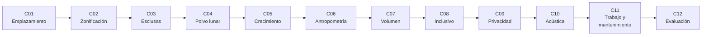

# B109 — Arquitectura y factores humanos de hábitats extraterrestres

> **Bloque nuevo de la estructura `0.2.0`.** Sus 12 clases estaban programadas por la ampliación y ahora están redactadas. Ver el [programa completo](../../PROGRAMA_ACADEMICO_COMPLETO.md).

**Programa:** Programa Integral de Astronomía, Astrofísica, Ciencias Espaciales e Ingeniería Aeroespacial
**Área:** A09 — Astronáutica humana, medicina y hábitats
**Nivel:** N3 (fundamentos disciplinares) · **Clases:** 12 · **Carga:** por calibrar con el uso
**Estado:** guía pedagógica del bloque (resumen de qué se aprende en cada clase). Las clases enlazadas en las tablas ya están redactadas; todas conservan el estado E0 en el catálogo hasta registrar revisión disciplinar.

## 🎯 Propósito del bloque

Enseña **cómo se decide dónde y cómo se construye un hábitat fuera de la Tierra y cómo se comprueba que las personas que lo usen puedan vivir y trabajar en él**. Recorre la elección de un emplazamiento, la distribución de módulos por flujos, las esclusas y la entrada de polvo lunar, el crecimiento por fases, las medidas del cuerpo y el volumen por tripulante, el diseño para usuarios diversos, la privacidad, el ruido, los espacios de trabajo y mantenimiento y, al final, la evaluación de maquetas con listas de verificación y cuestionarios. Cada clase cierra con un laboratorio en Python con semilla fija sobre **datos sintéticos rotulados** o sobre cifras publicadas con fuente y fecha: ningún resultado se presenta como una medición de un hábitat real.

## 📚 Al terminar el bloque podrás

1. Comparar emplazamientos con una matriz de decisión ponderada, aplicar umbrales de descarte y medir la estabilidad del orden frente a la incertidumbre de los pesos.
2. Distribuir zonas funcionales por flujos y adyacencias, y comprobar con una búsqueda exhaustiva que el óptimo supera a los trazados al azar.
3. Calcular el gas que consume cada ciclo de una esclusa con la ley de los gases ideales y el efecto de recuperarlo.
4. Estimar la masa de polvo que llega al interior tras varias barreras y el tiempo de sedimentación en gravedad lunar.
5. Planificar el crecimiento por fases de un asentamiento y comprobar que cada fase conserva lo anterior.
6. Dimensionar un puesto con percentiles de una población de referencia y explicar por qué se diseña para un intervalo y no para la media.
7. Calcular el volumen neto habitable por tripulante a partir del volumen bruto y de lo que se descuenta.
8. Medir la cobertura de usuarios de un control o paso según su altura o ancho, y justificar el diseño inclusivo.
9. Estimar la privacidad acústica de una cabina con la ley de masa y compararla con el ruido de fondo.
10. Sumar fuentes de ruido en decibelios, ponderarlas en A y comparar con límites publicados.
11. Comprobar los accesos y holguras de un puesto de mantenimiento.
12. Puntuar una maqueta con una lista de verificación, el cuestionario NMSUS y un contraste exacto, y rotular lo simulado frente a lo observado.

## 🧭 Secuencia del bloque

**Descripción textual.** Doce clases encadenadas en dos tramos. El primero va de la escala del asentamiento a la del módulo: dónde se construye (C01), cómo se organiza (C02), cómo se entra y sale (C03), cómo se evita que entre el polvo (C04) y cómo crece (C05). El segundo va de la escala de la persona a la de la maqueta: sus medidas (C06), su volumen (C07), la diversidad de usuarios (C08), la privacidad (C09), el ruido (C10), el trabajo (C11) y la evaluación (C12).

## 🗂️ Las 12 clases en resumen

**Navegación:** cada clase enlaza a la anterior, a la siguiente y a este bloque.

La columna «Evidencia» indica el producto que demostrará el aprendizaje. Los laboratorios usan datos **sintéticos** o **ilustrativos** (rotulados) o valores publicados con fuente y fecha.

### Tramo 1 · El asentamiento y sus accesos

| ID | Clase | Qué se aprende | Evidencia |
|---|---|---|---|
| [B109-C01](../clases/B109/B109-C01-seleccion-de-emplazamiento-para-un-asentamiento-extraterrestre/CLASE.md) | Selección de emplazamiento para un asentamiento extraterrestre | Criterios de sitio, descarte por umbral, matriz ponderada y estabilidad del orden. | Matriz de decisión de cinco sitios sintéticos |
| [B109-C02](../clases/B109/B109-C02-zonificacion-y-distribucion-funcional-de-modulos-de-un-habitat/CLASE.md) | Zonificación y distribución funcional de módulos de un hábitat | Flujos entre zonas, adyacencias y búsqueda exhaustiva del mejor trazado. | Plano de zonas con su coste de recorridos |
| [B109-C03](../clases/B109/B109-C03-accesos-esclusas-y-transferencia-entre-ambientes-presurizados/CLASE.md) | Accesos, esclusas y transferencia entre ambientes presurizados | Gas por ciclo, recuperación y tiempo de bombeo de una esclusa. | Ficha de consumo de una esclusa |
| [B109-C04](../clases/B109/B109-C04-mitigacion-de-polvo-lunar-en-accesos-y-habitats/CLASE.md) | Mitigación de polvo lunar en accesos y hábitats | Cascada de barreras, polvo residual y sedimentación en gravedad lunar. | Balance de polvo de una cadena de barreras |
| [B109-C05](../clases/B109/B109-C05-crecimiento-modular-y-escalabilidad-de-asentamientos/CLASE.md) | Crecimiento modular y escalabilidad de asentamientos | Fases aditivas, funciones fijas y por tripulante, y reutilización entre fases. | Plan de tres fases con su verificación |

### Tramo 2 · La persona, el espacio y la maqueta

| ID | Clase | Qué se aprende | Evidencia |
|---|---|---|---|
| [B109-C06](../clases/B109/B109-C06-antropometria-y-dimensionamiento-para-tripulacion/CLASE.md) | Antropometría y dimensionamiento para tripulación | Percentiles de una población mixta y dimensiones de diseño. | Tabla de dimensiones de diseño por percentil |
| [B109-C07](../clases/B109/B109-C07-asignacion-de-volumenes-habitables-por-tripulante/CLASE.md) | Asignación de volúmenes habitables por tripulante | Volumen neto habitable, descuentos y volumen funcional por tripulante. | Balance de volumen neto de un hábitat de dos tripulantes |
| [B109-C08](../clases/B109/B109-C08-diseno-inclusivo-en-habitats/CLASE.md) | Diseño inclusivo en hábitats | Cobertura de usuarios de un control o un paso según su geometría. | Informe de cobertura inclusiva de un puesto |
| [B109-C09](../clases/B109/B109-C09-privacidad-y-espacios-personales/CLASE.md) | Privacidad y espacios personales | Pérdida de transmisión por ley de masa y margen de privacidad acústica. | Ficha de privacidad de tres divisiones |
| [B109-C10](../clases/B109/B109-C10-acustica-y-control-de-ruido-interior/CLASE.md) | Acústica y control de ruido interior | Suma de fuentes, ponderación A, campo reverberante y límites. | Presupuesto de ruido de una cabina |
| [B109-C11](../clases/B109/B109-C11-diseno-de-espacios-de-trabajo-mantenimiento-y-laboratorio/CLASE.md) | Diseño de espacios de trabajo, mantenimiento y laboratorio | Superficies mínimas, holguras de acceso y paso de equipos. | Lista de verificación de accesos de un puesto |
| [B109-C12](../clases/B109/B109-C12-evaluacion-de-factores-humanos-de-maquetas-y-distribuciones/CLASE.md) | Evaluación de factores humanos de maquetas y distribuciones | Lista de verificación, NMSUS, acuerdo entre inspectores y contraste exacto. | Informe de evaluación de dos maquetas |

## 🧵 Hilos que atraviesan el bloque

- **Decidir con criterios explícitos:** C01, C02 y C05 comparan opciones con pesos y umbrales y miden cuánto cambia la decisión si los pesos cambian.
- **Del cuerpo al espacio:** C06, C07, C08 y C11 convierten percentiles y tareas en áreas, volúmenes y holguras.
- **Gravedad parcial:** C01, C04, C06 y C07 recuerdan que la Luna tiene `g ≈ 1,62 m/s²`, que cambia la postura, la sedimentación del polvo y el volumen de sueño.
- **Observado frente a modelado:** los laboratorios usan datos sintéticos o ilustrativos; las cifras publicadas (volúmenes, áreas, límites de ruido, esclusa) se citan con su fuente y se distinguen de lo calculado.
- **Verificación independiente:** cada laboratorio contrasta con un caso analítico o con otra vía de cálculo.

## 📝 Evaluación del bloque (propuesta, por calibrar)

- Fichas y ejercicios por clase, con retroalimentación y recuperación con evidencia distinta.
- Portafolio: el informe de evaluación de maquetas (C12), con la matriz de decisión (C01) y el balance de volumen (C07) como anexos.
- Las condiciones críticas (rotular lo sintético y lo ilustrativo, no presentar un modelo como observación, citar solo lo consultado y no dar consejo médico ni operativo) no se compensan con promedio.

## ⚠️ Seguridad y límites

El bloque es educativo. **No da consejo médico ni operativo** y no sustituye a las normas de diseño, a la revisión de ingeniería ni al juicio de profesionales de factores humanos, medicina aeroespacial y seguridad de misión. Los modelos son simplificados (gas ideal, ley de masa, poblaciones normales sintéticas, pesos ilustrativos) y sus datos de entrada son sintéticos o ilustrativos. Las cifras de volumen, áreas y esclusas proceden de dos artículos técnicos de NASA sobre un concepto de referencia que no es un diseño de vuelo, y los límites de ruido, de un resumen técnico de NASA derivado de la norma NASA-STD-3001; la norma completa y sus tablas por banda no se pudieron consultar.

## 📖 Fuentes consultadas en el bloque (resumen)

Consultadas el 2026-11-10: la ficha de datos de la Luna de la NASA/NSSDC (gravedad y entorno); el informe de consenso de expertos del Human Research Program de NASA sobre volumen neto habitable mínimo (25 m³ por persona para una misión a Marte de 30 meses); Burke, Howard y Kessler (2022), «Internal Layout of a Lunar Surface Habitat» (AIAA ASCEND); Stromgren et al. (2023), «Evaluating Extravehicular Activity Access Options for a Lunar Surface Habitat»; el resumen técnico OCHMO-TB-035 Rev C sobre acústica de NASA-STD-3001 Vol. 2 Rev D; el resumen del informe de Gaier (2005) sobre el polvo lunar en los sistemas de EVA de Apollo (solo la página de resumen); la ficha de la OMS sobre discapacidad y salud (7 de marzo de 2023); el resumen del NMSUS de NASA (cuestionario de usabilidad modificado) y las constantes del NIST (CODATA 2022). **No consultados:** la norma NASA-STD-3001 Vol. 2 completa (el enlace devolvió un error), el Human Integration Design Handbook, ANSUR II (acceso denegado) y los criterios oficiales de las regiones candidatas de Artemis III. Las leyes estándar (gas ideal, Stokes, ley de masa, ponderación A, Sabine) las verifica cada laboratorio con una segunda vía y no se consultaron en una fuente concreta.

## Fuentes de orientación preliminar

- **[NASA-STD-3001]** [NASA Technical Standards — Space Flight Human-System Standard](https://standards.nasa.gov/) — Norma de salud, factores humanos y habitabilidad de NASA.
- **[NASA-NTRS]** [NASA Technical Reports Server](https://ntrs.nasa.gov/) — Informes técnicos de NASA.
- **[ESA-EXPLORATION]** [ESA Human and Robotic Exploration](https://www.esa.int/Science_Exploration/Human_and_Robotic_Exploration) — Exploración humana y robótica de la ESA.
- **[WHO]** [Organización Mundial de la Salud](https://www.who.int/) — Datos de salud y discapacidad.

> La asociación de estas fuentes es orientativa por bloque. Las fuentes realmente consultadas para cada afirmación se registran en la sección 11 de cada clase.

## Roles que lo usan

- [Arquitectura y hábitats extraterrestres](../../rutas/arquitectura-y-habitats-extraterrestres.md)

[🏠 Volver al programa](../../README.md) · [➡️ B110 — Emergencias y seguridad de tripulación](./B110-emergencias-y-seguridad-de-tripulacion.md)
