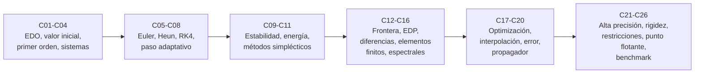

# B11 — Ecuaciones diferenciales y simulación numérica

**Programa:** Programa Integral de Astronomía, Astrofísica, Ciencias Espaciales e Ingeniería Aeroespacial
**Área:** A02 — Matemática, física computacional y métodos científicos
**Nivel:** N2 (fundamentos aplicados) · **Clases:** 20 de la línea base + 6 programadas (C21–C26) · **Carga:** por calibrar con el uso
**Estado:** guía pedagógica del bloque (resumen de qué se aprende en cada clase). Las clases enlazadas en la tabla ya están redactadas; el resto son resúmenes de especificación. Todas conservan el estado E0 en el catálogo hasta registrar revisión disciplinar.

> **Bloque ampliado (`0.2.0`).** Además de las 20 clases de la línea base, el bloque tiene 6 clases programadas (`B11-C21` a `B11-C26`). Ver el [programa completo](../../PROGRAMA_ACADEMICO_COMPLETO.md).

## 🎯 Propósito del bloque

Casi toda la dinámica espacial se escribe como ecuaciones diferenciales y casi ninguna tiene solución en forma cerrada. Este bloque enseña a **plantear una ley de cambio, convertirla en algo que un computador pueda avanzar, y saber cuánto fiarse del resultado**. Se apoya en el cálculo de [B09](./B09-calculo-diferencial-e-integral.md) y el álgebra lineal de [B10](./B10-algebra-lineal-y-matematicas-geometricas.md), y su ejemplo conductor es una nave en órbita baja terrestre (valores ilustrativos), contra la que se prueba cada método con soluciones exactas.

## 📚 Al terminar el bloque podrás

1. Clasificar una EDO y escribirla como sistema de primer orden con su vector de estado.
2. Plantear un problema de valor inicial y estimar cómo se amplifica un error inicial.
3. Aplicar y programar Euler, Heun, Runge–Kutta de cuarto orden y un paso adaptativo, midiendo su orden observado.
4. Analizar la estabilidad de un método y reconocer un problema rígido.
5. Vigilar la conservación de energía y elegir un método simpléctico cuando corresponda.
6. Resolver problemas de frontera y ecuaciones en derivadas parciales sencillas por diferencias finitas, elementos finitos y métodos espectrales.
7. Interpolar, optimizar y estimar errores de convergencia; construir un propagador reproducible con pruebas contra una solución exacta.

## 🧭 Secuencia del bloque

**Descripción textual.** Seis tramos encadenados: lenguaje de las EDO (C01–C04), integradores para problemas de valor inicial (C05–C08), estabilidad y conservación (C09–C11), problemas con varias variables o condiciones de frontera (C12–C16), herramientas numéricas transversales y el propagador de cierre (C17–C20), y las seis clases programadas de ampliación (C21–C26).

## 🗂️ Las clases en resumen

**Navegación:** cada clase desarrollada enlaza a la anterior, a la siguiente y a este bloque; mientras una clase siga en E0 o programada, su enlace lleva a su fila en esta tabla.

Los resúmenes son la **especificación pedagógica propuesta** (nivel E1 parcial, pendiente de revisión). La columna «Evidencia» indica el producto que demostrará el aprendizaje.

### Tramo 1 · Lenguaje de las ecuaciones diferenciales

| ID | Clase | Qué se aprende | Evidencia |
|---|---|---|---|
| [B11-C01](../clases/B11/B11-C01-ecuaciones-diferenciales-ordinarias/CLASE.md) | Ecuaciones diferenciales ordinarias | Orden, linealidad y autonomía; comprobar una solución por sustitución y por residuo numérico; la ley del satélite como EDO. | Ficha de clasificación y verificación |
| [B11-C02](../clases/B11/B11-C02-problemas-de-valor-inicial/CLASE.md) | Problemas de valor inicial | Condiciones iniciales, unicidad, sensibilidad `δ e^{Lt}`; altura máxima y velocidad de escape por energía. | Ficha de PVI |
| [B11-C03](../clases/B11/B11-C03-ecuaciones-de-primer-orden/CLASE.md) | Ecuaciones de primer orden | Separables y lineales con factor integrante; equilibrio y constante de tiempo; velocidad terminal. | Hoja de ecuaciones resueltas |
| [B11-C04](../clases/B11/B11-C04-sistemas-de-ecuaciones-diferenciales/CLASE.md) | Sistemas de ecuaciones diferenciales | Reducción de orden, vector de estado, valores propios, energía y momento angular conservados. | Ficha de estado y verificación |

### Tramo 2 · Integradores de valor inicial

| ID | Clase | Qué se aprende | Evidencia |
|---|---|---|---|
| [B11-C05](../clases/B11/B11-C05-metodo-de-euler/CLASE.md) | Método de Euler | Regla de la tangente, error local y global, orden observado; la órbita que se abre. | Informe de convergencia |
| [B11-C06](../clases/B11/B11-C06-metodo-de-heun/CLASE.md) | Método de Heun | Predictor–corrector de orden 2; comparación a igual número de evaluaciones. | Tabla comparativa a igual costo |
| [B11-C07](../clases/B11/B11-C07-runge-kutta-de-cuarto-orden/CLASE.md) | Runge-Kutta de cuarto orden | Cuatro etapas, orden 4, exactitud con `y′ = t³`; eficiencia frente a Euler y Heun. | Cuadro de eficiencia |
| [B11-C08](../clases/B11/B11-C08-integradores-de-paso-adaptativo/CLASE.md) | Integradores de paso adaptativo | Duplicación de paso, tolerancias relativa y absoluta, aceptación y rechazo; órbita excéntrica. | Informe de tolerancia y costo |

### Tramo 3 · Estabilidad y estructura

| ID | Clase | Qué se aprende | Evidencia |
|---|---|---|---|
| [B11-C09](../clases/B11/B11-C09-analisis-de-estabilidad-numerica/CLASE.md) | Análisis de estabilidad numérica | Ecuación de prueba, factor de amplificación, región de estabilidad, rigidez y Euler implícito. | Mapa de estabilidad |
| [B11-C10](../clases/B11/B11-C10-conservacion-de-energia-numerica/CLASE.md) | Conservación de energía numérica | Deriva secular de energía y momento angular, escala con el paso, traducción a semieje mayor. | Informe de deriva |
| [B11-C11](../clases/B11/B11-C11-metodos-simplecticos/CLASE.md) | Métodos simplécticos | Leapfrog, reversibilidad, energía acotada, error de fase; cuándo preferirlos. | Cuadro de comparación a largo plazo |

### Tramo 4 · Frontera, derivadas parciales y discretizaciones

| ID | Clase | Qué se aprende | Evidencia |
|---|---|---|---|
| [B11-C12](../clases/B11/B11-C12-problemas-de-frontera/CLASE.md) | Problemas de frontera | Diferencias finitas tridiagonales, tiro lineal y no lineal, existencia y unicidad. | Informe de frontera |
| [B11-C13](../clases/B11/B11-C13-ecuaciones-en-derivadas-parciales/CLASE.md) | Ecuaciones en derivadas parciales | Clasificación (calor, onda, Laplace, advección), condiciones, solución por separación de variables. | Ficha de clasificación y solución exacta |
| [B11-C14](../clases/B11/B11-C14-diferencias-finitas/CLASE.md) | Diferencias finitas | Esquemas, error de truncamiento, estabilidad de FTCS, condición `r ≤ 1/2`. | Informe de malla y estabilidad |
| [B11-C15](../clases/B11/B11-C15-elementos-finitos-introductorios/CLASE.md) | Elementos finitos introductorios | Forma débil, funciones de base lineales, ensamblaje; orden 2 en 1D. | Informe de convergencia de elementos finitos |
| [B11-C16](../clases/B11/B11-C16-metodos-espectrales-iniciales/CLASE.md) | Métodos espectrales iniciales | Derivada por transformada de Fourier, convergencia exponencial, aliasing. | Comparación espectral frente a diferencias |

### Tramo 5 · Herramientas numéricas y propagador

| ID | Clase | Qué se aprende | Evidencia |
|---|---|---|---|
| [B11-C17](../clases/B11/B11-C17-optimizacion-numerica/CLASE.md) | Optimización numérica | Mínimos, Newton, descenso por gradiente, sección áurea, mínimos cuadrados. | Informe de optimización con verificación |
| [B11-C18](../clases/B11/B11-C18-interpolacion-y-extrapolacion/CLASE.md) | Interpolación y extrapolación | Lagrange, error de interpolación, fenómeno de Runge, nodos de Chebyshev, peligros de extrapolar. | Tabla de interpolación con cota de error |
| [B11-C19](../clases/B11/B11-C19-estimacion-de-error-y-convergencia/CLASE.md) | Estimación de error y convergencia | Orden observado, Richardson, error de truncamiento frente a redondeo, presupuesto de error. | Estudio de convergencia con presupuesto de error |
| [B11-C20](../clases/B11/B11-C20-propagador-reproducible-de-trayectoria/CLASE.md) | Propagador reproducible de trayectoria | Configuración declarada, versiones, huella de resultados, pruebas contra Kepler. | Propagador con pruebas y huella reproducible |

### Tramo 6 · Ampliación programada (sin redactar al publicar esta guía)

| ID | Clase | Qué se aprende | Evidencia |
|---|---|---|---|
| [B11-C21](../clases/B11/B11-C21-integracion-numerica-de-alta-precision/CLASE.md) | Integración numérica de alta precisión | Métodos de orden alto (Taylor, Gauss–Radau) y aritmética extendida para trayectorias largas. | Comparación de integradores de alta precisión |
| [B11-C22](../clases/B11/B11-C22-metodos-implicitos-y-sistemas-rigidos/CLASE.md) | Métodos implícitos y sistemas rígidos | Euler implícito, BDF, rigidez; resolver el sistema no lineal de cada paso. | Informe de un problema rígido |
| [B11-C23](../clases/B11/B11-C23-optimizacion-restringida-lagrange-kkt-y-sqp/CLASE.md) | Optimización restringida: Lagrange, KKT y SQP | Multiplicadores de Lagrange, condiciones KKT y SQP en diseño de trayectorias. | Problema restringido resuelto y verificado |
| [B11-C24](../clases/B11/B11-C24-metodos-espectrales-avanzados-chebyshev-y-fourier/CLASE.md) | Métodos espectrales avanzados (Chebyshev y Fourier) | Colocación, convergencia exponencial y aliasing. | Resolución espectral de una EDO o EDP |
| [B11-C25](../clases/B11/B11-C25-aritmetica-de-punto-flotante-y-errores-de-redondeo/CLASE.md) | Aritmética de punto flotante y errores de redondeo | IEEE 754, cancelación y acumulación de error en cálculo científico. | Ficha de errores de redondeo |
| [B11-C26](../clases/B11/B11-C26-benchmark-de-algoritmos-numericos/CLASE.md) | Benchmark de algoritmos numéricos | Comparaciones justas de precisión y costo entre algoritmos. | Benchmark documentado y reproducible |

## 🧵 Hilos que atraviesan el bloque

- **Ejemplo conductor:** la nave a 400 km de altitud (C01, C02, C04–C07, C09–C11, C20) y la órbita excéntrica (C08, C10, C20), siempre con una solución exacta de referencia.
- **Verificación:** residuo (C01), orden observado (C05–C07, C14, C15, C19), conservación (C04, C10, C11) y solución analítica (C12–C16, C20). Nada se acepta sin prueba que pueda fallar.
- **Costo frente a precisión:** evaluaciones de la función (C06–C08), paso fijo y adaptativo (C08), rigidez (C09, C22), orden alto (C21).
- **Estabilidad y estructura:** C09 → C10 → C11 → C14 (condición `r ≤ 1/2`).
- **Reproducibilidad:** versiones impresas y huella de resultados en los laboratorios, que culmina en C20.

## 📝 Evaluación del bloque (propuesta, por calibrar)

- Fichas y ejercicios por clase, con retroalimentación y recuperación con evidencia distinta.
- Portafolio de laboratorios: cada script debe ejecutarse, declarar datos, supuestos, validez y tolerancia, y contener una prueba contra una solución exacta.
- Propagador de C20 con rúbrica publicada antes; las condiciones críticas (rotular lo sintético y lo simulado, comprobar con una referencia independiente, citar solo fuentes consultadas) no se compensan con promedio.

## ⚠️ Seguridad y límites

Todo el bloque es educativo. Los modelos son de dos cuerpos o de sistemas sintéticos y **no sirven** para operar naves, planificar maniobras, evaluar riesgo de colisión ni diseñar sistemas térmicos o estructurales reales. Los datos se rotulan observados, estimados, sintéticos o simulados.

## Fuentes de orientación preliminar

- **[NIST]** [NIST Digital Library of Mathematical Functions, cap. 1 y 3](https://dlmf.nist.gov/) — Ecuaciones diferenciales, interpolación, diferenciación y métodos numéricos (versión 1.2.8, consultada el 2026-11-05).
- **[IAU]** [IAU 2015 Resolución B3](https://arxiv.org/abs/1510.07674) — Valores nominales de `GM` y radios planetarios (consultada el 2026-11-05).
- **[NASA]** [NASA NSSDC Planetary Fact Sheets](https://nssdc.gsfc.nasa.gov/planetary/factsheet/) — Datos de la Tierra y la Luna.
- **[REBOUND]** Rein, H. y colaboradores, [IAS15](https://arxiv.org/abs/1409.4779) y [WHFast](https://arxiv.org/abs/1506.01084) — Integradores gravitacionales de paso adaptativo y simpléctico (solo resúmenes).
- **[IERS]** [IERS Conventions (2010)](https://iers-conventions.obspm.fr/content/tn36.pdf), **[JPL-SPICE]** y **[NASA-NTRS]** — Orientación; sin respaldar aún afirmaciones de clases.

> La asociación de estas fuentes es orientativa por bloque. No significa que cada afirmación de una futura clase esté respaldada todavía. Comprobar documentos, versiones y licencias antes de desarrollar contenido.

[🏠 Volver al programa](../../README.md) · [⬅️ B10 — Álgebra lineal y matemáticas geométricas](./B10-algebra-lineal-y-matematicas-geometricas.md) · [➡️ B12 — Probabilidad, estadística e incertidumbre](./B12-probabilidad-estadistica-e-incertidumbre.md)
