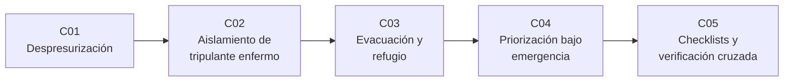

# B110 — Emergencias y seguridad de tripulación

> **Bloque nuevo de la estructura vigente.** Sus 5 clases estaban programadas por la ampliación y ahora están redactadas. Ver el [programa completo](../../PROGRAMA_ACADEMICO_COMPLETO.md).

**Programa:** Programa Integral de Astronomía, Astrofísica, Ciencias Espaciales e Ingeniería Aeroespacial
**Área:** A09 — Astronáutica humana, medicina y hábitats
**Nivel:** N3 (fundamentos disciplinares) · **Clases:** 5 · **Carga:** por calibrar con el uso
**Estado:** guía pedagógica del bloque (resumen de qué se aprende en cada clase). Las clases enlazadas en la tabla ya están redactadas; todas conservan el estado E0 en el catálogo hasta registrar revisión disciplinar.

## 🎯 Propósito del bloque

Enseña **cómo se razona, con números, una emergencia a bordo de una nave o un hábitat**: cuánto tiempo hay para actuar, qué se aísla, hacia dónde se retira la tripulación, qué se atiende primero cuando fallan varias cosas a la vez y cómo se ejecuta una lista de verificación bajo estrés sin que un error pase inadvertido. Recorre la despresurización (fuga, tiempo de reserva y aislamiento), el aislamiento de un tripulante enfermo o contaminado mediante ventilación y barreras, la evacuación y el refugio (tiempo disponible frente a tiempo necesario), la priorización cuando hay varias fallas simultáneas y los checklists con verificación cruzada. Cada clase cierra con un laboratorio en Python con semilla fija sobre **datos sintéticos rotulados**: el bloque no presenta ninguna simulación como si fuera un suceso o una medición real.

## 📚 Al terminar el bloque podrás

1. Calcular el tiempo de reserva hasta una presión mínima durante una fuga y el efecto de segmentar el volumen.
2. Estimar con un modelo de mezcla perfecta cómo la renovación de aire y el aislamiento reducen la exposición a un contaminante o patógeno en cabina.
3. Comparar el tiempo disponible con el tiempo necesario para llegar a un refugio o vehículo de retorno y expresar el margen con su incertidumbre.
4. Ordenar acciones de emergencia por plazo y consecuencia, y medir cuánto pierde una regla simple frente al orden óptimo.
5. Calcular la probabilidad de que un error de ejecución llegue sin detectar al final de un checklist con y sin verificación cruzada.
6. Rotular qué es consultado, qué es modelo y qué es ilustrativo en cada afirmación sobre emergencias.

## 🧭 Secuencia del bloque

**Descripción textual.** Cinco clases encadenadas: el tiempo de reserva ante una fuga (C01), la contención de un riesgo biológico o químico en cabina (C02), la comparación de tiempo disponible y necesario para evacuar o refugiarse (C03), la decisión de qué atender primero cuando coinciden varias fallas (C04) y la ejecución fiable de los procedimientos que lo materializan (C05).

## 🗂️ Las 5 clases en resumen

**Navegación:** cada clase enlaza a la anterior, a la siguiente y a este bloque.

La columna «Evidencia» indica el producto que demostrará el aprendizaje. Los laboratorios usan datos **sintéticos** o **ilustrativos** (rotulados) o valores publicados con fuente y fecha.

### Tramo 1 · Peligros del entorno de cabina

| ID | Clase | Qué se aprende | Evidencia |
|---|---|---|---|
| [B110-C01](../clases/B110/B110-C01-despresurizacion-deteccion-aislamiento-y-respuesta/CLASE.md) | Despresurización: detección, aislamiento y respuesta | Caída exponencial de la presión, tiempo de reserva `T_Res`, flujo por un orificio y segmentación del volumen. | Ficha de reserva de tiempo ante una fuga |
| [B110-C02](../clases/B110/B110-C02-protocolos-operativos-de-aislamiento-de-un-tripulante-enfermo-o-contaminado/CLASE.md) | Protocolos operativos de aislamiento de un tripulante enfermo o contaminado | Balance de mezcla perfecta, renovaciones por hora y riesgo tipo Wells–Riley con y sin barreras. | Ficha comparativa de exposición con y sin aislamiento |

### Tramo 2 · Respuesta y decisión

| ID | Clase | Qué se aprende | Evidencia |
|---|---|---|---|
| [B110-C03](../clases/B110/B110-C03-evacuacion-y-refugio-de-emergencia/CLASE.md) | Evacuación y refugio de emergencia | Tiempo disponible frente a tiempo necesario, cola en una escotilla y margen con incertidumbre. | Ficha de margen de evacuación |
| [B110-C04](../clases/B110/B110-C04-priorizacion-y-decisiones-bajo-emergencia/CLASE.md) | Priorización y decisiones bajo emergencia | Orden de prioridad (tripulación, vehículo, misión), plazos y comparación de reglas con el orden óptimo. | Ficha de priorización de un caso con tres fallas |
| [B110-C05](../clases/B110/B110-C05-checklists-de-emergencia-ejecucion-y-verificacion-cruzada/CLASE.md) | Checklists de emergencia: ejecución y verificación cruzada | Probabilidad de error no detectado, lectura-respuesta y coste en tiempo de la verificación. | Ficha de fiabilidad de un checklist |

## 🧵 Hilos que atraviesan el bloque

- **Tiempo disponible frente a tiempo necesario:** `T_Res` en C01, tiempo de exposición en C02, margen de evacuación en C03, plazos en C04 y tiempo de verificación en C05.
- **Prioridad de decisión:** tripulación primero, vehículo después, misión al final (C01, C03, C04).
- **Camino libre al refugio:** nunca cerrar el paso a la propia vía de retorno (C01, C03).
- **Observado frente a modelado:** todo número del bloque es un modelo con datos sintéticos o ilustrativos; ninguno describe un suceso real ni una medición.
- **Verificación independiente:** cada laboratorio contrasta con un caso analítico o con otra vía de cálculo.

## 📝 Evaluación del bloque (propuesta, por calibrar)

- Fichas y ejercicios por clase, con retroalimentación y recuperación con evidencia distinta.
- Portafolio: la ficha de priorización (C04) con su sensibilidad a los plazos.
- Las condiciones críticas (rotular lo ilustrativo y sintético, no presentar un modelo como suceso real, no dar instrucciones operativas ni médicas y citar solo lo consultado) no se compensan con promedio.

## ⚠️ Seguridad y límites

El bloque es **educativo**: no es consejo médico ni operativo, no sustituye la formación, la licencia, los procedimientos oficiales de un operador ni la supervisión de profesionales, y no debe usarse para decidir en una emergencia real. Los modelos son simplificados (aire como gas ideal, mezcla perfecta, personas independientes, plazos conocidos) y sus parámetros son ilustrativos. Las cifras de la ISS provienen de las fuentes citadas con fecha o están rotuladas como ilustrativas; los procedimientos vigentes de una agencia o un operador no se consultaron.

## 📖 Fuentes consultadas en el bloque (resumen)

Consultadas el 2026-11-10: la ponencia de Tobias y McMillan (NASA JSC, SpaceOps 2023) sobre la evolución de la respuesta a emergencias en la ISS (texto completo, PDF leído con PyMuPDF); el artículo de Schaezler y colaboradores (AIAA) sobre la tendencia de fugas de la cabina de la ISS (texto completo); la ficha de datos de la Tierra de la NASA/NSSDC; los resúmenes de los avisos de la NASA sobre la fuga de la Soyuz MS-09 de 2018; y el resumen de prensa de Harvard sobre el estudio de Haynes y colaboradores (2009) del checklist quirúrgico. Del informe de Degani y Wiener (NASA CR-177549) solo se consultó el registro bibliográfico; el PDF es un escaneado que no se leyó. El modelo de Wells–Riley, el flujo por un orificio y la teoría de colas son relaciones estándar que verifica cada laboratorio y no se consultaron en una fuente concreta. Los procedimientos vigentes de cualquier agencia no se consultaron.

## Fuentes de orientación preliminar

- **[NASA-HRP]** [NASA Human Research Program](https://www.nasa.gov/hrp/) — Riesgos de salud y desempeño humano en vuelos espaciales.
- **[NASA-STD-3001]** [NASA-STD-3001 Space Flight Human-System Standard](https://www.nasa.gov/reference/nasa-std-3001/) — Estándar de salud, desempeño y habitabilidad de la tripulación.
- **[ESA-HRE]** [ESA Human and Robotic Exploration](https://www.esa.int/Science_Exploration/Human_and_Robotic_Exploration) — Material institucional sobre exploración tripulada.
- **[NTRS]** [NASA Technical Reports Server](https://ntrs.nasa.gov/) — Informes técnicos de la NASA.

> La asociación de estas fuentes es orientativa por bloque. Las fuentes realmente consultadas para cada afirmación se registran en la sección 11 de cada clase.

## Roles que lo usan

- [Astronáutica tripulada y entrenamiento de astronautas](../../rutas/astronautica-tripulada-y-entrenamiento-de-astronautas.md)

[🏠 Volver al programa](../../README.md) · [➡️ B111 — Factores humanos y liderazgo de tripulación](./B111-factores-humanos-y-liderazgo-de-tripulacion.md)
