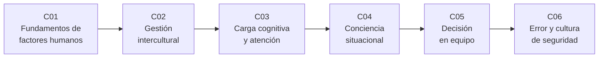

# B111 — Factores humanos y liderazgo de tripulación

> **Bloque nuevo de la estructura vigente.** Sus 6 clases estaban programadas por la ampliación y ahora están redactadas. Ver el [programa completo](../../PROGRAMA_ACADEMICO_COMPLETO.md).

**Programa:** Programa Integral de Astronomía, Astrofísica, Ciencias Espaciales e Ingeniería Aeroespacial
**Área:** A09 — Astronáutica humana, medicina y hábitats
**Nivel:** N3 (fundamentos disciplinares) · **Clases:** 6 · **Carga:** por calibrar con el uso
**Estado:** guía pedagógica del bloque (resumen de qué se aprende en cada clase). Las clases enlazadas en las tablas ya están redactadas; todas conservan el estado E0 en el catálogo hasta registrar revisión disciplinar.

## 🎯 Propósito del bloque

Enseña **a cuantificar con modelos simples cómo trabaja, se comunica, decide y se equivoca una tripulación**, y a distinguir lo que un modelo ilustrativo permite razonar de lo que solo la investigación y la formación reales pueden afirmar. Recorre las capacidades y límites del ser humano (tiempos de movimiento y de elección), las diferencias culturales y de idioma en equipos multinacionales, la carga cognitiva y su medición, la conciencia situacional, la decisión grupal bajo incertidumbre y la gestión del error con barreras y reporte. Cada clase cierra con un laboratorio en Python con semilla fija, con datos **sintéticos** rotulados y con una segunda vía de cálculo.

## 📚 Al terminar el bloque podrás

1. Predecir tiempos de movimiento (ley de Fitts) y de elección (Hick–Hyman) y ver cómo un guante o un menú más largo los degradan.
2. Calcular un índice de diversidad y de endogrupo de una tripulación y la probabilidad de un malentendido no detectado con y sin repetición de lectura.
3. Calcular la carga de trabajo ponderada (NASA-TLX) y detectar sobrecargas en una línea de tiempo de tareas.
4. Estimar la conciencia situacional en tres niveles y el intervalo de verificación que la mantiene sobre un umbral.
5. Comparar la exactitud de una decisión individual con la de un grupo según la correlación entre sus miembros, y decidir con utilidad esperada.
6. Calcular la probabilidad de que fallen todas las barreras con y sin causa común y distinguir tipos de error.
7. Rotular qué es modelo sintético, qué es literatura consultada y qué no se consultó.

## 🧭 Secuencia del bloque

**Descripción textual.** Seis clases encadenadas: el marco de capacidades y límites humanos (C01), el equipo multinacional (C02), la carga y la atención de cada persona (C03), lo que la tripulación percibe y proyecta (C04), cómo decide en conjunto (C05) y cómo se gestionan los errores que quedan (C06). El hilo común es diseñar el sistema para las personas y no al revés.

## 🗂️ Las 6 clases en resumen

**Navegación:** cada clase enlaza a la anterior, a la siguiente y a este bloque.

La columna «Evidencia» indica el producto que demostrará el aprendizaje. Los laboratorios usan datos **sintéticos** (rotulados) y metadatos de literatura con fuente y fecha.

### Tramo 1 · La persona y el equipo

| ID | Clase | Qué se aprende | Evidencia |
|---|---|---|---|
| [B111-C01](../clases/B111/B111-C01-fundamentos-de-factores-humanos-en-operaciones-espaciales/CLASE.md) | Fundamentos de factores humanos en operaciones espaciales | Ley de Fitts, ley de Hick–Hyman, efecto del guante y del número de opciones. | Ficha de capacidades y límites de una interfaz |
| [B111-C02](../clases/B111/B111-C02-gestion-intercultural-en-tripulaciones-multinacionales/CLASE.md) | Gestión intercultural en tripulaciones multinacionales | Diversidad, distancia cultural, endogrupo y malentendido no detectado con repetición de lectura. | Ficha de riesgo de comunicación de una tripulación sintética |
| [B111-C03](../clases/B111/B111-C03-carga-cognitiva-y-gestion-de-la-atencion/CLASE.md) | Carga cognitiva y gestión de la atención | NASA-TLX ponderado y utilización de una línea de tiempo de tareas. | Ficha de carga de una secuencia de tareas |

### Tramo 2 · Percibir, decidir y errar

| ID | Clase | Qué se aprende | Evidencia |
|---|---|---|---|
| [B111-C04](../clases/B111/B111-C04-conciencia-situacional-en-operaciones-de-vuelo/CLASE.md) | Conciencia situacional en operaciones de vuelo | Tres niveles, puntuación tipo SAGAT y degradación con el tiempo sin verificar. | Ficha de conciencia situacional con intervalo de verificación |
| [B111-C05](../clases/B111/B111-C05-toma-de-decisiones-con-incertidumbre-en-equipo/CLASE.md) | Toma de decisiones con incertidumbre en equipo | Votación mayoritaria con correlación, actualización bayesiana y utilidad esperada. | Ficha de decisión grupal con su sensibilidad |
| [B111-C06](../clases/B111/B111-C06-gestion-del-error-humano-y-cultura-de-seguridad/CLASE.md) | Gestión del error humano y cultura de seguridad | Barreras en serie, causa común, tipos de error y subregistro de reportes. | Ficha de barreras y de reporte de un evento sintético |

## 🧵 Hilos que atraviesan el bloque

- **Diseñar el sistema, no culpar a la persona:** C01 (interfaz), C03 (tareas) y C06 (barreras).
- **Equipo frente a individuo:** C02, C04 y C05 miden lo que cambia al pasar de uno a varios.
- **Correlación y causa común:** el grupo y las barreras valen menos de lo que dice la independencia (C05 y C06).
- **Observado frente a modelado:** todo número del bloque es un modelo con datos sintéticos; ninguno es una medición de personas ni de una misión.
- **Verificación independiente:** cada laboratorio contrasta con una segunda vía (simulación frente a fórmula o recuento frente a ajuste).

## 📝 Evaluación del bloque (propuesta, por calibrar)

- Fichas y ejercicios por clase, con retroalimentación y recuperación con evidencia distinta.
- Portafolio: la ficha de barreras y de reporte (C06) con su sensibilidad a la causa común.
- Las condiciones críticas (rotular lo sintético, no presentar un modelo como observación ni como evaluación de personas, y citar solo lo consultado) no se compensan con promedio.

## ⚠️ Seguridad y límites

El bloque es **educativo**. No da consejo médico, psicológico ni operativo, no sirve para seleccionar, evaluar ni diagnosticar a ninguna persona, y no sustituye a los estándares de factores humanos de las agencias, a la formación en gestión de recursos de tripulación ni al juicio de profesionales cualificados. Los modelos (Fitts, Hick–Hyman, NASA-TLX, votación, barreras) son simplificaciones con parámetros ilustrativos, y las puntuaciones culturales y de proficiencia de los laboratorios son sintéticas: no representan a ningún país ni grupo.

## 📖 Fuentes consultadas en el bloque (resumen)

Consultadas el 2026-11-10 mediante WebFetch: los metadatos de Reason (BMJ 2000), Endsley (Human Factors 1995, con su resumen), Hart y Staveland (1988), Fitts (1954) y Kahneman y Tversky (1979) a través de Crossref y Europe PMC; y los resúmenes de Cantisani et al. (PNAS 2026), De la Torre et al. (npj Microgravity 2024) y Basner et al. (Front. Psychol. 2026). De los artículos **no se consultó el texto completo**. No se pudo consultar la norma NASA-STD-3001 Vol. 2 (página no disponible), la página de NASA-TLX (sin conexión) ni el texto de Reason en PMC (bloqueo): las leyes y definiciones que dependen de ellos son relaciones estándar que verifica cada laboratorio y se rotulan «no consultada en una fuente concreta».

## Fuentes de orientación preliminar

- **[NASA-STD-3001]** [NASA Technical Standards — NASA-STD-3001](https://standards.nasa.gov/) — Estándares de salud, desempeño y factores humanos de la tripulación (no consultada).
- **[NASA-HRP]** [NASA Human Research Program](https://www.nasa.gov/hrp/) — Riesgos de la exploración humana (no consultada).
- **[ESA-HRE]** [ESA Human and Robotic Exploration](https://www.esa.int/Science_Exploration/Human_and_Robotic_Exploration) — Material institucional.
- **[ECSS]** [European Cooperation for Space Standardization](https://ecss.nl/) — Normas de ingeniería espacial.

> La asociación de estas fuentes es orientativa por bloque. Las fuentes realmente consultadas para cada afirmación se registran en la sección 11 de cada clase.

## Roles que lo usan

- [Astronáutica tripulada y entrenamiento de astronautas](../../rutas/astronautica-tripulada-y-entrenamiento-de-astronautas.md)

[🏠 Volver al programa](../../README.md)
