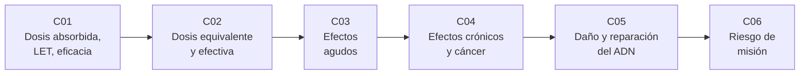

# B112 — Radiobiología y protección radiológica espacial

> **Bloque nuevo de la estructura `0.2.0`.** Sus 6 clases estaban programadas por la ampliación y ahora están redactadas. Ver el [programa completo](../../PROGRAMA_ACADEMICO_COMPLETO.md).

**Programa:** Programa Integral de Astronomía, Astrofísica, Ciencias Espaciales e Ingeniería Aeroespacial
**Área:** A09 — Astronáutica humana, medicina y hábitats
**Nivel:** N3 (fundamentos disciplinares) · **Clases:** 6 · **Carga:** por calibrar con el uso
**Estado:** guía pedagógica del bloque (resumen de qué se aprende en cada clase). Las clases enlazadas en las tablas ya están redactadas; todas conservan el estado E0 en el catálogo hasta registrar revisión disciplinar.

## 🎯 Propósito del bloque

Enseña **cómo se mide la radiación que recibe un cuerpo humano en el espacio, cómo se traduce esa medida en un riesgo para la salud y por qué ese riesgo viene siempre con una incertidumbre grande**. Recorre las magnitudes dosimétricas (dosis absorbida, LET, eficacia biológica), las magnitudes de protección (dosis equivalente y efectiva), los efectos agudos con umbral, los efectos crónicos y la carcinogénesis, los mecanismos de daño y reparación del ADN y, al final, un modelo de riesgo de misión con intervalo de confianza. Cada clase cierra con un laboratorio en Python con semilla fija sobre **datos sintéticos o cifras ilustrativas rotuladas**: el bloque no presenta ninguna salida simulada como una medición de una misión.

## 📚 Al terminar el bloque podrás

1. Calcular dosis absorbida en gray, relacionarla con el LET y explicar por qué dos radiaciones con la misma dosis producen efectos distintos.
2. Calcular dosis equivalente y efectiva con factores de ponderación y distinguir una magnitud física de una magnitud de protección.
3. Describir los síndromes agudos con sus intervalos de dosis y evaluar una dosis de un evento de partículas solares frente a umbrales.
4. Explicar el modelo lineal sin umbral, el factor de reducción por dosis y tasa de dosis y la lógica de un riesgo de exceso de muerte inducida por exposición.
5. Simular la formación y reparación de roturas del ADN, y reconocer por qué el daño agrupado de alto LET se repara peor.
6. Construir una estimación de riesgo de misión con su distribución de incertidumbre y leer un límite del 95 % de confianza.
7. Rotular qué es dato sintético, qué es valor consultado y qué es ilustrativo, y no dar nunca consejo médico ni operativo.

## 🧭 Secuencia del bloque

**Descripción textual.** Seis clases encadenadas: se define la dosis y la calidad de la radiación (C01); se convierten en magnitudes de protección (C02); se describen los efectos que aparecen por encima de un umbral (C03) y los que no tienen umbral claro (C04); se baja al mecanismo molecular que los explica (C05); y se integra todo en una estimación de riesgo por misión con su incertidumbre (C06).

## 🗂️ Las 6 clases en resumen

**Navegación:** cada clase enlaza a la anterior, a la siguiente y a este bloque.

La columna «Evidencia» indica el producto que demostrará el aprendizaje. Los laboratorios usan datos **sintéticos** o cifras **ilustrativas** (rotulados) y, cuando aparece un valor publicado, con fuente y fecha.

### Tramo 1 · Medir la radiación

| ID | Clase | Qué se aprende | Evidencia |
|---|---|---|---|
| [B112-C01](../clases/B112/B112-C01-magnitudes-dosimetricas-dosis-absorbida-let-y-eficacia-biologica/CLASE.md) | Magnitudes dosimétricas: dosis absorbida, LET y eficacia biológica | Gray, energía depositada por masa, LET y relación cualitativa con la eficacia biológica relativa. | Ficha dosimétrica con unidades y balance de energía |
| [B112-C02](../clases/B112/B112-C02-dosis-equivalente-y-dosis-efectiva/CLASE.md) | Dosis equivalente y dosis efectiva | Factores de ponderación de la radiación y de los tejidos, sievert y suma ponderada. | Ficha de dosis efectiva con tabla de ponderaciones |

### Tramo 2 · Efectos en el cuerpo

| ID | Clase | Qué se aprende | Evidencia |
|---|---|---|---|
| [B112-C03](../clases/B112/B112-C03-efectos-agudos-de-la-radiacion/CLASE.md) | Efectos agudos de la radiación | Síndromes hematopoyético, gastrointestinal y neurovascular, umbrales y evento de partículas solares. | Tabla de efectos por intervalo de dosis |
| [B112-C04](../clases/B112/B112-C04-efectos-cronicos-y-carcinogenesis-por-radiacion/CLASE.md) | Efectos crónicos y carcinogénesis por radiación | Modelo lineal sin umbral, DDREF, riesgo de exceso y su incertidumbre. | Ficha de riesgo de exceso con intervalo |
| [B112-C05](../clases/B112/B112-C05-dano-y-reparacion-del-adn-por-radiacion-espacial/CLASE.md) | Daño y reparación del ADN por radiación espacial | Roturas simples y dobles, daño agrupado de alto LET, reparación y errores. | Informe de roturas no reparadas frente al LET |

### Tramo 3 · De la dosis al riesgo de misión

| ID | Clase | Qué se aprende | Evidencia |
|---|---|---|---|
| [B112-C06](../clases/B112/B112-C06-modelos-de-riesgo-de-radiacion-para-misiones/CLASE.md) | Modelos de riesgo de radiación para misiones | Riesgo de exceso de muerte inducida por exposición, propagación de incertidumbre y límite del 95 %. | Informe de riesgo de misión con intervalo |

## 🧵 Hilos que atraviesan el bloque

- **Cada magnitud tiene su unidad y su propósito:** gray (física), sievert (protección), riesgo (probabilidad); confundirlas es el error más caro (C01, C02, C06).
- **Umbral frente a sin umbral:** los efectos agudos exigen una dosis mínima; los crónicos se modelan sin umbral y con incertidumbre (C03, C04).
- **La calidad de la radiación importa:** el mismo gray de iones pesados daña más que uno de fotones (C01, C02, C05).
- **Sintético frente a observado:** toda dosis, curva y distribución del bloque es sintética o ilustrativa y se rotula así.

## 📝 Evaluación del bloque (propuesta, por calibrar)

- Fichas y ejercicios por clase, con retroalimentación y recuperación con evidencia distinta.
- Portafolio: el informe de riesgo de misión (C06) con sus supuestos, sus unidades y su intervalo.
- Las condiciones críticas (rotular lo sintético, no dar consejo médico ni operativo y citar solo lo consultado) no se compensan con promedio.

## ⚠️ Seguridad y límites

El bloque es **educativo** y **no da consejo médico ni operativo**. No sustituye la formación, la licencia, la supervisión ni el juicio de profesionales de física médica, medicina aeroespacial o protección radiológica. Los modelos son versiones mínimas con cifras ilustrativas; los límites, factores y coeficientes reales los fijan las normas vigentes (ICRP, NCRP, NASA-STD-3001) y deben tomarse de su fuente actual. Ninguna cifra del bloque sirve para evaluar la exposición de una persona real.

## 📖 Fuentes consultadas en el bloque (resumen)

Consultadas el 2026-11-10: el extracto gratuito de la Publicación 103 de la ICRP (PDF, con PyMuPDF; glosario y resumen, **sin** las tablas numéricas de factores de ponderación), el resumen técnico OCHMO-TB-020 Rev E de NASA sobre NASA-STD-3001 (PDF, 2022-12-27), el artículo «Acute Effects» de T. M. Seed en NASA THREE (PDF, 2011), el artículo «Acceptable Risk» de NASA THREE (página), el capítulo 3 del informe de la National Academies de 2021 sobre el estándar de radiación de NASA (página, resumen), el manuscrito de Cucinotta, Kim y Ren sobre eficacia del blindaje y riesgo de cáncer (NASA NTRS, PDF), y los resúmenes de Hagiwara et al. (2019) y de Cucinotta y Durante (2006) vía Europe PMC (solo resumen). NCRP 132, 153 y 183, el texto completo de los dos últimos artículos y las tablas numéricas de la ICRP **no se consultaron**.

## Fuentes de orientación preliminar

- **[NASA-PDS]** [NASA Planetary Data System](https://pds.nasa.gov/) — Archivo de datos de misiones planetarias.
- **[ESA-SCIENCE]** [European Space Agency Science](https://www.esa.int/Science_Exploration/Space_Science) — Misiones, descubrimientos y material científico institucional.
- **[ADS]** [NASA Astrophysics Data System](https://ui.adsabs.harvard.edu/) — Índice bibliográfico de literatura astronómica y física.

> La asociación de estas fuentes es orientativa por bloque. Las fuentes realmente consultadas para cada afirmación se registran en la sección 11 de cada clase.

## Roles que lo usan

- [Medicina y bioingeniería espacial](../../rutas/medicina-y-bioingenieria-espacial.md)

[🏠 Volver al programa](../../README.md) · [➡️ B113 — Salud conductual y bienestar en aislamiento](./B113-salud-conductual-y-bienestar-en-aislamiento.md)
