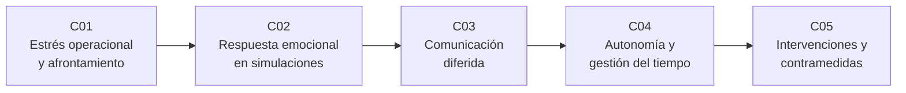

# B113 — Salud conductual y bienestar en aislamiento

> **Bloque nuevo de la estructura `0.2.0`.** Sus 5 clases estaban programadas por la ampliación y ahora están redactadas. Ver el [programa completo](../../PROGRAMA_ACADEMICO_COMPLETO.md).

**Programa:** Programa Integral de Astronomía, Astrofísica, Ciencias Espaciales e Ingeniería Aeroespacial
**Área:** A09 — Astronáutica humana, medicina y hábitats
**Nivel:** N3 (fundamentos disciplinares) · **Clases:** 5 · **Carga:** por calibrar con el uso
**Estado:** guía pedagógica del bloque (resumen de qué se aprende en cada clase). Las clases enlazadas en la tabla ya están redactadas; todas conservan el estado E0 en el catálogo hasta registrar revisión disciplinar.

## 🎯 Propósito del bloque

Enseña **cómo se razona, con modelos explícitos y datos sintéticos, sobre el estrés, la respuesta emocional, el apoyo a distancia, la autonomía y las contramedidas conductuales en una tripulación aislada y confinada**. Parte del marco del Programa de Investigación Humana (HRP) de la NASA: el aislamiento y el confinamiento pueden degradar el funcionamiento cognitivo y conductual, y en misiones de exploración el retardo de comunicación obliga a la tripulación a vigilar su propio estado y a aplicar contramedidas con autonomía. Cada clase cierra con un laboratorio en Python con semilla fija que verifica el modelo contra un caso analítico y rotula lo simulado.

Es **contenido educativo**: no es consejo médico, psicológico ni operativo, no sustituye formación, licencia ni supervisión profesional, y ningún número del bloque es una medición de una persona ni de una tripulación.

## 📚 Al terminar el bloque podrás

1. Modelar la acumulación y la recuperación del estrés operacional y comparar estrategias de afrontamiento con su estado estacionario.
2. Describir la habituación de la respuesta emocional a escenarios simulados repetidos y reconocer sus límites.
3. Calcular el retardo de comunicación entre la Tierra y Marte y su efecto sobre el ritmo de una sesión de apoyo a distancia.
4. Calcular la deriva entre el día marciano y el reloj terrestre y construir una rutina con holgura.
5. Estimar el tamaño de un efecto de una contramedida con datos sintéticos y su incertidumbre, sin confundirlo con evidencia clínica.
6. Rotular qué es consultado, qué es modelo y qué es sintético, y nombrar los límites éticos del tema.

## 🧭 Secuencia del bloque

**Descripción textual.** Cinco clases encadenadas: el estrés y su recuperación (C01), la respuesta emocional ante simulaciones de riesgo (C02), el efecto del retardo en el apoyo a distancia (C03), la autonomía y las rutinas (C04) y las intervenciones de apoyo con su evaluación (C05). El hilo común es que, con retardo, el seguimiento y la contramedida pasan a la tripulación.

## 🗂️ Las 5 clases en resumen

**Navegación:** cada clase enlaza a la anterior, a la siguiente y a este bloque.

La columna «Evidencia» indica el producto que demostrará el aprendizaje. Los laboratorios usan datos **sintéticos** (rotulados) o valores publicados con fuente y fecha.

### Tramo 1 · Estrés y respuesta emocional

| ID | Clase | Qué se aprende | Evidencia |
|---|---|---|---|
| [B113-C01](../clases/B113/B113-C01-estres-operacional-y-estrategias-de-afrontamiento/CLASE.md) | Estrés operacional y estrategias de afrontamiento | Acumulación y recuperación del estrés como modelo de primer orden y su estado estacionario. | Ficha comparativa de estrategias de afrontamiento |
| [B113-C02](../clases/B113/B113-C02-ansiedad-y-respuesta-emocional-en-escenarios-simulados/CLASE.md) | Ansiedad y respuesta emocional en escenarios simulados | Habituación a exposiciones repetidas, pico y recuperación de la activación. | Curva de habituación con sus límites |

### Tramo 2 · Distancia, tiempo e intervenciones

| ID | Clase | Qué se aprende | Evidencia |
|---|---|---|---|
| [B113-C03](../clases/B113/B113-C03-comunicacion-diferida-y-soporte-psicologico-a-distancia/CLASE.md) | Comunicación diferida y soporte psicológico a distancia | Retardo luz Tierra–Marte y turnos de conversación posibles en una sesión. | Tabla de retardo y de intercambios por sesión |
| [B113-C04](../clases/B113/B113-C04-autonomia-personal-y-gestion-del-tiempo-en-aislamiento/CLASE.md) | Autonomía personal y gestión del tiempo en aislamiento | Deriva del día marciano frente al reloj terrestre y rutina con holgura. | Plan de rutina con holgura y su deriva |
| [B113-C05](../clases/B113/B113-C05-intervenciones-de-apoyo-y-contramedidas-conductuales/CLASE.md) | Intervenciones de apoyo y contramedidas conductuales | Tamaño del efecto, intervalo por remuestreo y dependencia del tamaño de la muestra. | Informe de evaluación de una contramedida sintética |

## 🧵 Hilos que atraviesan el bloque

- **Aislamiento y confinamiento:** el riesgo que enmarca el HRP de la NASA; Basner et al. (2013) lo ilustra con 520 días de simulación.
- **Retardo y autonomía:** el retardo vuelve a la tripulación la primera línea de vigilancia y de contramedida (C03, C04, C05).
- **Modelo frente a observación:** todo número del bloque es un modelo con datos sintéticos; ninguno es una medición de una persona.
- **Verificación independiente:** cada laboratorio contrasta con un resultado analítico.

## 📝 Evaluación del bloque (propuesta, por calibrar)

- Fichas y ejercicios por clase, con retroalimentación y recuperación con evidencia distinta.
- Portafolio: el informe de evaluación de una contramedida (C05) con sus supuestos y su incertidumbre.
- Las condiciones críticas (rotular lo sintético, no presentar un modelo como evidencia clínica y citar solo lo consultado) no se compensan con promedio.

## ⚠️ Seguridad y límites

El bloque es educativo y **no da consejo médico, psicológico ni operativo**. Los modelos (estrés de primer orden, habituación exponencial, retardo luz, deriva de reloj, tamaño de efecto) son simplificaciones ilustrativas con datos sintéticos; no diagnostican, no predicen a una persona y no sustituyen a profesionales de salud mental ni a los protocolos de una agencia. Quien sienta malestar persistente debe consultar a un profesional cualificado. Las cifras sobre misiones proceden de las fuentes citadas, de las que solo se leyó lo indicado en cada clase.

## 📖 Fuentes consultadas en el bloque (resumen)

Consultadas el 2026-11-10: el informe de evidencia del HRP de la NASA *Risk of Adverse Cognitive or Behavioral Conditions and Psychiatric Disorders* (NTRS 20150016966, 106 páginas leídas como texto; el documento descargado lleva la fecha de publicación sin rellenar), la página de ese riesgo en nasa.gov, la ficha de Marte de la NASA/NSSDC, el valor de `c` del NIST (CODATA 2022) y las dos primeras páginas del artículo de Basner et al. (PNAS, 2013), con su resumen. De Basner et al. no se leyó el cuerpo completo. Las relaciones de los modelos (primer orden, exponencial, remuestreo) son estándar y las verifica cada laboratorio; no se consultaron en una fuente concreta. No se consultó literatura clínica sobre intervenciones concretas.

## Fuentes de orientación preliminar

- **[NASA-HRP]** [NASA Human Research Program](https://www.nasa.gov/hrp/) — Evidencia sobre riesgos humanos en vuelos espaciales.
- **[ESA-HUMAN]** [ESA Human and Robotic Exploration](https://www.esa.int/Science_Exploration/Human_and_Robotic_Exploration) — Material institucional sobre exploración humana.
- **[WHO]** [Organización Mundial de la Salud](https://www.who.int/) — Orientación general en salud mental.

> La asociación de estas fuentes es orientativa por bloque. Las fuentes realmente consultadas para cada afirmación se registran en la sección 11 de cada clase.

## Roles que lo usan

- [Medicina y bioingeniería espacial](../../rutas/medicina-y-bioingenieria-espacial.md)

[🏠 Volver al programa](../../README.md) · [➡️ B114 — Seguridad y respuesta a emergencias en hábitats](./B114-seguridad-y-respuesta-a-emergencias-en-habitats.md)
