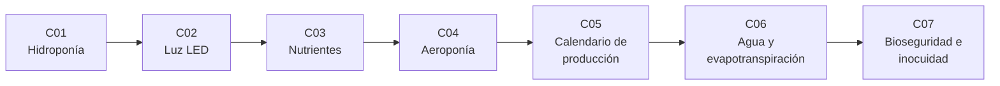

# B115 — Sistemas bioregenerativos y cultivo en hábitats

> **Bloque nuevo de la estructura vigente.** Sus 7 clases estaban programadas por la ampliación y ahora están redactadas. Ver el [programa completo](../../PROGRAMA_ACADEMICO_COMPLETO.md).

**Programa:** Programa Integral de Astronomía, Astrofísica, Ciencias Espaciales e Ingeniería Aeroespacial
**Área:** A09 — Astronáutica humana, medicina y hábitats
**Nivel:** N3 (fundamentos disciplinares) · **Clases:** 7 · **Carga:** por calibrar con el uso
**Estado:** guía pedagógica del bloque (resumen de qué se aprende en cada clase). Las clases enlazadas en las tablas ya están redactadas; todas conservan el estado E0 en el catálogo hasta registrar revisión disciplinar.

## 🎯 Propósito del bloque

Enseña **cómo se dimensiona y se opera un cultivo dentro de un hábitat cerrado** y cuánto pueden prometer los números que lo describen. Recorre el cultivo hidropónico (caudal, volumen de depósito, oxígeno disuelto), la iluminación con LED (fotones, espectro, fotoperiodo y potencia eléctrica), la solución nutritiva (dosificación y conductividad), el cultivo aeropónico (niebla, secado de raíces y ciclo de riego), la calendarización escalonada de siembra y cosecha para una tripulación, el balance de agua con la ecuación de Penman–Monteith y la bioseguridad del alimento fresco (patógenos, cargas microbianas y puntos de control). Cada clase cierra con un laboratorio en Python con semilla fija sobre **datos sintéticos rotulados** o valores publicados con fuente y fecha: el bloque no presenta ninguna salida simulada como si fuera una cosecha o una medición de una misión.

## 📚 Al terminar el bloque podrás

1. Dimensionar el caudal, el volumen de solución y el aporte de oxígeno de un canal hidropónico de película de nutrientes, y verificar el balance de masa.
2. Convertir una meta de integral diaria de luz en fotones, en potencia eléctrica y en calor, y comparar espectros por su eficacia en µmol/J.
3. Preparar una solución nutritiva por receta (Hoagland) y predecir su concentración, su conductividad eléctrica y su agotamiento en un circuito cerrado.
4. Modelar el ciclo de riego de un sistema aeropónico (tiempo de niebla frente a tiempo de secado) y su efecto en el agua y en el consumo de energía.
5. Planificar siembras escalonadas para que la cosecha cubra una demanda diaria y calcular el área de cultivo necesaria.
6. Calcular la evapotranspiración del cultivo con Penman–Monteith y cerrar el balance de agua con su recuperación por condensado.
7. Evaluar la carga microbiana de un cultivo, el riesgo por una contaminación y la efectividad de los puntos de control, sin dar consejo médico.
8. Rotular qué es dato sintético, qué es valor consultado y qué es ilustrativo en cada resultado de cultivo.

## 🧭 Secuencia del bloque

**Descripción textual.** Siete clases encadenadas: el sistema de raíz (C01), la luz que impulsa el crecimiento (C02), lo que se disuelve en el agua (C03) y la variante aeropónica del sistema de raíz (C04) definen un módulo de cultivo; la calendarización (C05) lo convierte en una producción para una tripulación; el balance de agua (C06) cuantifica el recurso más ligado a la vida del hábitat; y la bioseguridad (C07) cierra el ciclo preguntando si lo cosechado es seguro para comerse. El hilo común es el balance de masa y energía por metro cuadrado de cultivo.

## 🗂️ Las 7 clases en resumen

**Navegación:** cada clase enlaza a la anterior, a la siguiente y a este bloque.

La columna «Evidencia» indica el producto que demostrará el aprendizaje. Los laboratorios usan datos **sintéticos** (rotulados) y, cuando aparece un valor publicado, con fuente y fecha.

### Tramo 1 · El módulo de cultivo

| ID | Clase | Qué se aprende | Evidencia |
|---|---|---|---|
| [B115-C01](../clases/B115/B115-C01-cultivos-hidroponicos-para-habitats/CLASE.md) | Cultivos hidropónicos para hábitats | Canal NFT: caudal, volumen de solución, oxígeno disuelto y balance de masa. | Ficha de dimensionamiento de un canal hidropónico |
| [B115-C02](../clases/B115/B115-C02-iluminacion-de-cultivos-con-led-y-espectro-de-crecimiento/CLASE.md) | Iluminación de cultivos con LED y espectro de crecimiento | Fotones, integral diaria de luz, eficacia µmol/J, potencia y calor. | Ficha de iluminación con potencia eléctrica |
| [B115-C03](../clases/B115/B115-C03-control-de-nutrientes-y-solucion-nutritiva/CLASE.md) | Control de nutrientes y solución nutritiva | Receta de Hoagland, dosificación, conductividad y agotamiento en circuito cerrado. | Ficha de solución nutritiva con regla de reposición |
| [B115-C04](../clases/B115/B115-C04-sistemas-aeroponicos/CLASE.md) | Sistemas aeropónicos | Ciclo de niebla y secado, humedad de raíz y agua de un sistema en niebla. | Ficha de ciclo aeropónico con consumo de agua |

### Tramo 2 · De un módulo a una producción

| ID | Clase | Qué se aprende | Evidencia |
|---|---|---|---|
| [B115-C05](../clases/B115/B115-C05-ciclos-de-produccion-y-calendarizacion-de-cultivos/CLASE.md) | Ciclos de producción y calendarización de cultivos | Siembra escalonada, cosecha diaria, área necesaria y sensibilidad a fallos. | Calendario de siembras con área y margen |
| [B115-C06](../clases/B115/B115-C06-balance-de-agua-y-evapotranspiracion-en-cultivos/CLASE.md) | Balance de agua y evapotranspiración en cultivos | Penman–Monteith, coeficiente de cultivo, condensado recuperado y reposición. | Balance diario de agua de un módulo |

### Tramo 3 · Alimento seguro

| ID | Clase | Qué se aprende | Evidencia |
|---|---|---|---|
| [B115-C07](../clases/B115/B115-C07-bioseguridad-e-inocuidad-alimentaria-en-habitats/CLASE.md) | Bioseguridad e inocuidad alimentaria en hábitats | Carga microbiana en escala logarítmica, plan de muestreo, puntos de control y propagación. | Plan de control de inocuidad con su incertidumbre |

## 🧵 Hilos que atraviesan el bloque

- **Por metro cuadrado de cultivo:** el área manda en C02 (luz), C05 (calendario) y C06 (agua).
- **Cerrar el balance:** masa de agua (C01, C04, C06), nutrientes (C03) y energía (C02) se comprueban con una segunda vía de cálculo.
- **Luz y agua son el mismo recurso:** la luz absorbida se convierte en transpiración (C02 → C06).
- **Sintético frente a observado:** toda cosecha, conteo y balance del bloque es sintético o ilustrativo y se rotula así; ningún resultado equivale a una medición de una misión.

## 📝 Evaluación del bloque (propuesta, por calibrar)

- Fichas y ejercicios por clase, con retroalimentación y recuperación con evidencia distinta.
- Portafolio: el balance de agua de un módulo (C06) conectado con su luz (C02) y su calendario (C05), con supuestos e incertidumbre.
- Las condiciones críticas (rotular lo sintético y lo ilustrativo, no presentar un modelo como cosecha observada y citar solo lo consultado) no se compensan con promedio.

## ⚠️ Seguridad y límites

El bloque es educativo y **no da consejo médico, nutricional, sanitario ni operativo**. Los modelos son relaciones simplificadas (flujo estacionario, planta como superficie uniforme, mezcla perfecta, microbios en una población homogénea) y no sustituyen a la literatura primaria, a las normas de inocuidad ni al análisis de peligros de una misión. Una decisión real sobre alimento, agua o aire de una tripulación exige diseño, ensayo y revisión de especialistas. Las cifras de NASA que se citan proceden de documentos consultados; las afirmaciones comerciales (p. ej. el ahorro de agua de la aeroponía) se rotulan como de la empresa que las declara.

## 📖 Fuentes consultadas en el bloque (resumen)

Consultadas el 2026-11-10: las diapositivas de Wheeler (NASA/KSC, NTRS 20150022488) sobre vida bioregenerativa, el artículo de Monje et al. (ICES-2019-260, NTRS 20190027339) sobre producción de alimento más allá de la órbita baja, el artículo de Khodadad et al. (2020, *Frontiers in Plant Science*) sobre la lechuga de la ISS, el texto escaneado de Hoagland y Arnon (circular 347 de la Estación Experimental de California, a través del OCR de archive.org, con cifras parcialmente ilegibles), el artículo de Kusuma, Pattison y Bugbee (2020, *Horticulture Research*), el capítulo 2 de FAO-56 (la ecuación solo está como imagen) y la nota de NASA Spinoff (2006) sobre aeroponía. La documentación de la ISS sobre Veggie y las normas microbiológicas completas **no se consultaron**. Las relaciones estándar (balance de masa, Penman–Monteith, ley de Arrhenius, modelos logarítmicos de carga microbiana) las verifica cada laboratorio y no se consultaron en una fuente concreta.

## Fuentes de orientación preliminar

- **[NASA-HRP]** [NASA Human Research Program](https://www.nasa.gov/hrp/) — Riesgos de la salud y el rendimiento humanos en el espacio.
- **[ESA-EXPLORATION]** [ESA Human and Robotic Exploration](https://www.esa.int/Science_Exploration/Human_and_Robotic_Exploration) — Programas europeos de exploración humana y robótica.
- **[NTRS]** [NASA Technical Reports Server](https://ntrs.nasa.gov/) — Informes técnicos de la NASA.

> La asociación de estas fuentes es orientativa por bloque. Las fuentes realmente consultadas para cada afirmación se registran en la sección 11 de cada clase.

## Roles que lo usan

- [Arquitectura y hábitats extraterrestres](../../rutas/arquitectura-y-habitats-extraterrestres.md)

[🏠 Volver al programa](../../README.md) · [⬅️ B114 — Seguridad y respuesta a emergencias en hábitats](./B114-seguridad-y-respuesta-a-emergencias-en-habitats.md) · [➡️ B116 — Telemedicina y monitorización de salud en misión](./B116-telemedicina-y-monitorizacion-de-salud-en-mision.md)
