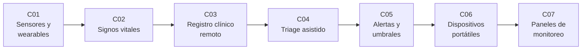

# B116 — Telemedicina y monitorización de salud en misión

> **Bloque nuevo de la estructura vigente.** Sus 7 clases estaban programadas y ahora están redactadas. Ver el [programa completo](../../PROGRAMA_ACADEMICO_COMPLETO.md).

**Programa:** Programa Integral de Astronomía, Astrofísica, Ciencias Espaciales e Ingeniería Aeroespacial
**Área:** A09 — Astronáutica humana, medicina y hábitats
**Nivel:** N4 (aplicación) · **Clases:** 7 · **Carga:** por calibrar con el uso
**Estado:** guía pedagógica del bloque (resumen de qué se aprende en cada clase). Las clases enlazadas en la tabla ya están redactadas; todas conservan el estado E0 en el catálogo hasta registrar revisión disciplinar.

## 🎯 Propósito del bloque

Enseña **cómo se mide, se registra, se prioriza y se muestra la salud de una tripulación cuando el médico está a minutos u horas de distancia**, y qué límites tiene cada paso. Recorre los sensores y su error, los signos vitales y su incertidumbre, el registro clínico que viaja con retardo y cortes, el apoyo a la decisión de triage, las alertas y su fatiga, los equipos biomédicos portátiles y el panel que lo resume para quien decide. Cada clase cierra con un laboratorio en Python con semilla fija sobre datos **sintéticos** (nunca de personas reales) y distingue lo consultado de lo ilustrativo.

**Este bloque es educativo: no da consejo médico ni operativo.** Los rangos, umbrales y puntuaciones que aparecen sirven para aprender a razonar con incertidumbre, no para evaluar a una persona ni para configurar un equipo.

## 📚 Al terminar el bloque podrás

1. Estimar la frecuencia cardiaca desde una señal óptica sintética con movimiento y cuantificar sesgo y límites de acuerdo.
2. Calcular la probabilidad de que el ruido de un sensor marque como anómalo un signo vital normal, y comparar rangos poblacionales con la línea base personal.
3. Modelar un registro de observaciones con integridad verificable y estimar el ancho de banda y el efecto de cortes de enlace.
4. Construir un puntaje de triage ilustrativo y medir su sub-triage con ruido y con retardo de comunicaciones.
5. Comparar umbral simple, persistencia e histéresis en alarmas por falsas alarmas diarias y retardo de detección.
6. Relacionar frecuencia, profundidad y resolución de un ecógrafo y calcular el valor predictivo de una prueba según la prevalencia.
7. Diseñar un panel de salud con datos con antigüedad visible, prioridades y contraste accesible; rotular siempre lo simulado.

## 🧭 Secuencia del bloque

**Descripción textual.** Siete clases encadenadas: el sensor y su error (C01), el signo vital y su incertidumbre (C02), el registro que viaja a tierra (C03), la decisión de triage con apoyo (C04), las alertas que interrumpen (C05), los equipos de diagnóstico a bordo (C06) y el panel que reúne todo (C07). El hilo común es la incertidumbre y el retardo.

## 🗂️ Las 7 clases en resumen

**Navegación:** cada clase enlaza a la anterior, a la siguiente y a este bloque.

La columna «Evidencia» indica el producto que demostrará el aprendizaje. Los laboratorios usan datos **sintéticos** (rotulados) o valores publicados con fuente y fecha.

### Tramo 1 · Medir y registrar

| ID | Clase | Qué se aprende | Evidencia |
|---|---|---|---|
| [B116-C01](../clases/B116/B116-C01-sensores-fisiologicos-y-wearables-para-vuelo/CLASE.md) | Sensores fisiológicos y wearables para vuelo | Estimación de frecuencia cardiaca óptica, artefacto de movimiento, sesgo y límites de acuerdo. | Ficha de desempeño de un sensor |
| [B116-C02](../clases/B116/B116-C02-signos-vitales-medicion-interpretacion-y-limites/CLASE.md) | Signos vitales: medición, interpretación y límites | Rangos, falsa marca por ruido y línea base personal frente a rango poblacional. | Tabla de signos con incertidumbre |
| [B116-C03](../clases/B116/B116-C03-historia-clinica-remota-y-registros-medicos-de-mision/CLASE.md) | Historia clínica remota y registros médicos de misión | Observaciones estructuradas, integridad por hash, volumen y sincronización con cortes. | Diseño de un registro de misión |

### Tramo 2 · Decidir y alertar

| ID | Clase | Qué se aprende | Evidencia |
|---|---|---|---|
| [B116-C04](../clases/B116/B116-C04-triage-asistido-por-decision/CLASE.md) | Triage asistido por decisión | Puntaje ilustrativo, sub-triage y efecto del retardo en la decisión remota. | Informe de desempeño de un triage |
| [B116-C05](../clases/B116/B116-C05-alertas-de-salud-y-umbrales-de-monitorizacion/CLASE.md) | Alertas de salud y umbrales de monitorización | Umbral, persistencia e histéresis; falsas alarmas por día y retardo. | Política de alertas comparada |

### Tramo 3 · Equipos y panel

| ID | Clase | Qué se aprende | Evidencia |
|---|---|---|---|
| [B116-C06](../clases/B116/B116-C06-dispositivos-biomedicos-portatiles-ultrasonido-diagnostico/CLASE.md) | Dispositivos biomédicos portátiles (ultrasonido, diagnóstico) | Frecuencia, profundidad y resolución del ecógrafo; valor predictivo según prevalencia. | Ficha de un equipo de diagnóstico |
| [B116-C07](../clases/B116/B116-C07-diseno-de-paneles-de-monitoreo-de-salud/CLASE.md) | Diseño de paneles de monitoreo de salud | Antigüedad del dato, prioridad, contraste WCAG y carga de indicadores. | Especificación de un panel |

## 🧵 Hilos que atraviesan el bloque

- **Incertidumbre de medida:** el error del sensor (C01) se propaga al signo (C02), al puntaje (C04), a la alarma (C05) y al panel (C07).
- **Retardo y cortes de enlace:** de 4 a 24 minutos entre Marte y la Tierra, según la NASA, condicionan el registro (C03), el triage (C04) y la antigüedad del dato (C07).
- **Autonomía frente a apoyo desde tierra:** qué decide la tripulación y qué decide el control en tierra.
- **Observado frente a simulado:** toda cifra del bloque es sintética o ilustrativa; ninguna describe a una persona ni a un equipo real.

## 📝 Evaluación del bloque (propuesta, por calibrar)

- Fichas y ejercicios por clase, con retroalimentación y recuperación con evidencia distinta.
- Portafolio: la especificación del panel (C07) con sus umbrales, su política de alertas y su análisis de falsas alarmas.
- Las condiciones críticas (rotular lo sintético, no dar consejo médico ni operativo y citar solo lo consultado) no se compensan con promedio.

## ⚠️ Seguridad y límites

El bloque es educativo y **no da consejo médico ni operativo**: no sirve para diagnosticar, tratar ni vigilar a una persona, ni para configurar equipos o alarmas reales. Los rangos y puntajes ilustrativos no son los de una guía clínica ni de un equipo certificado; la práctica real exige personal sanitario cualificado, equipos con la regulación aplicable y los requisitos de la agencia (por ejemplo NASA-STD-3001). Las señales y registros son sintéticos. No se consultó ninguna normativa de privacidad de datos de salud de misión: el tratamiento de datos reales requiere consentimiento y la revisión que corresponda.

## 📖 Fuentes consultadas en el bloque (resumen)

Consultadas el 2026-11-10: el recurso HL7 FHIR `Observation`; el cuadro de umbrales de NEWS2 del Royal College of Physicians (PDF leído con PyMuPDF); la página de rangos de signos vitales de MedlinePlus; la página «Pulse Oximeter Basics» de la FDA; la nota técnica OCHMO-TB-043 de la NASA sobre vigilancia longitudinal de la salud (PDF leído con PyMuPDF); el artículo de Kirkpatrick et al. sobre sonografía de trauma en microgravedad (NTRS, PDF leído con PyMuPDF); la página del Centro Goddard de la NASA sobre el retardo de comunicaciones con Marte; la página de WCAG 2.2 sobre el contraste mínimo; y, mediante búsqueda (solo resúmenes de resultados), el resumen de la alerta 50 de la Joint Commission y las revisiones sobre exactitud de pulsera óptica. Las relaciones físicas y estadísticas usadas en los laboratorios son estándar y las verifica cada laboratorio. Lo no consultado se rotula en cada clase.

## Fuentes de orientación preliminar

- **[NASA-HRP]** [NASA Human Research Program](https://www.nasa.gov/hrp/) — Riesgos de salud y capacidades médicas para exploración.
- **[NASA-STD-3001]** [NASA Technical Standards](https://standards.nasa.gov/) — Normas de salud y factores humanos de la tripulación.
- **[HL7-FHIR]** [HL7 FHIR](https://www.hl7.org/fhir/) — Estándar de intercambio de datos de salud.
- **[WHO]** [Organización Mundial de la Salud](https://www.who.int/) — Orientación sanitaria institucional.

> La asociación de estas fuentes es orientativa por bloque. Las fuentes realmente consultadas para cada afirmación se registran en la sección 11 de cada clase.

## Roles que lo usan

- [Medicina y bioingeniería espacial](../../rutas/medicina-y-bioingenieria-espacial.md)

[🏠 Volver al programa](../../README.md) · [➡️ B117 — Urgencias médicas y atención clínica en misión](./B117-urgencias-medicas-y-atencion-clinica-en-mision.md)
