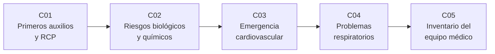

# B117 — Urgencias médicas y atención clínica en misión

> **Bloque nuevo de la estructura vigente.** Sus 5 clases estaban programadas por la ampliación y ahora están redactadas. Ver el [programa completo](../../PROGRAMA_ACADEMICO_COMPLETO.md).

**Programa:** Programa Integral de Astronomía, Astrofísica, Ciencias Espaciales e Ingeniería Aeroespacial
**Área:** A09 — Astronáutica humana, medicina y hábitats
**Nivel:** N4 (aplicación) · **Clases:** 5 · **Carga:** por calibrar con el uso
**Estado:** guía pedagógica del bloque (resumen de qué se aprende en cada clase). Las clases enlazadas en la tabla ya están redactadas; todas conservan el estado E0 en el catálogo hasta registrar revisión disciplinar.

## 🎯 Propósito del bloque

Enseña **cómo se razona una urgencia médica en una cabina espacial y con qué recursos limitados se atiende**, usando modelos simples y verificables en lugar de recetas clínicas. Recorre los primeros auxilios y la reanimación en microgravedad (qué pasa con la profundidad de compresión cuando el reanimador se cansa), la contención de un contaminante en el volumen de aire de la cabina, una emergencia cardiovascular modelada con un circuito hidráulico de dos elementos, el equilibrio de oxígeno y dióxido de carbono en el pulmón frente a la atmósfera de la cabina, y el inventario del equipo médico como problema de selección bajo límites de masa y volumen. Cada clase cierra con un laboratorio en Python con semilla fija; todos los datos clínicos son **sintéticos o ilustrativos** y están rotulados.

## 📚 Al terminar el bloque podrás

1. Modelar la fatiga de un reanimador y calcular cuánto tiempo mantiene una profundidad de compresión objetivo y cuándo conviene relevarlo.
2. Calcular la evolución de la concentración de un contaminante en un volumen de cabina mezclado y el tiempo hasta un límite, y comparar aislar un módulo con diluir en toda la cabina.
3. Simular la caída de presión arterial tras un paro con un modelo de dos elementos y calcular el índice de shock en escenarios sintéticos.
4. Calcular la presión alveolar de oxígeno con la ecuación del gas alveolar y la saturación con la curva de Severinghaus ante una fuga de presión o una acumulación de CO₂.
5. Elegir un botiquín óptimo bajo restricciones de masa y volumen y estimar la probabilidad de quedarse sin un insumo.
6. Rotular qué es observado, qué es consultado y qué es ilustrativo, y recordar que nada de esto sustituye formación, licencia ni supervisión profesional.

## 🧭 Secuencia del bloque

**Descripción textual.** Cinco clases encadenadas: los primeros auxilios y la reanimación (C01), la contención de contaminantes en cabina (C02), la emergencia cardiovascular simulada (C03), los problemas respiratorios simulados (C04) y el inventario del equipo médico que respalda todo lo anterior (C05). El hilo común es decidir con recursos limitados: tiempo, aire, personas y masa.

## 🗂️ Las 5 clases en resumen

**Navegación:** cada clase enlaza a la anterior, a la siguiente y a este bloque.

La columna «Evidencia» indica el producto que demostrará el aprendizaje. Los laboratorios usan datos **sintéticos** o **ilustrativos** (rotulados) o valores publicados con fuente y fecha.

### Tramo 1 · Atender y contener

| ID | Clase | Qué se aprende | Evidencia |
|---|---|---|---|
| [B117-C01](../clases/B117/B117-C01-primeros-auxilios-y-procedimientos-basicos-en-entorno-espacial/CLASE.md) | Primeros auxilios y procedimientos básicos en entorno espacial | Profundidad de compresión con fatiga, relevo del reanimador y comparación manual frente a dispositivo. | Ficha de plan de relevo de RCP simulada |
| [B117-C02](../clases/B117/B117-C02-contencion-de-riesgos-biologicos-y-quimicos-en-cabina/CLASE.md) | Contención de riesgos biológicos y químicos en cabina | Concentración en un volumen mezclado, decaimiento por renovación y tiempo hasta un límite. | Ficha de contención de un derrame sintético |

### Tramo 2 · Modelar la emergencia

| ID | Clase | Qué se aprende | Evidencia |
|---|---|---|---|
| [B117-C03](../clases/B117/B117-C03-emergencia-cardiovascular-simulada/CLASE.md) | Emergencia cardiovascular simulada | Gasto cardíaco, presión media, índice de shock y caída de presión tras un paro. | Ficha de escenarios cardiovasculares sintéticos |
| [B117-C04](../clases/B117/B117-C04-problemas-respiratorios-simulados/CLASE.md) | Problemas respiratorios simulados | Ecuación del gas alveolar, curva de Severinghaus, fuga de presión y CO₂ inspirado. | Tabla de oxigenación en cinco escenarios de cabina |

### Tramo 3 · Los recursos

| ID | Clase | Qué se aprende | Evidencia |
|---|---|---|---|
| [B117-C05](../clases/B117/B117-C05-inventario-y-gestion-del-equipo-medico-a-bordo/CLASE.md) | Inventario y gestión del equipo médico a bordo | Selección bajo masa y volumen, uso esperado y probabilidad de desabastecimiento. | Botiquín sintético optimizado con su riesgo de falta |

## 🧵 Hilos que atraviesan el bloque

- **Decidir con recursos limitados:** tiempo y fuerza en C01, volumen de aire en C02, presión y oxígeno en C03–C04, masa y volumen en C05.
- **Modelo frente a paciente:** todo número del bloque sale de un modelo con parámetros sintéticos; ninguno es una medición ni una recomendación clínica.
- **Verificación independiente:** cada laboratorio contrasta con una solución analítica o con una búsqueda exhaustiva.
- **Observado frente a modelado:** lo consultado (presiones de la cabina de la EEI, mediciones de maniquí, definiciones de límites de aire) se separa de lo ilustrativo.

## 📝 Evaluación del bloque (propuesta, por calibrar)

- Fichas y ejercicios por clase, con retroalimentación y recuperación con evidencia distinta.
- Portafolio: la tabla de oxigenación (C04) o el botiquín optimizado (C05) con sus supuestos y su sensibilidad.
- Las condiciones críticas (rotular lo ilustrativo y sintético, no presentar un modelo como pauta clínica y citar solo lo consultado) no se compensan con promedio.

## ⚠️ Seguridad y límites

El bloque es **educativo** y **no da consejo médico ni operativo**: no sustituye formación en primeros auxilios o soporte vital, licencia profesional ni supervisión médica, y nada de lo que calculan los laboratorios debe usarse para decidir sobre una persona real. Los modelos son simplificados (mezcla perfecta, circuito de dos elementos, intercambio gaseoso ideal, demanda de insumos poisoniana) y sus parámetros son ilustrativos. Los límites numéricos de exposición de la tabla de contaminantes de la NASA no se transcriben: la tabla consultada se leyó con extracción de texto y su maquetación no permitió asignar cada cifra a su compuesto con certeza.

## 📖 Fuentes consultadas en el bloque (resumen)

Consultadas el 2026-11-10: el resumen del Integrated Medical Model de la NASA (NTRS 20140016998, Myers et al.), la tabla JSC 20584 Rev C de concentraciones máximas permitidas en nave (NASA JSC, 2024-06-13; PDF leído con PyMuPDF, solo texto introductorio y estructura), el informe de la ICES-2015 sobre la atmósfera de la EEI (Schaezler y Cook, NTRS 20150010425; presiones y volumen libre) y el comunicado de la Sociedad Europea de Cardiología del 2025-08-27 sobre RCP en microgravedad en maniquí (resumen de prensa de un resumen de congreso, no un artículo revisado). Las relaciones fisiológicas (gasto cardíaco, gas alveolar, Severinghaus, Poisson) y las guías de reanimación no se consultaron en una fuente concreta: las verifica cada laboratorio con una segunda vía.

## Fuentes de orientación preliminar

- **[NASA-HRP]** [NASA Human Research Program](https://www.nasa.gov/hrp/) — Riesgos de salud y rendimiento en vuelos espaciales.
- **[NASA-STD-3001]** [NASA Space Flight Human-System Standard](https://www.nasa.gov/ochmo/) — Normas de salud y rendimiento de la tripulación.
- **[ESA-HRE]** [ESA Human and Robotic Exploration](https://www.esa.int/Science_Exploration/Human_and_Robotic_Exploration) — Medicina y fisiología espacial.
- **[NTRS]** [NASA Technical Reports Server](https://ntrs.nasa.gov/) — Informes técnicos de la NASA.

> La asociación de estas fuentes es orientativa por bloque. Las fuentes realmente consultadas para cada afirmación se registran en la sección 11 de cada clase.

## Roles que lo usan

- [Medicina y bioingeniería espacial](../../rutas/medicina-y-bioingenieria-espacial.md)

[🏠 Volver al programa](../../README.md) · [➡️ B118 — Tráfico espacial y sostenibilidad orbital](./B118-trafico-espacial-y-sostenibilidad-orbital.md)
