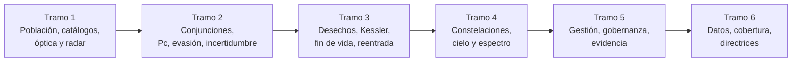

# B118 — Tráfico espacial y sostenibilidad orbital

> **Bloque ampliado (`0.2.0`).** Sus 20 clases de la línea base y las 4 clases programadas (`B118-C21` a `B118-C24`) ya están redactadas. Ver el [programa completo](../../PROGRAMA_ACADEMICO_COMPLETO.md).

**Programa:** Programa Integral de Astronomía, Astrofísica, Ciencias Espaciales e Ingeniería Aeroespacial
**Área:** A10 — Entorno orbital, derecho y seguridad espacial
**Nivel:** N3–N4 (fundamentos y aplicación) · **Clases:** 24 · **Carga:** por calibrar con el uso
**Estado:** guía pedagógica del bloque (resumen de qué se aprende en cada clase). Las clases enlazadas en las tablas ya están redactadas; todas conservan el estado E0 en el catálogo hasta registrar revisión disciplinar.

## 🎯 Propósito del bloque

Enseña **cómo se ve, se cuenta y se gestiona el tráfico en órbita terrestre y qué hay que hacer para que las órbitas útiles sigan siéndolo**. Parte de la población de objetos y de los catálogos que la describen (con los formatos y los límites de su cobertura), sigue con los sensores ópticos y de radar y con la geometría y la probabilidad de una conjunción, y pasa a la evasión y a cómo crece la incertidumbre. Después trata el origen de los desechos, el escenario de cascada de colisiones, el diseño para mitigarlos, la disposición al fin de vida, la desorbitación y el riesgo de la reentrada. Cierra con las constelaciones numerosas, su efecto en el cielo y en el espectro, la gestión del tráfico, la gobernanza y el modo de documentar una evaluación de riesgo, los datos de vigilancia (calidad, intercambio y sesgos) y las directrices técnicas. Cada clase termina con un laboratorio en Python (biblioteca estándar, semilla fija) cuya salida real se copia en la clase; los datos son **sintéticos o ilustrativos** y están rotulados, y lo normativo se cita con el texto y la fecha realmente consultados.

## 📚 Al terminar el bloque podrás

1. Estimar la densidad espacial de objetos por capa y la pendiente del tamaño a partir de dos cifras publicadas.
2. Leer un catálogo: identificadores Alpha-5, suma de comprobación de una TLE y asociación de pistas con tasas de acierto.
3. Calcular la detectabilidad óptica y por radar de un objeto y entender por qué el radar escala con la cuarta potencia del alcance.
4. Obtener el instante, la distancia y la velocidad relativa de una conjunción, su probabilidad de colisión por tres vías y cómo la diluye la incertidumbre.
5. Dimensionar una maniobra de evasión, una desorbitación y la fiabilidad que exige la disposición posmisión, y comprobar el riesgo de una reentrada contra un límite de 10⁻⁴.
6. Razonar escenarios de cascada, constelaciones, brillo, interferencia y cobertura de una red, separando lo consultado, lo sintético y lo ilustrativo.
7. Documentar una evaluación de riesgo de forma reproducible y distinguir lo que es una directriz voluntaria de una obligación jurídica.

## 🧭 Secuencia del bloque

**Descripción textual.** Seis tramos encadenados: ver y catalogar los objetos (C01–C04), calcular y gestionar una conjunción (C05–C08), entender y limitar los desechos (C09–C14), medir el efecto de las constelaciones en el cielo y el espectro (C15–C17), pasar de los cálculos a la gestión, la gobernanza y el registro de una decisión (C18–C20) y cerrar con la calidad de los datos, la cobertura de las redes y las directrices técnicas (C21–C24). El hilo común es que toda cifra viene con su incertidumbre y su origen.

## 🗂️ Las 24 clases en resumen

**Navegación:** cada clase enlaza a la anterior, a la siguiente y a este bloque.

La columna «Evidencia» indica el producto que demostrará el aprendizaje. Los laboratorios usan datos **sintéticos** o **ilustrativos** (rotulados) o valores publicados con fuente y fecha.

### Tramo 1 · Conocer el entorno y verlo

| ID | Clase | Qué se aprende | Evidencia |
|---|---|---|---|
| [B118-C01](../clases/B118/B118-C01-poblacion-de-objetos-orbitales/CLASE.md) | Población de objetos orbitales | Pendiente de la distribución de tamaños a partir de dos cifras de la ESA y densidad espacial por capa de altitud de una población sintética. | Ficha de población orbital con la densidad por capa |
| [B118-C02](../clases/B118/B118-C02-catalogos-de-objetos-espaciales/CLASE.md) | Catálogos de objetos espaciales | Codificación Alpha-5, suma de comprobación de una TLE sintética y asociación pista-catálogo con puerta chi-cuadrado. | Ficha de catálogo con tasas de asociación |
| [B118-C03](../clases/B118/B118-C03-deteccion-y-seguimiento-optico/CLASE.md) | Detección y seguimiento óptico | Magnitud de un objeto, relación señal-ruido, diámetro mínimo detectable y longitud de la traza. | Ficha de detectabilidad óptica |
| [B118-C04](../clases/B118/B118-C04-deteccion-por-radar/CLASE.md) | Detección por radar | Ecuación del radar, sección eficaz en dos regímenes y alcance máximo (escala con R⁻⁴). | Ficha de alcance de un radar hipotético |

### Tramo 2 · Conjunciones y evasión

| ID | Clase | Qué se aprende | Evidencia |
|---|---|---|---|
| [B118-C05](../clases/B118/B118-C05-conjunciones-orbitales/CLASE.md) | Conjunciones orbitales | Instante y distancia de máxima aproximación y velocidad relativa de dos órbitas que se cruzan. | Ficha geométrica de una conjunción |
| [B118-C06](../clases/B118/B118-C06-probabilidad-de-colision/CLASE.md) | Probabilidad de colisión | Probabilidad de colisión 2D por tres vías (cuadratura, disco pequeño y Monte Carlo) y su dilución con la incertidumbre. | Ficha de probabilidad de colisión de dos eventos |
| [B118-C07](../clases/B118/B118-C07-estrategias-de-evasion/CLASE.md) | Estrategias de evasión | Velocidad necesaria para una separación dada, coste en combustible y efecto del tiempo disponible. | Ficha de maniobra de evasión |
| [B118-C08](../clases/B118/B118-C08-propagacion-de-incertidumbre-en-conjunciones/CLASE.md) | Propagación de incertidumbre en conjunciones | Crecimiento lineal de la incertidumbre a lo largo de la traza y curvatura de la región de incertidumbre. | Ficha de crecimiento de incertidumbre |

### Tramo 3 · Desechos, fin de vida y reentrada

| ID | Clase | Qué se aprende | Evidencia |
|---|---|---|---|
| [B118-C09](../clases/B118/B118-C09-generacion-de-desechos/CLASE.md) | Generación de desechos | Distribución de fragmentos por ley de potencias con masa conservada y energía relativa de un impacto. | Ficha de fragmentación ilustrativa |
| [B118-C10](../clases/B118/B118-C10-sindrome-de-kessler-como-escenario/CLASE.md) | Síndrome de Kessler como escenario | Modelo de cero dimensiones con equilibrios, umbral crítico de fuente y dependencia de las condiciones iniciales. | Ficha de escenarios de cascada de colisiones |
| [B118-C11](../clases/B118/B118-C11-diseno-para-mitigacion-de-desechos/CLASE.md) | Diseño para mitigación de desechos | Presupuesto de fiabilidad de la disposición posmisión en serie y con redundancia frente a la meta del 90 %. | Ficha de presupuesto de fiabilidad de disposición |
| [B118-C12](../clases/B118/B118-C12-disposicion-al-fin-de-vida/CLASE.md) | Disposición al fin de vida | Vida orbital por arrastre frente a 25 años y elevación de perigeo en GEO (235 km + 1000 CR A/m). | Ficha de disposición en LEO y GEO |
| [B118-C13](../clases/B118/B118-C13-desorbitacion-controlada/CLASE.md) | Desorbitación controlada | Impulso, combustible y ángulo de entrada de una desorbitación y su dispersión por error de impulso. | Ficha de plan de desorbitación |
| [B118-C14](../clases/B118/B118-C14-reentrada-y-riesgos-en-superficie/CLASE.md) | Reentrada y riesgos en superficie | Área de víctima, número esperado de víctimas y comparación con el límite de 10⁻⁴. | Ficha de riesgo en superficie de una reentrada |

### Tramo 4 · Constelaciones, cielo y espectro

| ID | Clase | Qué se aprende | Evidencia |
|---|---|---|---|
| [B118-C15](../clases/B118/B118-C15-seguimiento-de-mega-constelaciones/CLASE.md) | Seguimiento de mega constelaciones | Constelación Walker sintética, pares cercanos medidos frente al gas uniforme y carga sobre el cribado. | Ficha de carga de seguimiento de una constelación |
| [B118-C16](../clases/B118/B118-C16-contaminacion-luminica/CLASE.md) | Contaminación lumínica | Ventana de iluminación, magnitud de un satélite y trazas esperadas en una exposición. | Ficha de impacto luminoso de una constelación |
| [B118-C17](../clases/B118/B118-C17-interferencia-radioastronomica/CLASE.md) | Interferencia radioastronómica | Sensibilidad de un radiotelescopio, flujo recibido de un satélite y exceso sobre el umbral del 10 %. | Ficha de margen de interferencia |

### Tramo 5 · Gestión, gobernanza y evidencia

| ID | Clase | Qué se aprende | Evidencia |
|---|---|---|---|
| [B118-C18](../clases/B118/B118-C18-gestion-del-trafico-espacial/CLASE.md) | Gestión del tráfico espacial | Cribado en cascada con filtro de apsis, comprobación de que no pierde pares y mapa de responsabilidades jurídicas. | Ficha de cribado de un catálogo sintético |
| [B118-C19](../clases/B118/B118-C19-sostenibilidad-y-gobernanza-orbital/CLASE.md) | Sostenibilidad y gobernanza orbital | Cuadro de cumplimiento frente a las 7 directrices de la COPUOS con intervalo bootstrap. | Cuadro de gobernanza con su incertidumbre |
| [B118-C20](../clases/B118/B118-C20-evaluacion-de-riesgo-de-conjuncion-documentada/CLASE.md) | Evaluación de riesgo de conjunción documentada | Registro reproducible de una evaluación, con sensibilidad, categoría y huella SHA-256. | Registro documentado de una evaluación de conjunción |

### Tramo 6 · Datos, cobertura y normas de vigilancia

| ID | Clase | Qué se aprende | Evidencia |
|---|---|---|---|
| [B118-C21](../clases/B118/B118-C21-calidad-latencia-y-trazabilidad-de-datos-de-vigilancia-espacial/CLASE.md) | Calidad, latencia y trazabilidad de datos de vigilancia espacial | Latencia por etapas con colas, edad de los elementos, error por edad y cadena de huellas que detecta alteraciones. | Ficha de calidad y trazabilidad de datos |
| [B118-C22](../clases/B118/B118-C22-intercambio-de-datos-de-vigilancia-entre-operadores-y-estados/CLASE.md) | Intercambio de datos de vigilancia entre operadores y Estados | Serialización y análisis de un mensaje con unidades, reconciliación entre operadores y rechazo de mensajes mal formados. | Ficha de intercambio de un mensaje de conjunción |
| [B118-C23](../clases/B118/B118-C23-cobertura-sesgos-y-limites-de-las-redes-de-vigilancia/CLASE.md) | Cobertura, sesgos y límites de las redes de vigilancia | Completitud por tamaño, sesgo de selección y pendiente estimada con lo detectado. | Ficha de cobertura y sesgo de una red |
| [B118-C24](../clases/B118/B118-C24-directrices-tecnicas-de-mitigacion-de-desechos-iadc-iso-24113/CLASE.md) | Directrices técnicas de mitigación de desechos (IADC, ISO 24113) | Verificador de cumplimiento con los valores de IADC Rev. 4 y casos límite. | Matriz de verificación de directrices |

## 🧵 Hilos que atraviesan el bloque

- **Cada número, con su incertidumbre:** la covarianza de C06 y C08, el bootstrap de C19, los percentiles de C21 y el sesgo de C23 repiten la misma idea.
- **Observado frente a sintético:** solo las cifras de la ESA (C01, C15) y los valores de las directrices (C11, C12, C14, C24) están consultados; todo lo demás es sintético o ilustrativo y así se rotula.
- **Geometría antes que estadística:** C05, C12, C13 y C15 se resuelven con órbitas keplerianas verificadas por una segunda vía.
- **Normas voluntarias y obligaciones:** las directrices de la COPUOS y de la IADC son voluntarias; los tratados (C18, C19) fijan responsabilidad y jurisdicción. La clase no sustituye la lectura del texto vigente.
- **Verificación independiente:** cada laboratorio contrasta con un caso analítico, un Monte Carlo o una prueba de bordes.

## 📝 Evaluación del bloque (propuesta, por calibrar)

- Fichas y ejercicios por clase, con retroalimentación y recuperación con evidencia distinta.
- Portafolio: el registro documentado de una evaluación de conjunción (C20) con su sensibilidad y los supuestos, y la matriz de verificación de directrices (C24).
- Las condiciones críticas (rotular lo sintético e ilustrativo, no presentar un modelo como observación, citar solo lo consultado y no usar las clases como asesoría) no se compensan con promedio.

## ⚠️ Seguridad y límites

El bloque es **educativo**: no constituye asesoría legal, regulatoria ni financiera, no sustituye la lectura del texto normativo vigente ni el criterio de un especialista habilitado, y ningún resultado debe usarse para decidir una maniobra, una licencia o un seguro reales. Los modelos son simplificados (dos cuerpos, atmósfera exponencial, covarianzas gaussianas, ley de potencias) y sus parámetros son sintéticos o ilustrativos. Los textos normativos se citan con la versión y la fecha realmente consultadas: directrices de la COPUOS (UNOOSA, 2010) y de la IADC (IADC-02-01 Rev. 4, enero de 2025), tratados en la compilación ST/SPACE/11 (2002); la versión vigente puede haber cambiado. Las directrices son voluntarias; las normas nacionales (por ejemplo, el plazo de 5 años de la FCC) y las normas ISO no se consultaron en su texto.

## 📖 Fuentes consultadas en el bloque (resumen)

Consultadas el 2026-11-11: las directrices de mitigación de desechos de la COPUOS (PDF de la UNOOSA, 2010), la compilación de tratados ST/SPACE/11 (Tratado del Espacio Ultraterrestre, arts. VI–IX; Convenio sobre Responsabilidad, arts. II–III; Convenio sobre Registro, art. II), las directrices IADC-02-01 Rev. 4 (enero de 2025, PDF presentado a la UNOOSA), la página del Informe sobre el Entorno Espacial 2025 de la ESA, la documentación de Space-Track y la ficha del Libro Azul CCSDS 508.0-B-1. De la Recomendación ITU-R RA.769, de las Directrices de Sostenibilidad a Largo Plazo de 2019 y de la regla de 5 años de la FCC solo se leyó el resumen de una búsqueda web, y no se abrieron los textos. No se consultaron el artículo de Kessler y Cour-Palais (1978), ISO 24113, los estándares ECSS ni los modelos de la NASA (ORDEM, DAS); las relaciones físicas (radar, Kepler, Pc 2D, magnitud de una esfera difusa) son estándar y cada laboratorio las verifica por una segunda vía. Los parámetros de sensores, atmósfera, fragmentación y operadores son sintéticos o ilustrativos.

## Fuentes de orientación preliminar

- **[UNOOSA]** [United Nations Office for Outer Space Affairs](https://www.unoosa.org/) — Tratados, regulación e iniciativas de cooperación internacional.
- **[ITU]** [International Telecommunication Union](https://www.itu.int/) — Telecomunicaciones y coordinación del espectro internacional.
- **[NASA-SYSTEMS]** [NASA Systems Engineering Handbook](https://www.nasa.gov/reference/systems-engineering-handbook/) — Ingeniería de sistemas, verificación, validación y gestión técnica.

> La asociación de estas fuentes es orientativa por bloque. Las fuentes realmente consultadas para cada afirmación se registran en la sección 11 de cada clase.

## Roles que lo usan

- [Derecho, políticas y negocios espaciales](../../rutas/derecho-politicas-y-negocios-espaciales.md)
- [Navegación, guiado y autonomía espacial](../../rutas/navegacion-guiado-y-autonomia-espacial.md)
- [Radioastronomía e interferometría](../../rutas/radioastronomia-e-interferometria.md)
- [Seguridad, defensa y resiliencia de infraestructuras espaciales](../../rutas/seguridad-defensa-y-resiliencia-de-infraestructuras-espaciales.md)

[🏠 Volver al programa](../../README.md) · [➡️ B119 — Derecho, seguridad y geopolítica espacial](./B119-derecho-seguridad-y-geopolitica-espacial.md)
