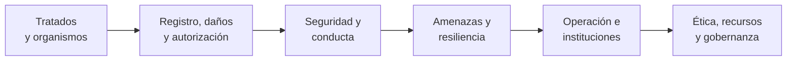

# B119 — Derecho, seguridad y geopolítica espacial

> **Bloque ampliado.** Sus 20 clases de la línea base y sus 16 clases programadas (`B119-C21` a `B119-C36`) están redactadas. Ver el [programa completo](../../PROGRAMA_ACADEMICO_COMPLETO.md).

**Programa:** Programa Integral de Astronomía, Astrofísica, Ciencias Espaciales e Ingeniería Aeroespacial
**Área:** A10 — Entorno orbital, derecho y seguridad espacial
**Nivel:** N3 (fundamentos disciplinares) · **Clases:** 36 · **Carga:** por calibrar con el uso
**Estado:** guía pedagógica del bloque (resumen de qué se aprende en cada clase). Las clases enlazadas en las tablas ya están redactadas; todas conservan el estado E0 en el catálogo hasta registrar revisión disciplinar.

## 🎯 Propósito del bloque

Enseña **cómo se razona el derecho y la seguridad del espacio con texto normativo citado y con modelos pequeños y verificables**, sin sustituir a un jurista, a un regulador ni a un operador. Recorre los cinco tratados de Naciones Unidas (principios, salvamento, responsabilidad, registro, Luna), los organismos que los administran, la autorización de operadores y el espectro, la responsabilidad por daños, el uso pacífico y la competencia estratégica, la vigilancia del entorno orbital, las amenazas cibernéticas y la resiliencia de comunicaciones, la protección de infraestructura crítica, la ética, la legislación comparada y la simulación de la respuesta institucional; y añade seguridad de sitio de lanzamiento, impacto ambiental, experimentación educativa, recursos espaciales, doctrinas y diplomacia, conducta responsable, escalada y atribución, costumbre e interpretación de tratados, obligaciones por actor, equidad de acceso y gobernanza de datos y de recursos. Cada clase cierra con un laboratorio en Python con semilla fija; todos los casos, países genéricos y cifras de actividad son **sintéticos o ilustrativos** y están rotulados.

## 📚 Al terminar el bloque podrás

1. Leer una cláusula de un tratado de Naciones Unidas y convertirla en una regla comprobable, citando la versión y la fecha de consulta.
2. Calcular con unidades explícitas magnitudes que el derecho presupone: períodos orbitales, pérdidas de enlace, probabilidades de colisión, zonas de exclusión y emisiones.
3. Distinguir obligaciones de Estados, de operadores y de organizaciones, y detectar vacíos en una matriz de obligaciones.
4. Modelar decisiones institucionales (consenso, colas de autorización, negociación, escalada) con simulaciones reproducibles.
5. Aplicar un análisis defensivo de amenazas y dependencias sin entrar en técnicas ofensivas.
6. Rotular qué es texto normativo consultado, qué es modelo y qué es sintético, y recordar que nada de esto es asesoría legal, regulatoria ni financiera.

## 🧭 Secuencia del bloque

**Descripción textual.** Seis tramos encadenados: primero el marco jurídico y su método de interpretación; luego quién registra, autoriza y responde por los daños; después la seguridad y la conducta entre Estados; las amenazas y la resiliencia técnica; la operación y las instituciones que responden a incidentes; y por último la ética y la gobernanza de los recursos. El hilo común es decidir con normas y con modelos que se pueden comprobar.

## 🗂️ Las 36 clases en resumen

**Navegación:** cada clase enlaza a la anterior, a la siguiente y a este bloque. Las clases se leen en el orden `C01`–`C36`; los tramos agrupan temas afines.

La columna «Evidencia» indica el producto que demostrará el aprendizaje. Los laboratorios usan datos **sintéticos** o **ilustrativos** (rotulados) o valores publicados con fuente y fecha.

### Tramo 1 · Tratados, organismos y método jurídico

| ID | Clase | Qué se aprende | Evidencia |
|---|---|---|---|
| [B119-C01](../clases/B119/B119-C01-tratado-del-espacio-ultraterrestre/CLASE.md) | Tratado del Espacio Ultraterrestre | Artículos I–IV, VI, VIII y IX del tratado de 1967 como matriz de obligaciones y verificación de misiones sintéticas contra ella. | Matriz de conformidad de tres misiones sintéticas |
| [B119-C02](../clases/B119/B119-C02-acuerdo-de-salvamento/CLASE.md) | Acuerdo de Salvamento | Obligaciones de notificación, auxilio y devolución; probabilidad de que un retorno de emergencia caiga en un territorio dado. | Ficha de un caso de salvamento sintético |
| [B119-C03](../clases/B119/B119-C03-convenio-de-responsabilidad/CLASE.md) | Convenio de Responsabilidad | Responsabilidad absoluta frente a responsabilidad por culpa, reparto solidario y plazo de reclamación. | Cálculo de reparto de una indemnización sintética |
| [B119-C04](../clases/B119/B119-C04-convenio-de-registro/CLASE.md) | Convenio de Registro | Datos que exige el convenio de registro y cálculo del período nodal desde apogeo y perigeo. | Registro sintético validado con período calculado |
| [B119-C05](../clases/B119/B119-C05-acuerdo-sobre-la-luna-y-alcance/CLASE.md) | Acuerdo sobre la Luna y alcance | «Patrimonio común», uso pacífico y régimen internacional previsto; superficie lunar y su ocupación. | Ficha comparativa Tratado–Acuerdo sobre la Luna |
| [B119-C06](../clases/B119/B119-C06-organismos-unoosa-y-copuos/CLASE.md) | Organismos UNOOSA y COPUOS | Origen, estructura y consenso de COPUOS; probabilidad de bloqueo según el número de miembros. | Modelo de consenso con sensibilidad |
| [B119-C31](../clases/B119/B119-C31-practica-estatal-y-costumbre-internacional-en-el-derecho-espacial/CLASE.md) | Práctica estatal y costumbre internacional en el derecho espacial | Práctica estatal y costumbre: difusión de una práctica y umbral de aceptación. | Curva de difusión de una práctica sintética |
| [B119-C32](../clases/B119/B119-C32-interpretacion-de-tratados-internacionales/CLASE.md) | Interpretación de tratados internacionales | Interpretación de tratados: lecturas posibles, ambigüedad y entropía. | Análisis de ambigüedad de una cláusula sintética |

### Tramo 2 · Registro, autorización, daños y marcos nacionales

| ID | Clase | Qué se aprende | Evidencia |
|---|---|---|---|
| [B119-C07](../clases/B119/B119-C07-registro-nacional-de-objetos/CLASE.md) | Registro nacional de objetos | Registro nacional: campos, identificadores, coherencia y completitud de una base sintética. | Informe de calidad de un registro sintético |
| [B119-C08](../clases/B119/B119-C08-autorizacion-y-supervision-de-operadores/CLASE.md) | Autorización y supervisión de operadores | Autorización y supervisión continua de operadores; tiempo de trámite como cola. | Plan de autorización con tiempos esperados |
| [B119-C09](../clases/B119/B119-C09-derecho-y-normas-de-telecomunicaciones/CLASE.md) | Derecho y normas de telecomunicaciones | Marco de telecomunicaciones espaciales; pérdida en espacio libre y margen de interferencia. | Ficha de interferencia entre dos enlaces sintéticos |
| [B119-C10](../clases/B119/B119-C10-responsabilidad-por-danos-espaciales/CLASE.md) | Responsabilidad por daños espaciales | Daño espacial: probabilidad de colisión, daño esperado y reparto de responsabilidad. | Ficha de exposición a daño con incertidumbre |
| [B119-C19](../clases/B119/B119-C19-legislacion-comparada-y-casos-nacionales/CLASE.md) | Legislación comparada y casos nacionales | Legislación comparada: matriz de rasgos y similitud entre regímenes sintéticos. | Matriz comparada de cinco regímenes sintéticos |
| [B119-C33](../clases/B119/B119-C33-matriz-comparativa-de-obligaciones-juridicas-por-actor/CLASE.md) | Matriz comparativa de obligaciones jurídicas por actor | Matriz de obligaciones por actor y detección de vacíos. | Matriz actor × obligación con vacíos señalados |

### Tramo 3 · Seguridad, uso pacífico y conducta

| ID | Clase | Qué se aprende | Evidencia |
|---|---|---|---|
| [B119-C11](../clases/B119/B119-C11-uso-pacifico-y-limitaciones-militares/CLASE.md) | Uso pacífico y limitaciones militares | Uso pacífico, armas de destrucción masiva y límites militares como árbol de decisión. | Árbol de clasificación verificado con tabla de verdad |
| [B119-C12](../clases/B119/B119-C12-historia-de-competencia-estrategica-espacial/CLASE.md) | Historia de competencia estratégica espacial | Hitos de la competencia estratégica y su cronología frente al derecho. | Línea de tiempo con intervalos calculados |
| [B119-C13](../clases/B119/B119-C13-vigilancia-y-conciencia-situacional-espacial/CLASE.md) | Vigilancia y conciencia situacional espacial | Vigilancia y conciencia situacional: cobertura de sensores, revisita y cribado de conjunciones. | Ficha de cobertura de una red de sensores sintética |
| [B119-C26](../clases/B119/B119-C26-doctrinas-y-politicas-espaciales-declaradas-publicamente/CLASE.md) | Doctrinas y políticas espaciales declaradas públicamente | Lectura sistemática de doctrinas públicas: codificación y acuerdo entre codificadores. | Libro de códigos con kappa de Cohen |
| [B119-C28](../clases/B119/B119-C28-normas-de-comportamiento-responsable-en-el-espacio/CLASE.md) | Normas de comportamiento responsable en el espacio | Conducta responsable: aproximación orbital, distancias relativas y transparencia. | Ficha de maniobra de proximidad sintética |
| [B119-C29](../clases/B119/B119-C29-escalada-desescalada-y-medidas-de-fomento-de-la-confianza/CLASE.md) | Escalada, desescalada y medidas de fomento de la confianza | Escalada, desescalada y medidas de confianza como cadena de Markov. | Ficha de escalada con y sin transparencia |

### Tramo 4 · Amenazas, resiliencia y atribución

| ID | Clase | Qué se aprende | Evidencia |
|---|---|---|---|
| [B119-C14](../clases/B119/B119-C14-amenazas-ciberneticas-a-satelites/CLASE.md) | Amenazas cibernéticas a satélites | Amenazas cibernéticas a satélites como árbol de ataque y riesgo probabilístico, a nivel defensivo. | Árbol de ataque defensivo con controles |
| [B119-C15](../clases/B119/B119-C15-interferencias-y-resiliencia-de-comunicaciones/CLASE.md) | Interferencias y resiliencia de comunicaciones | Interferencia y resiliencia: relación J/S, margen de enlace y alcance de recuperación. | Tabla de resiliencia de un enlace sintético |
| [B119-C16](../clases/B119/B119-C16-proteccion-de-infraestructura-critica/CLASE.md) | Protección de infraestructura crítica | Infraestructura crítica como grafo de dependencias y falla en cascada. | Mapa de criticidad de una red sintética |
| [B119-C17](../clases/B119/B119-C17-conflictos-y-normas-humanitarias-aplicables/CLASE.md) | Conflictos y normas humanitarias aplicables | Normas humanitarias aplicables y clasificación bajo incertidumbre de objetos de doble uso. | Ficha de clasificación con matriz de confusión |
| [B119-C30](../clases/B119/B119-C30-atribucion-de-incidentes-y-desinformacion-en-el-dominio-espacial/CLASE.md) | Atribución de incidentes y desinformación en el dominio espacial | Atribución de incidentes: razonamiento bayesiano y cuantificación de la confianza. | Informe de atribución con razón de verosimilitud |
| [B119-C27](../clases/B119/B119-C27-diplomacia-y-comunicacion-entre-estados-ante-incidentes-espaciales/CLASE.md) | Diplomacia y comunicación entre Estados ante incidentes espaciales | Diplomacia ante incidentes: negociación, alternativa y tiempo de notificación. | Ficha de negociación con sensibilidad |

### Tramo 5 · Operación, seguridad de sitio e instituciones

| ID | Clase | Qué se aprende | Evidencia |
|---|---|---|---|
| [B119-C20](../clases/B119/B119-C20-simulacion-de-respuesta-institucional-a-incidentes/CLASE.md) | Simulación de respuesta institucional a incidentes | Respuesta institucional a incidentes como simulación de eventos discretos. | Cronograma simulado de respuesta con percentiles |
| [B119-C21](../clases/B119/B119-C21-cultura-de-seguridad-aeroespacial-y-aprendizaje-de-incidentes/CLASE.md) | Cultura de seguridad aeroespacial y aprendizaje de incidentes | Cultura de seguridad: notificación de incidentes y curva de aprendizaje. | Ficha de indicadores de cultura de seguridad |
| [B119-C22](../clases/B119/B119-C22-seguridad-de-instalaciones-y-operaciones-de-sitio-de-lanzamiento/CLASE.md) | Seguridad de instalaciones y operaciones de sitio de lanzamiento | Seguridad del sitio de lanzamiento: alcance de fragmentos, zona de exclusión y riesgo colectivo. | Ficha de zona de exclusión sintética |
| [B119-C23](../clases/B119/B119-C23-proteccion-ambiental-de-las-actividades-de-lanzamiento/CLASE.md) | Protección ambiental de las actividades de lanzamiento | Impacto ambiental de lanzar: estequiometría de la combustión y emisiones por lanzamiento. | Balance de emisiones de un lanzamiento sintético |
| [B119-C24](../clases/B119/B119-C24-limites-legales-y-de-seguridad-de-la-experimentacion-educativa/CLASE.md) | Límites legales y de seguridad de la experimentación educativa | Límites de la experimentación educativa: impulso, apogeo y distancia de seguridad. | Ficha de límites de un experimento educativo |

### Tramo 6 · Ética, recursos y gobernanza

| ID | Clase | Qué se aprende | Evidencia |
|---|---|---|---|
| [B119-C18](../clases/B119/B119-C18-etica-y-derechos-en-actividades-espaciales/CLASE.md) | Ética y derechos en actividades espaciales | Ética y derechos: decisión multicriterio y sensibilidad a los pesos. | Matriz multicriterio con análisis de sensibilidad |
| [B119-C25](../clases/B119/B119-C25-derecho-y-marcos-de-recursos-espaciales/CLASE.md) | Derecho y marcos de recursos espaciales | Recursos espaciales: ecuación del cohete, valor del agua en órbita y marcos jurídicos. | Caso de negocio sintético de un recurso |
| [B119-C34](../clases/B119/B119-C34-equidad-de-acceso-al-espacio/CLASE.md) | Equidad de acceso al espacio | Equidad de acceso: curva de Lorenz y desigualdad de capacidad de lanzamiento. | Ficha de desigualdad con Gini y Atkinson |
| [B119-C35](../clases/B119/B119-C35-seguridad-y-gobernanza-de-datos-espaciales/CLASE.md) | Seguridad y gobernanza de datos espaciales | Gobernanza y seguridad de datos espaciales: clasificación y privacidad diferencial. | Política de acceso con compromiso privacidad–error |
| [B119-C36](../clases/B119/B119-C36-gobernanza-de-los-recursos-espaciales/CLASE.md) | Gobernanza de los recursos espaciales | Gobernanza de recursos: reparto de beneficios y valor de Shapley. | Comparación de tres reglas de reparto |

## 🧵 Hilos que atraviesan el bloque

- **Texto normativo frente a modelo:** cada clase separa lo que dice un instrumento (citado con versión y fecha) de lo que calcula el laboratorio.
- **Actor y obligación:** Estado, operador, organización internacional; quién debe qué y quién responde.
- **Verificación independiente:** cada laboratorio contrasta con una solución analítica, una enumeración exhaustiva o una propiedad que debe cumplirse.
- **Sintético frente a observado:** países genéricos, incidentes y cifras de actividad son inventados y rotulados; lo simulado nunca se presenta como observado.
- **Defensivo, no ofensivo:** las clases de amenazas y de doble uso modelan riesgo y resiliencia, no procedimientos para atacar.

## 📝 Evaluación del bloque (propuesta, por calibrar)

- Fichas y ejercicios por clase, con retroalimentación y recuperación con evidencia distinta.
- Portafolio: la matriz de obligaciones por actor (C33) o la simulación de respuesta institucional (C20), con sus supuestos y su sensibilidad.
- Las condiciones críticas (citar la versión y la fecha del texto consultado, rotular lo sintético, no presentar un modelo como asesoría) no se compensan con promedio.

## ⚠️ Seguridad y límites

El bloque es **educativo** y **no es asesoría legal, regulatoria ni financiera**: no sustituye a un abogado, a una autoridad competente ni a un asesor, y nada de lo que calculan los laboratorios debe usarse para decidir sobre una licencia, una reclamación, un contrato o una operación real. Los tratados se parafrasean a partir de las páginas oficiales consultadas en las fechas indicadas; el texto vinculante es el de la fuente oficial y puede haber cambiado. Las clases de amenazas y de doble uso son defensivas: no describen técnicas de ataque ni de selección de objetivos. Los modelos son simplificados (mezcla de actores en cadenas de Markov, juegos de negociación estilizados, mundos de países genéricos) y sus parámetros son ilustrativos.

## 📖 Fuentes consultadas en el bloque (resumen)

Consultadas el 2026-11-11: la página de la Convención sobre Registro de UNOOSA, la página del Acuerdo sobre la Luna de UNOOSA, la nota introductoria del Tratado del Espacio Ultraterrestre de la Biblioteca Audiovisual de Derecho Internacional de la ONU (legal.un.org) y la página de servicios espaciales de la UIT-R (lectura con WebFetch); y, solo como resumen de búsqueda web, las páginas de UNOOSA sobre el Tratado, el Convenio de Responsabilidad y COPUOS, y los metadatos de las revisiones de las directrices del IADC. **No consultados:** el texto completo del Acuerdo de Salvamento (la página de UNOOSA devolvió error), el Reglamento de Radiocomunicaciones, las directrices del IADC y de COPUOS (cuerpo del texto), la legislación de cualquier Estado, los Acuerdos Artemis y las doctrinas públicas de los Estados; todo lo que dependa de ellos se rotula «no consultado». Las relaciones físicas y matemáticas (Kepler, pérdida en espacio libre, Poisson, Shapley, Gini, kappa) no se consultaron en una fuente concreta: las verifica cada laboratorio con una segunda vía.

## Fuentes de orientación preliminar

- **[UNOOSA]** [United Nations Office for Outer Space Affairs](https://www.unoosa.org/) — Tratados, regulación e iniciativas de cooperación internacional.
- **[ITU]** [International Telecommunication Union](https://www.itu.int/) — Telecomunicaciones y coordinación del espectro internacional.
- **[NASA-HUMAN]** [NASA Human Research Program](https://www.nasa.gov/hrp/) — Factores humanos, medicina y riesgos de exploración tripulada.
- **[NASA-SYSTEMS]** [NASA Systems Engineering Handbook](https://www.nasa.gov/reference/systems-engineering-handbook/) — Ingeniería de sistemas, verificación, validación y gestión técnica.

> La asociación de estas fuentes es orientativa por bloque. Las fuentes realmente consultadas para cada afirmación se registran en la sección 11 de cada clase.
