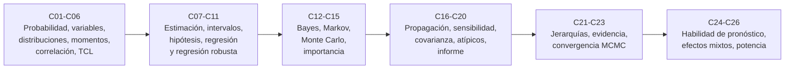

# B12 — Probabilidad, estadística e incertidumbre

**Programa:** Programa Integral de Astronomía, Astrofísica, Ciencias Espaciales e Ingeniería Aeroespacial
**Área:** A02 — Matemática, física computacional y métodos científicos
**Nivel:** N1 → N4 (de los fundamentos de la probabilidad al informe de incertidumbre) · **Clases:** 20 de la línea base + 6 programadas (C21–C26) · **Carga:** por calibrar con el uso
**Estado:** guía pedagógica del bloque (resumen de qué se aprende en cada clase). Las 26 clases (20 de la línea base y 6 de la ampliación) están redactadas y enlazadas en la tabla, pendientes de revisión disciplinar. Todas conservan el estado E0 en el catálogo hasta registrar esa revisión.

> **Bloque ampliado.** Además de las 20 clases de la línea base, el bloque tiene 6 clases programadas (`B12-C21` a `B12-C26`), ya redactadas. Ver el [programa completo](../../PROGRAMA_ACADEMICO_COMPLETO.md).

## 🎯 Propósito del bloque

Ninguna medida espacial es exacta: un telémetro, un contador de fotones, un filtro de navegación o un panel solar entregan números con ruido. Este bloque enseña a **describir esa incertidumbre con probabilidad, estimarla a partir de datos, propagarla a un resultado y comunicarla de forma que otra persona pueda auditarla**. Se apoya en el cálculo de [B09](./B09-calculo-diferencial-e-integral.md) y el álgebra lineal de [B10](./B10-algebra-lineal-y-matematicas-geometricas.md), y usa las simulaciones de [B11](./B11-ecuaciones-diferenciales-y-simulacion-numerica.md). Es la base de la metrología y de las mediciones de [B13](./B13-metrologia-tiempo-y-mediciones-cientificas.md) y de la computación científica reproducible de [B14](./B14-computacion-cientifica-y-ciencia-abierta.md).

## 📚 Al terminar el bloque podrás

1. Modelar un experimento con espacios muestrales, eventos y variables aleatorias, y elegir la distribución adecuada para conteos, esperas y ruido.
2. Calcular esperanza, varianza, covarianza y correlación, y combinar errores independientes y correlacionados.
3. Estimar parámetros con su error típico, construir intervalos y contrastar hipótesis controlando error y potencia.
4. Ajustar modelos lineales, no lineales y robustos, y detectar valores atípicos sin esconderlos.
5. Hacer inferencia bayesiana, muestrear con cadenas de Markov, diagnosticar su convergencia y comparar modelos con evidencia y criterios de información.
6. Simular con Monte Carlo, estimar sucesos raros con muestreo de importancia, propagar incertidumbre (GUM y JCGM 101) y analizar la sensibilidad.
7. Describir incertidumbres vectoriales con matrices de covarianza y redactar un informe de incertidumbre reproducible.
8. Evaluar pronósticos con métricas de habilidad y analizar datos longitudinales y poblaciones pequeñas con sus sesgos y su potencia.

## 🧭 Secuencia del bloque

**Descripción textual.** Seis tramos encadenados: el lenguaje de la probabilidad y sus resúmenes (C01–C06), la inferencia clásica y el ajuste de modelos (C07–C11), la inferencia bayesiana y los métodos de simulación (C12–C15), la propagación de incertidumbre y el informe que la documenta (C16–C20), la ampliación bayesiana (C21–C23: jerarquías, comparación de modelos y convergencia de cadenas) y las aplicaciones a pronósticos y a poblaciones pequeñas (C24–C26).

## 🗂️ Las clases en resumen

**Navegación:** cada clase desarrollada enlaza a la anterior, a la siguiente y a este bloque; la fila de cada clase lleva a su `CLASE.md`.

Los resúmenes son la **especificación pedagógica propuesta** (nivel E1 parcial, pendiente de revisión). La columna «Evidencia» indica el producto que demostrará el aprendizaje.

### Tramo 1 · Lenguaje de la probabilidad

| ID | Clase | Qué se aprende | Evidencia |
|---|---|---|---|
| [B12-C01](../clases/B12/B12-C01-espacios-muestrales-y-eventos/CLASE.md) | Espacios muestrales y eventos | Espacio muestral, eventos, probabilidad condicional, Bayes e independencia; redundancia de tres computadores con y sin causa común. | Informe de redundancia |
| [B12-C02](../clases/B12/B12-C02-variables-aleatorias/CLASE.md) | Variables aleatorias | Variable discreta y continua, función de masa, densidad, acumulada y cuantiles; por qué `P(Y = y) = 0`. | Ficha de variables aleatorias |
| [B12-C03](../clases/B12/B12-C03-distribuciones-de-probabilidad/CLASE.md) | Distribuciones de probabilidad | Binomial, Poisson, exponencial y normal; qué supuesto físico sostiene cada una; el detector de conteos. | Ficha de elección de distribución |
| [B12-C04](../clases/B12/B12-C04-esperanza-y-varianza/CLASE.md) | Esperanza y varianza | Centro y dispersión, transformaciones lineales, suma de varianzas, promedio `σ/√n` y su límite por el sesgo; Chebyshev. | Ficha de combinación de errores |
| [B12-C05](../clases/B12/B12-C05-covarianza-y-correlacion/CLASE.md) | Covarianza y correlación | Covarianza, Pearson, varianza de sumas con correlación, promedio con correlación común; correlación cero sin independencia. | Ficha de correlación |
| [B12-C06](../clases/B12/B12-C06-teorema-central-del-limite/CLASE.md) | Teorema central del límite | La campana como atractor de los promedios, distancia KS, y el contraejemplo de Cauchy. | Informe de convergencia a la normal |

### Tramo 2 · Inferencia clásica y ajuste de modelos

| ID | Clase | Qué se aprende | Evidencia |
|---|---|---|---|
| [B12-C07](../clases/B12/B12-C07-estimacion-de-parametros/CLASE.md) | Estimación de parámetros | Máxima verosimilitud, sesgo y error cuadrático medio, `n − 1` por enumeración exacta, error típico. | Ficha de estimador |
| [B12-C08](../clases/B12/B12-C08-intervalos-de-confianza/CLASE.md) | Intervalos de confianza | Intervalo `t`, interpretación correcta, cobertura simulada y tamaño de muestra. | Informe de cobertura |
| [B12-C09](../clases/B12/B12-C09-pruebas-de-hipotesis/CLASE.md) | Pruebas de hipótesis | `H₀`, valor `p`, error tipo I, potencia y pruebas múltiples; dos valores publicados de `H₀`. | Informe de decisión estadística |
| [B12-C10](../clases/B12/B12-C10-regresion-lineal-y-no-lineal/CLASE.md) | Regresión lineal y no lineal | Mínimos cuadrados, `s²(XᵀX)⁻¹`, correlación de parámetros, ajuste exponencial y extrapolación con incertidumbre. | Informe de ajuste |
| [B12-C11](../clases/B12/B12-C11-regresion-robusta/CLASE.md) | Regresión robusta | Mediana, MAD, Theil–Sen y Huber por IRLS; punto de ruptura y costo de eficiencia. | Comparación robusta |

### Tramo 3 · Inferencia bayesiana y simulación

| ID | Clase | Qué se aprende | Evidencia |
|---|---|---|---|
| [B12-C12](../clases/B12/B12-C12-inferencia-bayesiana/CLASE.md) | Inferencia bayesiana | Prior, verosimilitud, posterior conjugada (Beta–Binomial, Poisson–Gamma), intervalo creíble y tasa base. | Informe de actualización bayesiana |
| [B12-C13](../clases/B12/B12-C13-cadenas-de-markov-y-muestreo/CLASE.md) | Cadenas de Markov y muestreo | Distribución estacionaria, balance detallado y algoritmo de Metropolis. | Informe del muestreador |
| [B12-C14](../clases/B12/B12-C14-simulacion-monte-carlo/CLASE.md) | Simulación Monte Carlo | Estimar probabilidades e integrales, error `1/√N`, semilla y reproducibilidad. | Informe de simulación |
| [B12-C15](../clases/B12/B12-C15-muestreo-de-importancia/CLASE.md) | Muestreo de importancia | Pesos `p/q`, suceso raro `P(Z > 4)`, tamaño muestral efectivo y modos de fallo. | Informe de suceso raro |

### Tramo 4 · Propagación de incertidumbre e informe

| ID | Clase | Qué se aprende | Evidencia |
|---|---|---|---|
| [B12-C16](../clases/B12/B12-C16-propagacion-de-incertidumbre/CLASE.md) | Propagación de incertidumbre | Ley de propagación del GUM, coeficientes de sensibilidad, tolerancias rectangulares y Monte Carlo (JCGM 101); no linealidad. | Informe de propagación |
| [B12-C17](../clases/B12/B12-C17-analisis-de-sensibilidad/CLASE.md) | Análisis de sensibilidad | Derivadas, elasticidades, contribución a la varianza e índices de Sobol validados con Ishigami. | Tabla de prioridades de mejora |
| [B12-C18](../clases/B12/B12-C18-matrices-de-covarianza/CLASE.md) | Matrices de covarianza | Simetría y semidefinición positiva, elipse de error, `J P Jᵀ`, Mahalanobis y matriz inválida. | Informe de covarianza de un estado |
| [B12-C19](../clases/B12/B12-C19-deteccion-de-valores-atipicos/CLASE.md) | Detección de valores atípicos | Grubbs, puntaje z modificado, Mahalanobis, falsos positivos y enmascaramiento. | Informe de depuración de datos |
| [B12-C20](../clases/B12/B12-C20-informe-de-incertidumbre-de-una-mision/CLASE.md) | Informe de incertidumbre de una misión | Presupuesto de tipos A y B, Welch–Satterthwaite, incertidumbre expandida, verificación Monte Carlo y redacción GUM. | Informe de incertidumbre |

### Tramo 5 · Ampliación bayesiana

| ID | Clase | Qué se aprende | Evidencia |
|---|---|---|---|
| [B12-C21](../clases/B12/B12-C21-modelos-jerarquicos-bayesianos/CLASE.md) | Modelos jerárquicos bayesianos | Agrupación parcial normal–normal, contracción `B_j`, posterior de la heterogeneidad `τ`. | Informe del modelo jerárquico |
| [B12-C22](../clases/B12/B12-C22-comparacion-de-modelos-evidencia-bayesiana-y-criterios-de-informacion/CLASE.md) | Comparación de modelos: evidencia bayesiana y criterios de información | Evidencia, factor de Bayes, AIC y BIC; Occam automática y dependencia del prior. | Informe de selección de modelo |
| [B12-C23](../clases/B12/B12-C23-diagnostico-de-convergencia-y-reproducibilidad-de-cadenas-mcmc/CLASE.md) | Diagnóstico de convergencia y reproducibilidad de cadenas MCMC | `R̂` dividido, tiempo de autocorrelación y `ESS`, inicios dispersos y huellas SHA-256. | Registro de convergencia y reproducibilidad |

### Tramo 6 · Pronósticos y poblaciones pequeñas

| ID | Clase | Qué se aprende | Evidencia |
|---|---|---|---|
| [B12-C24](../clases/B12/B12-C24-metricas-de-habilidad-skill-scores-de-pronostico/CLASE.md) | Métricas de habilidad (skill scores) de pronóstico | Brier y BSS, tabla de contingencia, POD, POFD, TSS y HSS; la referencia importa. | Informe de verificación de un pronóstico |
| [B12-C25](../clases/B12/B12-C25-modelos-longitudinales-y-de-efectos-mixtos-para-muestras-pequenas/CLASE.md) | Modelos longitudinales y de efectos mixtos para muestras pequeñas | Intercepto aleatorio, ICC, error del nivel y de la pendiente, intervalos con `t(m − 1)` y privacidad. | Informe longitudinal con muestra pequeña |
| [B12-C26](../clases/B12/B12-C26-sesgos-y-potencia-estadistica-en-poblaciones-pequenas/CLASE.md) | Sesgos y potencia estadística en poblaciones pequeñas | Potencia exacta con la `t` no central, filtro de significancia (errores M y S) y valor predictivo positivo. | Informe de potencia y sesgo |

## 🧵 Hilos que atraviesan el bloque

- **Incertidumbre como número con método:** C04 y C16 introducen la combinación de varianzas; C17 identifica qué entrada domina; C20 la documenta en un presupuesto.
- **Verificar contra una referencia:** cada laboratorio incluye una prueba contra una solución exacta o un cálculo independiente (enumeración con fracciones, integración numérica, fórmula analítica).
- **Simulación con su error:** C14 enseña el error `1/√N`, que reaparece en C15 (importancia), C16 (JCGM 101), C23 (`ESS`) y C26 (potencia).
- **Supuestos explícitos:** independencia (C01, C05), normalidad (C06, C08), tasa constante (C03, C07), intercambiabilidad (C21), cada uno con su prueba de fallo.
- **Ética del dato:** C11 y C19 (no borrar atípicos), C25 y C26 (privacidad y exageración con muestras pequeñas).

## 📝 Evaluación del bloque (propuesta, por calibrar)

- Fichas y ejercicios por clase, con retroalimentación y recuperación con evidencia distinta.
- Portafolio de laboratorios: cada script debe ejecutarse, declarar datos, supuestos, validez y tolerancia, y contener una prueba contra una solución exacta o una referencia independiente.
- Informe de C20 con rúbrica publicada antes; las condiciones críticas (rotular lo sintético y lo simulado, combinar en cuadratura, declarar método y factor de cobertura, no borrar datos sin causa documentada, citar solo fuentes consultadas) no se compensan con promedio.

## ⚠️ Seguridad y límites

Todo el bloque es educativo. Los datos son sintéticos o ilustrativos, salvo las dos estimaciones publicadas de `H₀` de C09 (resúmenes consultados), y las constantes `GM` y radio nominales de la IAU. **Ningún cálculo sirve** para certificar la fiabilidad de una nave, evaluar riesgo de colisión, determinar una órbita ni emitir un pronóstico operativo. Los ejercicios con grupos pequeños (C25, C26) usan datos sintéticos; con datos de personas se requiere consentimiento, privacidad y revisión ética, y las decisiones de salud corresponden a profesionales competentes. Los datos se rotulan observados, estimados, sintéticos o simulados.

## Fuentes de orientación preliminar

- **[BIPM-JCGM]** [JCGM 100:2008 (GUM)](https://doi.org/10.59161/JCGM100-2008E), [JCGM 101:2008](https://doi.org/10.59161/JCGM101-2008) y [JCGM 102:2011](https://doi.org/10.59161/JCGM102-2011) — Expresión de la incertidumbre de medida, propagación por Monte Carlo y salidas múltiples (PDF consultados el 2026-11-05).
- **[NIST]** [NIST/SEMATECH e-Handbook of Statistical Methods](https://www.itl.nist.gov/div898/handbook/) — Secciones 1.3.5.2, 1.3.5.17, 1.3.6.6.1, 1.3.6.7.2 y 7.2.2.2 (páginas consultadas el 2026-11-05).
- **[IAU]** [IAU 2015 Resolución B3](https://arxiv.org/abs/1510.07674) — Valores nominales de `GM` y radios planetarios (PDF consultado el 2026-11-05).
- **[ARXIV]** Resúmenes consultados el 2026-11-05: Planck 2018 VI ([1807.06209](https://arxiv.org/abs/1807.06209)), Riess et al. ([2112.04510](https://arxiv.org/abs/2112.04510)), Hogg, Bovy y Lang ([1008.4686](https://arxiv.org/abs/1008.4686)), emcee ([1202.3665](https://arxiv.org/abs/1202.3665)), Vehtari et al. ([1903.08008](https://arxiv.org/abs/1903.08008)), Liddle ([astro-ph/0701113](https://arxiv.org/abs/astro-ph/0701113)) y Barnes et al. ([1608.06319](https://arxiv.org/abs/1608.06319)).
- **[IERS]**, **[JPL-SPICE]** y **[NASA-NTRS]** — Orientación; sin respaldar aún afirmaciones de clases de este bloque.

> La asociación de estas fuentes es orientativa por bloque. Cada clase registra en su sección 11 la fuente, el localizador, la fecha de consulta y lo que realmente respalda; de los artículos de arXiv solo se leyó el resumen, salvo indicación contraria. Las fórmulas estándar de estadística que no se atribuyen a una fuente consultada se señalan en los límites de cada clase.

[🏠 Volver al programa](../../README.md) · [⬅️ B11 — Ecuaciones diferenciales y simulación numérica](./B11-ecuaciones-diferenciales-y-simulacion-numerica.md) · [➡️ B13 — Metrología, tiempo y mediciones científicas](./B13-metrologia-tiempo-y-mediciones-cientificas.md)
