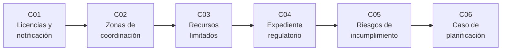

# B120 — Espectro, licencias y regulación satelital

> **Bloque nuevo de la estructura vigente.** Sus 6 clases estaban programadas por la ampliación y ahora están redactadas. Ver el [programa completo](../../PROGRAMA_ACADEMICO_COMPLETO.md).

**Programa:** Programa Integral de Astronomía, Astrofísica, Ciencias Espaciales e Ingeniería Aeroespacial
**Área:** A10 — Entorno orbital, derecho y seguridad espacial
**Nivel:** N4 (aplicación) · **Clases:** 6 · **Carga:** por calibrar con el uso
**Estado:** guía pedagógica del bloque (resumen de qué se aprende en cada clase). Las clases enlazadas en la tabla ya están redactadas; todas conservan el estado E0 en el catálogo hasta registrar revisión disciplinar.

## 🎯 Propósito del bloque

Enseña **cómo se pone en servicio un satélite desde el punto de vista del espectro radioeléctrico y de la órbita**, tratando la regulación como un conjunto de reglas con plazos, umbrales y condiciones que se pueden calcular y comprobar. Recorre el procedimiento de publicación anticipada, coordinación, notificación y registro ante la UIT con sus plazos, las zonas de coordinación entre servicios, el espectro y las posiciones orbitales como recursos limitados con reglas de acceso, el expediente que respalda cada trámite, el riesgo de perder derechos por incumplir un plazo o un hito, y un caso integrador que reúne todo en un plan. Cada clase cierra con un laboratorio en Python con semilla fija; todos los expedientes, sistemas y plazos de los ejemplos son **sintéticos** y están rotulados.

## 📚 Al terminar el bloque podrás

1. Calcular la línea de tiempo regulatoria de una red satelital (publicación anticipada, coordinación, notificación, puesta en servicio) y detectar plazos incumplidos.
2. Estimar una distancia de coordinación con un modelo de pérdida de espacio libre y decidir qué administraciones quedan dentro de la zona, distinguiéndolo del método reglamentario completo.
3. Explicar por qué el espectro y la órbita geoestacionaria son recursos limitados y comparar un acceso «primero en llegar, primero en ser servido» con una planificación a priori.
4. Verificar la completitud y la coherencia de un expediente regulatorio sintético campo por campo.
5. Estimar con una fórmula y una simulación la probabilidad de incumplir un plazo o un hito de despliegue y el costo esperado.
6. Integrar plazos, coordinación, posición orbital, expediente y riesgo en un plan regulatorio de un sistema sintético.
7. Rotular qué es texto normativo consultado, qué es modelo ilustrativo y qué no se consultó, y recordar que nada de esto es asesoría legal ni regulatoria.

## 🧭 Secuencia del bloque

**Descripción textual.** Seis clases encadenadas: el procedimiento y sus plazos (C01), la coordinación con otros servicios (C02), el recurso escaso que se coordina (C03), el expediente que prueba cada paso (C04), el riesgo de fallar un plazo (C05) y el plan que lo integra (C06). El hilo común es que cada regla regulatoria se traduce en una condición que se puede verificar.

## 🗂️ Las 6 clases en resumen

**Navegación:** cada clase enlaza a la anterior, a la siguiente y a este bloque.

La columna «Evidencia» indica el producto que demostrará el aprendizaje. Los laboratorios usan datos **sintéticos** (rotulados) o plazos tomados de textos con fuente y fecha.

### Tramo 1 · El procedimiento

| ID | Clase | Qué se aprende | Evidencia |
|---|---|---|---|
| [B120-C01](../clases/B120/B120-C01-licencias-satelitales-y-procedimiento-de-notificacion/CLASE.md) | Licencias satelitales y procedimiento de notificación | Publicación anticipada, coordinación, notificación y registro; plazos de siete años, 24 meses y 90 días. | Línea de tiempo regulatoria de una red sintética |
| [B120-C02](../clases/B120/B120-C02-zonas-de-coordinacion-entre-servicios-radioelectricos/CLASE.md) | Zonas de coordinación entre servicios radioeléctricos | Distancia de coordinación con pérdida de espacio libre, administraciones afectadas y plazos de respuesta. | Ficha de zona de coordinación de una estación terrena sintética |

### Tramo 2 · El recurso y su acceso

| ID | Clase | Qué se aprende | Evidencia |
|---|---|---|---|
| [B120-C03](../clases/B120/B120-C03-posiciones-orbitales-y-espectro-como-recursos-limitados/CLASE.md) | Posiciones orbitales y espectro como recursos limitados | Radio de la órbita geoestacionaria, número de posiciones, orden de llegada frente a planificación y diligencia debida. | Comparación de dos regímenes de acceso con su índice de desigualdad |

### Tramo 3 · Documentar, arriesgar y planificar

| ID | Clase | Qué se aprende | Evidencia |
|---|---|---|---|
| [B120-C04](../clases/B120/B120-C04-documentacion-regulatoria-de-un-sistema-satelital/CLASE.md) | Documentación regulatoria de un sistema satelital | Datos exigidos en cada trámite, completitud y coherencia del expediente. | Informe de completitud de un expediente sintético |
| [B120-C05](../clases/B120/B120-C05-riesgos-de-incumplimiento-regulatorio/CLASE.md) | Riesgos de incumplimiento regulatorio | Probabilidad de perder un plazo o un hito de despliegue, fórmula frente a simulación, costo esperado. | Matriz de riesgo de incumplimiento con su sensibilidad |
| [B120-C06](../clases/B120/B120-C06-caso-de-planificacion-regulatoria-de-un-sistema-satelital/CLASE.md) | Caso de planificación regulatoria de un sistema satelital | Plan regresivo desde la puesta en servicio, coordinación, expediente y riesgo en un solo plan. | Plan regulatorio sintético con calendario, riesgos y límites |

## 🧵 Hilos que atraviesan el bloque

- **Regla como condición verificable:** cada plazo o umbral se programa y se prueba con casos que lo cumplen y casos que lo violan.
- **Versión y fecha del texto:** toda cifra normativa se cita con el documento y la fecha en que se consultó; las ediciones posteriores del Reglamento de Radiocomunicaciones no se consultaron.
- **Texto frente a modelo:** el plazo de siete años es texto consultado; el retraso de lanzamiento, el costo y el nivel de interferencia permisible son ilustrativos.
- **Verificación independiente:** cada laboratorio contrasta con una segunda vía (otra aritmética de fechas, la inversa de una fórmula, una cota analítica o una simulación).

## 📝 Evaluación del bloque (propuesta, por calibrar)

- Fichas y ejercicios por clase, con retroalimentación y recuperación con evidencia distinta.
- Portafolio: el plan regulatorio sintético (C06) con su análisis de sensibilidad.
- Las condiciones críticas (rotular lo sintético, citar la versión y fecha del texto normativo y declarar que no es asesoría legal ni regulatoria) no se compensan con promedio.

## ⚠️ Seguridad y límites

El bloque es **educativo** y **no es asesoría legal, regulatoria ni financiera**: no sustituye la consulta al texto vigente del Reglamento de Radiocomunicaciones, a la administración nacional ni a un abogado especialista, y ningún resultado de los laboratorios debe usarse para tomar decisiones sobre un sistema real. Los plazos citados provienen de documentos de la UIT consultados el 2026-11-11 cuya versión se indica en cada clase (el más antiguo refleja el Reglamento hasta la CMR-15); el texto vigente puede diferir. Los modelos son simplificados (propagación en espacio libre, retrasos con distribución normal, entregas de lanzamiento poissonianas) y todos los sistemas, expedientes y costos son sintéticos.

## 📖 Fuentes consultadas en el bloque (resumen)

Consultadas el 2026-11-11: el documento de la UIT «ITU Radio Regulatory Framework for Space Services» (PDF, metadatos de creación 2018-01-10; leído con PyMuPDF), la presentación «Orbit-Spectrum International Regulatory Framework» de la Oficina de Radiocomunicaciones (PDF, metadatos 2021-05-11), las diapositivas del Seminario Mundial de Radiocomunicaciones 2022 sobre la Resolución 35 (CMR-19) (24–28 de octubre de 2022), la nota de la UIT del 2020-01-30 sobre los hitos de despliegue no geoestacionarios, la página del Departamento de Servicios Espaciales de la UIT y el texto del Tratado del Espacio Ultraterrestre (copia de la NASA, SP-4225, leída como paráfrasis). No se consultaron el texto completo del Reglamento de Radiocomunicaciones (ediciones 2020 y 2024), el Apéndice 7 (método de la zona de coordinación), el Artículo 22 (límites de epfd), la Resolución 35 en su revisión de la CMR-23, la normativa nacional de ninguna administración ni los convenios de responsabilidad y registro.

## Fuentes de orientación preliminar

- **[ITU-R-SSD]** [ITU-R Space Services Department](https://www.itu.int/en/ITU-R/space/Pages/default.aspx) — Presentación, coordinación y registro de redes de satélite.
- **[UNOOSA-Tratados]** [UNOOSA, tratados y principios](https://www.unoosa.org/oosa/en/ourwork/spacelaw/treaties/index.html) — Tratados de la ONU sobre el espacio ultraterrestre.
- **[ITU-RR]** [Reglamento de Radiocomunicaciones](https://www.itu.int/pub/R-REG-RR) — Texto del tratado internacional sobre espectro y órbitas.

> La asociación de estas fuentes es orientativa por bloque. Las fuentes realmente consultadas para cada afirmación se registran en la sección 11 de cada clase.

## Roles que lo usan

- [Derecho políticas y negocios espaciales](../../rutas/derecho-politicas-y-negocios-espaciales.md)

[🏠 Volver al programa](../../README.md) · [➡️ B121 — Regulación nacional de actividades espaciales](./B121-regulacion-nacional-de-actividades-espaciales.md)
