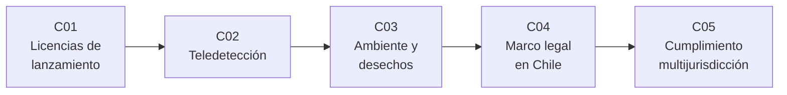

# B121 — Regulación nacional de actividades espaciales

> **Bloque nuevo de la estructura `0.2.0`.** Sus 5 clases estaban programadas por la ampliación y ahora están redactadas. Ver el [programa completo](../../PROGRAMA_ACADEMICO_COMPLETO.md).

**Programa:** Programa Integral de Astronomía, Astrofísica, Ciencias Espaciales e Ingeniería Aeroespacial
**Área:** A10 — Entorno orbital, derecho y seguridad espacial
**Nivel:** N4 (aplicación) · **Clases:** 5 · **Carga:** por calibrar con el uso
**Estado:** guía pedagógica del bloque (resumen de qué se aprende en cada clase). Las clases enlazadas en la tabla ya están redactadas; todas conservan el estado E0 en el catálogo hasta registrar revisión disciplinar.

## 🎯 Propósito del bloque

Enseña **cómo un Estado traduce las obligaciones de los tratados espaciales en requisitos que un operador puede cumplir o incumplir**, y cómo se razona ese cumplimiento con números. Recorre los requisitos de una licencia de lanzamiento (riesgo para el público), la regulación de la teledetección (qué resolución importa y por qué), los requisitos ambientales y de desorbitación (plazos, probabilidad de éxito, riesgo de reentrada), el marco chileno visto con rótulos de evidencia y el análisis de cumplimiento de una misión con socios de varios países. Cada clase cierra con un laboratorio en Python; los **umbrales normativos** que se usan se consultaron en el texto con fecha, y todos los **diseños, poblaciones y jurisdicciones inventadas** están rotulados como sintéticos.

## 📚 Al terminar el bloque podrás

1. Calcular las bajas esperadas de un lanzamiento con un modelo de zonas y compararlas con el criterio de riesgo colectivo del texto consultado.
2. Calcular la resolución efectiva de un sensor óptico (GSD y límite de difracción) y explicar por qué la regulación de la teledetección la toma como variable.
3. Estimar la vida orbital de un satélite y comprobar si cumple un plazo de 25 o de 5 años, y el riesgo de reentrada frente a `10⁻⁴`.
4. Ordenar el marco espacial chileno por nivel de evidencia y distinguir «sin evidencia hallada» de «no existe».
5. Construir una matriz de cumplimiento multijurisdicción, hallar la envolvente del requisito más estricto y calcular el camino crítico de los trámites.
6. Citar siempre la versión y la fecha del texto normativo, y recordar que nada de esto es asesoría legal, regulatoria ni financiera.

## 🧭 Secuencia del bloque

**Descripción textual.** Cinco clases encadenadas: lanzar (C01), observar la Tierra (C02), limpiar tras la misión (C03), mirar el marco local (C04) y combinar regímenes distintos en una sola misión (C05). El hilo común es el mismo: un requisito normativo es una condición verificable que se contrasta con un diseño.

## 🗂️ Las 5 clases en resumen

**Navegación:** cada clase enlaza a la anterior, a la siguiente y a este bloque.

La columna «Evidencia» indica el producto que demostrará el aprendizaje. Los laboratorios usan **umbrales consultados con fecha** y datos **sintéticos** rotulados.

### Tramo 1 · Actividades con licencia

| ID | Clase | Qué se aprende | Evidencia |
|---|---|---|---|
| [B121-C01](../clases/B121/B121-C01-licencias-y-requisitos-nacionales-para-el-lanzamiento/CLASE.md) | Licencias y requisitos nacionales para el lanzamiento | Responsabilidad del Estado, autorización y supervisión, y riesgo colectivo e individual de una trayectoria. | Ficha de riesgo de tres trayectorias sintéticas |
| [B121-C02](../clases/B121/B121-C02-licenciamiento-de-actividades-de-teledeteccion/CLASE.md) | Licenciamiento de actividades de teledetección | GSD, límite de difracción, resolución efectiva y tramos de una licencia. | Tabla de resolución de cinco sensores sintéticos |

### Tramo 2 · Ambiente y marco local

| ID | Clase | Qué se aprende | Evidencia |
|---|---|---|---|
| [B121-C03](../clases/B121/B121-C03-proteccion-ambiental-en-la-legislacion-espacial/CLASE.md) | Protección ambiental en la legislación espacial | Vida orbital, plazos de 25 y 5 años, probabilidad de éxito de desorbitación y riesgo de reentrada. | Ficha de desorbitación de un satélite sintético |
| [B121-C04](../clases/B121/B121-C04-marco-legal-espacial-en-chile/CLASE.md) | Marco legal espacial en Chile | Tratados ratificados, instrumentos nacionales identificados y niveles de evidencia. | Matriz de cobertura con nivel de evidencia |

### Tramo 3 · Varias jurisdicciones

| ID | Clase | Qué se aprende | Evidencia |
|---|---|---|---|
| [B121-C05](../clases/B121/B121-C05-cumplimiento-regulatorio-en-varias-jurisdicciones/CLASE.md) | Cumplimiento regulatorio en varias jurisdicciones | Matriz de cumplimiento, envolvente del requisito más estricto y trámites en serie o en paralelo. | Matriz de cumplimiento de una misión sintética |

## 🧵 Hilos que atraviesan el bloque

- **Norma frente a diseño:** cada requisito se expresa como una desigualdad (`≤` o `≥`) que un diseño cumple o no.
- **Texto con versión y fecha:** los umbrales vienen del eCFR (14 CFR 450.101, 47 CFR 25.114) y de las directrices IADC (Rev. 4, 2025), consultados el 2026-11-11; una norma sin fecha de consulta no se usa.
- **Recomendación frente a obligación:** las directrices IADC son voluntarias; que una jurisdicción las convierta en obligación es un hecho nacional que hay que verificar.
- **Evidencia frente a ausencia:** «no se encontró» no equivale a «no existe».

## 📝 Evaluación del bloque (propuesta, por calibrar)

- Fichas y ejercicios por clase, con retroalimentación y recuperación con evidencia distinta.
- Portafolio: la matriz de cumplimiento (C05) con su envolvente y sus supuestos.
- Las condiciones críticas (citar versión y fecha de la norma, rotular lo sintético y no presentar nada como asesoría legal) no se compensan con promedio.

## ⚠️ Seguridad y límites

El bloque es **educativo** y **no es asesoría legal, regulatoria ni financiera**: no sustituye a un abogado ni a la autoridad competente, y ningún resultado de un laboratorio debe usarse para decidir si una misión real cumple o no una norma. Los textos normativos cambian; cada clase cita la versión y la fecha consultadas y esas citas caducan. Los modelos son simplificados (zonas discretas, atmósfera exponencial ilustrativa, geometría nadir). Del marco chileno solo se consultó la tabla de estado de tratados de la ONU al 2020-01-01, la traducción no oficial del Decreto Supremo 338 de 2001 y resultados de búsqueda sobre la Ley 18.168 y la Política Nacional Espacial; el texto de la Ley 18.168 y el decreto de la política **no se leyeron** y la existencia de otras normas no se descarta.

## 📖 Fuentes consultadas en el bloque (resumen)

Consultadas el 2026-11-11: 14 CFR 450.101 y 450.3 y 47 CFR 25.114(d)(14)(vii) y 15 CFR 960.1 (eCFR, página sin fecha de vigencia visible); IADC Space Debris Mitigation Guidelines, Rev. 4 (enero de 2025, reproducidas en A/AC.105/C.1/2025/CRP.9, 2025-02-03; PDF leído con PyMuPDF); texto del Tratado del Espacio Ultraterrestre (copia de la NASA, artículos VI, VII y IX); tabla de estado de los tratados espaciales al 2020-01-01 (UNOOSA, PDF leído con PyMuPDF); traducción no oficial del Decreto Supremo 338/2001 de Chile (UNOOSA). Los metadatos de la resolución A/RES/41/65 (1986-12-03) provienen de un resultado de búsqueda; su texto no se leyó. La Ley 18.168 y la Política Nacional Espacial de Chile se conocen solo por resultados de búsqueda (Subtel, ChileAtiende, prensa).

## Fuentes de orientación preliminar

- **[UNOOSA]** [Oficina de Asuntos del Espacio Ultraterrestre de la ONU](https://www.unoosa.org/) — Tratados, principios y legislación nacional.
- **[IADC]** [Inter-Agency Space Debris Coordination Committee](https://www.iadc-home.org/) — Directrices de mitigación de desechos.
- **[eCFR]** [Electronic Code of Federal Regulations](https://www.ecfr.gov/) — Textos vigentes de 14 CFR, 15 CFR y 47 CFR.

> La asociación de estas fuentes es orientativa por bloque. Las fuentes realmente consultadas para cada afirmación se registran en la sección 11 de cada clase.

## Roles que lo usan

- [Derecho políticas y negocios espaciales](../../rutas/derecho-politicas-y-negocios-espaciales.md)

[🏠 Volver al programa](../../README.md) · [➡️ B122 — Resiliencia y continuidad de infraestructura espacial](./B122-resiliencia-y-continuidad-de-infraestructura-espacial.md)
