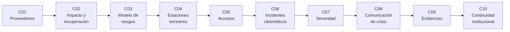

# B122 — Resiliencia y continuidad de infraestructura espacial

> **Bloque nuevo de la estructura `0.2.0`.** Sus 10 clases estaban programadas por la ampliación y ahora están redactadas. Ver el [programa completo](../../PROGRAMA_ACADEMICO_COMPLETO.md).

**Programa:** Programa Integral de Astronomía, Astrofísica, Ciencias Espaciales e Ingeniería Aeroespacial
**Área:** A10 — Entorno orbital, derecho y seguridad espacial
**Nivel:** N4 (aplicación profesional) · **Clases:** 10 · **Carga:** por calibrar con el uso
**Estado:** guía pedagógica del bloque (resumen de qué se aprende en cada clase). Las clases enlazadas en la tabla ya están redactadas; todas conservan el estado E0 en el catálogo hasta registrar revisión disciplinar.

## 🎯 Propósito del bloque

Enseña **cómo cuantificar y reducir la fragilidad de una infraestructura espacial desde el lado defensivo**: de qué proveedores depende, cuánto tiempo puede estar caída antes de que el daño sea inaceptable, qué activos y amenazas importan, cómo se protegen las estaciones terrestres y los accesos, cómo se responde a un incidente, cómo se clasifica, cómo se comunica, cómo se conservan sus evidencias y cómo sigue funcionando la institución. Cada clase cierra con un laboratorio en Python con semilla fija y **datos sintéticos rotulados**: ningún número describe un sistema real.

## 📚 Al terminar el bloque podrás

1. Medir la concentración de proveedores y el alcance de la caída de uno de ellos en una cadena de suministro sintética.
2. Calcular disponibilidad, RTO, RPO y el punto en que una interrupción deja de ser tolerable.
3. Construir un registro de riesgos con activos, amenazas y controles, y estimar el riesgo residual.
4. Evaluar defensas por capas de una estación terrestre y comprobar si la detección llega antes que el retardo.
5. Detectar privilegios excesivos y conflictos de segregación de funciones en una matriz de roles.
6. Cronometrar el ciclo de respuesta a un incidente y estimar el beneficio de contener antes.
7. Clasificar incidentes con una escala de severidad y priorizarlos.
8. Calcular los plazos de una notificación de incidente y planificar mensajes por audiencia.
9. Encadenar evidencias con hashes y detectar manipulaciones.
10. Dimensionar la dotación mínima para sostener las funciones esenciales de la institución.

## 🧭 Secuencia del bloque

**Descripción textual.** Tres tramos: entender la exposición (C01–C03), proteger (C04–C05) y responder y sostener (C06–C10). El hilo es la secuencia «cuánto dependo, cuánto aguanto, qué protejo, cómo respondo y cómo sigo».

## 🗂️ Las 10 clases en resumen

**Navegación:** cada clase enlaza a la anterior, a la siguiente y a este bloque.

La columna «Evidencia» indica el producto que demostrará el aprendizaje.

### Tramo 1 · Entender la exposición

| ID | Clase | Qué se aprende | Evidencia |
|---|---|---|---|
| [B122-C01](../clases/B122/B122-C01-dependencias-de-proveedores-y-cadena-de-suministro-de-infraestructura-espacial/CLASE.md) | Dependencias de proveedores y cadena de suministro de infraestructura espacial | Índice de concentración de proveedores y alcance de la caída de un proveedor. | Ficha de dependencias de una cadena sintética |
| [B122-C02](../clases/B122/B122-C02-continuidad-de-servicio-impacto-y-objetivos-de-recuperacion/CLASE.md) | Continuidad de servicio: impacto y objetivos de recuperación | Disponibilidad, RTO, RPO y tiempo máximo tolerable. | Ficha de análisis de impacto de un servicio |
| [B122-C03](../clases/B122/B122-C03-modelo-defensivo-de-riesgos-de-infraestructura-espacial/CLASE.md) | Modelo defensivo de riesgos de infraestructura espacial | Registro de activos, amenazas y controles; riesgo inherente y residual. | Registro de riesgos sintético |

### Tramo 2 · Proteger

| ID | Clase | Qué se aprende | Evidencia |
|---|---|---|---|
| [B122-C04](../clases/B122/B122-C04-seguridad-de-estaciones-terrestres-y-segmento-de-control/CLASE.md) | Seguridad de estaciones terrestres y segmento de control | Defensa por capas y condición «detección antes que retardo». | Ficha de capas de una estación sintética |
| [B122-C05](../clases/B122/B122-C05-control-de-accesos-y-gestion-de-identidades-en-operaciones/CLASE.md) | Control de accesos y gestión de identidades en operaciones | Privilegio mínimo, segregación de funciones y auditoría de una matriz de roles. | Informe de auditoría de accesos sintético |

### Tramo 3 · Responder y sostener

| ID | Clase | Qué se aprende | Evidencia |
|---|---|---|---|
| [B122-C06](../clases/B122/B122-C06-respuesta-a-incidentes-ciberneticos-en-operaciones-de-mision/CLASE.md) | Respuesta a incidentes cibernéticos en operaciones de misión | Cronología detección-contención-erradicación y costo de la demora. | Línea de tiempo de un incidente simulado |
| [B122-C07](../clases/B122/B122-C07-clasificacion-de-severidad-e-impacto-de-incidentes-espaciales/CLASE.md) | Clasificación de severidad e impacto de incidentes espaciales | Escala de severidad ponderada y cola de prioridad. | Tabla de clasificación de incidentes sintéticos |
| [B122-C08](../clases/B122/B122-C08-comunicacion-de-crisis-con-operadores-autoridades-y-publico/CLASE.md) | Comunicación de crisis con operadores, autoridades y público | Plazos de notificación y matriz de audiencias y mensajes. | Plan de comunicación de crisis simulado |
| [B122-C09](../clases/B122/B122-C09-preservacion-de-evidencias-y-cadena-de-custodia-de-datos-de-incidentes/CLASE.md) | Preservación de evidencias y cadena de custodia de datos de incidentes | Hash SHA-256, cadena de custodia encadenada y detección de alteración. | Registro de custodia sintético verificado |
| [B122-C10](../clases/B122/B122-C10-planes-de-continuidad-institucional-y-de-operaciones/CLASE.md) | Planes de continuidad institucional y de operaciones | Dotación mínima de funciones esenciales con probabilidad binomial. | Plan de continuidad de operaciones sintético |

## 🧵 Hilos que atraviesan el bloque

- **Cuantificar la fragilidad:** concentración (C01), tiempo tolerable (C02), riesgo (C03).
- **Defensa en capas y mínimo privilegio:** C04 y C05.
- **Tiempo como variable central:** RTO, tiempos de detección y contención, plazos de notificación (C02, C06, C08).
- **Evidencia verificable:** hashes y registros en C09; trazabilidad en C07.
- **Sintético frente a real:** todos los datos son inventados y rotulados; lo normativo se cita con versión y fecha.

## 📝 Evaluación del bloque (propuesta, por calibrar)

- Fichas y ejercicios por clase, con retroalimentación y recuperación con evidencia distinta.
- Portafolio: el registro de riesgos (C03) con su plan de respuesta (C06) y continuidad (C10).
- Las condiciones críticas (rotular lo sintético, declarar que no es asesoría y citar solo lo consultado) no se compensan con promedio.

## ⚠️ Seguridad y límites

El bloque es **educativo y exclusivamente defensivo**: no es asesoría legal, regulatoria, de seguridad ni financiera, no describe cómo atacar sistemas y no sustituye a un análisis con el operador, su asesor jurídico o su autoridad competente. Los textos normativos se citan con la versión y la fecha consultadas; pueden haber cambiado. Los datos de los laboratorios son sintéticos; no representan a ningún operador, proveedor ni incidente real.

## 📖 Fuentes consultadas en el bloque (resumen)

Consultadas el 2026-11-11 (páginas oficiales y, cuando se indica, solo su resumen): NIST SP 800-161 Rev. 1 (2022, retirada el 2024-11-01), NIST SP 800-34 Rev. 1 (2010), NIST IR 8401 (2022), NIST SP 800-61 Rev. 3 (2025), NIST SP 800-86 (2006), NIST SP 800-30 Rev. 1 (2012), NIST SP 800-53 Rev. 5 (página de publicación) y la Directiva (UE) 2022/2555 en EUR-Lex (artículo 23 y anexo I). De los documentos NIST solo se leyó la ficha de publicación y su resumen, no el cuerpo. No se consultaron ISO 22301, ISO/IEC 27001, las políticas espaciales nacionales ni las directrices de UNOOSA sobre sostenibilidad a largo plazo.

## Fuentes de orientación preliminar

- **[UNOOSA]** [UN Office for Outer Space Affairs](https://www.unoosa.org/) — Tratados y principios de la ONU sobre el espacio.
- **[ITU]** [International Telecommunication Union](https://www.itu.int/) — Radiocomunicaciones y órbitas.
- **[ESA]** [European Space Agency](https://www.esa.int/) — Misiones y seguridad espacial.
- **[NIST]** [NIST Computer Security Resource Center](https://csrc.nist.gov/) — Guías de ciberseguridad y continuidad.

> La asociación de estas fuentes es orientativa por bloque. Las fuentes realmente consultadas para cada afirmación se registran en la sección 11 de cada clase.

## Roles que lo usan

- [Seguridad defensa y resiliencia de infraestructuras espaciales](../../rutas/seguridad-defensa-y-resiliencia-de-infraestructuras-espaciales.md)

[🏠 Volver al programa](../../README.md)
