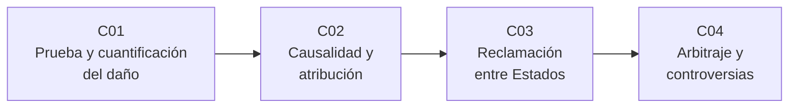

# B123 — Responsabilidad, daños y controversias espaciales

> **Bloque nuevo de la estructura `0.2.0`.** Sus 4 clases estaban programadas por la ampliación y ahora están redactadas. Ver el [programa completo](../../PROGRAMA_ACADEMICO_COMPLETO.md).

**Programa:** Programa Integral de Astronomía, Astrofísica, Ciencias Espaciales e Ingeniería Aeroespacial
**Área:** A10 — Entorno orbital, derecho y seguridad espacial
**Nivel:** N3 (fundamentos disciplinares) · **Clases:** 4 · **Carga:** por calibrar con el uso
**Estado:** guía pedagógica del bloque (resumen de qué se aprende en cada clase). Las clases enlazadas en la tabla ya están redactadas; todas conservan el estado E0 en el catálogo hasta registrar revisión disciplinar.

## 🎯 Propósito del bloque

Enseña **qué ocurre después de un daño causado por un objeto espacial**: cómo se prueba y se cuantifica, cómo se atribuye a un actor, por qué vías lo reclama un Estado a otro y cómo se resuelven las controversias por arbitraje. Parte del Convenio sobre responsabilidad internacional por daños causados por objetos espaciales (1972), de lo que enseña la clase B119-C10 sobre el régimen de responsabilidad, y lo complementa con la parte práctica: pruebas, causalidad, plazos, comisión de reclamaciones y reglas de arbitraje. Cada clase cierra con un laboratorio en Python con semilla fija y **datos sintéticos** que ilustra el razonamiento, nunca un caso real resuelto.

## 📚 Al terminar el bloque podrás

1. Armar un expediente de daño con pruebas graduadas, cuantificar la reparación en la moneda del reclamante y expresar su incertidumbre.
2. Elegir el régimen de responsabilidad (absoluta o por culpa) según dónde ocurre el daño y repartir la carga entre varios Estados de lanzamiento.
3. Calcular los plazos de una reclamación entre Estados y recorrer sus etapas, de la vía diplomática a la comisión de reclamaciones.
4. Comparar la comisión de reclamaciones del Convenio con un arbitraje bajo reglas opcionales para controversias espaciales.
5. Distinguir texto normativo consultado, comentario y ejemplo sintético, y citar siempre versión y fecha.

## 🧭 Secuencia del bloque

**Descripción textual.** Cuatro clases encadenadas: probar y valorar el daño (C01), atribuirlo a un actor (C02), presentar la reclamación entre Estados (C03) y resolver la controversia por arbitraje u otras vías (C04).

## 🗂️ Las 4 clases en resumen

**Navegación:** cada clase enlaza a la anterior, a la siguiente y a este bloque.

La columna «Evidencia» indica el producto que demostrará el aprendizaje. Los laboratorios usan datos **sintéticos** (rotulados) o textos normativos con versión y fecha.

### Tramo 1 · Del daño al responsable

| ID | Clase | Qué se aprende | Evidencia |
|---|---|---|---|
| [B123-C01](../clases/B123/B123-C01-prueba-del-dano-y-cuantificacion-de-la-reparacion/CLASE.md) | Prueba del daño y cuantificación de la reparación | Daño según el Convenio, graduación de pruebas, reparación en la moneda del reclamante e incertidumbre. | Expediente de daño sintético con cuantía y rango |
| [B123-C02](../clases/B123/B123-C02-causalidad-y-atribucion-juridica-del-dano/CLASE.md) | Causalidad y atribución jurídica del daño | Prueba contrafactual, régimen absoluto o por culpa y reparto entre Estados de lanzamiento. | Memorando de atribución sobre un caso sintético |

### Tramo 2 · De la reclamación a la resolución

| ID | Clase | Qué se aprende | Evidencia |
|---|---|---|---|
| [B123-C03](../clases/B123/B123-C03-mecanismos-de-reclamacion-entre-estados/CLASE.md) | Mecanismos de reclamación entre Estados | Plazos y etapas: vía diplomática, negociación, comisión de reclamaciones y valor de su decisión. | Cronograma de una reclamación sintética |
| [B123-C04](../clases/B123/B123-C04-arbitraje-y-resolucion-de-controversias-espaciales/CLASE.md) | Arbitraje y resolución de controversias espaciales | Reglas opcionales de arbitraje, composición del tribunal, medidas provisionales y comparación de vías. | Cuadro comparativo de vías de resolución |

## 🧵 Hilos que atraviesan el bloque

- **Texto antes que opinión:** cada regla se cita con el texto consultado, su versión y su fecha.
- **Plazos:** el año de C01 y C03 y los plazos de C04 se calculan con fechas explícitas.
- **Sintético frente a real:** ningún caso del bloque es un caso real resuelto; el único caso real mencionado (C03) se describe con lo consultado y sin imputar responsabilidad.
- **Incertidumbre:** la cuantía (C01) y la atribución (C02) se expresan con rango o probabilidad, no con certeza.

## 📝 Evaluación del bloque (propuesta, por calibrar)

- Fichas y ejercicios por clase, con retroalimentación y recuperación con evidencia distinta.
- Portafolio: el cronograma de C03 y el cuadro comparativo de C04 con sus supuestos.
- Las condiciones críticas (rotular lo sintético, no presentar un ejemplo como caso real, citar versión y fecha de la norma y no dar asesoría) no se compensan con promedio.

## ⚠️ Seguridad y límites

El bloque es educativo y **no constituye asesoría legal, regulatoria ni financiera**. Los textos se leyeron en reproducciones y resúmenes, no en una edición autenticada completa; para un caso real hay que acudir a un profesional y al texto oficial vigente. Las cifras, fechas de hechos y partes de los laboratorios son sintéticas. No se imputa responsabilidad a ninguna persona u organización.

## 📖 Fuentes consultadas en el bloque (resumen)

Consultadas el 2026-11-11: el texto del Convenio sobre responsabilidad (1972) reproducido por el Instituto de Derecho Aéreo y Espacial de McGill (se leyó un resumen artículo por artículo con citas breves), la página introductoria de UNOOSA sobre el Convenio, el Protocolo Canadá–URSS de 1981 en el Tratado E103429 del Gobierno de Canadá y las Reglas Opcionales de la CPA para controversias relacionadas con actividades espaciales (2011) en la reproducción de italaw. El texto completo en UNOOSA y en la Treaty Series de la ONU **no se pudo leer** (error 404 y PDF escaneado) y los artículos de la CDI sobre responsabilidad del Estado (2001) **no se consultaron**.

## Fuentes de orientación preliminar

- **[UNOOSA]** [UN Office for Outer Space Affairs](https://www.unoosa.org/) — Tratados y principios de la ONU sobre el espacio.
- **[ITU]** [International Telecommunication Union](https://www.itu.int/) — Regulación internacional de radiocomunicaciones.
- **[IADC]** [Inter-Agency Space Debris Coordination Committee](https://www.iadc-home.org/) — Mitigación de desechos espaciales.
- **[ISO-TC20]** [ISO/TC 20/SC 14](https://www.iso.org/committee/46614.html) — Normas de sistemas espaciales.

> La asociación de estas fuentes es orientativa por bloque. Las fuentes realmente consultadas para cada afirmación se registran en la sección 11 de cada clase.

## Roles que lo usan

- [Derecho políticas y negocios espaciales](../../rutas/derecho-politicas-y-negocios-espaciales.md)
