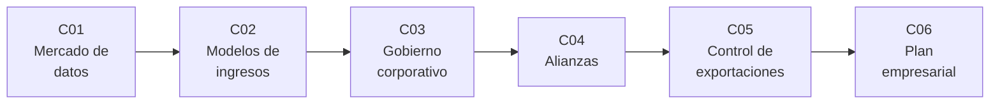

# B125 — Creación y operación de empresas espaciales

> **Bloque nuevo de la estructura vigente.** Sus 6 clases estaban programadas por la ampliación y ahora están redactadas. Ver el [programa completo](../../PROGRAMA_ACADEMICO_COMPLETO.md).

**Programa:** Programa Integral de Astronomía, Astrofísica, Ciencias Espaciales e Ingeniería Aeroespacial
**Área:** A11 — Economía, industria y gestión de proyectos espaciales
**Nivel:** N4 (aplicación) · **Clases:** 6 · **Carga:** por calibrar con el uso
**Estado:** guía pedagógica del bloque (resumen de qué se aprende en cada clase). Las clases enlazadas en la tabla ya están redactadas; todas conservan el estado E0 en el catálogo hasta registrar revisión disciplinar.

## 🎯 Propósito del bloque

Enseña **cómo se razona la creación y la operación de una empresa espacial con modelos pequeños y verificables**, sin recetas de negocio. Recorre el mercado de los datos espaciales (qué pasa con el precio de un producto cuando existe un sustituto gratuito y abierto), los modelos de ingresos por suscripción y por servicio (reconocimiento de ingresos, abandono de clientes y valor de un cliente), el gobierno corporativo (quién decide cuando hay acciones con distinto número de votos), las alianzas internacionales (cómo se reparte el excedente de una coalición y cuánta dependencia hay de un solo socio), el control de exportaciones (un clasificador esquemático y el costo esperado de un retraso de licencia) y, como cierre, un plan empresarial sintético a cinco años que integra mercado, finanzas y operación. Cada clase cierra con un laboratorio en Python con semilla fija; todas las cifras de empresas son **sintéticas o ilustrativas** salvo las que se citan con fuente y fecha.

## 📚 Al terminar el bloque podrás

1. Calcular el precio que maximiza el ingreso por un dato de pago cuando un sustituto gratuito cubre una fracción del valor, y explicar por qué el valor se desplaza hacia el producto elaborado.
2. Comparar el reconocimiento ratable de una suscripción con el de un contrato por hitos, y calcular el valor de vida de un cliente con abandono mensual.
3. Calcular el poder de voto y la participación económica mínima en una estructura de dos clases de acciones, y el índice de poder de Banzhaf de un consejo.
4. Repartir el excedente de una alianza con el valor de Shapley y medir la dependencia de un socio con el índice de Herfindahl.
5. Estimar el costo esperado del retraso de una licencia de exportación y distinguir lo que se clasifica de lo que solo un especialista puede decidir.
6. Armar un plan empresarial sintético a cinco años (ingresos, caja, punto de equilibrio, valor actual y sensibilidad) y rotular qué es observado, qué es consultado y qué es ilustrativo.

## 🧭 Secuencia del bloque

**Descripción textual.** Seis clases encadenadas: el mercado de los datos (C01), cómo se cobra (C02), cómo se decide dentro de la empresa (C03), con quién se coopera (C04), qué límites legales condicionan vender tecnología (C05) y el plan que integra todo (C06). El hilo común es decidir con información incompleta y declarar qué se supone.

## 🗂️ Las 6 clases en resumen

**Navegación:** cada clase enlaza a la anterior, a la siguiente y a este bloque.

La columna «Evidencia» indica el producto que demostrará el aprendizaje. Los laboratorios usan datos **sintéticos** o **ilustrativos** (rotulados) o valores publicados con fuente y fecha.

### Tramo 1 · El negocio

| ID | Clase | Qué se aprende | Evidencia |
|---|---|---|---|
| [B125-C01](../clases/B125/B125-C01-mercado-de-datos-espaciales/CLASE.md) | Mercado de datos espaciales | Disposición a pagar, sustituto gratuito, precio que maximiza el ingreso y cadena de valor del dato. | Ficha de mercado de un dato sintético |
| [B125-C02](../clases/B125/B125-C02-modelos-de-ingresos-suscripcion-y-servicio/CLASE.md) | Modelos de ingresos: suscripción y servicio | Reconocimiento ratable frente a hitos, abandono, valor de vida del cliente y recuperación del costo de adquisición. | Ficha de modelo de ingresos con su calendario |

### Tramo 2 · La organización

| ID | Clase | Qué se aprende | Evidencia |
|---|---|---|---|
| [B125-C03](../clases/B125/B125-C03-gobierno-corporativo-de-una-empresa-espacial/CLASE.md) | Gobierno corporativo de una empresa espacial | Votos por clase de acción, participación mínima para controlar y poder de voto de un consejo. | Ficha de estructura de gobierno con su índice de poder |
| [B125-C04](../clases/B125/B125-C04-alianzas-y-cooperacion-internacional-empresarial/CLASE.md) | Alianzas y cooperación internacional empresarial | Valor de Shapley, estabilidad de una coalición y concentración de la dependencia entre socios. | Ficha de reparto y dependencia de una alianza sintética |

### Tramo 3 · Límites y plan

| ID | Clase | Qué se aprende | Evidencia |
|---|---|---|---|
| [B125-C05](../clases/B125/B125-C05-control-de-exportaciones-y-transferencia-de-tecnologia/CLASE.md) | Control de exportaciones y transferencia de tecnología | Esquema de clasificación, transferencia intangible y costo esperado del retraso de una licencia. | Ficha de ruta de exportación esquemática con su costo esperado |
| [B125-C06](../clases/B125/B125-C06-plan-empresarial-de-una-empresa-espacial/CLASE.md) | Plan empresarial de una empresa espacial | Flujo de caja a cinco años, punto de equilibrio, valor actual y sensibilidad. | Plan empresarial sintético con sus supuestos y su sensibilidad |

## 🧵 Hilos que atraviesan el bloque

- **Declarar qué se supone:** todo número de una empresa nace de un modelo con parámetros sintéticos; ninguno es una predicción ni una recomendación.
- **Verificación independiente:** cada laboratorio contrasta con una fórmula cerrada, una enumeración o una simulación.
- **Observado frente a modelado:** lo consultado (política de datos abiertos, revelaciones de un informe anual, texto de reglamentos) se separa de lo ilustrativo.
- **Dinero, poder y ley:** C01–C02 tratan el dinero, C03–C04 el poder, C05 la ley y C06 los junta.

## 📝 Evaluación del bloque (propuesta, por calibrar)

- Fichas y ejercicios por clase, con retroalimentación y recuperación con evidencia distinta.
- Portafolio: el plan empresarial sintético (C06) con sus supuestos, su sensibilidad y la lista de lo consultado.
- Las condiciones críticas (rotular lo sintético, no presentar un modelo como asesoría y citar solo lo consultado) no se compensan con promedio.

## ⚠️ Seguridad y límites

El bloque es **educativo** y **no es asesoría financiera, legal, tributaria ni de inversión**: no sustituye a un abogado, un contador, un especialista en cumplimiento de exportaciones ni un asesor financiero, y nada de lo que calculan los laboratorios debe usarse para decidir una operación, una constitución societaria, una exportación o una inversión reales. Los modelos son simplificados (demanda uniforme, flujos deterministas, coaliciones de tres socios, clasificación esquemática) y sus parámetros son sintéticos. Las cifras de empresas reales se citan solo cuando se consultaron, con su fuente y fecha; los textos legales se resumen y no se reproducen.

## 📖 Fuentes consultadas en el bloque (resumen)

Consultadas el 2026-11-11: el Reglamento (UE) n.º 377/2014 (artículo 23, política de datos de Copernicus; versión derogada), la política de acceso a Landsat del USGS, el informe anual (Formulario 10-K) de Planet Labs PBC del ejercicio cerrado el 2026-01-31 (SEC; secciones de negocio y factores de riesgo), el artículo 120.1 y la Categoría XV de la Lista de Municiones de EE. UU. del Título 22 del CFR (Legal Information Institute de Cornell), el Reglamento (UE) 2021/821 de doble uso (EUR-Lex), la página de los Acuerdos Artemis de la NASA y, por resumen de búsqueda (texto no leído directamente), la edición 2023 de *The Space Economy in Figures* de la OCDE, los Principios de Gobierno Corporativo G20/OCDE 2023 y el artículo VI del Tratado del Espacio Ultraterrestre. Los textos que el servidor rechazó (403/404) se rotulan «no consultado» en cada clase. Las relaciones matemáticas (valor de Shapley, Banzhaf, valor actual) no se consultaron en una fuente concreta: las verifica cada laboratorio con una segunda vía.

## Fuentes de orientación preliminar

- **[OECD-SPACE]** [OECD Space Forum](https://www.oecd.org/en/topics/space-economy.html) — Economía espacial y estadísticas.
- **[ESA-COMM]** [ESA Commercialisation](https://commercialisation.esa.int/) — Apoyo a empresas y transferencia de tecnología.
- **[UNOOSA]** [UN Office for Outer Space Affairs](https://www.unoosa.org/) — Tratados y principios del espacio ultraterrestre.
- **[SEC-EDGAR]** [SEC EDGAR](https://www.sec.gov/edgar) — Informes anuales de empresas que cotizan.

> La asociación de estas fuentes es orientativa por bloque. Las fuentes realmente consultadas para cada afirmación se registran en la sección 11 de cada clase.

## Roles que lo usan

- [Derecho políticas y negocios espaciales](../../rutas/derecho-politicas-y-negocios-espaciales.md)

[🏠 Volver al programa](../../README.md) · [➡️ B126 — Financiamiento de proyectos y negocios espaciales](./B126-financiamiento-de-proyectos-y-negocios-espaciales.md)
