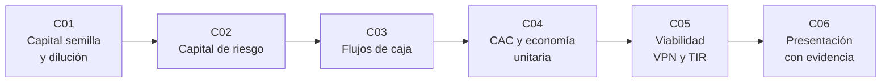

# B126 — Financiamiento de proyectos y negocios espaciales

> **Bloque nuevo de la estructura vigente.** Sus 6 clases estaban programadas por la ampliación y ahora están redactadas. Ver el [programa completo](../../PROGRAMA_ACADEMICO_COMPLETO.md).

**Programa:** Programa Integral de Astronomía, Astrofísica, Ciencias Espaciales e Ingeniería Aeroespacial
**Área:** A11 — Economía, industria y gestión de proyectos espaciales
**Nivel:** N4 (aplicación) · **Clases:** 6 · **Carga:** por calibrar con el uso
**Estado:** guía pedagógica del bloque (resumen de qué se aprende en cada clase). Las clases enlazadas en la tabla ya están redactadas; todas conservan el estado E0 en el catálogo hasta registrar revisión disciplinar.

## 🎯 Propósito del bloque

Enseña **cómo se razona la plata de un proyecto o de una empresa espacial**, con modelos pequeños y verificables en lugar de recetas de inversión. Recorre las rondas iniciales de una empresa (conversión de un instrumento tipo SAFE y dilución), el capital de riesgo (preferencias de liquidación y retorno de un fondo), la proyección de flujos de caja de un proyecto con inversión inicial larga, la economía unitaria (costo de adquisición de clientes, valor del cliente y plazo de recuperación), la evaluación de viabilidad (valor presente neto, tasa interna de retorno y sensibilidad) y la presentación a inversionistas con cifras que se pueden rastrear hasta su evidencia. Cada clase cierra con un laboratorio en Python (solo biblioteca estándar) con semilla fija; **todas las cifras de empresas, rondas y mercado son sintéticas o ilustrativas** y están rotuladas.

## 📚 Al terminar el bloque podrás

1. Calcular la conversión de un instrumento con tope de valoración y descuento, y la dilución resultante de los fundadores.
2. Calcular el reparto de una salida con preferencias de liquidación (con y sin participación) y estimar el retorno de una cartera de riesgo con Monte Carlo.
3. Proyectar flujos de caja anuales de un proyecto espacial, su caja mínima y el financiamiento que exige.
4. Calcular costo de adquisición de clientes, valor de vida del cliente y plazo de recuperación, con su sensibilidad.
5. Calcular valor presente neto y tasa interna de retorno, verificarlos por dos vías y mostrar su sensibilidad a la tasa de descuento, según la práctica de análisis de costos y beneficios de la Circular A-94 de la OMB.
6. Armar un anexo financiero donde cada cifra tiene su fuente, su rótulo (consultada, sintética o calculada) y su rango de incertidumbre.
7. Recordar que nada de esto es asesoría financiera, legal ni de inversión.

## 🧭 Secuencia del bloque

**Descripción textual.** Seis clases encadenadas: cómo se financia el inicio (C01) y qué condiciones trae el capital de riesgo (C02); luego el proyecto se modela con sus flujos de caja (C03) y su economía por cliente (C04); con ello se evalúa si es viable (C05) y se comunica con evidencia (C06). El hilo común es separar **lo que se sabe, lo que se supone y lo que se calcula**.

## 🗂️ Las 6 clases en resumen

**Navegación:** cada clase enlaza a la anterior, a la siguiente y a este bloque.

La columna «Evidencia» indica el producto que demostrará el aprendizaje. Los laboratorios usan datos **sintéticos** o **ilustrativos** (rotulados) o valores publicados con fuente y fecha.

### Tramo 1 · Levantar capital

| ID | Clase | Qué se aprende | Evidencia |
|---|---|---|---|
| [B126-C01](../clases/B126/B126-C01-capital-semilla-y-financiamiento-inicial/CLASE.md) | Capital semilla y financiamiento inicial | Conversión de un SAFE con tope y descuento, dilución y participación de los fundadores. | Tabla de capitalización antes y después de una ronda sintética |
| [B126-C02](../clases/B126/B126-C02-capital-de-riesgo-en-empresas-espaciales/CLASE.md) | Capital de riesgo en empresas espaciales | Preferencias de liquidación, participación y retorno de una cartera con cola pesada. | Ficha de reparto de una salida y retorno de cartera sintéticos |

### Tramo 2 · Modelar el negocio

| ID | Clase | Qué se aprende | Evidencia |
|---|---|---|---|
| [B126-C03](../clases/B126/B126-C03-proyeccion-de-flujos-de-caja-de-un-proyecto-espacial/CLASE.md) | Proyección de flujos de caja de un proyecto espacial | Flujos anuales, caja acumulada, caja mínima y financiamiento requerido. | Proyección a 10 años con su necesidad de financiamiento |
| [B126-C04](../clases/B126/B126-C04-costo-de-adquisicion-de-clientes-y-economia-unitaria/CLASE.md) | Costo de adquisición de clientes y economía unitaria | CAC, valor de vida del cliente, razón LTV/CAC y plazo de recuperación. | Ficha de economía unitaria con sensibilidad |

### Tramo 3 · Evaluar y comunicar

| ID | Clase | Qué se aprende | Evidencia |
|---|---|---|---|
| [B126-C05](../clases/B126/B126-C05-evaluacion-de-viabilidad-economica-de-un-negocio-espacial/CLASE.md) | Evaluación de viabilidad económica de un negocio espacial | VPN, TIR, plazo de recuperación descontado y sensibilidad a la tasa. | Informe de viabilidad con tabla de sensibilidad |
| [B126-C06](../clases/B126/B126-C06-presentacion-financiera-ante-inversionistas-con-evidencia/CLASE.md) | Presentación financiera ante inversionistas con evidencia | Trazabilidad de cada cifra, rótulos de evidencia y rangos de incertidumbre. | Anexo financiero con matriz de evidencia |

## 🧵 Hilos que atraviesan el bloque

- **Dinero en el tiempo:** una cifra sin su fecha y su tasa no se puede comparar (C03, C05).
- **Modelo frente a empresa real:** toda empresa, ronda y cliente del bloque es sintético; ninguno es una predicción ni una oferta.
- **Verificación independiente:** cada laboratorio contrasta con una segunda vía (fórmula cerrada, búsqueda, recálculo).
- **Observado frente a supuesto:** lo consultado (la práctica de descuento de la Circular A-94, el esquema de hitos del programa COTS de la NASA, los documentos SAFE de Y Combinator, las exenciones de la SEC) se separa de lo ilustrativo.

## 📝 Evaluación del bloque (propuesta, por calibrar)

- Fichas y ejercicios por clase, con retroalimentación y recuperación con evidencia distinta.
- Portafolio: el informe de viabilidad (C05) o el anexo financiero (C06) con sus supuestos y su sensibilidad.
- Las condiciones críticas (rotular lo sintético, no presentar un modelo como consejo y citar solo lo consultado) no se compensan con promedio.

## ⚠️ Seguridad y límites

El bloque es **educativo** y **no es asesoría financiera, legal ni de inversión**: no recomienda comprar, vender ni invertir, no sustituye a un abogado, un contador ni un asesor con licencia, y nada de lo que calculan los laboratorios debe usarse para decidir sobre un instrumento, una ronda o una empresa reales. Los modelos son simplificados (flujos anuales deterministas, cohortes sin estacionalidad, retornos con distribuciones inventadas) y sus parámetros son ilustrativos. Los documentos SAFE y las exenciones de la SEC se consultaron solo en sus páginas descriptivas; los textos legales completos no se leyeron.

## 📖 Fuentes consultadas en el bloque (resumen)

Consultadas el 2026-11-11: la Circular A-94 de la OMB (2023-11-09; PDF leído con PyMuPDF, secciones 8 a 9 y Apéndice B), el informe de la NASA sobre COTS (NASA SP-2014-617; PDF leído con PyMuPDF), la página de documentos SAFE de Y Combinator, la página de ofertas exentas de la SEC (revisada por la SEC el 2026-01-26) y la página de documentos modelo de la NVCA (solo su listado). La OCDE (*The Space Economy in Figures*) se intentó consultar y devolvió acceso denegado: **no consultada**. Las cifras de mercado espacial no se citan. Los modelos de capital de riesgo, de economía unitaria y de VPN/TIR no se consultaron en una fuente concreta: los verifica cada laboratorio con una segunda vía.

## Fuentes de orientación preliminar

- **[OMB-A94]** [OMB Circular A-94](https://www.whitehouse.gov/wp-content/uploads/2023/11/CircularA-94.pdf) — Análisis de costos y beneficios y tasas de descuento.
- **[NASA-COTS]** [NASA SP-2014-617](https://www.nasa.gov/sites/default/files/files/SP-2014-617.pdf) — Financiamiento por hitos de precio fijo.
- **[OECD-SPACE]** [OECD Space Economy](https://www.oecd.org/en/topics/space-economy.html) — Economía espacial (orientativa, no consultada).

> La asociación de estas fuentes es orientativa por bloque. Las fuentes realmente consultadas para cada afirmación se registran en la sección 11 de cada clase.

## Roles que lo usan

- [Derecho políticas y negocios espaciales](../../rutas/derecho-politicas-y-negocios-espaciales.md)

[🏠 Volver al programa](../../README.md) · [➡️ B127 — Seguros espaciales](./B127-seguros-espaciales.md)
