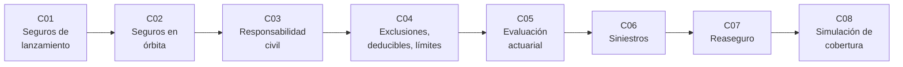

# B127 — Seguros espaciales

> **Bloque nuevo de la estructura vigente.** Sus 8 clases estaban programadas por la ampliación y ahora están redactadas. Ver el [programa completo](../../PROGRAMA_ACADEMICO_COMPLETO.md).

**Programa:** Programa Integral de Astronomía, Astrofísica, Ciencias Espaciales e Ingeniería Aeroespacial
**Área:** A11 — Economía, industria y gestión de proyectos espaciales
**Nivel:** N4 (aplicación) · **Clases:** 8 · **Carga:** por calibrar con el uso
**Estado:** guía pedagógica del bloque (resumen de qué se aprende en cada clase). Las clases enlazadas en la tabla ya están redactadas; todas conservan el estado E0 en el catálogo hasta registrar revisión disciplinar.

## 🎯 Propósito del bloque

Enseña **cómo se razona el traspaso de riesgo de una misión espacial a un asegurador**, con modelos pequeños y verificables en lugar de cotizaciones. Recorre el seguro de lanzamiento (probabilidad de fallo, tasa de prima y recargo), el seguro en órbita (riesgo que cambia con la edad del satélite), la responsabilidad civil frente a terceros (pérdida máxima probable, tope asegurado y el marco del Convenio de Responsabilidad de 1972), la lectura de una póliza (exclusiones, deducibles y límites), la base actuarial (frecuencia, severidad y pérdida agregada), el proceso de siniestro, el reaseguro y, al final, la integración de todo en una decisión de cobertura para una misión sintética. Cada clase cierra con un laboratorio en Python con semilla fija; **todos los datos de pólizas, primas y pérdidas son sintéticos o ilustrativos** y están rotulados.

## 📚 Al terminar el bloque podrás

1. Calcular la tasa de prima de equilibrio de un lanzamiento a partir de una probabilidad de fallo, un pago parcial y un recargo.
2. Modelar el riesgo en órbita con una tasa de fallo que decrece con la edad y calcular supervivencia y prima anual.
3. Obtener una pérdida máxima probable por cuantil y repartir una pérdida entre el seguro exigido, el excedente público y lo no cubierto.
4. Aplicar deducible, límite y exclusión a una pérdida y calcular el pago esperado con una fórmula cerrada verificada por Monte Carlo.
5. Construir una prima pura con un modelo de frecuencia y severidad y medir su incertidumbre.
6. Calcular el pago de un siniestro total o parcial con salvamento y respetar los plazos del Convenio.
7. Comparar un reaseguro proporcional con uno de exceso de pérdida desde el punto de vista de la cedente y del reasegurador.
8. Decidir una combinación de coberturas con un criterio explícito y rotular qué es consultado, qué es modelado y qué es ilustrativo, recordando que **nada de esto es asesoría financiera, legal ni de seguros**.

## 🧭 Secuencia del bloque

**Descripción textual.** Ocho clases encadenadas: las tres coberturas principales (lanzamiento C01, órbita C02, responsabilidad civil C03), la lectura de las condiciones de una póliza (C04), la base actuarial que fija precios (C05), lo que ocurre tras una pérdida (C06), el reparto del riesgo entre aseguradores (C07) y la decisión integrada de una misión (C08).

## 🗂️ Las 8 clases en resumen

**Navegación:** cada clase enlaza a la anterior, a la siguiente y a este bloque.

La columna «Evidencia» indica el producto que demostrará el aprendizaje. Los laboratorios usan datos **sintéticos** o **ilustrativos** (rotulados) o valores publicados con fuente y fecha.

### Tramo 1 · Las coberturas

| ID | Clase | Qué se aprende | Evidencia |
|---|---|---|---|
| [B127-C01](../clases/B127/B127-C01-seguros-de-lanzamiento/CLASE.md) | Seguros de lanzamiento | Tasa de equilibrio, recargo, pago parcial y ventana de cobertura. | Ficha de cotización sintética de un lanzamiento |
| [B127-C02](../clases/B127/B127-C02-seguros-en-orbita/CLASE.md) | Seguros en órbita | Tasa de fallo con la edad (Weibull), supervivencia y prima anual. | Tabla de prima por año de vida en órbita |
| [B127-C03](../clases/B127/B127-C03-seguros-de-responsabilidad-civil-espacial/CLASE.md) | Seguros de responsabilidad civil espacial | Pérdida máxima probable por cuantil, tope y capas; absoluta frente a culpa. | Ficha de capas de responsabilidad sintética |

### Tramo 2 · Leer y valorar una póliza

| ID | Clase | Qué se aprende | Evidencia |
|---|---|---|---|
| [B127-C04](../clases/B127/B127-C04-exclusiones-deducibles-y-limites-de-polizas/CLASE.md) | Exclusiones, deducibles y límites de pólizas | Pago esperado con deducible y límite, exclusión y coaseguro. | Comparación de cuatro pólizas sintéticas |
| [B127-C05](../clases/B127/B127-C05-evaluacion-actuarial-basica-del-riesgo-espacial/CLASE.md) | Evaluación actuarial básica del riesgo espacial | Frecuencia y severidad, prima pura, pérdida agregada y su incertidumbre. | Estimación de prima pura con intervalo |

### Tramo 3 · Después y alrededor del siniestro

| ID | Clase | Qué se aprende | Evidencia |
|---|---|---|---|
| [B127-C06](../clases/B127/B127-C06-gestion-de-siniestros-espaciales/CLASE.md) | Gestión de siniestros espaciales | Pérdida total y parcial, salvamento, plazos y tiempo de liquidación. | Expediente de siniestro sintético con calendario |
| [B127-C07](../clases/B127/B127-C07-reaseguro-espacial/CLASE.md) | Reaseguro espacial | Cuota parte frente a exceso de pérdida, neto de la cedente. | Comparación de dos programas de reaseguro |

### Tramo 4 · Integración

| ID | Clase | Qué se aprende | Evidencia |
|---|---|---|---|
| [B127-C08](../clases/B127/B127-C08-simulacion-de-cobertura-de-seguros-para-una-mision/CLASE.md) | Simulación de cobertura de seguros para una misión | Costo esperado y riesgo retenido de cuatro estrategias de cobertura. | Informe de cobertura de una misión sintética |

## 🧵 Hilos que atraviesan el bloque

- **Prima = pérdida esperada + recargo:** de C01 a C08 el precio se descompone y se contrasta con simulación.
- **Pérdidas de cola pesada:** pocas pérdidas enormes dominan el resultado, de modo que el promedio solo no basta (C03, C05, C08).
- **Modelo frente a mercado:** ninguna prima ni tasa de las clases es una cotización; las cifras de mercado consultadas se citan con año y fuente.
- **Verificación independiente:** cada laboratorio contrasta una fórmula cerrada con Monte Carlo.
- **Observado frente a modelado:** el Convenio de 1972, el reglamento 14 CFR parte 440 y el informe de mercado consultado se separan de lo sintético.

## 📝 Evaluación del bloque (propuesta, por calibrar)

- Fichas y ejercicios por clase, con retroalimentación y recuperación con evidencia distinta.
- Portafolio: el informe de cobertura de C08 con sus supuestos y su sensibilidad.
- Las condiciones críticas (rotular lo sintético, no presentar un modelo como cotización ni asesoría, y citar solo lo consultado) no se compensan con promedio.

## ⚠️ Seguridad y límites

El bloque es **educativo** y **no es asesoría financiera, legal ni de seguros**: no sustituye a un corredor, un actuario, un abogado ni la lectura de una póliza real, y nada de lo que calculan los laboratorios debe usarse para contratar, tarificar o reclamar. Los modelos son simplificados (frecuencias de Poisson, severidades lognormales, tasas de fallo de Weibull, pagos independientes) y todos sus parámetros son sintéticos. El reglamento 14 CFR parte 440 se leyó a través de un resumen automático del texto vigente y debe verificarse en la fuente antes de cualquier uso fuera de esta clase.

## 📖 Fuentes consultadas en el bloque (resumen)

- Naciones Unidas, Oficina de Asuntos del Espacio Ultraterrestre, *International Space Law: United Nations Instruments* (ST/SPACE/61/Rev.1): Convenio de Responsabilidad de 1972 y Tratado del Espacio Ultraterrestre (PDF leído con PyMuPDF, consultado 2026-11-11).
- Código de Regulaciones Federales de EE. UU., título 14, parte 440 «Financial Responsibility» (eCFR, consultado 2026-11-11 mediante resumen).
- Gallagher, «Space insurance market update Q1 2026» (10 de abril de 2026), corretaje; datos de mercado y opiniones del autor, consultado 2026-11-11.

Cada clase detalla en su sección 11 qué respalda cada fuente y qué quedó **no consultado**.

## Roles que lo usan

- [Derecho políticas y negocios espaciales](../../rutas/derecho-politicas-y-negocios-espaciales.md)
