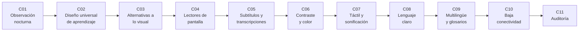

# B128 — Accesibilidad e inclusión en la enseñanza de la astronomía

> **Bloque nuevo de la estructura vigente.** Sus 11 clases estaban programadas por la ampliación y ahora están redactadas. Ver el [programa completo](../../PROGRAMA_ACADEMICO_COMPLETO.md).

**Programa:** Programa Integral de Astronomía, Astrofísica, Ciencias Espaciales e Ingeniería Aeroespacial
**Área:** A12 — Educación, historia aplicada y divulgación astronómica
**Nivel:** N4 (aplicación profesional) · **Clases:** 11 · **Carga:** por calibrar con el uso
**Estado:** guía pedagógica del bloque (resumen de qué se aprende en cada clase). Las clases enlazadas en la tabla ya están redactadas; todas conservan el estado E0 en el catálogo hasta registrar revisión disciplinar.

## 🎯 Propósito del bloque

Enseña **cómo diseñar y comprobar que una actividad, un documento o un recurso de astronomía pueda usarlo la mayor diversidad posible de estudiantes**, sin esperar a adaptarlo después. Recorre la observación nocturna, el diseño universal de aprendizaje, las alternativas a lo visual, los lectores de pantalla, los subtítulos, el contraste y el color, los modelos táctiles y la sonificación, el lenguaje claro, el apoyo multilingüe y la baja conectividad, y cierra con una auditoría completa. Cada clase termina con un laboratorio en Python con semilla fija o datos sintéticos que convierte un criterio de accesibilidad en una comprobación medible y distingue lo consultado de lo ilustrativo.

## 📚 Al terminar el bloque podrás

1. Calcular si el ocular de un telescopio queda al alcance de una persona sentada o de pie y planificar la observación nocturna con alternativas.
2. Auditar un plan de clase contra las nueve pautas del diseño universal de aprendizaje.
3. Dar a una misma observación astronómica varias vías de acceso con equivalencia de información.
4. Revisar un documento HTML para lectores de pantalla (idioma, títulos, alternativas de imagen, tablas).
5. Verificar subtítulos (ritmo de lectura, duración) y medir el error de una transcripción automática.
6. Calcular la razón de contraste WCAG y elegir paletas que no dependan solo del color.
7. Convertir una curva de luz en tono sonoro y en relieve táctil con pasos de cuantización explícitos.
8. Medir la claridad de un texto y gestionar glosarios multilingües coherentes.
9. Estimar el tiempo de carga con baja conectividad y fijar un presupuesto de peso.
10. Auditar un recurso educativo completo y priorizar sus correcciones.

## 🧭 Secuencia del bloque

**Descripción textual.** Once clases encadenadas: primero el marco (observación nocturna accesible, C01, y diseño universal de aprendizaje, C02), luego las vías de acceso a la información (alternativas a lo visual, C03; lectores de pantalla, C04; subtítulos, C05; contraste, C06; táctil y sonoro, C07), después el lenguaje y el contexto (lenguaje claro, C08; multilingüe, C09; baja conectividad, C10) y al final la auditoría que integra todo (C11).

## 🗂️ Las 11 clases en resumen

**Navegación:** cada clase enlaza a la anterior, a la siguiente y a este bloque.

La columna «Evidencia» indica el producto que demostrará el aprendizaje. Los laboratorios usan datos **sintéticos** o **ilustrativos** (rotulados) o valores publicados con fuente y fecha.

### Tramo 1 · Marco y diseño

| ID | Clase | Qué se aprende | Evidencia |
|---|---|---|---|
| [B128-C01](../clases/B128/B128-C01-accesibilidad-de-la-observacion-nocturna/CLASE.md) | Accesibilidad de la observación nocturna | Alcance del ocular según la altitud del objeto y la postura del observador. | Plan de una noche de observación accesible |
| [B128-C02](../clases/B128/B128-C02-diseno-universal-de-aprendizaje-aplicado-a-la-astronomia/CLASE.md) | Diseño universal de aprendizaje aplicado a la astronomía | Cobertura de las nueve pautas del DUA en un plan de clase. | Matriz de cobertura de un plan de clase |
| [B128-C03](../clases/B128/B128-C03-alternativas-a-la-observacion-visual/CLASE.md) | Alternativas a la observación visual | Misma información de las fases lunares en texto, tabla y relieve. | Paquete de alternativas equivalentes |

### Tramo 2 · Canales de acceso

| ID | Clase | Qué se aprende | Evidencia |
|---|---|---|---|
| [B128-C04](../clases/B128/B128-C04-documentos-y-contenidos-para-lectores-de-pantalla/CLASE.md) | Documentos y contenidos para lectores de pantalla | Revisión automática de idioma, títulos, imágenes y tablas. | Informe de revisión de un documento |
| [B128-C05](../clases/B128/B128-C05-subtitulos-y-transcripciones/CLASE.md) | Subtítulos y transcripciones | Ritmo de lectura, duración y tasa de error de palabras. | Informe de calidad de subtítulos |
| [B128-C06](../clases/B128/B128-C06-contraste-y-color-accesibles/CLASE.md) | Contraste y color accesibles | Luminancia relativa, razón de contraste y uso del color. | Ficha de paleta accesible |
| [B128-C07](../clases/B128/B128-C07-modelos-tactiles-y-sonificacion/CLASE.md) | Modelos táctiles y sonificación | Curva de luz a tono sonoro y a relieve de cinco niveles. | Ficha de mapeo sonoro y táctil |

### Tramo 3 · Lenguaje, contexto y auditoría

| ID | Clase | Qué se aprende | Evidencia |
|---|---|---|---|
| [B128-C08](../clases/B128/B128-C08-lenguaje-claro-y-redaccion-accesible/CLASE.md) | Lenguaje claro y redacción accesible | Longitud de frase, voz pasiva y jerga medidas antes y después. | Texto reescrito con métricas |
| [B128-C09](../clases/B128/B128-C09-apoyo-multilingue-y-glosarios/CLASE.md) | Apoyo multilingüe y glosarios | Cobertura y coherencia de un glosario en tres idiomas. | Glosario trilingüe validado |
| [B128-C10](../clases/B128/B128-C10-acceso-con-baja-conectividad/CLASE.md) | Acceso con baja conectividad | Tiempo de carga según ancho de banda y presupuesto de peso. | Plan de entrega con baja conectividad |
| [B128-C11](../clases/B128/B128-C11-auditoria-de-accesibilidad-de-un-recurso-educativo/CLASE.md) | Auditoría de accesibilidad de un recurso educativo | Auditoría con criterios críticos y priorización de correcciones. | Informe de auditoría priorizado |

## 🧵 Hilos que atraviesan el bloque

- **Equivalencia, no reducción:** toda alternativa debe entregar la misma información (C03, C04, C05, C07).
- **No depender de un solo sentido:** la vista (C06), el oído (C05) y el tacto (C07) se complementan.
- **Medir en vez de suponer:** cada criterio se convierte en una comprobación con umbral explícito (C04–C06, C10).
- **Observado frente a modelado:** ningún dato del bloque proviene de personas reales ni de un estudio; todo es sintético o ilustrativo y está rotulado.
- **Las personas primero:** las comprobaciones automáticas no reemplazan la prueba con usuarios (C11).

## 📝 Evaluación del bloque (propuesta, por calibrar)

- Fichas y ejercicios por clase, con retroalimentación y recuperación con evidencia distinta.
- Portafolio: el informe de auditoría (C11), con sus criterios, su priorización y lo que no pudo comprobarse.
- Las condiciones críticas (rotular lo sintético y lo ilustrativo, no presentar una comprobación automática como prueba con personas y citar solo lo consultado) no se compensan con promedio.

## ⚠️ Seguridad y límites

El bloque es educativo y trata la accesibilidad con respeto: se habla de **barreras del entorno y del diseño**, no de «carencias» de las personas, y ninguna clase sustituye la consulta y la prueba con las personas usuarias ni el asesoramiento profesional. Los umbrales provienen de las pautas citadas (WCAG 2.2) o son del curso y están rotulados; ningún dato describe a personas reales. La observación nocturna implica riesgos físicos (terreno, oscuridad, frío) que cada actividad debe evaluar en su sitio. Los laboratorios son modelos simples y no certifican conformidad con ninguna norma.

## 📖 Fuentes consultadas en el bloque (resumen)

Consultadas el 2026-11-11: W3C WCAG 2.2 (criterios 1.1.1, 1.2.1, 1.2.2, 1.4.1, 1.4.3, 1.4.11; solo se leyó el primer tramo del documento) y sus documentos «Understanding» de 1.4.3, 1.4.1 y 1.1.1; la página de subtítulos de W3C WAI; las directrices DUA 3.0 de CAST (2024); la página de educación inclusiva de UNESCO; la página de daltonismo del NEI/NIH; la guía de escritura clara de digital.gov; el artículo «What are PWAs» de web.dev; el resumen del artículo de revisión de Zanella et al. (2022) en arXiv; y la página «Accessible Prints» del centro italiano de la Oficina de Astronomía para la Educación de la IAU. **No consultadas:** el texto completo de Zanella et al., la evaluación de Harrison et al. del espectáculo «Audio Universe» (solo apareció en una búsqueda), la página del subgrupo de la IAU para personas con discapacidad visual (devolvió error 404), la norma ISO de lenguaje claro y los glosarios multilingües de la IAU. Las demás cifras del bloque son sintéticas o ilustrativas.

## Fuentes de orientación preliminar

- **[UNESCO]** [UNESCO](https://www.unesco.org/) — Educación inclusiva, ciencia abierta y cooperación internacional.
- **[IAU-OAE]** [IAU Office of Astronomy for Education](https://astro4edu.org/) — Recursos y comunidad para la educación astronómica.
- **[W3C-WAI]** [W3C Web Accessibility Initiative](https://www.w3.org/WAI/) — Pautas y materiales de accesibilidad web.

> La asociación de estas fuentes es orientativa por bloque. Las fuentes realmente consultadas para cada afirmación se registran en la sección 11 de cada clase.

## Roles que lo usan

- [Educación historia y divulgación astronómica](../../rutas/educacion-historia-y-divulgacion-astronomica.md)

[🏠 Volver al programa](../../README.md) · [➡️ B129 — Ciencia ciudadana astronómica](./B129-ciencia-ciudadana-astronomica.md)
