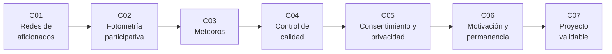

# B129 — Ciencia ciudadana astronómica

> **Bloque nuevo de la estructura vigente.** Sus 7 clases estaban programadas por la ampliación y ahora están redactadas. Ver el [programa completo](../../PROGRAMA_ACADEMICO_COMPLETO.md).

**Programa:** Programa Integral de Astronomía, Astrofísica, Ciencias Espaciales e Ingeniería Aeroespacial
**Área:** A12 — Educación, historia aplicada y divulgación astronómica
**Nivel:** N3 (fundamentos disciplinares) · **Clases:** 7 · **Carga:** por calibrar con el uso
**Estado:** guía pedagógica del bloque (resumen de qué se aprende en cada clase). Las clases enlazadas en la tabla ya están redactadas; todas conservan el estado E0 en el catálogo hasta registrar revisión disciplinar.

## 🎯 Propósito del bloque

Enseña **cómo se diseña y se sostiene un proyecto de ciencia ciudadana astronómica cuyos datos se puedan usar de verdad**. Recorre las redes de observadores aficionados (cuánta cobertura da una red y con qué redundancia), la fotometría y el recuento de meteoros hechos por voluntarios (qué precisión alcanzan y qué sesgos no se promedian), el control de calidad de lo que se contribuye, el consentimiento y la privacidad de las personas que participan, lo que se sabe y lo que no sobre su motivación y permanencia, y un proyecto integrador que se valida contra una referencia experta. Cada clase cierra con un laboratorio en Python con semilla fija que usa datos **sintéticos** (rotulados) y los contrasta con una segunda vía de cálculo.

## 📚 Al terminar el bloque podrás

1. Calcular la cobertura temporal y la redundancia (visión simultánea desde dos estaciones) de una red de observadores con nubosidad independiente.
2. Combinar estimaciones fotométricas de voluntarios con ponderación por varianza y distinguir el ruido que baja con `1/√N` del sesgo que no baja.
3. Estimar una tasa horaria cenital (ZHR) a partir de recuentos de meteoros con su incertidumbre de Poisson y comparar observadores.
4. Diseñar un filtro de calidad (formato, rango, duplicados, valores atípicos robustos) y medir su precisión y su exhaustividad con errores sembrados.
5. Reducir el riesgo de reidentificación con minimización, generalización de coordenadas y `k`-anonimato, y registrar y retirar un consentimiento.
6. Estimar curvas de permanencia con el estimador de Kaplan–Meier y la concentración de contribuciones, sin atribuir a un incentivo un efecto que no se midió.
7. Planificar el número de votos por objeto, validar una clasificación contra una referencia experta con la `κ` de Cohen y revisar un proyecto contra los diez principios de la ECSA.

## 🧭 Secuencia del bloque

**Descripción textual.** Siete clases encadenadas: la red de observadores (C01), dos tipos de medida voluntaria, el brillo de una estrella variable (C02) y los meteoros (C03), el control de calidad de lo contribuido (C04), el cuidado de las personas que contribuyen (C05 y C06) y el proyecto integrador validable (C07). El hilo común es separar el **ruido** (baja con más voluntarios), el **sesgo** (no baja) y lo que no se sabe.

## 🗂️ Las 7 clases en resumen

**Navegación:** cada clase enlaza a la anterior, a la siguiente y a este bloque.

La columna «Evidencia» indica el producto que demostrará el aprendizaje. Los laboratorios usan datos **sintéticos** (rotulados); las cifras publicadas llevan su fuente y fecha en la sección 11 de cada clase.

### Tramo 1 · Medir con voluntarios

| ID | Clase | Qué se aprende | Evidencia |
|---|---|---|---|
| [B129-C01](../clases/B129/B129-C01-redes-de-observadores-aficionados/CLASE.md) | Redes de observadores aficionados | Cobertura temporal y redundancia estéreo de una red con nubosidad, analítica y Monte Carlo. | Ficha de cobertura de una red sintética |
| [B129-C02](../clases/B129/B129-C02-fotometria-participativa/CLASE.md) | Fotometría participativa | Magnitud diferencial, error `1,0857/SNR` y combinación ponderada con sesgo por observador. | Ficha de curva de luz de voluntarios |
| [B129-C03](../clases/B129/B129-C03-seguimiento-ciudadano-de-meteoros/CLASE.md) | Seguimiento ciudadano de meteoros | ZHR desde recuentos, corrección por magnitud límite, nubosidad y altura del radiante. | Ficha de ZHR con incertidumbre |

### Tramo 2 · Calidad, personas y proyecto

| ID | Clase | Qué se aprende | Evidencia |
|---|---|---|---|
| [B129-C04](../clases/B129/B129-C04-contribucion-de-medidas-voluntarias-con-control-de-calidad/CLASE.md) | Contribución de medidas voluntarias con control de calidad | Validación de formato y rango, duplicados, outliers con MAD, precisión y exhaustividad. | Informe de calidad de un lote sintético |
| [B129-C05](../clases/B129/B129-C05-consentimiento-y-privacidad-de-participantes/CLASE.md) | Consentimiento y privacidad de participantes | Minimización, generalización de coordenadas, `k`-anonimato y registro de consentimiento retirable. | Ficha de privacidad de un conjunto sintético |
| [B129-C06](../clases/B129/B129-C06-motivacion-y-permanencia-de-participantes/CLASE.md) | Motivación y permanencia de participantes | Kaplan–Meier, concentración de contribuciones y límites de lo que se sabe de la motivación. | Ficha de permanencia de una cohorte sintética |
| [B129-C07](../clases/B129/B129-C07-proyecto-de-ciencia-ciudadana-validable/CLASE.md) | Proyecto de ciencia ciudadana validable | Votos por objeto, `κ` de Cohen frente a una referencia experta y lista de los diez principios ECSA. | Plan de proyecto validable con su informe de validación |

## 🧵 Hilos que atraviesan el bloque

- **Ruido, sesgo y desconocido:** el promedio de muchos voluntarios reduce el ruido (C02, C03, C07) pero no el sesgo común ni el error de método (C02, C04).
- **Calidad antes que cantidad:** cada contribución pasa por un filtro y cada filtro se mide con errores sembrados (C04, C07).
- **Las personas son parte del dato:** consentimiento, minimización y retirada (C05) y permanencia sin manipular (C06).
- **Observado frente a modelado:** toda cifra de los laboratorios es sintética; las cifras publicadas (Galaxy Zoo, Red Global de Meteoros) se citan con fecha y límites.
- **Verificación independiente:** cada laboratorio contrasta una vía analítica con una simulación o un recuento directo.

## 📝 Evaluación del bloque (propuesta, por calibrar)

- Fichas y ejercicios por clase, con retroalimentación y recuperación con evidencia distinta.
- Portafolio: el plan de proyecto validable (C07) con su informe de validación, su ficha de privacidad y sus límites.
- Las condiciones críticas (rotular lo sintético, no presentar una simulación como dato real, proteger a las personas y citar solo lo consultado) no se compensan con promedio.

## ⚠️ Seguridad y límites

El bloque es **educativo**. Los modelos son simplificados (nubosidad independiente, errores gaussianos, llegadas de Poisson, abandono con riesgo constante) y los datos de los laboratorios son sintéticos; no reemplazan a los protocolos de una organización científica ni a asesoría jurídica sobre protección de datos. Seguridad de la observación: el Sol solo se observa con filtros solares certificados colocados al frente del instrumento, nunca a simple vista, con prismáticos ni con telescopio sin filtro; las salidas de observación nocturna se hacen en grupo, con permiso del sitio y atención a la seguridad personal. No se publican ubicaciones exactas de viviendas ni datos de menores. La Asociación Americana de Observadores de Estrellas Variables (AAVSO) y otros protocolos concretos de observación no se pudieron consultar (acceso denegado) y no se describen como fuente.

## 📖 Fuentes consultadas en el bloque (resumen)

Consultadas el 2026-11-11: el texto completo de los Diez principios de la ciencia ciudadana de la ECSA (2015); el artículo de Raddick et al. (2009, arXiv:0909.2925) sobre motivaciones de voluntarios de Galaxy Zoo (PDF leído); el resumen de Lintott et al. (2008, MNRAS 389, 1179) sobre Galaxy Zoo; el resumen de Vida et al. (2021, arXiv:2107.12335) sobre la Red Global de Meteoros y su sitio web; la página «About» de Zooniverse; la página de la Recomendación de la UNESCO sobre Ciencia Abierta; la página de inicio de la Organización Internacional de Meteoros (IMO) y los considerandos y los artículos 4, 5 y 7 del Reglamento General de Protección de Datos (UE 2016/679, EUR-Lex; lectura parcial). No se consultaron: la AAVSO (acceso denegado, 403), la política de privacidad de Zooniverse (la página no devolvió texto), el texto de la Recomendación de la UNESCO, los manuales de observación visual y las fórmulas de la IMO. Las relaciones estándar (magnitudes, Poisson, `k`-anonimato, Kaplan–Meier, `κ` de Cohen) las verifica cada laboratorio con una segunda vía.

## Fuentes de orientación preliminar

- **[UNESCO-OS]** [UNESCO Open Science](https://www.unesco.org/en/open-science) — Recomendación sobre Ciencia Abierta.
- **[IAU-OAE]** [IAU Office of Astronomy for Education](https://astro4edu.org/) — Educación astronómica.
- **[ADS]** [NASA Astrophysics Data System](https://ui.adsabs.harvard.edu/) — Índice bibliográfico de literatura astronómica y física.

> La asociación de estas fuentes es orientativa por bloque. Las fuentes realmente consultadas para cada afirmación se registran en la sección 11 de cada clase.

## Roles que lo usan

- [Educación historia y divulgación astronómica](../../rutas/educacion-historia-y-divulgacion-astronomica.md)

[🏠 Volver al programa](../../README.md) · [➡️ B130 — Comunicación y divulgación científica](./B130-comunicacion-y-divulgacion-cientifica.md)
