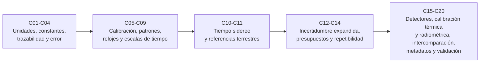

# B13 — Metrología, tiempo y mediciones científicas

> **Bloque ampliado (`0.2.0`).** Además de las 20 clases de esta página, el bloque tiene 3 clases programadas (`B13-C21` a `B13-C23`), sin redactar. Ver el [programa completo](../../PROGRAMA_ACADEMICO_COMPLETO.md).

**Programa:** Programa Integral de Astronomía, Astrofísica, Ciencias Espaciales e Ingeniería Aeroespacial
**Área:** A02 — Matemática, física computacional y métodos científicos
**Nivel:** N2 (fundamentos aplicados) · **Clases:** 20 · **Carga:** por calibrar con el uso
**Estado:** guía pedagógica del bloque (resumen de qué se aprende en cada clase). Las clases enlazadas en la tabla ya están redactadas; todas conservan el estado E0 en el catálogo hasta registrar revisión disciplinar. Las clases `B13-C21` a `B13-C23` siguen solo programadas.

## 🎯 Propósito del bloque

Enseña a **medir con garantías**: qué unidades y constantes sostienen una medida, cómo se mide y se distribuye el tiempo, cómo se fija la posición sobre la Tierra, cómo se cuantifica la incertidumbre y cómo se calibra, compara y valida una cadena de medida. Es el lenguaje de confianza que usan todos los bloques que manejan datos de instrumentos, de seguimiento y de navegación.

## 📚 Al terminar el bloque podrás

1. Explicar el SI, sus siete constantes definitorias y la trazabilidad de una medida a un patrón.
2. Distinguir exactitud, precisión, sesgo y dispersión, y separar errores sistemáticos de aleatorios.
3. Convertir entre escalas de tiempo (UTC, TAI, TT, TDB), tratar segundos intercalares y calcular el tiempo sidéreo.
4. Pasar entre coordenadas geodésicas y cartesianas terrestres con un sistema de referencia declarado.
5. Calcular y reportar incertidumbres (típica, combinada, expandida) y construir un presupuesto.
6. Calibrar, comparar y validar instrumentos y documentar la cadena con metadatos completos.

## 🧭 Secuencia del bloque

**Descripción textual.** Cinco tramos encadenados: fundamentos de medida (C01–C04), calibración y tiempo (C05–C09), geometría del tiempo y de la Tierra (C10–C11), incertidumbre cuantificada (C12–C14) y cadenas instrumentales completas (C15–C20), que terminan en una validación integradora.

## 🗂️ Las 20 clases en resumen

**Navegación:** cada clase desarrollada enlaza a la anterior, a la siguiente y a este bloque; mientras una clase siga solo programada, su enlace lleva a su fila en esta tabla.

La columna «Evidencia» indica el producto que demostrará el aprendizaje. Los laboratorios usan datos **sintéticos** (rotulados) o valores publicados con fuente y fecha.

### Tramo 1 · Unidades, constantes, trazabilidad y error

| ID | Clase | Qué se aprende | Evidencia |
|---|---|---|---|
| [B13-C01](../clases/B13/B13-C01-sistema-internacional-y-constantes/CLASE.md) | Sistema Internacional y constantes | Las siete constantes exactas del SI, distinguir exacto de medido y convertir sin perder cifras (tiempo de luz, GM, au). | Hoja de constantes y conversiones |
| [B13-C02](../clases/B13/B13-C02-dimensiones-y-trazabilidad/CLASE.md) | Dimensiones y trazabilidad | Análisis dimensional con vectores de exponentes; trazabilidad como cadena documentada cuya incertidumbre se acumula. | Informe de consistencia y trazabilidad |
| [B13-C03](../clases/B13/B13-C03-exactitud-frente-a-precision/CLASE.md) | Exactitud frente a precisión | Sesgo, dispersión y error cuadrático medio; por qué promediar no corrige un sesgo. | Tabla de cuatro instrumentos |
| [B13-C04](../clases/B13/B13-C04-errores-sistematicos-y-aleatorios/CLASE.md) | Errores sistemáticos y aleatorios | Ley `1/√n`, sesgo constante frente a deriva y cómo se descubre un sesgo. | Diagnóstico de una serie de medidas |

### Tramo 2 · Calibración y tiempo

| ID | Clase | Qué se aprende | Evidencia |
|---|---|---|---|
| [B13-C05](../clases/B13/B13-C05-calibracion-instrumental/CLASE.md) | Calibración instrumental | Curva de calibración por mínimos cuadrados con incertidumbre de pendiente y ordenada; inversión de la curva. | Curva de calibración con su incertidumbre |
| [B13-C06](../clases/B13/B13-C06-patrones-de-longitud-y-tiempo/CLASE.md) | Patrones de longitud y tiempo | Cómo se realizan el metro y el segundo, y cómo un error de frecuencia se convierte en error de distancia. | Cuaderno de equivalencias tiempo–distancia |
| [B13-C07](../clases/B13/B13-C07-relojes-atomicos-y-frecuencia/CLASE.md) | Relojes atómicos y frecuencia | Estabilidad de frecuencia, desviación de Allan y tipos de ruido de un reloj. | Curva de estabilidad con su interpretación |
| [B13-C08](../clases/B13/B13-C08-escalas-utc-tai-tt-y-tdb/CLASE.md) | Escalas UTC, TAI, TT y TDB | Qué mide cada escala, cómo se convierten y qué usa una efeméride. | Conversión verificada entre cuatro escalas |
| [B13-C09](../clases/B13/B13-C09-segundos-intercalares-y-cronologia/CLASE.md) | Segundos intercalares y cronología | Fechas julianas, el calendario y el tratamiento de los segundos intercalares. | Conversor de fechas con prueba de segundo intercalar |

### Tramo 3 · Tiempo sidéreo y referencias terrestres

| ID | Clase | Qué se aprende | Evidencia |
|---|---|---|---|
| [B13-C10](../clases/B13/B13-C10-tiempo-sidereo-local-y-terrestre/CLASE.md) | Tiempo sidéreo local y terrestre | Ángulo de rotación terrestre, día sidéreo y ángulo horario local de una dirección celeste. | Tabla de ángulo de rotación y culminación |
| [B13-C11](../clases/B13/B13-C11-sistemas-de-referencia-terrestres/CLASE.md) | Sistemas de referencia terrestres | ITRS/ITRF, elipsoide, conversión geodésica ↔ cartesiana y velocidad por rotación. | Conversor de coordenadas con ida y vuelta |

### Tramo 4 · Incertidumbre cuantificada

| ID | Clase | Qué se aprende | Evidencia |
|---|---|---|---|
| [B13-C12](../clases/B13/B13-C12-incertidumbre-expandida/CLASE.md) | Incertidumbre expandida | Incertidumbre típica, factor de cobertura y nivel de confianza; qué asume `k = 2`. | Reporte con `U` y cobertura simulada |
| [B13-C13](../clases/B13/B13-C13-presupuestos-de-incertidumbre/CLASE.md) | Presupuestos de incertidumbre | Propagación de varianzas, coeficientes de sensibilidad y contribuciones dominantes. | Presupuesto de una medida indirecta |
| [B13-C14](../clases/B13/B13-C14-repetibilidad-y-reproducibilidad/CLASE.md) | Repetibilidad y reproducibilidad | Condiciones de repetibilidad y reproducibilidad; separar variación intra e inter laboratorio. | Estudio de dos operadores |

### Tramo 5 · Cadenas instrumentales completas

| ID | Clase | Qué se aprende | Evidencia |
|---|---|---|---|
| [B13-C15](../clases/B13/B13-C15-sensibilidad-de-detectores/CLASE.md) | Sensibilidad de detectores | Relación señal-ruido de un detector con ruido de disparo, de lectura y de oscuridad. | Señal mínima para una relación dada |
| [B13-C16](../clases/B13/B13-C16-calibracion-termica/CLASE.md) | Calibración térmica | Calibración de un sensor de temperatura por dos puntos y balance térmico de una superficie. | Calibración térmica con incertidumbre |
| B13-C17 | Calibración radiométrica | Ley de Planck, radiancia y calibración con una fuente de cuerpo negro. | Calibración radiancia–cuentas |
| B13-C18 | Intercomparación de instrumentos | Diferencia normalizada entre dos instrumentos y media ponderada. | Informe de intercomparación |
| B13-C19 | Metadatos y registros de calibración | Qué debe contener un registro de calibración y cómo validarlo y firmarlo. | Registro de calibración validado |
| B13-C20 | Validación de una cadena de medida | Integrar patrón, calibración, presupuesto y validación frente a un criterio de aceptación. | Informe de validación de una cadena |

## 🧵 Hilos que atraviesan el bloque

- **Incertidumbre:** C03–C04 la separan en sesgo y dispersión; C12–C14 la cuantifican; C20 la usa para aceptar o rechazar una cadena.
- **Tiempo:** C06–C10 construyen la cadena segundo → reloj → escala → fecha → ángulo de rotación.
- **Trazabilidad:** C01–C02 la definen; C05, C16–C17 la aplican a instrumentos; C19 la registra.
- **Verificación independiente:** cada laboratorio contrasta con un caso analítico o una referencia.

## 📝 Evaluación del bloque (propuesta, por calibrar)

- Fichas y ejercicios por clase, con retroalimentación y recuperación con evidencia distinta.
- Portafolio: una cadena de medida completa (C20) con presupuesto, calibración, metadatos y validación.
- Las condiciones críticas (no tratar una estimación como exacta, declarar siempre la incertidumbre, rotular lo sintético y citar solo lo consultado) no se compensan con promedio.

## ⚠️ Seguridad y límites

El bloque es educativo. Los instrumentos y datos de laboratorio son simulados y no sustituyen la calibración acreditada, los certificados de un laboratorio ni los productos oficiales del BIPM o del IERS. Las predicciones de tiempo y de orientación terrestre con fines operativos deben usar los boletines vigentes. Las cifras publicadas se citan con fecha de consulta.

## Fuentes de orientación preliminar

- **[NIST]** [National Institute of Standards and Technology](https://www.nist.gov/) — Constantes, patrones y metrología.
- **[IERS]** [International Earth Rotation and Reference Systems Service](https://www.iers.org/) — Convenciones, rotación terrestre y sistemas de referencia.
- **[JPL-SPICE]** [NASA NAIF/SPICE](https://naif.jpl.nasa.gov/naif/) — Tiempo y referencias en misiones.
- **[NASA-NTRS]** [NASA Technical Reports Server](https://ntrs.nasa.gov/) — Informes técnicos de misión.

> La asociación de estas fuentes es orientativa por bloque. Las fuentes realmente consultadas para cada afirmación se registran en la sección 11 de cada clase.

[🏠 Volver al programa](../../README.md) · [➡️ B14 — Computación científica y ciencia abierta](./B14-computacion-cientifica-y-ciencia-abierta.md)
