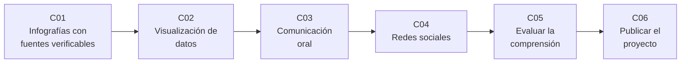

# B130 — Comunicación y divulgación científica

> **Bloque nuevo de la estructura vigente.** Sus 6 clases estaban programadas por la ampliación y ahora están redactadas. Ver el [programa completo](../../PROGRAMA_ACADEMICO_COMPLETO.md).

**Programa:** Programa Integral de Astronomía, Astrofísica, Ciencias Espaciales e Ingeniería Aeroespacial
**Área:** A12 — Educación, historia aplicada y divulgación astronómica
**Nivel:** N3 (fundamentos disciplinares) · **Clases:** 6 · **Carga:** por calibrar con el uso
**Estado:** guía pedagógica del bloque (resumen de qué se aprende en cada clase). Las clases enlazadas en la tabla ya están redactadas; todas conservan el estado E0 en el catálogo hasta registrar revisión disciplinar.

## 🎯 Propósito del bloque

Enseña **cómo llevar un resultado astronómico a un público sin perder la fuente, la incertidumbre ni la honestidad**, y cómo comprobar después si ese público entendió. Recorre cinco canales o momentos del trabajo de divulgación: la infografía con su procedencia, el gráfico que no engaña, la exposición oral, el hilo en redes sociales y la medición de la comprensión; y cierra con la publicación abierta y verificable del proyecto educativo. Cada clase termina con un laboratorio en Python (biblioteca estándar, semilla fija) que convierte una buena práctica en una comprobación automática: un audit de procedencia, una medición del exagerado visual, un cronómetro y legibilidad de un guion, un verificador de hilos, una ganancia normalizada y un paquete con huellas SHA-256. Los datos de los laboratorios son **sintéticos o ilustrativos** y están rotulados.

## 📚 Al terminar el bloque podrás

1. Auditar una infografía: que cada cifra lleve fuente, fecha, unidad, incertidumbre y estado (observado, modelado, ilustrativo).
2. Medir cuánto exagera un gráfico (factor de mentira, eje truncado, escala de color) y elegir un diseño honesto y accesible con contraste verificable.
3. Preparar una exposición oral con presupuesto de tiempo, legibilidad (INFLESZ) y densidad de jerga calculados.
4. Dividir un mensaje en un hilo para redes con fuente, texto alternativo y corrección de un mito sin repetirlo como hecho.
5. Calcular la ganancia normalizada y la fiabilidad de un cuestionario pre/post, con su intervalo y sus límites.
6. Empaquetar un proyecto educativo con licencia, metadatos mínimos, huellas de integridad y lista FAIR, sin confundir «publicado» con «verificado».

## 🧭 Secuencia del bloque

**Descripción textual.** Seis clases encadenadas: producir una pieza visual con procedencia (C01 y C02), llevarla a un auditorio presencial o a una red (C03 y C04), medir si funcionó (C05) y publicar el proyecto completo de forma abierta (C06). El hilo común es no decir más de lo que se sabe.

## 🗂️ Las 6 clases en resumen

**Navegación:** cada clase enlaza a la anterior, a la siguiente y a este bloque.

La columna «Evidencia» indica el producto que demostrará el aprendizaje. Los laboratorios usan datos **sintéticos** o **ilustrativos** (rotulados) o valores publicados con fuente y fecha.

### Tramo 1 · Piezas visuales con procedencia

| ID | Clase | Qué se aprende | Evidencia |
|---|---|---|---|
| [B130-C01](../clases/B130/B130-C01-infografias-con-fuentes-verificables/CLASE.md) | Infografías con fuentes verificables | Ficha de procedencia por cifra, incertidumbre y cifras significativas, créditos y color representativo. | Auditoría de una infografía de datos planetarios |
| [B130-C02](../clases/B130/B130-C02-visualizacion-de-datos-para-comunicar/CLASE.md) | Visualización de datos para comunicar | Factor de mentira, eje truncado, luminancia de una escala de color y contraste WCAG. | Informe de honestidad de un gráfico |

### Tramo 2 · Llegar al público

| ID | Clase | Qué se aprende | Evidencia |
|---|---|---|---|
| [B130-C03](../clases/B130/B130-C03-comunicacion-oral-de-la-ciencia/CLASE.md) | Comunicación oral de la ciencia | Presupuesto de tiempo, legibilidad INFLESZ y densidad de jerga de un guion. | Guion con tiempos y métricas |
| [B130-C04](../clases/B130/B130-C04-divulgacion-cientifica-en-redes-sociales/CLASE.md) | Divulgación científica en redes sociales | Hilo con fuente y texto alternativo, corrección de mitos y alcance incierto de una cascada. | Hilo verificado con su lista de comprobación |

### Tramo 3 · Medir y publicar

| ID | Clase | Qué se aprende | Evidencia |
|---|---|---|---|
| [B130-C05](../clases/B130/B130-C05-evaluacion-de-la-comprension-del-publico/CLASE.md) | Evaluación de la comprensión del público | Ganancia normalizada, dificultad y discriminación de ítems, KR-20 y remuestreo. | Informe de evaluación pre/post sintético |
| [B130-C06](../clases/B130/B130-C06-publicacion-de-un-proyecto-educativo/CLASE.md) | Publicación de un proyecto educativo | Licencia, metadatos mínimos DataCite, huellas SHA-256 y lista FAIR. | Paquete publicable con manifiesto de integridad |

## 🧵 Hilos que atraviesan el bloque

- **Fuente e incertidumbre visibles:** C01 y C02 las exigen en la pieza; C04 en cada publicación; C06 en el paquete.
- **Observado frente a modelado o ilustrativo:** todo número del bloque lleva su estado; ninguno de los laboratorios es una medición de público real.
- **Accesibilidad:** contraste, texto alternativo, legibilidad y formatos abiertos aparecen en C02, C03, C04 y C06.
- **Evidencia con límites:** los estudios citados (Hake, Franconeri et al., Vosoughi et al., Lewandowsky et al.) se resumen con su alcance; no se generalizan a la divulgación astronómica.

## 📝 Evaluación del bloque (propuesta, por calibrar)

- Fichas y ejercicios por clase, con retroalimentación y recuperación con evidencia distinta.
- Portafolio: la auditoría de infografía (C01), el guion con métricas (C03) y el paquete publicable (C06).
- Las condiciones críticas (rotular lo ilustrativo y sintético, no presentar un modelo como observación, no atribuir impacto sin fuente y citar solo lo consultado) no se compensan con promedio.

## ⚠️ Seguridad y límites

El bloque es educativo. Las métricas (INFLESZ, factor de mentira, ganancia normalizada, KR-20, cascada de compartidos) son indicadores simplificados y no sustituyen a una evaluación con público real, a la revisión editorial ni al criterio de un comunicador. Los datos de público, de redes y de respuestas son sintéticos y no describen a nadie. El bloque no da asesoría legal: las licencias se resumen desde sus páginas oficiales y no se consultó su texto legal completo. Las normas actuales de cada plataforma de redes no se consultaron.

## 📖 Fuentes consultadas en el bloque (resumen)

Consultadas el 2026-11-11: las fichas de la NASA/NSSDC de la Tierra y Marte; los explicadores de la NASA y de ESA/Webb sobre color representativo; la política de uso de imágenes de ESO (CC BY 4.0); la página de comprensión del criterio de contraste de WCAG 2.2 (W3C); la página de la revisión de Franconeri et al. (2021) de la Association for Psychological Science y los resúmenes de Vosoughi et al. (2018), Lewandowsky et al. (2012) y Barrio-Cantalejo et al. (2008) obtenidos por buscador, sin el texto completo; el PDF de Hake (1998), leído con PyMuPDF; los principios FAIR en GO FAIR; el esquema DataCite 4.5; el resumen de CC BY 4.0 de Creative Commons y la Recomendación de la UNESCO sobre Recursos Educativos Abiertos (2019). No se consultó el texto de Cleveland y McGill, de Tufte ni del Debunking Handbook (el servidor respondió con error). La ficha de Titán no interviene en este bloque.

## Fuentes de orientación preliminar

- **[IAU-C2]** [IAU Commission C2 — Communicating Astronomy with the Public](https://iau.org/science/scientific_bodies/commissions/C2/) — Normas y buenas prácticas de comunicación astronómica.
- **[ESO-OUTREACH]** [ESO Outreach](https://www.eso.org/public/outreach/) — Materiales y políticas de divulgación de un observatorio.
- **[UNESCO-OER]** [UNESCO — Recursos Educativos Abiertos](https://www.unesco.org/en/legal-affairs/recommendation-open-educational-resources-oer) — Marco internacional de recursos abiertos.
- **[ADS]** [NASA Astrophysics Data System](https://ui.adsabs.harvard.edu/) — Índice bibliográfico de literatura astronómica y física.

> La asociación de estas fuentes es orientativa por bloque. Las fuentes realmente consultadas para cada afirmación se registran en la sección 11 de cada clase.

## Roles que lo usan

- [Educación historia y divulgación astronómica](../../rutas/educacion-historia-y-divulgacion-astronomica.md)

[🏠 Volver al programa](../../README.md) · [➡️ B131 — Didáctica de la astronomía](./B131-didactica-de-la-astronomia.md)
