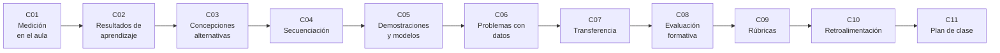

# B131 — Didáctica de la astronomía

> **Bloque nuevo de la estructura vigente.** Sus 11 clases estaban programadas y ahora están redactadas. Ver el [programa completo](../../PROGRAMA_ACADEMICO_COMPLETO.md).

**Programa:** Programa Integral de Astronomía, Astrofísica, Ciencias Espaciales e Ingeniería Aeroespacial
**Área:** A12 — Educación, historia aplicada y divulgación astronómica
**Nivel:** N4 (aplicación) · **Clases:** 11 · **Carga:** por calibrar con el uso
**Estado:** guía pedagógica del bloque (resumen de qué se aprende en cada clase). Las clases enlazadas en la tabla ya están redactadas; todas conservan el estado E0 en el catálogo hasta registrar revisión disciplinar.

## 🎯 Propósito del bloque

Enseña **cómo diseñar, impartir y evaluar una clase de astronomía con evidencia**, no solo cómo explicar astronomía. Recorre el diseño de actividades de medición para el aula (con datos reales de una experiencia escolar), la redacción de resultados de aprendizaje observables, el diagnóstico de concepciones alternativas, la secuenciación de una unidad según sus dependencias conceptuales, las demostraciones y los modelos a escala, el aprendizaje basado en problemas con datos astronómicos, los ejercicios de transferencia, la evaluación formativa, las rúbricas, la retroalimentación y, al final, el plan completo de una clase. Cada clase cierra con un laboratorio en Python con semilla fija que trata con **datos de aula sintéticos** (rotulados) las cuentas que un docente necesita: error de medición, ganancia normalizada, orden de prerrequisitos, escalas, curvas de luz, análisis de ítems, acuerdo entre evaluadores y coherencia de un plan.

## 📚 Al terminar el bloque podrás

1. Diseñar una actividad de medición con incertidumbre explícita y contrastarla con un valor de referencia citado.
2. Redactar resultados de aprendizaje observables y revisar su alineación con la actividad y la evaluación.
3. Diagnosticar concepciones alternativas con distractores de opción múltiple y medir el cambio con la ganancia normalizada.
4. Ordenar los conceptos de una unidad respetando sus prerrequisitos y detectar ciclos y saltos.
5. Construir modelos a escala del Sistema Solar y reconocer lo que cada escala deforma.
6. Plantear un problema con datos astronómicos y reconstruir con él los parámetros de un tránsito sintético.
7. Generar variantes de transferencia cercana y lejana de un mismo problema.
8. Analizar ítems, calcular el acuerdo entre evaluadores y clasificar la retroalimentación.
9. Armar un plan de clase coherente en tiempo, objetivos, evaluación y seguridad, y rotular lo que es evidencia citada frente a lo que es ilustrativo.

## 🧭 Secuencia del bloque

**Descripción textual.** Once clases encadenadas: una actividad de medición concreta (C01), los resultados de aprendizaje que la justifican (C02), lo que los estudiantes ya creen (C03), el orden de una unidad (C04), las demostraciones y modelos (C05), los problemas con datos (C06) y la transferencia (C07); después la evaluación formativa (C08), las rúbricas (C09), la retroalimentación (C10) y el plan completo que integra todo (C11).

## 🗂️ Las 11 clases en resumen

**Navegación:** cada clase enlaza a la anterior, a la siguiente y a este bloque.

La columna «Evidencia» indica el producto que demostrará el aprendizaje. Los laboratorios usan datos **sintéticos** o **ilustrativos** (rotulados) o valores publicados con fuente y fecha.

### Tramo 1 · Diseñar el aprendizaje

| ID | Clase | Qué se aprende | Evidencia |
|---|---|---|---|
| [B131-C01](../clases/B131/B131-C01-actividades-de-medicion-astronomica-para-el-aula/CLASE.md) | Actividades de medición astronómica para el aula | Radio de la Tierra con dos sombras (datos de una experiencia escolar), error y propagación. | Ficha de medición con incertidumbre |
| [B131-C02](../clases/B131/B131-C02-resultados-de-aprendizaje-observables-en-astronomia/CLASE.md) | Resultados de aprendizaje observables en astronomía | Verbos observables, nivel cognitivo y alineación con la evaluación. | Lista revisada de resultados de aprendizaje |
| [B131-C03](../clases/B131/B131-C03-conocimientos-previos-y-concepciones-alternativas/CLASE.md) | Conocimientos previos y concepciones alternativas | Distractores diagnósticos, frecuencias, ganancia normalizada y la física de las estaciones. | Informe de diagnóstico de un curso sintético |
| [B131-C04](../clases/B131/B131-C04-secuenciacion-conceptual-de-una-unidad/CLASE.md) | Secuenciación conceptual de una unidad | Grafo de prerrequisitos, orden topológico, ciclos y camino crítico. | Mapa y orden de una unidad |

### Tramo 2 · Enseñar y practicar

| ID | Clase | Qué se aprende | Evidencia |
|---|---|---|---|
| [B131-C05](../clases/B131/B131-C05-demostraciones-visuales-y-modelos-para-el-aula/CLASE.md) | Demostraciones visuales y modelos para el aula | Escalas del Sistema Solar, el modelo que no cabe en una sala y la fase lunar como geometría. | Tabla de escalas con su deformación |
| [B131-C06](../clases/B131/B131-C06-aprendizaje-basado-en-problemas-con-datos-astronomicos/CLASE.md) | Aprendizaje basado en problemas con datos astronómicos | Un problema abierto con una curva de luz sintética: profundidad, período y radio relativo. | Informe del problema resuelto |
| [B131-C07](../clases/B131/B131-C07-ejercicios-de-transferencia/CLASE.md) | Ejercicios de transferencia | Variantes cercanas y lejanas de un problema de la tercera ley de Kepler, con clave verificada. | Banco de variantes con clave |

### Tramo 3 · Evaluar y planificar

| ID | Clase | Qué se aprende | Evidencia |
|---|---|---|---|
| [B131-C08](../clases/B131/B131-C08-evaluacion-formativa-en-el-aula-de-astronomia/CLASE.md) | Evaluación formativa en el aula de astronomía | Dificultad y discriminación de ítems, fiabilidad y regla de decisión. | Informe de ítems con decisiones |
| [B131-C09](../clases/B131/B131-C09-rubricas-de-evaluacion/CLASE.md) | Rúbricas de evaluación | Niveles y criterios, acuerdo entre dos evaluadores con kappa ponderado. | Rúbrica con acuerdo calculado |
| [B131-C10](../clases/B131/B131-C10-retroalimentacion-efectiva/CLASE.md) | Retroalimentación efectiva | Niveles de la retroalimentación (tarea, proceso, autorregulación, persona) y su distribución. | Auditoría de comentarios |
| [B131-C11](../clases/B131/B131-C11-plan-completo-de-una-clase-de-astronomia/CLASE.md) | Plan completo de una clase de astronomía | Plan de 90 min coherente en tiempo, alineación y seguridad, con la fase lunar como caso. | Plan de clase validado |

## 🧵 Hilos que atraviesan el bloque

- **Alineación:** objetivo, actividad y evaluación deben corresponderse (C02, C08, C09, C11).
- **Evidencia con límites:** cada afirmación sobre enseñanza cita su fuente y dice qué no prueba; ningún tamaño de efecto se generaliza (C03, C08, C10).
- **Observado frente a modelado:** solo los valores de C01 (sombras medidas por una escuela) y las constantes de la IAU son datos consultados; las clases de aula, notas y curvas de luz son sintéticas.
- **Verificación independiente:** cada laboratorio contrasta con otra vía de cálculo.
- **Seguridad en el aula:** la observación del Sol solo con filtros certificados (C01, C05, C11).

## 📝 Evaluación del bloque (propuesta, por calibrar)

- Fichas y ejercicios por clase, con retroalimentación y recuperación con evidencia distinta.
- Portafolio: el plan de clase validado (C11) con sus supuestos, alineación y evidencia.
- Las condiciones críticas (rotular lo ilustrativo y sintético, no generalizar un efecto pedagógico y citar solo lo consultado) no se compensan con promedio.

## ⚠️ Seguridad y límites

El bloque es **educativo**. Los datos de estudiantes, cursos y notas son **sintéticos** y ningún resultado describe a una persona o un curso reales. Los modelos (ganancia normalizada, kappa, análisis de ítems, curva de luz con ruido gaussiano) son simplificaciones y no sustituyen la investigación en didáctica ni el juicio profesional del docente. Observar el Sol, incluso en actividades de sombra o proyección, exige filtros certificados o proyección indirecta y nunca mirar directamente ni con instrumentos sin filtro; el bloque no cubre procedimientos de observación solar.

## 📖 Fuentes consultadas en el bloque (resumen)

Consultadas el 2026-11-11: la página del IAU Office of Astronomy for Education (astro4edu.org), la revisión de Bailey y Slater (2004, *Astronomy Education Review*; PDF leído con PyMuPDF), el resumen de Hake (1998, *American Journal of Physics*), el artículo de Black y Wiliam (1998, PDF leído con PyMuPDF; la extracción de texto salió parcialmente degradada), los resúmenes de Hattie y Timperley (2007), Wisniewski, Zierer y Hattie (2020) y Savery (2006), la Resolución B3 de la IAU (2015; PDF leído con PyMuPDF), la presentación de CESAR/ESA sobre el experimento de Eratosthenes (2018; PDF leído con PyMuPDF) y la página del proyecto Eratosthenes Experiment. De Barnett y Ceci (2002) solo se obtuvo la referencia bibliográfica y el inicio del resumen; de Jönsson y Svingby (2007) solo la referencia bibliográfica por una búsqueda (la página del editor devolvió 403). **UNESCO no se consultó** como fuente de este bloque. Los textos completos de Hake, Hattie y Timperley, Savery, Wisniewski et al. y Barnett y Ceci no se leyeron: solo se usan sus resúmenes. Las relaciones de los laboratorios (error estándar, kappa, índices de ítems, KR-20, ordenación topológica) son resultados estándar que verifica cada laboratorio con otra vía y no se consultaron en una fuente concreta.

## Fuentes de orientación preliminar

- **[IAU-OAE]** [IAU Office of Astronomy for Education](https://astro4edu.org/) — Recursos y guías para docentes de astronomía.
- **[AER]** [Astronomy Education Review](https://aas.org/) — Investigación en didáctica de la astronomía.
- **[CESAR]** [ESA CESAR](https://cesar.esa.int/) — Actividades educativas con datos astronómicos.
- **[ADS]** [NASA Astrophysics Data System](https://ui.adsabs.harvard.edu/) — Índice bibliográfico de literatura astronómica y de su didáctica.

> La asociación de estas fuentes es orientativa por bloque. Las fuentes realmente consultadas para cada afirmación se registran en la sección 11 de cada clase.

## Roles que lo usan

- [Educación historia y divulgación astronómica](../../rutas/educacion-historia-y-divulgacion-astronomica.md)

[🏠 Volver al programa](../../README.md) · [➡️ B132 — Historia y arqueoastronomía aplicadas](./B132-historia-y-arqueoastronomia-aplicadas.md)
