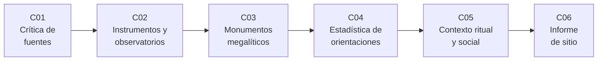

# B132 — Historia y arqueoastronomía aplicadas

> **Bloque nuevo de la estructura vigente.** Sus 6 clases estaban programadas por la ampliación y ahora están redactadas. Ver el [programa completo](../../PROGRAMA_ACADEMICO_COMPLETO.md).

**Programa:** Programa Integral de Astronomía, Astrofísica, Ciencias Espaciales e Ingeniería Aeroespacial
**Área:** A12 — Educación, historia aplicada y divulgación astronómica
**Nivel:** N4 (aplicación) · **Clases:** 6 · **Carga:** por calibrar con el uso
**Estado:** guía pedagógica del bloque (resumen de qué se aprende en cada clase). Las clases enlazadas en la tabla ya están redactadas; todas conservan el estado E0 en el catálogo hasta registrar revisión disciplinar.

## 🎯 Propósito del bloque

Enseña **cómo se razona con evidencia cuando se cuenta la historia de la astronomía y cuando se estudia cómo los pueblos del pasado miraron el cielo**. Recorre la crítica de fuentes de época, el estudio material y la datación de instrumentos y observatorios, los monumentos megalíticos como caso clásico, la estadística que permite decidir si un conjunto de orientaciones es intencional, el contexto ritual y social sin el cual una alineación no se interpreta, y el informe de sitio como producto profesional. Cada clase cierra con un laboratorio en Python con semilla fija y datos **sintéticos** rotulados: el bloque no afirma nada nuevo sobre ningún sitio real; enseña el método y cita, con su fecha, lo que sí se consultó.

El bloque distingue siempre tres planos: **evidencia** (lo que se midió o se leyó), **interpretación** (lo que se propone a partir de ella) y **lo que no se sabe**. Los saberes y las prácticas de los pueblos y las culturas que observaron el cielo son propios de ellos y se describen con respeto y atribuidos a sus fuentes.

## 📚 Al terminar el bloque podrás

1. Evaluar una fuente de época por cercanía, independencia, tipo y propósito, y reconocer una cadena de copias.
2. Contrastar un ciclo astronómico inscrito en un instrumento con su valor moderno y fechar por intervalos compatibles.
3. Convertir un azimut y una altura de horizonte en declinación, y decidir si una alineación solar es compatible con un monumento dentro de su tolerancia.
4. Aplicar una prueba de Rayleigh sobre datos axiales y una prueba binomial, y corregir por la cantidad de objetivos probados.
5. Combinar líneas de evidencia contextual de forma que ninguna alineación se interprete sin su contexto cultural.
6. Redactar un informe de sitio con tabla de mediciones, incertidumbres, categoría de credibilidad y límites.

## 🧭 Secuencia del bloque

**Descripción textual.** Seis clases encadenadas: primero cómo se evalúa lo escrito (C01), luego lo material (C02), después el caso clásico de los megalitos y su geometría (C03), la estadística que separa intención de azar (C04), el contexto que da sentido a una alineación (C05) y el informe que reúne todo (C06).

## 🗂️ Las 6 clases en resumen

**Navegación:** cada clase enlaza a la anterior, a la siguiente y a este bloque.

La columna «Evidencia» indica el producto que demostrará el aprendizaje. Los laboratorios usan datos **sintéticos** (rotulados) o valores publicados con fuente y fecha.

### Tramo 1 · Fuentes y objetos

| ID | Clase | Qué se aprende | Evidencia |
|---|---|---|---|
| [B132-C01](../clases/B132/B132-C01-critica-historica-de-fuentes-y-metodo-historiografico/CLASE.md) | Crítica histórica de fuentes y método historiográfico | Ponderar fuentes por cercanía, independencia y tipo; ciclos del Mecanismo de Anticitera como caso. | Matriz de crítica de fuentes con sensibilidad |
| [B132-C02](../clases/B132/B132-C02-arqueologia-de-observatorios-y-de-instrumentos-antiguos/CLASE.md) | Arqueología de observatorios y de instrumentos antiguos | Datación por intervalos compatibles y precisión de un gnomon sintético. | Ficha de datación y precisión de un instrumento |
| [B132-C03](../clases/B132/B132-C03-monumentos-megaliticos-y-astronomia/CLASE.md) | Monumentos megalíticos y astronomía | Azimut a declinación, oblicuidad de la época y compatibilidad solar de un eje. | Tabla de compatibilidad de un monumento sintético |

### Tramo 2 · Decidir, interpretar y comunicar

| ID | Clase | Qué se aprende | Evidencia |
|---|---|---|---|
| [B132-C04](../clases/B132/B132-C04-estadistica-de-orientaciones-en-arqueoastronomia/CLASE.md) | Estadística de orientaciones en arqueoastronomía | Prueba de Rayleigh sobre datos axiales, prueba binomial y corrección por comparaciones. | Informe estadístico de una muestra sintética |
| [B132-C05](../clases/B132/B132-C05-contexto-ritual-y-social-de-la-observacion-del-cielo/CLASE.md) | Contexto ritual y social de la observación del cielo | Cuatro categorías de credibilidad y combinación de líneas de evidencia. | Ficha de credibilidad de una alineación |
| [B132-C06](../clases/B132/B132-C06-informe-de-un-sitio-arqueoastronomico/CLASE.md) | Informe de un sitio arqueoastronómico | Propagación de incertidumbres, verificación de estructura y redacción del informe. | Informe de un sitio sintético |

## 🧵 Hilos que atraviesan el bloque

- **Evidencia, interpretación y desconocido:** cada clase obliga a rotular las tres cosas por separado.
- **Intención frente a azar:** C03 mide la compatibilidad, C04 la contrasta estadísticamente y C05 pide contexto antes de concluir.
- **Incertidumbre explícita:** intervalos de fechas (C02), tolerancias angulares (C03, C06) y valores p (C04).
- **Respeto por las fuentes y los pueblos:** los datos de los laboratorios son sintéticos; las prácticas culturales reales solo se citan desde sus fuentes consultadas.
- **Verificación independiente:** cada laboratorio contrasta con un caso analítico o con otra vía de cálculo.

## 📝 Evaluación del bloque (propuesta, por calibrar)

- Fichas y ejercicios por clase, con retroalimentación y recuperación con evidencia distinta.
- Portafolio: el informe de sitio (C06) con sus incertidumbres, su categoría de credibilidad y sus límites.
- Las condiciones críticas (rotular lo sintético, no presentar una alineación como intencional sin contexto ni estadística, no inventar datos arqueológicos y citar solo lo consultado) no se compensan con promedio.

## ⚠️ Seguridad y límites

El bloque es educativo. Todos los sitios, muestras y sociedades de los laboratorios son **sintéticos**: ningún resultado describe un monumento real ni a un pueblo real, y no sustituye a la literatura arqueológica ni a la consulta con las comunidades que mantienen un lugar o un saber. Las cifras históricas proceden de las fuentes citadas en cada clase; lo que no se consultó se rotula «no consultado». No se promueve ninguna interpretación de un sitio real: el bloque insiste en que la intencionalidad se evalúa con contexto y estadística.

## 📖 Fuentes consultadas en el bloque (resumen)

Consultadas el 2026-11-11: el artículo de Freeth et al. (2006, *Nature* 444) sobre el Mecanismo de Anticitera (texto completo, extraído con PyMuPDF); los capítulos de introducción y conclusión del Estudio Temático ICOMOS–IAU sobre patrimonio astronómico (Cotte y Ruggles, texto completo de esos dos capítulos); los resúmenes de Magli y Belmonte (arXiv:2211.07981) y de González García y Belmonte (2014); y la documentación de `astropy.stats.rayleightest`. Las páginas de la UNESCO y de Historic England devolvieron acceso denegado y **no se consultaron**; el artículo de Parracho Silva (2020) tampoco. Las fórmulas astronómicas estándar (conversión azimut–declinación, refracción, estadística circular) las verifica cada laboratorio y no se consultaron en una fuente concreta.

## Fuentes de orientación preliminar

- **[UNESCO-WHC]** [UNESCO World Heritage Centre — Astronomy](https://whc.unesco.org/en/astronomy/) — Iniciativa de astronomía y patrimonio mundial (no consultada: acceso denegado).
- **[ICOMOS-IAU]** [Estudio Temático ICOMOS–IAU sobre patrimonio astronómico](https://web.astronomicalheritage.org/) — Estudio de referencia sobre patrimonio astronómico.
- **[ADS]** [NASA Astrophysics Data System](https://ui.adsabs.harvard.edu/) — Índice bibliográfico de literatura astronómica y de historia de la astronomía.

> La asociación de estas fuentes es orientativa por bloque. Las fuentes realmente consultadas para cada afirmación se registran en la sección 11 de cada clase.

## Roles que lo usan

- [Educación historia y divulgación astronómica](../../rutas/educacion-historia-y-divulgacion-astronomica.md)

[🏠 Volver al programa](../../README.md) · [➡️ B133 — Saberes astronómicos y educación intercultural](./B133-saberes-astronomicos-y-educacion-intercultural.md)
