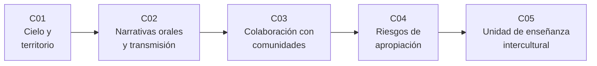

# B133 — Saberes astronómicos y educación intercultural

> **Bloque nuevo de la estructura `0.2.0`.** Sus 5 clases estaban programadas por la ampliación y ahora están redactadas. Ver el [programa completo](../../PROGRAMA_ACADEMICO_COMPLETO.md).

**Programa:** Programa Integral de Astronomía, Astrofísica, Ciencias Espaciales e Ingeniería Aeroespacial
**Área:** A12 — Educación, historia aplicada y divulgación astronómica
**Nivel:** N4 (aplicación) · **Clases:** 5 · **Carga:** por calibrar con el uso
**Estado:** guía pedagógica del bloque (resumen de qué se aprende en cada clase). Las clases enlazadas en la tabla ya están redactadas; todas conservan el estado E0 en el catálogo hasta registrar revisión disciplinar. Ninguna fue revisada por personas de las comunidades cuyos saberes se mencionan.

## 🎯 Propósito del bloque

Enseña **cómo trabajar con los saberes astronómicos de pueblos y culturas sin desfigurarlos ni apropiárselos**, y cómo llevarlos al aula junto con la ciencia escolar. Los saberes del cielo pertenecen a las comunidades que los sostienen; el bloque no los resume ni los generaliza: muestra el método para estudiarlos, transmitirlos y enseñarlos con respeto. Recorre la relación entre cielo y territorio (con un caso documentado en una comunidad mapuche-pewenche y una geometría de orto solar), la transmisión oral y por qué no se puede «datar» una tradición a ojo, la colaboración con comunidades (consentimiento, autoridad sobre los datos, devolución de resultados), los riesgos de apropiación al divulgar y el diseño de una unidad de enseñanza intercultural. Cada clase cierra con un laboratorio en Python que calcula o audita algo concreto con datos **sintéticos rotulados**: nunca con saberes de un pueblo real.

## 📚 Al terminar el bloque podrás

1. Calcular el acimut de salida del sol según la latitud y la elevación del horizonte, y explicar por qué un marcador local (un agujero en una pared, una cumbre) es un instrumento del territorio.
2. Modelar cuánta información de un relato sobrevive a varias generaciones según los canales que la sostienen, y por qué eso no permite fechar ninguna tradición real.
3. Verificar que el plan de una colaboración ponga el consentimiento, la autoridad de la comunidad y la devolución de resultados antes de lo que dependa de ellos.
4. Auditar un texto de divulgación contra una lista de riesgos de apropiación y reconocer lo que ninguna lista puede decidir.
5. Diseñar una unidad intercultural con un presupuesto de tiempo, una actividad de medición con su incertidumbre y un reparto explícito de roles.
6. Rotular, en cada afirmación, qué es evidencia documentada, qué es interpretación de quien investiga y qué no se sabe.

## 🧭 Secuencia del bloque

**Descripción textual.** Cinco clases encadenadas: el cielo ligado al lugar que se habita (C01), cómo se conserva y se transmite ese saber (C02), cómo se trabaja con las comunidades que lo sostienen (C03), qué riesgos tiene divulgarlo (C04) y cómo se lleva al aula junto con la ciencia escolar (C05).

## 🗂️ Las 5 clases en resumen

**Navegación:** cada clase enlaza a la anterior, a la siguiente y a este bloque.

La columna «Evidencia» indica el producto que demostrará el aprendizaje. Los laboratorios usan datos **sintéticos** (rotulados); ninguno reproduce saberes de un pueblo real.

### Tramo 1 · Entender cómo se sostiene el saber del cielo

| ID | Clase | Qué se aprende | Evidencia |
|---|---|---|---|
| [B133-C01](../clases/B133/B133-C01-relaciones-entre-cielo-y-territorio-en-los-saberes-tradicionales/CLASE.md) | Relaciones entre cielo y territorio en los saberes tradicionales | Acimut de salida del sol, horizonte local y marcador en una pared; qué dice y qué no dice una geometría. | Ficha de un marcador solar sintético con su ventana de incertidumbre |
| [B133-C02](../clases/B133/B133-C02-narrativas-orales-y-transmision-del-saber-del-cielo/CLASE.md) | Narrativas orales y transmisión del saber del cielo | Retención de un relato por generaciones según sus canales; límites para datar tradiciones. | Ficha de transmisión de un relato sintético |

### Tramo 2 · Trabajar con las comunidades

| ID | Clase | Qué se aprende | Evidencia |
|---|---|---|---|
| [B133-C03](../clases/B133/B133-C03-colaboracion-con-comunidades-en-investigacion-y-educacion/CLASE.md) | Colaboración con comunidades en investigación y educación | Acuerdo de colaboración como dato verificable: CARE, consentimiento previo, orden de las etapas. | Acuerdo sintético validado con sus hallazgos |
| [B133-C04](../clases/B133/B133-C04-riesgos-de-apropiacion-cultural-en-la-divulgacion/CLASE.md) | Riesgos de apropiación cultural en la divulgación | Auditoría de un guion de divulgación sintético y límites de las reglas automáticas. | Informe de auditoría de un guion |

### Tramo 3 · Enseñar

| ID | Clase | Qué se aprende | Evidencia |
|---|---|---|---|
| [B133-C05](../clases/B133/B133-C05-diseno-de-una-unidad-de-ensenanza-intercultural/CLASE.md) | Diseño de una unidad de enseñanza intercultural | Presupuesto de tiempo, medición del orto solar con incertidumbre y reparto de roles con quien porta el saber. | Plan de una unidad intercultural de 6 sesiones |

## 🧵 Hilos que atraviesan el bloque

- **Los saberes son de quienes los sostienen:** C03 y C04 parten de que la autoridad es de la comunidad; C01, C02 y C05 no sustituyen su voz.
- **Evidencia, interpretación y lo que no se sabe:** cada afirmación sobre un pueblo lleva su fuente y su estado.
- **Sintético frente a real:** los números de los laboratorios son de modelos y nunca representan saberes de un pueblo.
- **Dos formas de ver:** la idea de ver con ambos «ojos» (saberes y ciencia) como guía, tal como la formularon sus autores, aparece en C03 y C05.

## 📝 Evaluación del bloque (propuesta, por calibrar)

- Fichas y ejercicios por clase, con retroalimentación y recuperación con evidencia distinta.
- Portafolio: el plan de unidad intercultural (C05) con su acuerdo de colaboración (C03) y su auditoría (C04).
- Las condiciones críticas (atribuir a fuentes reales, no generalizar de un pueblo a otros, rotular lo sintético y no presentar un modelo como saber de una comunidad) no se compensan con promedio.

## ⚠️ Seguridad y límites

El bloque es educativo. No contiene saberes ni relatos de ningún pueblo: describe, con fuente, lo que otras personas documentaron y declara qué es evidencia, qué es interpretación y qué no se sabe. Los laboratorios son modelos sintéticos y no sustituyen el trabajo con las comunidades; ninguna clase fue revisada por ellas. Un resultado de este bloque nunca autoriza a divulgar o enseñar un saber ajeno: eso lo decide la comunidad.

## 📖 Fuentes consultadas en el bloque (resumen)

Consultadas el 2026-11-11: el texto de la Declaración de las Naciones Unidas sobre los derechos de los pueblos indígenas (resolución 61/295 de la Asamblea General), la página del programa LINKS y la de la Convención de 2003 para la salvaguardia del patrimonio inmaterial (UNESCO), el resumen del artículo de Bartlett, Marshall y Marshall (2012) sobre *Two-Eyed Seeing*, los textos de Lee et al. (2020) sobre el marco de colaboración del Bell Museum y de Neilson et al. (2019) sobre la astronomía canadiense y la indigenización, el artículo de Fu (2016) sobre la etnoastronomía mapuche-pewenche y los resúmenes de Hamacher (2017) y de Leaman, Hamacher y Carter. De los principios CARE (Carroll et al. 2020) y del trabajo de Nunn y Reid (2016) solo se consultaron resúmenes de registros. Las páginas de los principios CARE (GIDA), de OCAP y del programa de patrimonio astronómico de la UNESCO no pudieron consultarse (error de acceso): no consultadas.

## Fuentes de orientación preliminar

- **[IAU]** [International Astronomical Union](https://www.iau.org/) — Organización profesional internacional de astronomía.
- **[UNESCO]** [UNESCO](https://www.unesco.org/) — Patrimonio, educación y conocimientos locales e indígenas.
- **[ADS]** [NASA Astrophysics Data System](https://ui.adsabs.harvard.edu/) — Índice bibliográfico de literatura astronómica y física.

> La asociación de estas fuentes es orientativa por bloque. Las fuentes realmente consultadas para cada afirmación se registran en la sección 11 de cada clase.

## Roles que lo usan

- [Educación historia y divulgación astronómica](../../rutas/educacion-historia-y-divulgacion-astronomica.md)

[🏠 Volver al programa](../../README.md)
