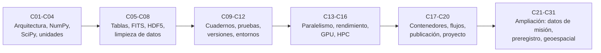

# B14 — Computación científica y ciencia abierta

> **Bloque ampliado.** Además de las 20 clases de la línea base, el bloque tiene 11 clases programadas (`B14-C21` a `B14-C31`), ya redactadas y en la tabla como tramo 6. Ver el [programa completo](../../PROGRAMA_ACADEMICO_COMPLETO.md).

**Programa:** Programa Integral de Astronomía, Astrofísica, Ciencias Espaciales e Ingeniería Aeroespacial
**Área:** A02 — Matemática, física computacional y métodos científicos
**Nivel:** N2 (fundamentos aplicados) · **Clases:** 20 de línea base + 11 programadas · **Carga:** por calibrar con el uso
**Estado:** guía pedagógica del bloque (resumen de qué se aprende en cada clase). Las 31 clases están redactadas (con ficha editorial y, donde corresponde, laboratorio ejecutado); todas conservan el estado E0 en el catálogo hasta registrar revisión disciplinar. Los laboratorios de las clases C15, C16 y C17 no usan GPU, clúster ni contenedor, y los de C21, C22, C25, C26, C29 y C31 usan formatos o servicios simplificados o locales: cada clase lo declara en su aviso de alcance.

## 🎯 Propósito del bloque

Enseña a **calcular y publicar de forma que otra persona pueda repetir y comprobar tu resultado**: cómo se organiza un programa científico, cómo se manejan arreglos, unidades, tablas y formatos de datos astronómicos, cómo se prueba que un cálculo sigue dando lo mismo, cómo se fija y se comparte el entorno de ejecución, cómo se paraleliza con honestidad sobre sus límites y cómo se publica código y datos. Es el soporte de reproducibilidad de todos los bloques que procesan datos o simulan.

## 📚 Al terminar el bloque podrás

1. Separar un programa científico en núcleo, adaptadores y orquestación, y probar el núcleo contra soluciones exactas.
2. Manejar arreglos, algoritmos numéricos, unidades, tablas y formatos (FITS, HDF5) verificando cada resultado con un caso conocido.
3. Limpiar datos de forma explícita y registrar cada decisión.
4. Hacer experimentos reproducibles: cuadernos, pruebas de regresión, control de versiones de datos, entornos fijados.
5. Medir y razonar sobre el rendimiento (vectorización, paralelismo, GPU, HPC) sin prometer aceleraciones que no mediste.
6. Publicar código y datos con metadatos, licencia y procedencia, y completar un proyecto de análisis astronómico reproducible.

## 🧭 Secuencia del bloque

**Descripción textual.** Seis tramos encadenados: herramientas numéricas (C01–C04), datos y formatos (C05–C08), reproducibilidad (C09–C12), rendimiento y escala (C13–C16), entornos, flujos, publicación y proyecto integrador (C17–C20), y la ampliación programada para datos de misión, protocolos de análisis y datos geoespaciales (C21–C31).

## 🗂️ Las 31 clases en resumen

**Navegación:** cada clase desarrollada enlaza a la anterior, a la siguiente y a este bloque; mientras una clase siga en E0, su enlace lleva a su fila en esta tabla.

Los resúmenes son la **especificación pedagógica propuesta** (nivel E1 parcial, pendiente de revisión). La columna «Evidencia» indica el producto que demostrará el aprendizaje.

### Tramo 1 · Herramientas numéricas

| ID | Clase | Qué se aprende | Evidencia |
|---|---|---|---|
| [B14-C01](../clases/B14/B14-C01-arquitectura-de-software-cientifico/CLASE.md) | Arquitectura de software científico | Separar núcleo, adaptadores y orquestación; funciones puras con unidades y dominio de validez; pruebas contra casos analíticos. | Diseño en capas con núcleo probado |
| [B14-C02](../clases/B14/B14-C02-arreglos-multidimensionales-numpy/CLASE.md) | Arreglos multidimensionales NumPy | Forma, tipo, vistas y copias; difusión; matriz de distancias sin bucles y su verificación. | Matriz de distancias verificada |
| [B14-C03](../clases/B14/B14-C03-analisis-numerico-con-scipy/CLASE.md) | Análisis numérico con SciPy | Integrar una órbita, resolver Kepler, integrar con `quad`; elegir tolerancias y verificarlas con una cantidad conservada. | Informe de verificación numérica |
| [B14-C04](../clases/B14/B14-C04-unidades-y-constantes-con-astropy/CLASE.md) | Unidades y constantes con Astropy | Magnitudes con unidad, conversión, equivalencias y constantes con origen; detectar incompatibilidades dimensionales. | Hoja de conversiones comprobada |

### Tramo 2 · Datos y formatos

| ID | Clase | Qué se aprende | Evidencia |
|---|---|---|---|
| [B14-C05](../clases/B14/B14-C05-tablas-astronomicas-y-catalogos/CLASE.md) | Tablas astronómicas y catálogos | Tablas con unidades y máscara, metadatos, cruce posicional con umbral, envoltura de ascensión recta. | Catálogo cruzado documentado |
| [B14-C06](../clases/B14/B14-C06-formato-fits-y-encabezados/CLASE.md) | Formato FITS y encabezados | Bloques de 2880 bytes, tarjetas de 80 caracteres, `BSCALE`/`BZERO`, orden de ejes y WCS lineal. | Auditoría de un archivo FITS |
| [B14-C07](../clases/B14/B14-C07-hdf5-y-almacenamiento-cientifico/CLASE.md) | HDF5 y almacenamiento científico | Grupos, datasets, atributos, fragmentos y compresión sin pérdida; lectura parcial; elegir formato. | Ficha de almacenamiento |
| [B14-C08](../clases/B14/B14-C08-pandas-y-limpieza-de-datos/CLASE.md) | Pandas y limpieza de datos | Centinelas, ausentes, duplicados y atípicos; marcar frente a borrar; comprobar la limpieza contra defectos conocidos. | Registro de limpieza |

### Tramo 3 · Reproducibilidad

| ID | Clase | Qué se aprende | Evidencia |
|---|---|---|---|
| [B14-C09](../clases/B14/B14-C09-jupyter-y-experimentos-reproducibles/CLASE.md) | Jupyter y experimentos reproducibles | Cuadernos como registro de un experimento: orden de ejecución, semillas, estado oculto y exportación. | Cuaderno que se ejecuta de principio a fin |
| [B14-C10](../clases/B14/B14-C10-pruebas-de-regresion-numerica/CLASE.md) | Pruebas de regresión numérica | Fijar resultados de referencia, tolerancias y detección de cambios numéricos entre versiones. | Batería de regresión con tolerancias justificadas |
| [B14-C11](../clases/B14/B14-C11-control-de-versiones-de-datos/CLASE.md) | Control de versiones de datos | Versionar datos grandes con sumas de verificación y metadatos sin duplicar el repositorio. | Historial de datos con verificación de integridad |
| [B14-C12](../clases/B14/B14-C12-ejecucion-reproducible-con-uv/CLASE.md) | Ejecución reproducible con uv | Fijar versiones de Python y dependencias en un archivo de bloqueo y recrear el entorno. | Entorno recreable desde cero |

### Tramo 4 · Rendimiento y escala

| ID | Clase | Qué se aprende | Evidencia |
|---|---|---|---|
| [B14-C13](../clases/B14/B14-C13-computacion-paralela/CLASE.md) | Computación paralela | Procesos e hilos, reparto de trabajo, ley de Amdahl y límites de la aceleración. | Medición de aceleración frente a la teórica |
| [B14-C14](../clases/B14/B14-C14-vectorizacion-y-rendimiento/CLASE.md) | Vectorización y rendimiento | Medir antes de optimizar; vectorizar con arreglos y reconocer cuellos de botella. | Informe de perfilado con mejora medida |
| [B14-C15](../clases/B14/B14-C15-calculo-en-gpu-y-limitaciones/CLASE.md) | Cálculo en GPU y limitaciones | Qué se acelera en GPU, transferencia de datos y precisión numérica; cuándo no conviene. | Comparación CPU–GPU con sus límites |
| [B14-C16](../clases/B14/B14-C16-computacion-distribuida-y-hpc/CLASE.md) | Computación distribuida y HPC | Clústeres, colas de trabajo, comunicación entre nodos y escalado débil y fuerte. | Plan de ejecución escalable |

### Tramo 5 · Entornos, flujos, publicación y proyecto

| ID | Clase | Qué se aprende | Evidencia |
|---|---|---|---|
| [B14-C17](../clases/B14/B14-C17-contenedores-y-ambientes-cientificos/CLASE.md) | Contenedores y ambientes científicos | Imágenes y contenedores para empaquetar un entorno; qué reproducen y qué no. | Definición de contenedor verificada |
| [B14-C18](../clases/B14/B14-C18-flujos-de-datos-espaciales/CLASE.md) | Flujos de datos espaciales | De la adquisición a la tabla analizable: archivos remotos, consultas, caché y procedencia. | Diagrama de flujo con procedencia |
| [B14-C19](../clases/B14/B14-C19-publicacion-de-codigo-y-datos/CLASE.md) | Publicación de código y datos | Licencias, metadatos, citación, identificadores persistentes y principios FAIR. | Paquete publicable con ficha de metadatos |
| [B14-C20](../clases/B14/B14-C20-proyecto-reproducible-de-analisis-astronomico/CLASE.md) | Proyecto reproducible de análisis astronómico | Integrar arquitectura, datos, pruebas, entorno y publicación en un análisis completo. | Repositorio reproducible con informe |

### Tramo 6 · Ampliación programada (observación terrestre, datos de misión y ciencia abierta)

| ID | Clase | Qué se aprende | Evidencia |
|---|---|---|---|
| [B14-C21](../clases/B14/B14-C21-datos-de-misiones-planetarias-pds4-etiquetas-y-spice/CLASE.md) | Datos de misiones planetarias: PDS4, etiquetas y SPICE | Estructura de archivos PDS4 y su lectura; etiquetas y kernels de geometría. | Lectura verificada de un producto de misión |
| [B14-C22](../clases/B14/B14-C22-acceso-a-datos-heliofisicos-abiertos-con-sunpy/CLASE.md) | Acceso a datos heliofísicos abiertos con SunPy | Acceso práctico a archivos heliofísicos (VSO, JSOC, CDAWeb). | Descarga y lectura documentadas de datos solares |
| [B14-C23](../clases/B14/B14-C23-protocolo-preregistrado-de-analisis/CLASE.md) | Protocolo preregistrado de análisis | Redactar hipótesis, métodos y criterios antes de ver los datos. | Protocolo preregistrado con criterios de decisión |
| [B14-C24](../clases/B14/B14-C24-documentacion-de-hipotesis-y-decisiones-de-analisis/CLASE.md) | Documentación de hipótesis y decisiones de análisis | Registro de hipótesis, desviaciones y decisiones durante el análisis. | Bitácora de decisiones y desviaciones |
| [B14-C25](../clases/B14/B14-C25-catalogos-de-datos-geoespaciales-y-metadatos-stac/CLASE.md) | Catálogos de datos geoespaciales y metadatos (STAC) | Encontrar y reutilizar escenas satelitales con catálogos y metadatos estándar. | Búsqueda reproducible en un catálogo |
| [B14-C26](../clases/B14/B14-C26-formatos-de-datos-raster-geoespaciales-geotiff-y-cog/CLASE.md) | Formatos de datos ráster geoespaciales: GeoTIFF y COG | Formatos ráster de observación terrestre y lectura por regiones. | Auditoría de un ráster |
| [B14-C27](../clases/B14/B14-C27-procesamiento-por-teselas-de-grandes-volumenes-de-imagenes/CLASE.md) | Procesamiento por teselas de grandes volúmenes de imágenes | Procesar coberturas que no caben en memoria dividiéndolas en teselas. | Procesamiento por teselas verificado |
| [B14-C28](../clases/B14/B14-C28-bases-de-datos-espaciales/CLASE.md) | Bases de datos espaciales | Consultas espaciales sobre datos geográficos. | Consultas espaciales con resultados comprobados |
| [B14-C29](../clases/B14/B14-C29-servicios-de-datos-geoespaciales-estandar-ogc/CLASE.md) | Servicios de datos geoespaciales estándar (OGC) | Publicar y consumir datos mediante servicios estándar. | Servicio descrito y consumido |
| [B14-C30](../clases/B14/B14-C30-cadenas-de-procesamiento-automatizado-de-datos/CLASE.md) | Cadenas de procesamiento automatizado de datos | Cadenas automáticas con control de calidad para producir datos de forma continua. | Cadena automatizada con controles de calidad |
| [B14-C31](../clases/B14/B14-C31-apis-de-servicios-de-datos/CLASE.md) | APIs de servicios de datos | Interfaces programables para entregar datos a otros sistemas. | API documentada con pruebas |

## 🧵 Hilos que atraviesan el bloque

- **Verificación:** C01–C04 enseñan a probar un cálculo contra un caso exacto; C10 lo convierte en regresión y C20 lo integra.
- **Datos con significado:** C04–C08 conservan unidades, máscara, escala y procedencia; C11, C18 y C19 los versionan, siguen y publican.
- **Reproducibilidad:** C09, C12 y C17 fijan cuaderno, dependencias y entorno; C20 exige repetirlo desde cero.
- **Honestidad sobre el rendimiento:** C13–C16 piden medir antes de afirmar una aceleración.

## 📝 Evaluación del bloque (propuesta, por calibrar)

- Fichas y ejercicios por clase, con retroalimentación y recuperación con evidencia distinta.
- Portafolio: un script con núcleo probado (C01–C03), una auditoría de archivo (C06) y un registro de limpieza (C08), con primera versión, retroalimentación y cambio.
- Proyecto C20 con rúbrica publicada antes; las condiciones críticas (no presentar lo sintético como observado, citar solo lo consultado, no afirmar una aceleración sin medirla) no se compensan con promedio.

## ⚠️ Seguridad y límites

No ejecutes código ni abras archivos de origen desconocido sin revisarlos; respeta licencias y condiciones de uso de los datos y de las herramientas; los recursos compartidos (HPC, nube) tienen cuotas y costos. Los laboratorios del bloque usan datos sintéticos o publicados y rotulan cada uno: no son procesamiento operacional ni sustituyen la verificación y validación de software de vuelo.

## Fuentes de orientación

Las clases redactadas citan lo realmente consultado en su sección 11. Fuentes de orientación para el resto:

- **[NIST]** [NIST: guía de unidades y conversiones](https://www.nist.gov/pml/special-publication-811) — Factores de conversión del SI (consultada para C04).
- **[Astropy]** [Documentación de Astropy](https://docs.astropy.org/) — Unidades, constantes, tablas y FITS (consultada para C01–C06).
- **[FITS]** [Estándar FITS 4.0](https://fits.gsfc.nasa.gov/fits_standard.html) — Formato de intercambio astronómico (consultada para C06).
- **[IERS]** [International Earth Rotation and Reference Systems Service](https://www.iers.org/) — Convenciones y parámetros de orientación terrestre (orientativa).
- **[JPL-SPICE]** [NASA NAIF / SPICE](https://naif.jpl.nasa.gov/naif/) — Geometría de observación de misiones (orientativa).
- **[NASA-NTRS]** [NASA Technical Reports Server](https://ntrs.nasa.gov/) — Informes técnicos de misión (orientativa).

> La asociación de estas fuentes es orientativa por bloque. No significa que cada afirmación de una futura clase esté respaldada todavía. Comprobar documentos, versiones y licencias antes de desarrollar contenido.

[🏠 Volver al programa](../../README.md) · [⬅️ B13 — Metrología, tiempo y mediciones científicas](./B13-metrologia-tiempo-y-mediciones-cientificas.md) · [➡️ B15 — Señales, imágenes y estimación científica](./B15-senales-imagenes-y-estimacion-cientifica.md)
