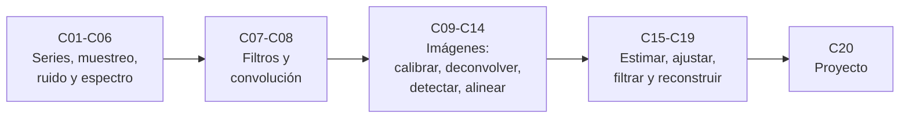

# B15 — Señales, imágenes y estimación científica

> **Bloque ampliado (`0.2.0`).** Además de las 20 clases de esta página, el bloque tiene 4 clases programadas (`B15-C21` a `B15-C24`), sin redactar. Ver el [programa completo](../../PROGRAMA_ACADEMICO_COMPLETO.md).

**Programa:** Programa Integral de Astronomía, Astrofísica, Ciencias Espaciales e Ingeniería Aeroespacial
**Área:** A02 — Matemática, física computacional y métodos científicos
**Nivel:** N2 → N3 (fundamentos y aplicación guiada) · **Clases:** 20 · **Carga:** por calibrar con el uso
**Estado:** guía pedagógica del bloque (resumen de qué se aprende en cada clase). Las clases enlazadas en la tabla ya están redactadas; el resto son resúmenes de especificación. Todas conservan el estado E0 en el catálogo hasta registrar revisión disciplinar.

## 🎯 Propósito del bloque

Los instrumentos espaciales entregan series de números y matrices de píxeles; la ciencia sale de lo que se hace con ellos. Este bloque enseña a **tratar señales e imágenes con rigor**: cómo se muestrean, qué frecuencias contienen, cómo se filtran, cómo se detectan fuentes y cómo se estiman parámetros y trayectorias con su incertidumbre. Usa el cálculo ([B09](B09-calculo-diferencial-e-integral.md)), el álgebra lineal ([B10](B10-algebra-lineal-y-matematicas-geometricas.md)) y la estadística ([B12](B12-probabilidad-estadistica-e-incertidumbre.md)); prepara la computación científica ([B14](B14-computacion-cientifica-y-ciencia-abierta.md)), el control ([B16](B16-sistemas-dinamicos-y-control-automatico.md)) y la instrumentación posterior.

## 📚 Al terminar el bloque podrás

1. Describir una serie temporal discreta, su cadencia, sus huecos y su ruido (blanco o coloreado).
2. Predecir y evitar el aliasing y leer un espectro con ventana y resolución declaradas.
3. Diseñar y comprobar un filtro digital y aplicar la convolución a señales e imágenes.
4. Calibrar, normalizar y deconvolucionar una imagen y detectar fuentes con un umbral justificado.
5. Segmentar y alinear imágenes y cuantificar el error de cada paso.
6. Estimar parámetros, ajustar curvas y seguir un objeto con filtros de Kalman y de partículas, con incertidumbre.
7. Integrar todo en un proyecto de detección y seguimiento verificable.

## 🧭 Secuencia del bloque

**Descripción textual.** Cinco tramos encadenados: señales en una dimensión (C01–C06), filtros y convolución (C07–C08), procesamiento de imágenes (C09–C14), estimación y seguimiento (C15–C19) y un proyecto de detección y seguimiento (C20).

## 🗂️ Las 20 clases en resumen

**Navegación:** cada clase desarrollada enlaza a la anterior, a la siguiente y a este bloque; mientras una clase siga en E0, su enlace lleva a su fila en esta tabla.

Los resúmenes son la **especificación pedagógica propuesta** (nivel E1 parcial, pendiente de revisión). La columna «Evidencia» indica el producto que demostrará el aprendizaje. Las clases B15-C21 a C24 están programadas y no se redactan.

### Tramo 1 · Señales en una dimensión

| ID | Clase | Qué se aprende | Evidencia |
|---|---|---|---|
| [B15-C01](../clases/B15/B15-C01-series-temporales-discretas/CLASE.md) | Series temporales discretas | Construir el eje de tiempo, cadencia y frecuencia de muestreo; resumir con media, dispersión y tendencia; autocorrelación y huecos. | Ficha de una serie temporal |
| [B15-C02](../clases/B15/B15-C02-muestreo-y-aliasing/CLASE.md) | Muestreo y aliasing | Frecuencia de Nyquist y alias; predecir la frecuencia aparente y elegir la cadencia. | Tabla de aliasing verificada |
| [B15-C03](../clases/B15/B15-C03-ruido-blanco-y-coloreado/CLASE.md) | Ruido blanco y coloreado | Ruido blanco, AR(1) y paseo aleatorio; cuánto ayuda promediar y muestras efectivas. | Informe de ruido |
| [B15-C04](../clases/B15/B15-C04-transformada-de-fourier/CLASE.md) | Transformada de Fourier | DFT, bins y frecuencias, amplitud, fuga espectral; identidades de Parseval y de convolución. | Espectro verificado |
| [B15-C05](../clases/B15/B15-C05-transformada-rapida-de-fourier/CLASE.md) | Transformada rápida de Fourier | Idea de dividir y combinar; coste N log N frente a N²; uso correcto de las rutinas de FFT. | Tabla de tiempos y exactitud |
| [B15-C06](../clases/B15/B15-C06-analisis-espectral-de-senales/CLASE.md) | Análisis espectral de señales | Periodograma, ventanas, promedio de Welch y muestreo irregular (Lomb–Scargle); nivel de ruido y significancia. | Espectro con ventana y umbral declarados |

### Tramo 2 · Filtros y convolución

| ID | Clase | Qué se aprende | Evidencia |
|---|---|---|---|
| [B15-C07](../clases/B15/B15-C07-filtrado-digital/CLASE.md) | Filtrado digital | Filtros de media móvil, FIR e IIR sencillos; respuesta en frecuencia, retardo y efectos de borde. | Filtro con respuesta comprobada |
| [B15-C08](../clases/B15/B15-C08-convolucion-y-respuesta-impulsional/CLASE.md) | Convolución y respuesta impulsional | Convolución discreta, respuesta impulsional y sistemas lineales invariantes; convolución rápida con FFT. | Convolución verificada con un sistema físico sencillo |

### Tramo 3 · Imágenes

| ID | Clase | Qué se aprende | Evidencia |
|---|---|---|---|
| B15-C09 | Procesamiento de imágenes digitales | La imagen como matriz; bias, oscuro y campo plano; calibración y propagación de ruido. | Calibración de una imagen sintética |
| B15-C10 | Histogramas y normalización | Histograma, estiramiento de contraste y escalas lineal, logarítmica y asinh; no confundir la visualización con el dato. | Imagen normalizada con escala declarada |
| B15-C11 | Deconvolución y enfoque | PSF, desenfoque como convolución y deconvolución (Richardson–Lucy); amplificación del ruido. | Deconvolución con medida de mejora y de artefactos |
| B15-C12 | Detección de fuentes astronómicas | Estimar el fondo, umbral de significancia, relación señal–ruido, completitud y falsos positivos. | Catálogo de fuentes con criterios de detección |
| B15-C13 | Segmentación de imágenes | Umbralización, regiones conectadas y métricas de acuerdo; separar objetos del fondo. | Máscara segmentada con métricas |
| B15-C14 | Registro y alineación | Correlación cruzada y transformaciones afines; alineación con precisión subpíxel. | Alineación con error medido |

### Tramo 4 · Estimación y seguimiento

| ID | Clase | Qué se aprende | Evidencia |
|---|---|---|---|
| B15-C15 | Estimación de parámetros — Señales, imágenes y estimación científica | Estimadores, sesgo y varianza, máxima verosimilitud y cota de Cramér–Rao aplicadas a señales. | Estimador comparado con su cota |
| B15-C16 | Ajuste de curvas | Mínimos cuadrados lineales y no lineales, residuos, χ² e incertidumbre de los parámetros. | Ajuste con residuos y parámetros con error |
| B15-C17 | Filtros de Kalman introductorios | Modelo de estado, predicción y actualización; seguimiento de un objeto en una dimensión. | Seguimiento filtrado frente a verdad conocida |
| B15-C18 | Filtros de partículas iniciales | Representar la incertidumbre con muestras ponderadas; remuestreo y casos no lineales. | Seguimiento por partículas comparado con Kalman |
| B15-C19 | Reconstrucción por datos incompletos | Interpolar, regularizar y reconstruir con huecos; cuantificar el error de la reconstrucción. | Reconstrucción con error medido |

### Tramo 5 · Integración

| ID | Clase | Qué se aprende | Evidencia |
|---|---|---|---|
| B15-C20 | Proyecto de detección y seguimiento | Integrar calibración, detección, alineación y seguimiento en un caso sintético con verdad conocida. | Proyecto con datos sintéticos, código verificado e informe |

## 🧵 Hilos que atraviesan el bloque

- **Muestreo y frecuencia:** C01–C02 fijan la cadencia que reaparece en C04–C08 y C19.
- **Ruido:** C03 se retoma en C09, C12 y C15–C17 para decidir umbrales y pesos.
- **Convolución:** C04 (convolución y Fourier), C08, C09 y C11 usan la misma idea con señales e imágenes.
- **Verificación con solución exacta:** cada laboratorio incluye una prueba contra un caso analítico o una identidad.
- **Datos sintéticos y publicados:** se rotulan siempre; los sintéticos tienen verdad conocida.

## 📝 Evaluación del bloque (propuesta, por calibrar)

- Ficha de evidencia por clase, con retroalimentación y recuperación con datos distintos.
- Portafolio de scripts verificados con versiones y semillas.
- Proyecto C20 con rúbrica publicada antes; las condiciones críticas (no presentar lo sintético como observado, declarar la convención de cada transformada, citar solo lo consultado) no se compensan con promedio.

## ⚠️ Seguridad y límites

Los métodos del bloque pueden producir detecciones falsas o estimaciones sesgadas si se violan sus supuestos. Ninguna salida de este bloque es apta por sí sola para una decisión de seguridad (por ejemplo, navegación de una nave o alerta de colisión): eso exige procedimientos, datos y verificación especializados. Observar el Sol u otros objetos requiere filtros certificados; el bloque es educativo.

## Fuentes de orientación

Las fuentes realmente consultadas para cada clase figuran en la sección 11 de su `CLASE.md`. Las siguientes son de orientación general del bloque:

- **[NIST]** [NIST Publications](https://www.nist.gov/publications) — Metrología, física, seguridad, computación y normas.
- **[IERS]** [International Earth Rotation and Reference Systems Service](https://www.iers.org/) — Rotación terrestre y sistemas de referencia.
- **[JPL-SPICE]** [NASA NAIF SPICE](https://naif.jpl.nasa.gov/naif/) — Geometría de observación, referencias espaciales y tiempos.
- **[NASA-NTRS]** [NASA Technical Reports Server](https://ntrs.nasa.gov/) — Informes técnicos e investigación histórica y actual.

> La asociación de estas fuentes es orientativa por bloque. No significa que cada afirmación de una clase todavía no redactada esté respaldada. Comprobar documentos, versiones y licencias antes de desarrollar contenido.
