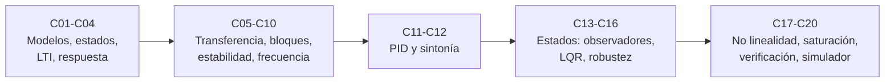

# B16 — Sistemas dinámicos y control automático

**Programa:** Programa Integral de Astronomía, Astrofísica, Ciencias Espaciales e Ingeniería Aeroespacial
**Área:** A02 — Matemática, física computacional y métodos científicos
**Nivel:** N2 (aplicación de la matemática a sistemas) · **Clases:** 20 · **Carga:** por calibrar con el uso
**Estado:** guía pedagógica del bloque (resumen de qué se aprende en cada clase). Las clases enlazadas en la tabla ya están redactadas; las demás son resúmenes de especificación. Todas conservan el estado E0 en el catálogo hasta registrar revisión disciplinar.

## 🎯 Propósito del bloque

Enseña a **modelar un sistema que cambia en el tiempo y a gobernarlo con realimentación**: cómo se describe, cuándo es estable, cómo se diseña un controlador y cómo se comprueba antes de volar. Su caso conductor es el apuntamiento de un telescopio espacial de un eje (cifras **sintéticas**), que culmina en el control de orientación de un cuerpo rígido en un simulador. Usa la derivada y las ecuaciones diferenciales (B09, B11), las matrices y los autovalores (B10) y prepara el control de actitud de B87.

## 📚 Al terminar el bloque podrás

1. Escribir el modelo de estados de un sistema físico y clasificarlo (lineal, invariante, orden).
2. Analizar su respuesta transitoria y estacionaria, y su función de transferencia.
3. Decidir la estabilidad de un lazo cerrado con polos, Routh–Hurwitz, lugar de las raíces, Bode y Nyquist.
4. Diseñar y sintonizar un controlador PID, un regulador LQR y un observador de estados.
5. Reconocer límites: incertidumbre, no linealidad, saturación y windup.
6. Verificar un lazo cerrado con pruebas contra soluciones exactas y entregar un simulador de orientación.

## 🧭 Secuencia del bloque

**Descripción textual.** Cinco tramos encadenados: modelado y respuesta (C01–C04), análisis clásico de lazos y estabilidad (C05–C10), control PID (C11–C12), control moderno en espacio de estados (C13–C16) y cierre con no linealidad, saturación, verificación y un simulador de orientación (C17–C20).

## 🗂️ Las 20 clases en resumen

**Navegación:** cada clase desarrollada enlaza a la anterior, a la siguiente y a este bloque; mientras una clase siga en E0, su enlace lleva a su fila en esta tabla.

Los resúmenes son la **especificación pedagógica propuesta** (nivel E1 parcial, pendiente de revisión). La columna «Evidencia» indica el producto que demostrará el aprendizaje.

### Tramo 1 · Modelos y respuesta

| ID | Clase | Qué se aprende | Evidencia |
|---|---|---|---|
| [B16-C01](../clases/B16/B16-C01-modelos-dinamicos-y-estados/CLASE.md) | Modelos dinámicos y estados | Entrada, salida, estado y perturbación; ecuaciones de un eje y de una rueda; linealizar con dominio de validez. | Ficha de modelo |
| [B16-C02](../clases/B16/B16-C02-representaciones-en-espacio-de-estados/CLASE.md) | Representaciones en espacio de estados | Matrices A, B, C, D; exponencial matricial; discretización con retenedor de orden cero. | Hoja de matrices verificada |
| [B16-C03](../clases/B16/B16-C03-sistemas-lineales-invariantes/CLASE.md) | Sistemas lineales invariantes | Superposición, invariancia, respuesta al impulso y convolución; cómo la saturación rompe la linealidad. | Auditoría LTI |
| [B16-C04](../clases/B16/B16-C04-respuesta-transitoria-y-estacionaria/CLASE.md) | Respuesta transitoria y estacionaria | Constante de tiempo, ωn y ζ; sobreimpulso, asentamiento y error estacionario. | Hoja de especificaciones |

### Tramo 2 · Análisis clásico y estabilidad

| ID | Clase | Qué se aprende | Evidencia |
|---|---|---|---|
| [B16-C05](../clases/B16/B16-C05-funciones-de-transferencia/CLASE.md) | Funciones de transferencia | Laplace, polos y ceros, C(sI−A)⁻¹B+D, valor final. | Tarjeta de transferencia |
| [B16-C06](../clases/B16/B16-C06-diagramas-de-bloques/CLASE.md) | Diagramas de bloques | Serie, paralelo y realimentación; L, S y T; derivada sobre el error o la medida. | Reducción comentada |
| [B16-C07](../clases/B16/B16-C07-realimentacion-y-estabilidad/CLASE.md) | Realimentación y estabilidad | Estabilidad por polos; P sobre doble integrador; sensibilidad; efecto del retardo. | Dossier de estabilidad |
| [B16-C08](../clases/B16/B16-C08-criterio-de-routh-hurwitz/CLASE.md) | Criterio de Routh-Hurwitz | Arreglo de Routh, ganancia crítica y casos especiales. | Tabla de estabilidad paramétrica |
| B16-C09 | Lugar de las raíces | Trayectoria de los polos con la ganancia: asíntotas, ruptura, cruce. | Ficha de lugar de las raíces |
| B16-C10 | Diagramas de Bode y Nyquist | Respuesta en frecuencia, márgenes de ganancia y fase, criterio de Nyquist, margen de retardo. | Informe de márgenes |

### Tramo 3 · PID

| ID | Clase | Qué se aprende | Evidencia |
|---|---|---|---|
| B16-C11 | Control proporcional integral derivativo | Acción P, I y D; error estacionario ante perturbación; límite de Ki. | Comparación PD frente a PID |
| B16-C12 | Sintonía de controladores PID | Ganancia última (Ziegler–Nichols), colocación de polos y compromisos de sintonía. | Informe de sintonía |

### Tramo 4 · Control en espacio de estados

| ID | Clase | Qué se aprende | Evidencia |
|---|---|---|---|
| B16-C13 | Observabilidad y controlabilidad | Pruebas de rango, grammianos y qué se pierde con menos actuadores o sensores. | Informe de rango |
| B16-C14 | Observadores de estados | Observador de Luenberger, estimación de sesgo de giroscopio, principio de separación. | Observador verificado |
| B16-C15 | Control óptimo LQR | Costo cuadrático, ecuación de Riccati, compromiso esfuerzo–error. | Diseño LQR comparado |
| B16-C16 | Control robusto inicial | Incertidumbre de inercia, picos de S y T, ganancia pequeña. | Informe de robustez |

### Tramo 5 · No linealidad, verificación y simulador

| ID | Clase | Qué se aprende | Evidencia |
|---|---|---|---|
| B16-C17 | Control no lineal | Ecuaciones de Euler, Lyapunov, desrotación por realimentación de velocidad. | Análisis de Lyapunov |
| B16-C18 | Saturación y anti-windup | Límite de par y de momento; windup; recálculo hacia atrás. | Comparación con y sin anti-windup |
| B16-C19 | Verificación de lazo cerrado | Matriz de verificación, convergencia del simulador, Monte Carlo de parámetros. | Informe de verificación |
| B16-C20 | Control de orientación en un simulador | Simulador de tres ejes con cuaterniones, PD de actitud, saturación y pruebas. | Simulador verificado |

## 🧵 Hilos que atraviesan el bloque

- **Modelo → lazo:** C01–C06 construyen el modelo y el diagrama que todo el bloque reutiliza.
- **Estabilidad y margen:** C07, C08, C09 y C10 miran lo mismo desde el polinomio, el lugar de las raíces y la frecuencia; C16 y C19 lo vuelven robustez y verificación.
- **Comprobar contra lo exacto:** cada clase con laboratorio compara su cálculo con una solución cerrada o una referencia independiente.
- **Del ideal a lo real:** retardo (C07), perturbación (C11), saturación (C18) e incertidumbre (C16) acercan el lazo a un vehículo real.

## 📝 Evaluación del bloque (propuesta, por calibrar)

- Fichas y ejercicios por clase, con retroalimentación y recuperación con evidencia distinta.
- Portafolio: dossier de estabilidad (C07), informe de sintonía (C12) y diseño LQR (C15).
- Proyecto C20 con rúbrica publicada antes; las condiciones críticas (no presentar datos sintéticos como de misión, declarar unidades y dominio de validez, citar solo lo consultado) no se compensan con promedio.

## ⚠️ Seguridad y límites

Todas las cifras del bloque son **sintéticas** o proceden de fichas públicas citadas; no sirven para operar un vehículo. Un lazo marginal o sin margen frente a retardo y saturación no es aceptable en un diseño real. El bloque es educativo y no sustituye la verificación formal ni la revisión de un ingeniero de control.

## Fuentes de orientación preliminar

- **[NIST]** [NIST Publications](https://www.nist.gov/publications) — Metrología, física, seguridad, computación y normas.
- **[IERS]** [International Earth Rotation and Reference Systems Service](https://www.iers.org/) — Rotación terrestre y sistemas de referencia.
- **[JPL-SPICE]** [NASA NAIF SPICE](https://naif.jpl.nasa.gov/naif/) — Geometría de observación, referencias espaciales y tiempos.
- **[NASA-NTRS]** [NASA Technical Reports Server](https://ntrs.nasa.gov/) — Informes técnicos e investigación histórica y actual.

> La asociación de estas fuentes es orientativa por bloque. No significa que cada afirmación de una futura clase esté respaldada todavía. Las fuentes realmente consultadas figuran en la sección 11 de cada clase.

[🏠 Volver al programa](../../README.md) · [⬅️ B15 — Señales, imágenes y estimación científica](./B15-senales-imagenes-y-estimacion-cientifica.md) · [➡️ B17 — Aprendizaje automático científico](./B17-aprendizaje-automatico-cientifico.md)
