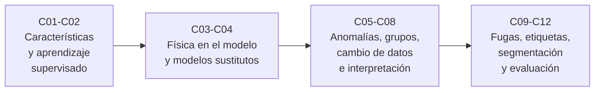

# B17 — Aprendizaje automático científico

**Programa:** Programa Integral de Astronomía, Astrofísica, Ciencias Espaciales e Ingeniería Aeroespacial
**Área:** A02 — Matemática, física computacional y métodos científicos
**Nivel:** N2 → N3 (aplicación con verificación) · **Clases:** 12 · **Carga:** por calibrar con el uso
**Estado:** guía pedagógica del bloque. Las 12 clases están redactadas, con laboratorios ejecutados y fuentes consultadas; conservan el estado E0 en el catálogo hasta registrar revisión disciplinar. El orden de las clases es el de su programación y no una secuencia revisada por el autor.

## 🎯 Propósito del bloque

Enseña a **usar el aprendizaje automático como instrumento científico verificable**: preparar variables con sentido físico, entrenar y validar sin trampas, incorporar leyes físicas, sustituir simuladores costosos, detectar lo raro, agrupar, vigilar el cambio de los datos, interpretar, segmentar imágenes y juzgar un sistema de alertas por sus falsos positivos. En todo el bloque, cada método se prueba contra un caso con respuesta conocida antes de aplicarlo.

## 📚 Al terminar el bloque podrás

1. Construir características con unidad o adimensionales y verificarlas contra una referencia independiente.
2. Entrenar modelos supervisados y estimar su desempeño con validación cruzada, sin fugas de datos.
3. Incorporar una ecuación diferencial en una pérdida y construir un modelo sustituto con su dominio de validez.
4. Detectar anomalías, agrupar datos sin etiqueta y decidir con qué confianza se interpretan los grupos.
5. Detectar el cambio de distribución, medir su daño e interpretar un modelo con pruebas de consistencia física.
6. Construir un conjunto etiquetado de calidad medida, segmentar imágenes y evaluar un sistema de alertas por costo.

## 🧭 Secuencia del bloque

**Descripción textual.** Cuatro tramos encadenados: fundamentos de características y modelos supervisados (C01–C02), modelos que incorporan o emulan la física (C03–C04), detección, agrupamiento, monitoreo e interpretación (C05–C08) y rigor de datos y evaluación: fugas, etiquetas, segmentación y métricas (C09–C12).

## 🗂️ Las 12 clases en resumen

**Navegación:** cada clase enlaza a la anterior, a la siguiente y a este bloque. La columna «Evidencia» indica el producto que demostrará el aprendizaje.

### Tramo 1 · Fundamentos

| ID | Clase | Qué se aprende | Evidencia |
|---|---|---|---|
| [B17-C01](../clases/B17/B17-C01-ingenieria-de-caracteristicas-cientificas/CLASE.md) | Ingeniería de características científicas | Construir variables con unidad o adimensionales a partir de una relación física (a/R★, duración esperada de un tránsito); efecto de la escala en modelos de distancias. | Ficha de características |
| [B17-C02](../clases/B17/B17-C02-aprendizaje-supervisado/CLASE.md) | Aprendizaje supervisado | Clasificación y regresión; validación cruzada estratificada con media y dispersión; sobreajuste; exactitud máxima posible en un caso gaussiano. | Informe de validación |

### Tramo 2 · La física en el modelo

| ID | Clase | Qué se aprende | Evidencia |
|---|---|---|---|
| [B17-C03](../clases/B17/B17-C03-redes-neuronales-informadas-por-la-fisica-pinn/CLASE.md) | Redes neuronales informadas por la física (PINN) | Residuo de una EDO como pérdida; derivadas de una red verificadas; comparación con el ajuste solo a datos. | Informe de comparación |
| [B17-C04](../clases/B17/B17-C04-modelos-sustitutos-surrogates/CLASE.md) | Modelos sustitutos (surrogates) | Emular un simulador verificado con un proceso gaussiano; diseño de Sobol; error, cobertura y dominio de validez. | Ficha del sustituto |

### Tramo 3 · Detectar, agrupar, vigilar e interpretar

| ID | Clase | Qué se aprende | Evidencia |
|---|---|---|---|
| [B17-C05](../clases/B17/B17-C05-deteccion-de-anomalias/CLASE.md) | Detección de anomalías | Distancia de Mahalanobis con umbral chi-cuadrado y bosque de aislamiento; falsas alarmas y prevalencia. | Informe del detector |
| [B17-C06](../clases/B17/B17-C06-aprendizaje-no-supervisado/CLASE.md) | Aprendizaje no supervisado | Componentes principales por SVD y k-medias; silueta; un grupo hallado no es una clase física. | Informe de agrupamiento |
| [B17-C07](../clases/B17/B17-C07-validacion-fuera-de-distribucion/CLASE.md) | Validación fuera de distribución | Detectar el cambio de distribución (KS, clasificador de dominio) y medir el daño; la confianza puede engañar. | Plan de monitoreo |
| [B17-C08](../clases/B17/B17-C08-interpretabilidad-con-consistencia-fisica/CLASE.md) | Interpretabilidad con consistencia física | Importancia por permutación y su límite con variables correlacionadas; pruebas de exponentes, monotonía y extrapolación. | Auditoría de consistencia |

### Tramo 4 · Datos y evaluación con rigor

| ID | Clase | Qué se aprende | Evidencia |
|---|---|---|---|
| [B17-C09](../clases/B17/B17-C09-prevencion-de-fuga-de-datos/CLASE.md) | Prevención de fuga de datos | Tres fugas (preprocesamiento global, tiempo, fuente) con verdad conocida; Pipeline y particiones por grupo y tiempo. | Auditoría de fugas |
| [B17-C10](../clases/B17/B17-C10-conjuntos-de-datos-etiquetados-para-aprendizaje-supervisado/CLASE.md) | Conjuntos de datos etiquetados para aprendizaje supervisado | Protocolo, varios anotadores, acuerdo y kappa, voto mayoritario; ruido de etiquetas en entrenamiento y evaluación. | Ficha del conjunto etiquetado |
| [B17-C11](../clases/B17/B17-C11-redes-de-segmentacion-semantica-de-imagenes/CLASE.md) | Redes de segmentación semántica de imágenes | Convolución, IoU y Dice; capa convolucional aprendida frente a un umbral; idea de la U-Net. | Informe de segmentación |
| [B17-C12](../clases/B17/B17-C12-evaluacion-de-modelos-precision-exhaustividad-y-falsos-positivos/CLASE.md) | Evaluación de modelos: precisión, exhaustividad y falsos positivos | Matriz de confusión, precisión, exhaustividad, F, ROC y precisión–exhaustividad; umbral por costo. | Informe de evaluación |

## 🧵 Hilos que atraviesan el bloque

- **Verdad conocida:** todos los laboratorios usan datos sintéticos o simulados con una respuesta exacta (techo de Bayes, KS, fórmula de la altura máxima, ley de Kepler) para detectar errores de código antes de aplicar el método a algo desconocido.
- **Honestidad de la evaluación:** C02, C07, C09, C10 y C12 construyen la cadena validación → cambio de datos → fugas → etiquetas → métricas.
- **Física y unidades:** C01, C03, C04 y C08 llevan unidades, ecuaciones y exponentes al modelo y los usan como pruebas.
- **Incertidumbre:** cada clase pide informar dispersión, cobertura o intervalo, no solo una cifra.

## 📝 Evaluación del bloque (propuesta, por calibrar)

- Un producto por clase (ficha, informe, plan o auditoría), con rúbrica publicada y retroalimentación.
- Portafolio: primera versión, retroalimentación y cambio.
- Las condiciones críticas (rotular lo sintético como sintético, no medir en lo entrenado, citar solo lo consultado) no se compensan con promedio.

## ⚠️ Seguridad y límites

Un modelo que valida bien puede fallar fuera de su dominio, y un sistema de alertas automático no sustituye la revisión humana en decisiones críticas (seguridad de misión, salud de tripulación, observación de la Tierra con efectos sobre personas). Los laboratorios son didácticos: con datos sintéticos, sin redes profundas entrenadas y sin validación disciplinar. Material educativo, no un procedimiento operativo.

## Roles que lo usan

- [Matemática y computación científica espacial](../../rutas/matematica-y-computacion-cientifica-espacial.md)
- [Observación terrestre y geointeligencia científica](../../rutas/observacion-terrestre-y-geointeligencia-cientifica.md)

## Fuentes de orientación preliminar

Las fuentes realmente consultadas figuran en la sección 11 de cada clase: documentación de scikit-learn y SciPy, NIST (CODATA 2022), la ficha del Sol de NASA NSSDC y los resúmenes de arXiv de Raissi et al. (1711.10561), Ronneberger et al. (1505.04597), Shallue y Vanderburg (1712.05044), Rabanser et al. (1810.11953), Hendrycks y Gimpel (1610.02136) y Lintott et al. (0804.4483).

> La asociación de estas fuentes es orientativa por bloque. No significa que cada afirmación esté respaldada todavía por revisión disciplinar. De varias de ellas solo se leyeron resúmenes.

[🏠 Volver al programa](../../README.md) · [⬅️ B16 — Sistemas dinámicos y control automático](./B16-sistemas-dinamicos-y-control-automatico.md) · [➡️ B18 — Computación de alto rendimiento](./B18-computacion-de-alto-rendimiento.md)
