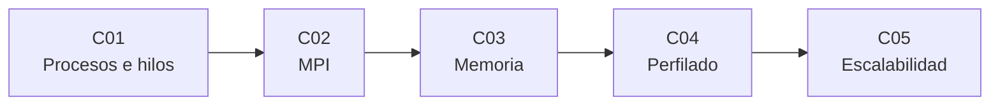

# B18 — Computación de alto rendimiento

> **Bloque nuevo (`0.2.0`).** Sus 5 clases están redactadas y listadas abajo. Ver el [programa completo](../../PROGRAMA_ACADEMICO_COMPLETO.md).

**Programa:** Programa Integral de Astronomía, Astrofísica, Ciencias Espaciales e Ingeniería Aeroespacial
**Área:** A02 — Matemática, física computacional y métodos científicos
**Nivel:** N2 → N3 (aplicación y desarrollo) · **Clases:** 5 · **Carga:** por calibrar con el uso
**Estado:** guía pedagógica del bloque (resumen de qué se aprende en cada clase). Las clases enlazadas en la tabla ya están redactadas y conservan el estado E0 en el catálogo hasta registrar revisión disciplinar.

## 🎯 Propósito del bloque

Enseña a hacer que un cálculo científico use bien el hardware: repartirlo entre procesos y máquinas, mover los datos con criterio, medir dónde se va el tiempo y demostrar con datos cuánto escala.

## 📚 Al terminar el bloque podrás

1. Elegir entre hilos, procesos y mensajes según el tipo de tarea.
2. Escribir un programa MPI sencillo y probarlo contra una solución exacta.
3. Predecir el efecto de la disposición de los datos en memoria.
4. Perfilar un programa y decidir qué cambiar con un techo calculado.
5. Diseñar e interpretar un experimento de escalado fuerte y débil.

## 🧭 Secuencia del bloque

**Descripción textual.** Cinco clases encadenadas: modelo de ejecución (C01), comunicación entre procesos (C02), memoria dentro de cada proceso (C03), medición del tiempo (C04) y cuantificación del escalado (C05).

## 🗂️ Las 5 clases en resumen

**Navegación:** cada clase enlaza a la anterior, a la siguiente y a este bloque.

| ID | Clase | Qué se aprende | Evidencia |
|---|---|---|---|
| [B18-C01](../clases/B18/B18-C01-procesos-hilos-y-concurrencia/CLASE.md) | Procesos, hilos y concurrencia | Qué comparten procesos e hilos; el GIL; tareas de CPU frente a E/S; condiciones de carrera y coste de arrancar procesos. | Comparación medida serie/hilos/procesos con resultados idénticos |
| [B18-C02](../clases/B18/B18-C02-paso-de-mensajes-con-mpi/CLASE.md) | Paso de mensajes con MPI | Rangos, punto a punto, colectivas, objetos frente a buffers, bloqueo mutuo y orden de las sumas. | Programa MPI probado contra solución exacta |
| [B18-C03](../clases/B18/B18-C03-jerarquia-y-estructuras-de-memoria/CLASE.md) | Jerarquía y estructuras de memoria | Caché, líneas, strides, filas frente a columnas, AoS frente a SoA y ancho de banda. | Nota de rendimiento con predicción y medición |
| [B18-C04](../clases/B18/B18-C04-perfilado-de-rendimiento/CLASE.md) | Perfilado de rendimiento | cProfile, ncalls/tottime/cumtime, sobrecoste del perfilador, techo de una mejora y verificación. | Informe de perfilado |
| [B18-C05](../clases/B18/B18-C05-experimentos-de-escalabilidad/CLASE.md) | Experimentos de escalabilidad | Escalado fuerte y débil, Amdahl, Gustafson, Karp–Flatt y diseño de experimentos. | Informe de escalado |

## 🧵 Hilos que atraviesan el bloque

- **Ejemplo conductor:** un lote de órbitas circulares simuladas (unidades canónicas) aparece en C01, C02, C04 y C05.
- **Medir antes de afirmar:** C01, C04 y C05 exigen repeticiones, entorno declarado y resultados verificados.
- **Techos:** memoria (C03), función dominante (C04) y fracción serial (C05).

## 📝 Evaluación del bloque (propuesta, por calibrar)

- Un producto archivable por clase, con rúbrica publicada antes.
- Las condiciones críticas (no presentar tiempos esperados como medidos, no omitir la comprobación de resultados, citar solo lo consultado) no se compensan con promedio.

## ⚠️ Seguridad y límites

El bloque es educativo. Limita procesos y memoria en equipos compartidos y usa el planificador en clústeres. Los tiempos del laboratorio son ruidosos y no caracterizan ningún equipo; no validan software de misión.

## Fuentes de orientación preliminar

Documentación de Python 3.12, mpi4py, NumPy y STREAM; Amdahl (1967) y Gustafson (1988) solo con metadatos verificados. Las fuentes realmente consultadas se registran en la sección 11 de cada clase.

## Roles que lo usan

- [Matemática y computación científica espacial](../../rutas/matematica-y-computacion-cientifica-espacial.md)

[🏠 Volver al programa](../../README.md)
