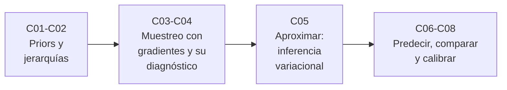

# B19 — Inferencia bayesiana y computación probabilística

**Programa:** Programa Integral de Astronomía, Astrofísica, Ciencias Espaciales e Ingeniería Aeroespacial
**Área:** A02 — Matemática, física computacional y métodos científicos
**Nivel:** N2 (análisis cuantitativo avanzado) · **Clases:** 8 · **Carga:** por calibrar con el uso
**Estado:** guía pedagógica del bloque, nuevo en la estructura `0.2.0`. Las ocho clases están redactadas y pendientes de revisión disciplinar y aprobación del autor; no existen en la línea base y conservan el estado E0.

## 🎯 Propósito del bloque

Continúa la inferencia bayesiana de B12-C12 y el muestreo de B12-C13 con la práctica que faltaba: **construir priors con la física, modelar poblaciones, muestrear con gradientes, comprobar el cómputo, aproximar cuando muestrear es caro, predecir, comparar modelos y verificar que las incertidumbres reportadas son fiables**. Todo con laboratorios cuyas respuestas se conocen o se pueden comprobar.

## 📚 Al terminar el bloque podrás

1. Traducir restricciones físicas a un prior y medir la sensibilidad de la conclusión.
2. Escribir y analizar un modelo jerárquico y explicar el encogimiento parcial.
3. Explicar Hamiltonian Monte Carlo, su límite de estabilidad y el criterio de giro de NUTS.
4. Diagnosticar cadenas con `R̂`, tamaño efectivo y divergencias.
5. Ajustar una aproximación variacional y cuantificar lo que subestima.
6. Predecir con la distribución predictiva posterior y chequear el modelo.
7. Comparar modelos con evidencia, WAIC y LOO sin sobreinterpretar.
8. Verificar la calibración de intervalos y pronósticos por simulación.

## 🧭 Secuencia del bloque

**Descripción textual.** Cuatro tramos encadenados: construcción del modelo (C01–C02), cómputo con muestreo y su diagnóstico (C03–C04), aproximación como alternativa (C05) y evaluación del modelo: predicción, comparación y calibración (C06–C08).

## 🗂️ Las 8 clases en resumen

**Navegación:** cada clase enlaza a la anterior, a la siguiente y a este bloque. Los datos de todos los laboratorios son sintéticos o simulados, con pruebas contra soluciones exactas.

| ID | Clase | Qué se aprende | Evidencia |
|---|---|---|---|
| [B19-C01](../clases/B19/B19-C01-priors-fisicamente-informados/CLASE.md) | Priors físicamente informados | Construir un prior Gamma desde restricciones físicas; predictiva a priori; sensibilidad y conflicto prior–datos. | Informe de sensibilidad del prior |
| [B19-C02](../clases/B19/B19-C02-modelos-jerarquicos/CLASE.md) | Modelos jerárquicos | Niveles, hiperparámetros, encogimiento parcial y posterior de la dispersión entre unidades. | Análisis de tres agrupaciones |
| [B19-C03](../clases/B19/B19-C03-hamiltonian-monte-carlo-y-nuts/CLASE.md) | Hamiltonian Monte Carlo y NUTS | Salto de rana, aceptación, límite de estabilidad del paso y criterio de giro en U. | Informe comparativo HMC–Metropolis |
| [B19-C04](../clases/B19/B19-C04-diagnostico-de-convergencia-de-cadenas/CLASE.md) | Diagnóstico de convergencia de cadenas | R̂ dividido, tamaño efectivo y divergencias; reparametrización no centrada. | Informe de diagnóstico |
| [B19-C05](../clases/B19/B19-C05-inferencia-variacional/CLASE.md) | Inferencia variacional | KL, ELBO y campo medio; cuánto subestima la varianza y cómo medirlo. | Informe de aproximación variacional |
| [B19-C06](../clases/B19/B19-C06-distribucion-predictiva-posterior/CLASE.md) | Distribución predictiva posterior | Predictiva exacta Gamma–Poisson, descomposición de varianza y chequeo predictivo por simulación. | Informe de chequeo predictivo |
| [B19-C07](../clases/B19/B19-C07-comparacion-de-modelos-bayesianos/CLASE.md) | Comparación de modelos bayesianos | Evidencia, factor de Bayes y su dependencia del prior; WAIC y LOO con error estándar. | Informe de comparación de modelos |
| [B19-C08](../clases/B19/B19-C08-calibracion-probabilistica/CLASE.md) | Calibración probabilística | Cobertura, histogramas de rangos (SBC) y diagramas de fiabilidad. | Informe de calibración |

## 🧵 Hilos que atraviesan el bloque

- **El prior como decisión:** C01 lo construye; C02 lo aprende de la población; C07 muestra cómo cambia el factor de Bayes con él; C08 prueba qué pasa si es incorrecto.
- **Cómputo verificable:** C03 muestrea, C04 diagnostica, C05 aproxima y C08 valida con simulación: ninguna salida de algoritmo se acepta sin comprobación.
- **Incertidumbre honesta:** C05 y C08 cuantifican la confianza excesiva; C06 y C07 separan ruido, parámetro y modelo.

## 📝 Evaluación del bloque (propuesta, por calibrar)

- Un informe por clase con la rúbrica publicada antes; recuperación con evidencia distinta.
- Portafolio: primera versión, retroalimentación y cambio.
- Condiciones críticas que no se compensan con promedio: rotular los datos como sintéticos o simulados, declarar prior y supuestos, no afirmar convergencia, detección o calibración sin la comprobación correspondiente, citar solo lo consultado.

## ⚠️ Seguridad y límites

Material educativo: los laboratorios usan datos sintéticos y no sirven para decisiones de misión, seguridad ni calibración de instrumentos reales. Las fuentes de las clases se consultaron solo en sus resúmenes (arXiv) y no respaldan los resultados clásicos, que se verifican en los laboratorios. No incluye NUTS completo, PSIS-LOO ni ADVI.

## Fuentes de orientación preliminar

- **[ARXIV]** [arXiv.org](https://arxiv.org/) — Preprints primarios de estadística y cómputo bayesiano (consultados en resumen).
- **[BDA3]** [Gelman et al., *Bayesian Data Analysis*, 3.ª ed.](https://sites.stat.columbia.edu/gelman/book/) — Referencia general; solo se consultó la página del libro.
- **[ADS]** [NASA Astrophysics Data System](https://ui.adsabs.harvard.edu/) — Índice bibliográfico de literatura astronómica y física.

> La asociación de estas fuentes es orientativa por bloque. No significa que cada afirmación esté respaldada por ellas: las fuentes verificadas de cada clase están en su sección 11.

## Roles que lo usan

- [Matemática y computación científica espacial](../../rutas/matematica-y-computacion-cientifica-espacial.md)

[🏠 Volver al programa](../../README.md)
